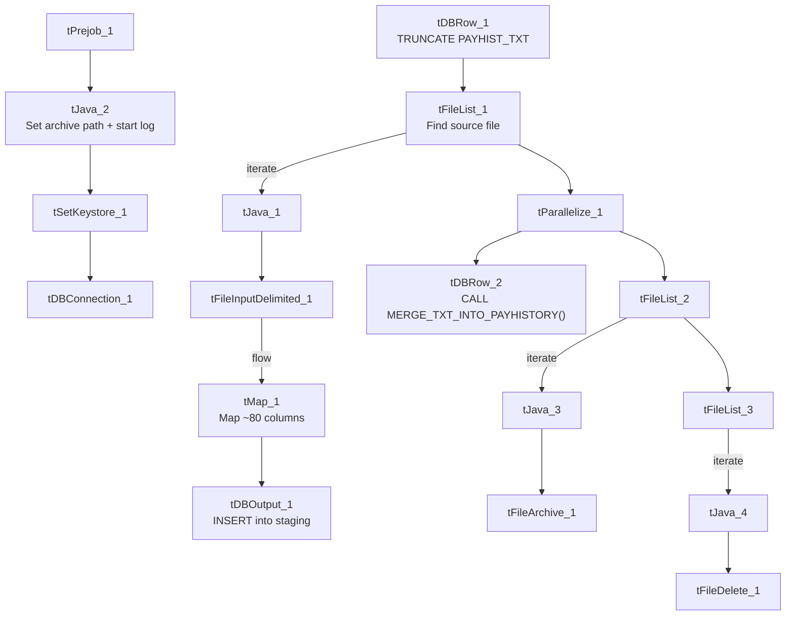

# Talend Job: PayHistory_Table_Text_Load

## Overview

This job loads payment-history transaction records (a large schema covering batches, invoices, fees, balances, and various payment-processor identifiers) from a shared folder into Snowflake. It follows the project's standard load pattern: truncate the staging table, read the source file, load into staging, merge into the permanent table via a stored procedure, then archive and delete the source file. Notably, the staging table (`PAYHIST_TXT`) and the merge procedure name (`MERGE_TXT_INTO_PAYHISTORY`) don't follow the same naming stem as every other job in this batch — see Issues observed.

## Detail table

| Field | Value |
|---|---|
| Job name | PayHistory_Table_Text_Load |
| Version | 0.1 |
| Project | LATITUDE |
| Author | jmach@harriscollect.com |
| Created | 2024-10-24T10:27:16.865-0700 |
| Last Modified | 2026-07-12T14:16:06.767-0700 |

## Step-by-step data flow

1. **Set up.** `tPrejob_1` starts the job; `tJava_2` appends today's date to `context.archiveDir` and opens a log file; `tSetKeystore_1` configures the SSL client keystore; `tDBConnection_1` opens the Snowflake connection.
2. **Empty the staging table.** `tDBRow_1` runs `TRUNCATE TABLE PAYHIST_TXT;`, then triggers the file-processing chain.
3. **Find the file.** `tFileList_1` lists files in `context.sourceDir` (skipping `.txt` files); the match becomes `context.filePath` (`tJava_1`).
4. **Read and reshape.** `tFileInputDelimited_1` reads the file using the repository schema "payhist" — pipe-delimited (`|~|`/`|$|`), quote-enclosed fields (`"`), US-ASCII encoding, header row, `DIE_ON_ERROR` true. `tMap_1` maps its roughly 80 columns (payment batch details, fee/balance breakdowns 1–10, invoice info, AIM agency fields, etc.) onto the equivalent target schema, adding `LOAD_DT`.
5. **Load staging.** The mapped rows flow directly into `tDBOutput_1`, which inserts them into `PAYHIST_TXT` (no row counter on this path).
6. **Merge and clean up — in parallel.** `tParallelize_1` splits into:
   - **Merge branch:** `tDBRow_2` runs `CALL MERGE_TXT_INTO_PAYHISTORY();`. No `tDie`/`tWarn` check follows it.
   - **Cleanup branch:** the source file is listed again, archived (`tFileArchive_1`), then separately listed and deleted (`tFileDelete_1`, `FAILON` false).

## Settings tables

### Source: `tFileInputDelimited_1`

| Setting | Value | What it means |
|---|---|---|
| FILENAME | `context.filePath` | Reads whichever file `tFileList_1` found. |
| Schema | Repository schema "payhist" | Uses a shared, pre-defined column layout matching this large payment-history record. |
| FIELDSEPARATOR / ROWSEPARATOR | `\|~\|` / `\|$\|` | The project's standard pipe-delimited format. |
| ESCAPE_CHAR / TEXT_ENCLOSURE | `"` | Fields can be quoted with `"`. |
| ENCODING | US-ASCII | Plain ASCII. |
| DIE_ON_ERROR | true | A malformed row fails the whole job. |

### Target: `tDBOutput_1`

| Setting | Value | What it means |
|---|---|---|
| Table | PAYHIST_TXT | Staging table written to. |
| Output action | INSERT | Adds rows only. |
| Table action | NONE | Structure untouched — truncation is the separate `tDBRow_1` step. |

### Merge step: `tDBRow_2`

| Setting | Value | What it means |
|---|---|---|
| Query | `CALL MERGE_TXT_INTO_PAYHISTORY();` | Snowflake stored procedure folding staged rows into the permanent table. Body not visible in this metadata. Note the name doesn't match the staging table's stem (`PAYHIST` vs. `PAYHISTORY`) — see Issues observed. |

## Dependencies & configuration

- **Triggers/depends on other jobs:** none — no `tRunJob` links found.
- **Context variables used:** `context.sourceDir`, `context.archiveDir`, `context.filePath`, `context.fileName`, `context.logDir`, `context.keystorePath` (all `Directories_0.1`).
- **Snowflake connection:** uses the shared connection object, not `LEGACY_DW_*` context variables directly.

## Glossary

| Component type | Plain-English meaning |
|---|---|
| `tPrejob` / `tParallelize` | Setup-before-main-flow, and concurrent branches (see `job_Address_Text_Load.md`). |
| `tFileList` | Lists files in a folder to loop over (see `job_Address_Text_Load.md`). |
| `tFileInputDelimited` | Reads a delimited text file row by row (see `job_Address_Text_Load.md`). |
| `tMap` | Maps/transforms columns (see `job_Address_Text_Load.md`). |
| `tSnowflakeOutput` (`tDBOutput`) | Writes rows into Snowflake (see `job_Address_Text_Load.md`). |
| `tSnowflakeRow` (`tDBRow`) | Runs a single SQL statement — `TRUNCATE` and `CALL <procedure>` here (see `job_Address_Text_Load.md`). |
| `tJava` | Custom Java code for small tasks (see `job_Address_Text_Load.md`). |
| `tFileArchive` | Zips a file into an archive location (see `job_Address_Text_Load.md`). |
| `tFileDelete` | Deletes a file from disk (see `job_Address_Text_Load.md`). |
| `tSetKeystore` | Configures the SSL keystore for the Snowflake connection (see `job_Address_Text_Load.md`). |

## Issues observed

- **Naming mismatch between staging table and merge procedure.** Every other job in this batch either keeps the same stem (e.g. `DESK` → `MERGE_TXT_INTO_DESK`) or simply drops the staging table's `_TXT` suffix (e.g. `LETTER_TXT` → `MERGE_TXT_INTO_LETTER`, `CMI_DIALER_SBT_HISTORY_TXT` → `MERGE_TXT_INTO_CMI_DIALER_SBT_HISTORY`). Here, the staging table is `PAYHIST_TXT` but the procedure is `MERGE_TXT_INTO_PAYHISTORY` — a full stem change from "PAYHIST" to "PAYHISTORY", not just a suffix drop. Worth confirming with the Snowflake procedure owner that this is intentional and that the procedure is in fact merging from `PAYHIST_TXT` (and not from some other, differently-named staging table).
- **Hardcoded machine-specific paths**: `tFileInputDelimited_1.TEMP_DIR`, `tFileArchive_1.SOURCE_FILE`, `tFileDelete_1.DIRECTORY`/`PATH`, and `tSetKeystore_1.SSL_TRUSTSERVER_TRUSTSTORE` are all fixed `C:/Talend-Studio-20211109_1610-V8.0.1/...` or `C:/clientTrustStore.trustStore` paths rather than context variables — the same pattern flagged project-wide.
- **No row counter (`tFlowMeter`)** on the load path.
- **No explicit error handling on the merge step** — no `tDie`/`tWarn` reacting to whether the merge succeeded.
