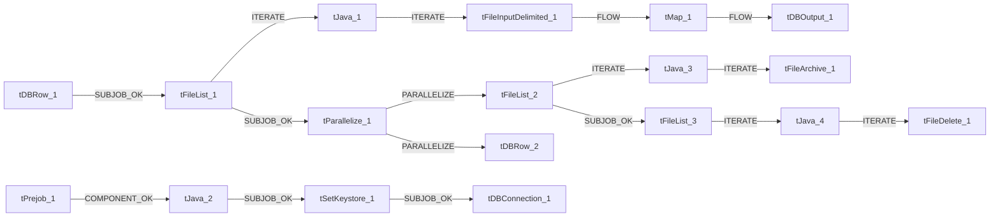

# Talend Job: PayHistory_Table_Text_Load

- **Project**: LATITUDE
- **Version**: 0.1
- **Job Type**: Standard

- **Author**: jmach@harriscollect.com
- **Created**: 2024-10-24T10:27:16.865-0700
- **Last Modified**: 2026-07-12T14:16:06.767-0700

## Components

| # | Component | Type | Key Parameters |
|---|-----------|------|----------------|
| 1 | tDBConnection_1 | `tSnowflakeConnection` | `CONNECTION_FORMAT`=row, `PROPERTIES`={"@id":2,"@type":"org.talend.components.snowflake. |
| 2 | tFileList_1 | `tFileList` | `DIRECTORY`=context.sourceDir, `LIST_MODE`=FILES, `INCLUDSUBDIR`=false, `CASE_SENSITIVE`=YES, `ERROR`=false |
| 3 | tJava_1 | `tJava` | `CODE`=context.filePath= ((String)globalMap.get("tFileLis, `IMPORT`=//import java.util.List;, `CONNECTION_FORMAT`=row |
| 4 | tFileInputDelimited_1 | `tFileInputDelimited` | `USE_EXISTING_DYNAMIC`=false, `FILENAMETEXT`="When the input source is a stream or a zip file,f, `FILENAME`=context.filePath, `CSV_OPTION`=false, `ROWSEPARATOR`="|$|" |
| 5 | tMap_1 | `tMap` | `LINK_STYLE`=AUTO, `DIE_ON_ERROR`=true, `LKUP_PARALLELIZE`=false, `LEVENSHTEIN`=0, `JACCARD`=0 |
| 6 | tDBOutput_1 | `tSnowflakeOutput` | `CONNECTION_FORMAT`=row, `PROPERTIES`={"@id":4,"@type":"org.talend.components.snowflake. |
| 7 | tDBRow_1 | `tSnowflakeRow` | `CONNECTION_FORMAT`=row, `PROPERTIES`={"@id":3,"@type":"org.talend.components.snowflake. |
| 8 | tPrejob_1 | `tPrejob` | `CONNECTION_FORMAT`=row |
| 9 | tDBRow_2 | `tSnowflakeRow` | `CONNECTION_FORMAT`=row, `PROPERTIES`={"@id":3,"@type":"org.talend.components.snowflake. |
| 10 | tJava_2 | `tJava` | `CODE`=context.archiveDir = context.archiveDir + TalendDa, `IMPORT`=//import java.util.List;, `CONNECTION_FORMAT`=row |
| 11 | tFileList_2 | `tFileList` | `DIRECTORY`=context.sourceDir, `LIST_MODE`=FILES, `INCLUDSUBDIR`=false, `CASE_SENSITIVE`=YES, `ERROR`=false |
| 12 | tJava_3 | `tJava` | `CODE`=context.filePath = ((String)globalMap.get("tFileLi, `IMPORT`=//import java.util.List;, `CONNECTION_FORMAT`=row |
| 13 | tFileArchive_1 | `tFileArchive` | `SOURCE`=context.sourceDir, `SOURCE_FILE`="C:/Talend-Studio-20211109_1610-V8.0.1/workspace/s, `SUB_DIRECTROY`=false, `TARGET`=context.archiveDir + context.fileName+".zip", `MKDIR`=true |
| 14 | tFileList_3 | `tFileList` | `DIRECTORY`=context.sourceDir, `LIST_MODE`=FILES, `INCLUDSUBDIR`=false, `CASE_SENSITIVE`=YES, `ERROR`=false |
| 15 | tJava_4 | `tJava` | `CODE`=context.filePath = ((String)globalMap.get("tFileLi, `IMPORT`=//import java.util.List;, `CONNECTION_FORMAT`=row |
| 16 | tFileDelete_1 | `tFileDelete` | `FILENAME`=context.filePath, `DIRECTORY`="C:/Talend-Studio-20211109_1610-V8.0.1/workspace/d, `PATH`="C:/Talend-Studio-20211109_1610-V8.0.1/workspace/d, `FAILON`=false, `FOLDER`=false |
| 17 | tParallelize_1 | `tParallelize` | `WAIT_FOR`=All, `SLEEPTIME`=100, `DIE_ON_ERROR`=false, `CONNECTION_FORMAT`=row |
| 18 | tSetKeystore_1 | `tSetKeystore` | `SET_TRUSTSTORE`=false, `SET_TRUSTSTORE_KEYSTORE`=false, `TRUSTSTORE_TYPE`=JKS, `SSL_TRUSTSERVER_TRUSTSTORE`="C:/clientTrustStore.trustStore", `KEYSTORE_TYPE`=PKCS12 |

## Schemas

### tFileInputDelimited_1

| Column | Type | Nullable | Length |
|--------|------|----------|--------|
| datetimeentered | id_String | Yes | -1 |
| number | id_String | Yes | -1 |
| Seq | id_String | Yes | -1 |
| batchtype | id_String | Yes | -1 |
| matched | id_String | Yes | -1 |
| ctl | id_String | Yes | -1 |
| customer | id_String | Yes | -1 |
| sortdata | id_String | Yes | -1 |
| paytype | id_String | Yes | -1 |
| paymethod | id_String | Yes | -1 |
| systemmonth | id_String | Yes | -1 |
| systemyear | id_String | Yes | -1 |
| entered | id_String | Yes | -1 |
| desk | id_String | Yes | -1 |
| checknbr | id_String | Yes | -1 |
| invoiced | id_String | Yes | -1 |
| InvoiceSort | id_String | Yes | -1 |
| InvoiceType | id_String | Yes | -1 |
| InvoicePayType | id_String | Yes | -1 |
| comment | id_String | Yes | -1 |
| datepaid | id_String | Yes | -1 |
| totalpaid | id_String | Yes | -1 |
| paid1 | id_String | Yes | -1 |
| paid2 | id_String | Yes | -1 |
| paid3 | id_String | Yes | -1 |
| paid4 | id_String | Yes | -1 |
| paid5 | id_String | Yes | -1 |
| paid6 | id_String | Yes | -1 |
| paid7 | id_String | Yes | -1 |
| paid8 | id_String | Yes | -1 |
| paid9 | id_String | Yes | -1 |
| paid10 | id_String | Yes | -1 |
| fee1 | id_String | Yes | -1 |
| fee2 | id_String | Yes | -1 |
| fee3 | id_String | Yes | -1 |
| fee4 | id_String | Yes | -1 |
| fee5 | id_String | Yes | -1 |
| fee6 | id_String | Yes | -1 |
| fee7 | id_String | Yes | -1 |
| fee8 | id_String | Yes | -1 |
| fee9 | id_String | Yes | -1 |
| fee10 | id_String | Yes | -1 |
| balance | id_String | Yes | -1 |
| balance1 | id_String | Yes | -1 |
| balance3 | id_String | Yes | -1 |
| balance4 | id_String | Yes | -1 |
| balance5 | id_String | Yes | -1 |
| balance6 | id_String | Yes | -1 |
| balance7 | id_String | Yes | -1 |
| balance8 | id_String | Yes | -1 |
| balance9 | id_String | Yes | -1 |
| balance10 | id_String | Yes | -1 |
| balance2 | id_String | Yes | -1 |
| BatchNumber | id_String | Yes | -1 |
| UID | id_String | Yes | -1 |
| Invoice | id_String | Yes | -1 |
| InvoiceFlags | id_String | Yes | -1 |
| OverPaidAmt | id_String | Yes | -1 |
| ForwardeeFee | id_String | Yes | -1 |
| ReverseOfUID | id_String | Yes | -1 |
| AccruedSurcharge | id_String | Yes | -1 |
| TransCost | id_String | Yes | -1 |
| Tax | id_String | Yes | -1 |
| AttorneyID | id_String | Yes | -1 |
| CollectorFee | id_String | Yes | -1 |
| PAIdentifier | id_String | Yes | -1 |
| AIMAgencyId | id_String | Yes | -1 |
| AIMDueAgency | id_String | Yes | -1 |
| AIMAgencyFee | id_String | Yes | -1 |
| FeeSched | id_String | Yes | -1 |
| CollectorFeeSched | id_String | Yes | -1 |
| PaidToDate | id_String | Yes | -1 |
| IsFreeDemand | id_String | Yes | -1 |
| IsCorrection | id_String | Yes | -1 |
| CreatedBy | id_String | Yes | -1 |
| Created | id_String | Yes | -1 |
| BatchPmtCreatedBy | id_String | Yes | -1 |
| BatchPmtCreated | id_String | Yes | -1 |
| CurrencyISO3 | id_String | Yes | -1 |
| AIMBatchId | id_String | Yes | -1 |
| AIMSendingID | id_String | Yes | -1 |
| SubBatchType | id_String | Yes | -1 |
| PostDateUID | id_String | Yes | -1 |
| PaymentLinkUID | id_String | Yes | -1 |
| DebtorId | id_String | Yes | -1 |
| PromiseAppliedAmt | id_String | Yes | -1 |
| Echo | id_String | Yes | -1 |
| Echoed | id_String | Yes | -1 |
| EchoID | id_String | Yes | -1 |
| Reference | id_String | Yes | -1 |
| FeeScheduleClassCode | id_String | Yes | -1 |
| BackdatedTransID | id_Integer | Yes | -1 |
| ReallocatedPHUID | id_Integer | Yes | -1 |
| datetimeentered | id_String | Yes | -1 |
| number | id_String | Yes | -1 |
| Seq | id_String | Yes | -1 |
| batchtype | id_String | Yes | -1 |
| matched | id_String | Yes | -1 |
| ctl | id_String | Yes | -1 |
| customer | id_String | Yes | -1 |
| sortdata | id_String | Yes | -1 |
| paytype | id_String | Yes | -1 |
| paymethod | id_String | Yes | -1 |
| systemmonth | id_String | Yes | -1 |
| systemyear | id_String | Yes | -1 |
| entered | id_String | Yes | -1 |
| desk | id_String | Yes | -1 |
| checknbr | id_String | Yes | -1 |
| invoiced | id_String | Yes | -1 |
| InvoiceSort | id_String | Yes | -1 |
| InvoiceType | id_String | Yes | -1 |
| InvoicePayType | id_String | Yes | -1 |
| comment | id_String | Yes | -1 |
| datepaid | id_String | Yes | -1 |
| totalpaid | id_String | Yes | -1 |
| paid1 | id_String | Yes | -1 |
| paid2 | id_String | Yes | -1 |
| paid3 | id_String | Yes | -1 |
| paid4 | id_String | Yes | -1 |
| paid5 | id_String | Yes | -1 |
| paid6 | id_String | Yes | -1 |
| paid7 | id_String | Yes | -1 |
| paid8 | id_String | Yes | -1 |
| paid9 | id_String | Yes | -1 |
| paid10 | id_String | Yes | -1 |
| fee1 | id_String | Yes | -1 |
| fee2 | id_String | Yes | -1 |
| fee3 | id_String | Yes | -1 |
| fee4 | id_String | Yes | -1 |
| fee5 | id_String | Yes | -1 |
| fee6 | id_String | Yes | -1 |
| fee7 | id_String | Yes | -1 |
| fee8 | id_String | Yes | -1 |
| fee9 | id_String | Yes | -1 |
| fee10 | id_String | Yes | -1 |
| balance | id_String | Yes | -1 |
| balance1 | id_String | Yes | -1 |
| balance3 | id_String | Yes | -1 |
| balance4 | id_String | Yes | -1 |
| balance5 | id_String | Yes | -1 |
| balance6 | id_String | Yes | -1 |
| balance7 | id_String | Yes | -1 |
| balance8 | id_String | Yes | -1 |
| balance9 | id_String | Yes | -1 |
| balance10 | id_String | Yes | -1 |
| balance2 | id_String | Yes | -1 |
| BatchNumber | id_String | Yes | -1 |
| UID | id_String | Yes | -1 |
| Invoice | id_String | Yes | -1 |
| InvoiceFlags | id_String | Yes | -1 |
| OverPaidAmt | id_String | Yes | -1 |
| ForwardeeFee | id_String | Yes | -1 |
| ReverseOfUID | id_String | Yes | -1 |
| AccruedSurcharge | id_String | Yes | -1 |
| TransCost | id_String | Yes | -1 |
| Tax | id_String | Yes | -1 |
| AttorneyID | id_String | Yes | -1 |
| CollectorFee | id_String | Yes | -1 |
| PAIdentifier | id_String | Yes | -1 |
| AIMAgencyId | id_String | Yes | -1 |
| AIMDueAgency | id_String | Yes | -1 |
| AIMAgencyFee | id_String | Yes | -1 |
| FeeSched | id_String | Yes | -1 |
| CollectorFeeSched | id_String | Yes | -1 |
| PaidToDate | id_String | Yes | -1 |
| IsFreeDemand | id_String | Yes | -1 |
| IsCorrection | id_String | Yes | -1 |
| CreatedBy | id_String | Yes | -1 |
| Created | id_String | Yes | -1 |
| BatchPmtCreatedBy | id_String | Yes | -1 |
| BatchPmtCreated | id_String | Yes | -1 |
| CurrencyISO3 | id_String | Yes | -1 |
| AIMBatchId | id_String | Yes | -1 |
| AIMSendingID | id_String | Yes | -1 |
| SubBatchType | id_String | Yes | -1 |
| PostDateUID | id_String | Yes | -1 |
| PaymentLinkUID | id_String | Yes | -1 |
| DebtorId | id_String | Yes | -1 |
| PromiseAppliedAmt | id_String | Yes | -1 |
| Echo | id_String | Yes | -1 |
| Echoed | id_String | Yes | -1 |
| EchoID | id_String | Yes | -1 |
| Reference | id_String | Yes | -1 |
| FeeScheduleClassCode | id_String | Yes | -1 |
| BackdatedTransID | id_Integer | Yes | -1 |
| ReallocatedPHUID | id_Integer | Yes | -1 |
| errorCode | id_String | Yes | 255 |
| errorMessage | id_String | Yes | 255 |

### tMap_1

| Column | Type | Nullable | Length |
|--------|------|----------|--------|
| LOAD_DT | id_Date | Yes | -1 |
| DATETIMEENTERED | id_String | Yes | 16777216 |
| NUMBER | id_String | Yes | 16777216 |
| SEQ | id_String | Yes | 16777216 |
| BATCHTYPE | id_String | Yes | 16777216 |
| MATCHED | id_String | Yes | 16777216 |
| CTL | id_String | Yes | 16777216 |
| CUSTOMER | id_String | Yes | 16777216 |
| SORTDATA | id_String | Yes | 16777216 |
| PAYTYPE | id_String | Yes | 16777216 |
| PAYMETHOD | id_String | Yes | 16777216 |
| SYSTEMMONTH | id_String | Yes | 16777216 |
| SYSTEMYEAR | id_String | Yes | 16777216 |
| ENTERED | id_String | Yes | 16777216 |
| DESK | id_String | Yes | 16777216 |
| CHECKNBR | id_String | Yes | 16777216 |
| INVOICED | id_String | Yes | 16777216 |
| INVOICESORT | id_String | Yes | 16777216 |
| INVOICETYPE | id_String | Yes | 16777216 |
| INVOICEPAYTYPE | id_String | Yes | 16777216 |
| COMMENT | id_String | Yes | 16777216 |
| DATEPAID | id_String | Yes | 16777216 |
| TOTALPAID | id_String | Yes | 16777216 |
| PAID1 | id_String | Yes | 16777216 |
| PAID2 | id_String | Yes | 16777216 |
| PAID3 | id_String | Yes | 16777216 |
| PAID4 | id_String | Yes | 16777216 |
| PAID5 | id_String | Yes | 16777216 |
| PAID6 | id_String | Yes | 16777216 |
| PAID7 | id_String | Yes | 16777216 |
| PAID8 | id_String | Yes | 16777216 |
| PAID9 | id_String | Yes | 16777216 |
| PAID10 | id_String | Yes | 16777216 |
| FEE1 | id_String | Yes | 16777216 |
| FEE2 | id_String | Yes | 16777216 |
| FEE3 | id_String | Yes | 16777216 |
| FEE4 | id_String | Yes | 16777216 |
| FEE5 | id_String | Yes | 16777216 |
| FEE6 | id_String | Yes | 16777216 |
| FEE7 | id_String | Yes | 16777216 |
| FEE8 | id_String | Yes | 16777216 |
| FEE9 | id_String | Yes | 16777216 |
| FEE10 | id_String | Yes | 16777216 |
| BALANCE | id_String | Yes | 16777216 |
| BALANCE1 | id_String | Yes | 16777216 |
| BALANCE3 | id_String | Yes | 16777216 |
| BALANCE4 | id_String | Yes | 16777216 |
| BALANCE5 | id_String | Yes | 16777216 |
| BALANCE6 | id_String | Yes | 16777216 |
| BALANCE7 | id_String | Yes | 16777216 |
| BALANCE8 | id_String | Yes | 16777216 |
| BALANCE9 | id_String | Yes | 16777216 |
| BALANCE10 | id_String | Yes | 16777216 |
| BALANCE2 | id_String | Yes | 16777216 |
| BATCHNUMBER | id_String | Yes | 16777216 |
| UID | id_String | Yes | 16777216 |
| INVOICE | id_String | Yes | 16777216 |
| INVOICEFLAGS | id_String | Yes | 16777216 |
| OVERPAIDAMT | id_String | Yes | 16777216 |
| FORWARDEEFEE | id_String | Yes | 16777216 |
| REVERSEOFUID | id_String | Yes | 16777216 |
| ACCRUEDSURCHARGE | id_String | Yes | 16777216 |
| TRANSCOST | id_String | Yes | 16777216 |
| TAX | id_String | Yes | 16777216 |
| ATTORNEYID | id_String | Yes | 16777216 |
| COLLECTORFEE | id_String | Yes | 16777216 |
| PAIDENTIFIER | id_String | Yes | 16777216 |
| AIMAGENCYID | id_String | Yes | 16777216 |
| AIMDUEAGENCY | id_String | Yes | 16777216 |
| AIMAGENCYFEE | id_String | Yes | 16777216 |
| FEESCHED | id_String | Yes | 16777216 |
| COLLECTORFEESCHED | id_String | Yes | 16777216 |
| PAIDTODATE | id_String | Yes | 16777216 |
| ISFREEDEMAND | id_String | Yes | 38 |
| ISCORRECTION | id_String | Yes | 38 |
| CREATEDBY | id_String | Yes | 16777216 |
| CREATED | id_String | Yes | 16777216 |
| BATCHPMTCREATEDBY | id_String | Yes | 16777216 |
| BATCHPMTCREATED | id_String | Yes | 16777216 |
| CURRENCYISO3 | id_String | Yes | 16777216 |
| AIMBATCHID | id_String | Yes | 16777216 |
| AIMSENDINGID | id_String | Yes | 16777216 |
| SUBBATCHTYPE | id_String | Yes | 16777216 |
| POSTDATEUID | id_String | Yes | 16777216 |
| PAYMENTLINKUID | id_String | Yes | 16777216 |
| DEBTORID | id_String | Yes | 16777216 |
| PROMISEAPPLIEDAMT | id_String | Yes | 16777216 |
| ECHO | id_String | Yes | 16777216 |
| ECHOED | id_String | Yes | 16777216 |
| ECHOID | id_String | Yes | 16777216 |
| REFERENCE | id_String | Yes | 16777216 |
| FEESCHEDULECLASSCODE | id_String | Yes | 5 |
| BACKDATEDTRANSID | id_Integer | Yes | 38 |
| REALLOCATEDPHUID | id_Integer | Yes | 38 |

### tDBOutput_1

| Column | Type | Nullable | Length |
|--------|------|----------|--------|
| LOAD_DT | id_Date | Yes | -1 |
| DATETIMEENTERED | id_String | Yes | 16777216 |
| NUMBER | id_String | Yes | 16777216 |
| SEQ | id_String | Yes | 16777216 |
| BATCHTYPE | id_String | Yes | 16777216 |
| MATCHED | id_String | Yes | 16777216 |
| CTL | id_String | Yes | 16777216 |
| CUSTOMER | id_String | Yes | 16777216 |
| SORTDATA | id_String | Yes | 16777216 |
| PAYTYPE | id_String | Yes | 16777216 |
| PAYMETHOD | id_String | Yes | 16777216 |
| SYSTEMMONTH | id_String | Yes | 16777216 |
| SYSTEMYEAR | id_String | Yes | 16777216 |
| ENTERED | id_String | Yes | 16777216 |
| DESK | id_String | Yes | 16777216 |
| CHECKNBR | id_String | Yes | 16777216 |
| INVOICED | id_String | Yes | 16777216 |
| INVOICESORT | id_String | Yes | 16777216 |
| INVOICETYPE | id_String | Yes | 16777216 |
| INVOICEPAYTYPE | id_String | Yes | 16777216 |
| COMMENT | id_String | Yes | 16777216 |
| DATEPAID | id_String | Yes | 16777216 |
| TOTALPAID | id_String | Yes | 16777216 |
| PAID1 | id_String | Yes | 16777216 |
| PAID2 | id_String | Yes | 16777216 |
| PAID3 | id_String | Yes | 16777216 |
| PAID4 | id_String | Yes | 16777216 |
| PAID5 | id_String | Yes | 16777216 |
| PAID6 | id_String | Yes | 16777216 |
| PAID7 | id_String | Yes | 16777216 |
| PAID8 | id_String | Yes | 16777216 |
| PAID9 | id_String | Yes | 16777216 |
| PAID10 | id_String | Yes | 16777216 |
| FEE1 | id_String | Yes | 16777216 |
| FEE2 | id_String | Yes | 16777216 |
| FEE3 | id_String | Yes | 16777216 |
| FEE4 | id_String | Yes | 16777216 |
| FEE5 | id_String | Yes | 16777216 |
| FEE6 | id_String | Yes | 16777216 |
| FEE7 | id_String | Yes | 16777216 |
| FEE8 | id_String | Yes | 16777216 |
| FEE9 | id_String | Yes | 16777216 |
| FEE10 | id_String | Yes | 16777216 |
| BALANCE | id_String | Yes | 16777216 |
| BALANCE1 | id_String | Yes | 16777216 |
| BALANCE3 | id_String | Yes | 16777216 |
| BALANCE4 | id_String | Yes | 16777216 |
| BALANCE5 | id_String | Yes | 16777216 |
| BALANCE6 | id_String | Yes | 16777216 |
| BALANCE7 | id_String | Yes | 16777216 |
| BALANCE8 | id_String | Yes | 16777216 |
| BALANCE9 | id_String | Yes | 16777216 |
| BALANCE10 | id_String | Yes | 16777216 |
| BALANCE2 | id_String | Yes | 16777216 |
| BATCHNUMBER | id_String | Yes | 16777216 |
| UID | id_String | Yes | 16777216 |
| INVOICE | id_String | Yes | 16777216 |
| INVOICEFLAGS | id_String | Yes | 16777216 |
| OVERPAIDAMT | id_String | Yes | 16777216 |
| FORWARDEEFEE | id_String | Yes | 16777216 |
| REVERSEOFUID | id_String | Yes | 16777216 |
| ACCRUEDSURCHARGE | id_String | Yes | 16777216 |
| TRANSCOST | id_String | Yes | 16777216 |
| TAX | id_String | Yes | 16777216 |
| ATTORNEYID | id_String | Yes | 16777216 |
| COLLECTORFEE | id_String | Yes | 16777216 |
| PAIDENTIFIER | id_String | Yes | 16777216 |
| AIMAGENCYID | id_String | Yes | 16777216 |
| AIMDUEAGENCY | id_String | Yes | 16777216 |
| AIMAGENCYFEE | id_String | Yes | 16777216 |
| FEESCHED | id_String | Yes | 16777216 |
| COLLECTORFEESCHED | id_String | Yes | 16777216 |
| PAIDTODATE | id_String | Yes | 16777216 |
| ISFREEDEMAND | id_String | Yes | 16777216 |
| ISCORRECTION | id_String | Yes | 16777216 |
| CREATEDBY | id_String | Yes | 16777216 |
| CREATED | id_String | Yes | 16777216 |
| BATCHPMTCREATEDBY | id_String | Yes | 16777216 |
| BATCHPMTCREATED | id_String | Yes | 16777216 |
| CURRENCYISO3 | id_String | Yes | 16777216 |
| AIMBATCHID | id_String | Yes | 16777216 |
| AIMSENDINGID | id_String | Yes | 16777216 |
| SUBBATCHTYPE | id_String | Yes | 16777216 |
| POSTDATEUID | id_String | Yes | 16777216 |
| PAYMENTLINKUID | id_String | Yes | 16777216 |
| DEBTORID | id_String | Yes | 16777216 |
| PROMISEAPPLIEDAMT | id_String | Yes | 16777216 |
| ECHO | id_String | Yes | 16777216 |
| ECHOED | id_String | Yes | 16777216 |
| ECHOID | id_String | Yes | 16777216 |
| REFERENCE | id_String | Yes | 16777216 |
| FEESCHEDULECLASSCODE | id_String | Yes | 5 |
| BACKDATEDTRANSID | id_Integer | Yes | 38 |
| REALLOCATEDPHUID | id_Integer | Yes | 38 |
| columnName | id_String | No | 255 |
| rowNumber | id_String | No | 255 |
| category | id_String | No | 255 |
| character | id_String | No | 255 |
| errorMessage | id_String | No | 255 |
| byteOffset | id_String | No | 255 |
| line | id_String | No | 255 |
| sqlState | id_String | No | 255 |
| code | id_String | No | 255 |

### tDBRow_1

| Column | Type | Nullable | Length |
|--------|------|----------|--------|
| errorCode | id_String | No | 255 |
| errorMessage | id_String | No | 255 |

### tDBRow_2

| Column | Type | Nullable | Length |
|--------|------|----------|--------|
| errorCode | id_String | No | 255 |
| errorMessage | id_String | No | 255 |

## Data Flow

