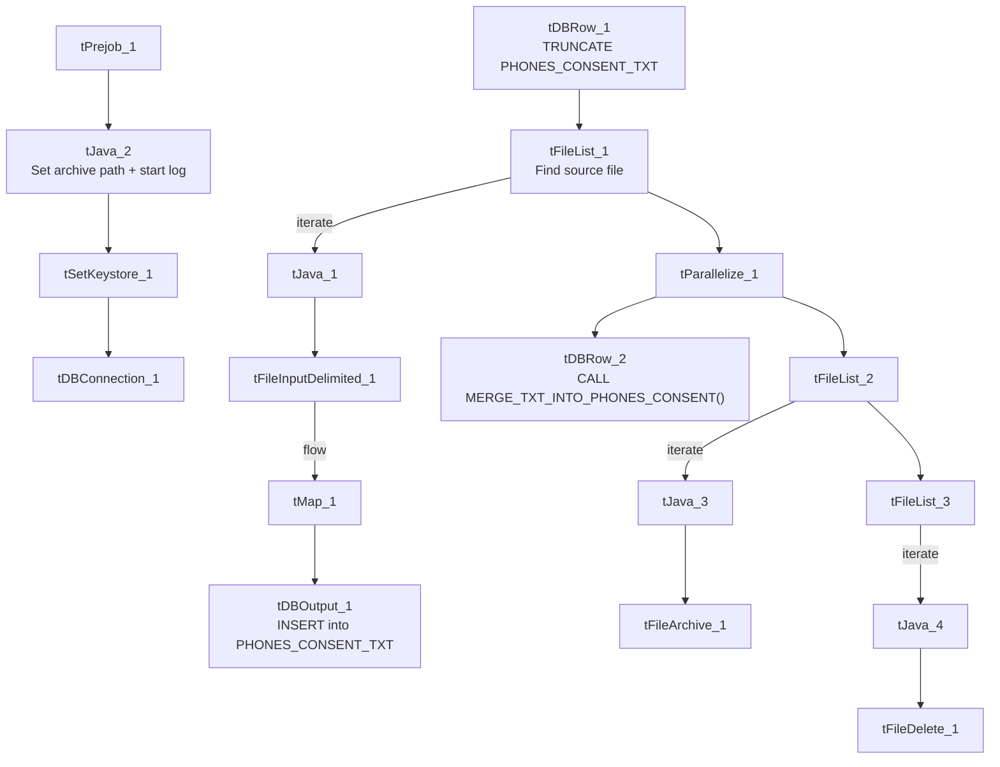

# Talend Job: Phones_Consent_Table_Text_Load

## Overview

This job loads phone-consent records — whether a given phone number has consented to manual calls, autodialer calls, fax, text, or pre-recorded messages, along with who obtained that consent and when — into Snowflake. It follows the standard truncate → load → merge → archive/delete pattern exactly, with no notable deviations.

## Detail table

| Field | Value |
|---|---|
| Job name | Phones_Consent_Table_Text_Load |
| Version | 0.1 |
| Project | LATITUDE |
| Author | jmach@harriscollect.com |
| Created | 2024-12-11T09:26:45.341-0800 |
| Last Modified | 2026-04-29T14:49:08.883-0700 |

## Step-by-step data flow

1. **Set up.** `tPrejob_1` triggers `tJava_2`, which appends today's date to `context.archiveDir` and opens a log file; this chains into `tSetKeystore_1` and `tDBConnection_1`.
2. **Empty the staging table.** `tDBRow_1` runs `TRUNCATE TABLE PHONES_CONSENT_TXT;` (no explicit schema prefix — see Issues observed).
3. **Find the file.** `tFileList_1` lists files in `context.sourceDir` (skipping `*.txt`), with no explicit sort order.
4. **Read and reshape the file.** `tFileInputDelimited_1` reads the file as pipe-delimited (`|~|`/`|$|`), US-ASCII encoded, with a header row, covering consent ID, master phone ID, four Boolean-style consent flags (manual call, autodialer, fax, text), whether written consent was obtained, who obtained it, a documentation ID, effective date, comment, and a pre-recorded-message flag. `tMap_1` maps these onto the `PHONES_CONSENT_TXT` schema, adding `LOAD_DT`.
5. **Load staging.** Mapped rows flow directly into `tDBOutput_1` (no row counter), inserting into `PHONES_CONSENT_TXT`.
6. **Merge and clean up — in parallel.** Once the file-list subjob completes, `tParallelize_1` splits into: `tDBRow_2` calling `CALL MERGE_TXT_INTO_PHONES_CONSENT();`, and a file-listing chain (`tFileList_2` → `tFileList_3` → delete; `tFileList_2` also drives archiving).

## Settings tables

### Source: `tFileInputDelimited_1`

| Setting | Value | What it means |
|---|---|---|
| FILENAME | `context.filePath` | Reads whichever file `tFileList_1` just found. |
| FIELDSEPARATOR / ROWSEPARATOR | `\|~\|` / `\|$\|` | Standard project pipe-delimited format. |
| HEADER | 1 | First line is a header. |
| ENCODING | US-ASCII | Plain ASCII text. |

### Target: `tDBOutput_1`

| Setting | Value | What it means |
|---|---|---|
| Table | PHONES_CONSENT_TXT | Staging table for phone consent records. |
| Output action | INSERT | Adds rows only. |

### Merge step: `tDBRow_2`

| Setting | Value | What it means |
|---|---|---|
| Query | `CALL MERGE_TXT_INTO_PHONES_CONSENT();` | Snowflake procedure that folds staged rows into the permanent `PHONES_CONSENT` table. |

## Dependencies & configuration

- **Triggers/depends on other jobs:** none found — no `tRunJob` links.
- **Context variables used:** `context.sourceDir`, `context.archiveDir`, `context.filePath`, `context.fileName`, `context.logDir`, `context.keystorePath` (all `Directories_0.1`). Uses the shared Snowflake connection object, not `LEGACY_DW_*` variables directly.
- **Hardcoded values found:** `tFileInputDelimited_1.TEMP_DIR`, `tFileArchive_1.SOURCE_FILE`, `tFileDelete_1.DIRECTORY`/`PATH`, and `tSetKeystore_1.SSL_TRUSTSERVER_TRUSTSTORE` are fixed paths rather than context variables.

## Glossary

| Component type | Plain-English meaning |
|---|---|
| `tPrejob` / `tParallelize` | Setup-before-main-start, concurrent branches (see job_Address_Text_Load.md). |
| `tFileList` | Lists files for the job to loop over (see job_Address_Text_Load.md). |
| `tFileInputDelimited` | Reads a delimited text file (see job_Address_Text_Load.md). |
| `tMap` | Maps/transforms columns (see job_Address_Text_Load.md). |
| `tDBOutput` / `tSnowflakeOutput` | Writes rows into Snowflake (see job_Address_Text_Load.md). |
| `tDBRow` / `tSnowflakeRow` | Runs a single SQL statement (see job_Address_Text_Load.md). |
| `tJava` | Custom Java code block (see job_Address_Text_Load.md). |
| `tFileArchive` | Zips a file into an archive location (see job_Address_Text_Load.md). |
| `tFileDelete` | Deletes a file from disk (see job_Address_Text_Load.md). |
| `tSetKeystore` | Configures the SSL keystore for the Snowflake connection (see job_Address_Text_Load.md). |

## Issues observed

- **The staging truncate doesn't qualify its schema** (`TRUNCATE TABLE PHONES_CONSENT_TXT;`, no `LIQUID_STAGING.` prefix) — same pattern as other jobs in this batch; likely relies on the connection's default schema.
- **No row-count logging** — no `tFlowMeter` component between `tMap_1` and `tDBOutput_1`.
- **`tFileDelete_1.FAILON` is `false`**, meaning a failed delete of the source file won't fail the job.
- **Several hardcoded, machine-specific paths** exist alongside parameterized ones — see Dependencies & configuration.
- **The merge procedure's own logic is outside Talend** and not visible in this metadata.
