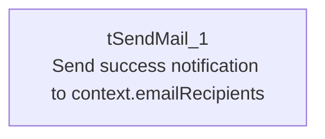

# Talend Job: Plan_Success_Alert

## Overview

This is a minimal, single-component alert job: it sends one email confirming that the daily Latitude-to-Snowflake load completed successfully. It has no file handling, no database connection, and no branching logic at all — it exists purely to send a "everything's fine" notification, which is notably the kind of positive confirmation that `Export_File_Check.md` observed was missing from that job's own (failure-only) alerting.

## Detail table

| Field | Value |
|---|---|
| Job name | Plan_Success_Alert |
| Version | 0.1 |
| Project | LATITUDE |
| Author | jmach@harriscollect.com |
| Created | 2025-10-16T09:02:46.821-0700 |
| Last Modified | 2025-10-16T09:31:04.919-0700 |

## Step-by-step data flow

1. **Send the notification.** The job consists of a single component, `tSendMail_1`, which sends an email to `context.emailRecipients` from a fixed sender address (`svc_analytics@harriscollect.com`), with the subject `"Latitude load to Snowflake complete"` and the body `"The daily load of Latitude data to Snowflake has completed successfully.."`. There are no other components and no connections in this job's metadata — it runs and finishes as soon as the email is sent (or dies trying, since `DIE_ON_ERROR`=true).

## Settings tables

### Alert: `tSendMail_1`

| Setting | Value | What it means |
|---|---|---|
| TO | `context.emailRecipients` | Parameterized — recipients are configurable per environment, unlike the sender/SMTP settings below. This context variable is not part of the `Directories_0.1` or `LEGACY_DW_0.1` groups captured in `_shared_context.json`, so its actual value can't be confirmed from the provided metadata. |
| FROM | `"svc_analytics@harriscollect.com"` | Hardcoded shared service-account sender address. |
| SUBJECT | `"Latitude load to Snowflake complete"` | |
| MESSAGE | `"The daily load of Latitude data to Snowflake has completed successfully.."` | Note the double period at the end — a small typo in the message text. |
| SMTP_HOST | `"harriscollect-com.mail.protection.outlook.com"` | Hardcoded Microsoft 365/Exchange Online mail relay — not parameterized via `context.*`. |
| SMTP_PORT | 25 | Standard unencrypted SMTP submission port. |
| SSL / STARTTLS | false / false | The connection to the mail server is not encrypted at the transport level. |
| DIE_ON_ERROR | true | If the email fails to send, the job fails — there's no "log and continue" fallback. |
| ENCODING | ISO-8859-15 | Same encoding convention used by most of this project's file-reading components. |

## Dependencies & configuration

- **Triggers/depends on other jobs:** none found — no `tRunJob` links, and this job has no incoming or outgoing job-flow connections captured in its metadata at all (a single standalone component). It is very likely invoked directly by an external scheduler once the day's load jobs are believed to have finished, but nothing in this job's own metadata confirms that relationship.
- **Context variables used:** `context.emailRecipients` only — this variable does not appear in either context group (`Directories_0.1` or `LEGACY_DW_0.1`) captured in `_shared_context.json`, so its configured value(s) are unknown from the provided metadata.
- Does not use any Snowflake connection, staging table, or file component — it is a pure notification job.

## Glossary

| Component type | Plain-English meaning |
|---|---|
| `tSendMail` | Sends an email (see job_Export_File_Check.md) — here used as a success notification with no attachment, the mirror image of `Export_File_Check`'s failure-only alert. |

## Issues observed

- **Job name vs. content mismatch.** The job is named `Plan_Success_Alert` — which reads as if it should relate to a payment/collection "plan" succeeding — but the actual email subject and body are entirely about the "Latitude load to Snowflake" completing, with no mention of a plan. This is worth a quick check with the team to confirm the job name isn't a leftover from an earlier, different purpose, or a copy-paste naming mistake from another alert job.
- **SMTP host, port, and sender address are all hardcoded** (`SMTP_HOST`, `FROM`) rather than parameterized via `context.*`, even though the recipient (`TO`) is parameterized — an inconsistent approach to configuration within the same component.
- **No SSL/STARTTLS on the SMTP connection** (`SSL`=false, `STARTTLS`=false, port 25) — mail is submitted to the relay without transport encryption, per this component's settings.
- **No corresponding failure check.** Since this job runs independently of the actual load jobs (no `tRunJob` link visible), there's nothing in this job's own metadata that guarantees it only sends this "success" email when the loads genuinely succeeded — that logic, if it exists, lives in whatever external process/scheduler invokes this job.
