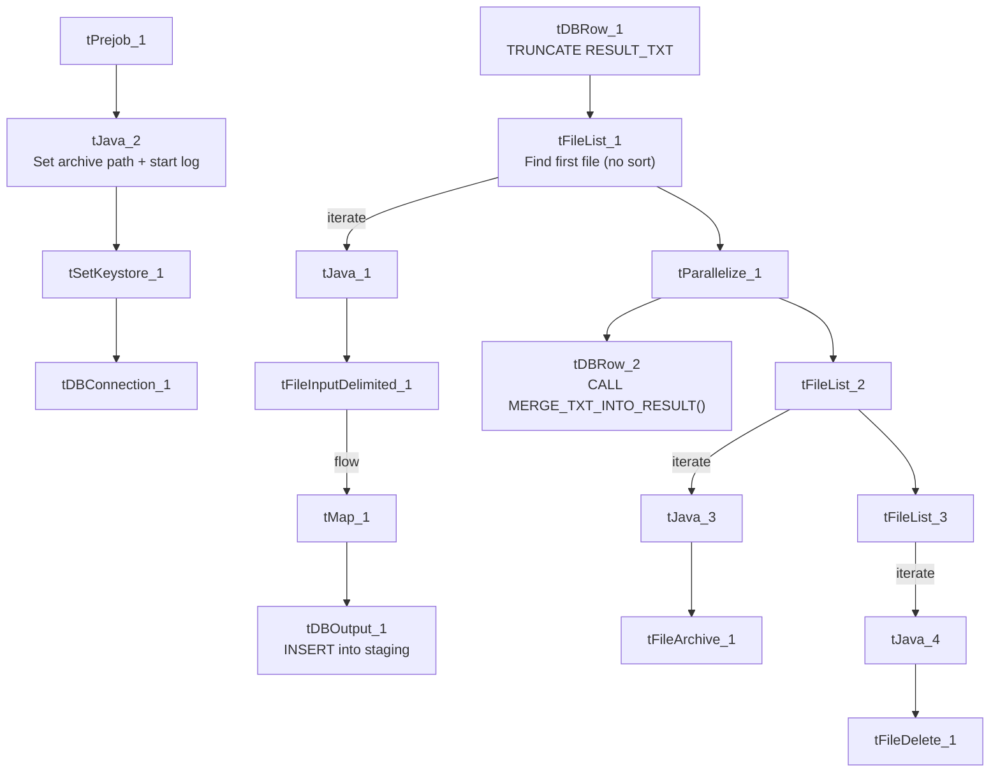

# Talend Job: Result_Table_Text_Load

## Overview

This job loads "result code" reference data (contact-attempt outcome codes like whether a call was worked/contacted, with descriptions and compliance-attempt flags) into Snowflake. It follows the standard truncate → load → merge → archive/delete pattern, with a couple of naming inconsistencies worth flagging (see Issues observed).

## Detail table

| Field | Value |
|---|---|
| Job name | Result_Table_Text_Load |
| Version | 0.1 |
| Project | LATITUDE |
| Author | jmach@harriscollect.com |
| Created | 2024-10-25T09:48:07.359-0700 |
| Last Modified | 2025-10-02T10:44:45.581-0700 |

## Step-by-step data flow

1. **Set up.** `tPrejob_1` starts the job; `tJava_2` sets the dated archive path and opens the log; `tSetKeystore_1` configures the SSL keystore; `tDBConnection_1` opens the Snowflake connection.
2. **Empty the staging table.** `tDBRow_1` runs `TRUNCATE TABLE RESULT_TXT;` — note there is no schema qualifier here (see Issues observed).
3. **Find the file.** `tFileList_1` lists files in `context.sourceDir` (skipping `.txt`) with no explicit sort order applied (`ORDER_BY_NOTHING`=true — unlike most peer jobs, which sort by last-modified date). The match becomes `context.filePath` (`tJava_1`).
4. **Read and reshape.** `tFileInputDelimited_1` reads the file as pipe-delimited (`|~|`/`|$|`), US-ASCII encoded, with a header row. `tMap_1` maps the file's columns (`code`, `ctl`, `Description`, `worked`, `contacted`, `note`, `ComplianceAttempt`) plus `LOAD_DT` onto the `RESULT_TXT` schema.
5. **Load staging.** The mapped rows flow directly into `tDBOutput_1` (no row-counter component here, unlike several peer jobs), which inserts them into the staging table.
6. **Merge and cleanup — in parallel.** `tParallelize_1` splits into:
   - **Merge branch:** `tDBRow_2` runs `CALL MERGE_TXT_INTO_RESULT();` — note the procedure name refers to "RESULT", not "RESULT_TXT" as the table itself is named (see Issues observed). No `tDie`/`tWarn` reacts to the result.
   - **Cleanup branch:** the file is listed again, archived as a `.zip` into `context.archiveDir` (`tFileArchive_1`), and deleted (`tFileDelete_1`).

## Settings tables

### Source: `tFileInputDelimited_1`

| Setting | Value | What it means |
|---|---|---|
| FILENAME | `context.filePath` | Reads whichever file `tFileList_1` just found. |
| FIELDSEPARATOR / ROWSEPARATOR | `\|~\|` / `\|$\|` | Standard pipe-delimited format. |
| CSVROWSEPARATOR | `\n` | Fallback row separator (inert since `CSV_OPTION` is false). |
| ENCODING | US-ASCII | Matches `Carrier_Text_Load`/`Insurance_Text_Load`. |
| SCHEMA_REJECT | repository schema `"customer"` | Mismatched — same copy-paste artifact seen in `Carrier_Text_Load`, `cmi_Dialer_Plan_History_Table_Text_Load`, and `cmi_renkim_ReturnHistory_Text_Load`. |
| ORDER_BY_NOTHING (on `tFileList_1`) | true | No sort order is applied when picking the file to process — whichever file the filesystem returns first is used, unlike jobs that explicitly sort by last-modified date. |
| EXCLUDEFILEMASK (on `tFileList_1`) | `*.txt` | `.txt` files skipped. |

### Target: `tDBOutput_1`

| Setting | Value | What it means |
|---|---|---|
| Table | RESULT_TXT | Loads into the staging copy of this table. |
| Output action | INSERT | Adds rows only. |
| Table action | NONE | No table create/drop/truncate here. |

### Truncate & merge: `tDBRow_1` / `tDBRow_2`

| Setting | Value | What it means |
|---|---|---|
| Query (`tDBRow_1`) | `TRUNCATE TABLE RESULT_TXT;` | Empties staging — no schema prefix, unlike `TRUNCATE TABLE LIQUID_STAGING.<table>;` used in most peer jobs (relies on whatever schema is the connection's default). |
| Query (`tDBRow_2`) | `CALL MERGE_TXT_INTO_RESULT();` | Runs the merge procedure — named after "RESULT", not "RESULT_TXT". |

## Dependencies & configuration

- **Triggers/depends on other jobs:** none found — no `tRunJob` links.
- **Context variables used:** `context.sourceDir`, `context.archiveDir`, `context.filePath`, `context.fileName`, `context.logDir`, `context.keystorePath` (all `Directories_0.1`). Uses the shared Snowflake connection object, not `LEGACY_DW_0.1` directly.
- **Hardcoded values found:** `tFileInputDelimited_1.TEMP_DIR`, `tFileArchive_1.SOURCE_FILE`, `tFileDelete_1.DIRECTORY`/`PATH`, and `tSetKeystore_1.SSL_TRUSTSERVER_TRUSTSTORE` — the same fixed Windows paths seen project-wide.

## Glossary

| Component type | Plain-English meaning |
|---|---|
| `tPrejob` / `tParallelize` | Job-flow control (see `job_Address_Text_Load.md`). |
| `tFileList` | Lists files to loop over (see `job_Address_Text_Load.md`). |
| `tFileInputDelimited` | Reads a delimited text file (see `job_Address_Text_Load.md`). |
| `tMap` | Maps/transforms columns (see `job_Address_Text_Load.md`). |
| `tDBOutput` / `tSnowflakeOutput` | Writes rows to Snowflake (see `job_Address_Text_Load.md`). |
| `tDBRow` / `tSnowflakeRow` | Runs a single SQL statement (see `job_Address_Text_Load.md`). |
| `tJava` | Custom Java code blocks (see `job_Address_Text_Load.md`). |
| `tFileArchive` | Zips a file into an archive location (see `job_Address_Text_Load.md`). |
| `tFileDelete` | Deletes a file from disk (see `job_Address_Text_Load.md`). |
| `tSetKeystore` | Configures the SSL keystore for Snowflake (see `job_Address_Text_Load.md`). |

## Issues observed

- **Naming mismatch between the table and its merge procedure.** The staging/permanent table is `RESULT_TXT`, but the merge procedure is `MERGE_TXT_INTO_RESULT()` — dropping the `_TXT` suffix. This breaks the otherwise-consistent `MERGE_TXT_INTO_<TABLE>()` naming convention seen elsewhere (e.g. `MERGE_TXT_INTO_CARRIER()` for table `CARRIER`) and is worth double-checking with whoever owns the Snowflake procedures to confirm it's pointed at the right table.
- **The truncate statement has no schema qualifier** (`TRUNCATE TABLE RESULT_TXT;`), unlike most peer jobs which explicitly truncate `LIQUID_STAGING.<table>`. This likely still works via the connection's default schema, but is inconsistent with the more explicit style used elsewhere.
- **No row-counter (`tFlowMeter`) between the map and the load**, unlike `DeskChangeHistory_Text_Load`/`Users_Text_Load`/`Insurance_Text_Load` — a minor observability gap (no per-run row count logged at that point).
- **File is picked with no sort order** (`ORDER_BY_NOTHING`=true) rather than by last-modified date — if more than one matching file is ever present in the source folder at once, which one gets processed is effectively arbitrary/filesystem-dependent.
- **Reject-schema mismatch** ("customer" reject schema) — same copy-paste artifact flagged in `Carrier_Text_Load`.
- **Hardcoded, machine-specific paths** exist alongside the parameterized ones — the same project-wide pattern.
