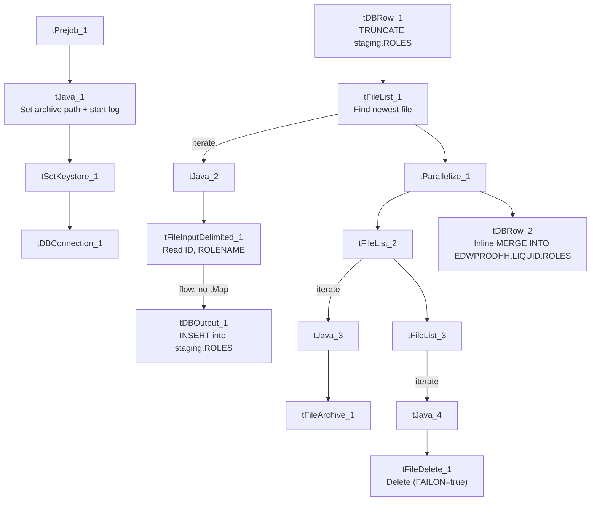

# Talend Job: Roles_Text_Load

## Overview

This job loads user-role reference data (just an ID and a role name) from a shared folder into Snowflake. It's one of only two jobs in the whole LATITUDE project that runs its own inline `MERGE INTO ... USING ...` SQL statement instead of calling a stored procedure — meaning, unusually, its full merge logic is visible directly in this metadata rather than hidden inside Snowflake. It also skips the `tMap` transform step used by nearly every other "Text Load" job, since the file's columns already match the target schema.

## Detail table

| Field | Value |
|---|---|
| Job name | Roles_Text_Load |
| Version | 0.1 |
| Project | LATITUDE |
| Author | jmach@harriscollect.com |
| Created | 2026-08-05T09:32:35.837-0700 |
| Last Modified | 2026-08-05T10:24:32.821-0700 |

## Step-by-step data flow

1. **Set up.** `tPrejob_1` starts the job; `tJava_1` appends today's date to `context.archiveDir` and opens a log file; `tSetKeystore_1` configures the SSL client keystore; `tDBConnection_1` opens the Snowflake connection.
2. **Empty the staging table.** `tDBRow_1` runs `TRUNCATE TABLE LIQUID_STAGING.ROLES;`, then triggers the file-processing chain.
3. **Find the file.** `tFileList_1` lists files in `context.sourceDir`, ordered by modified date (skipping `.txt` files); the match becomes `context.filePath` (`tJava_2`).
4. **Read and load — no transform step.** `tFileInputDelimited_1` reads the pipe-delimited file (`|~|`/`|$|`, ISO-8859-15 encoding, header row, `DIE_ON_ERROR` true, quote-enclosed fields) with just two columns, `ID` and `ROLENAME`. Its output flows **directly** into `tDBOutput_1` — there is no `tMap` in between, since the file's two columns already match the staging table's columns one-for-one.
5. **Load staging.** `tDBOutput_1` inserts the rows into `ROLES` (schema `LIQUID_STAGING`, per the truncate).
6. **Merge and clean up — in parallel.** `tParallelize_1` splits into:
   - **Merge branch:** `tDBRow_2` runs an inline `MERGE INTO EDWPRODHH.LIQUID.ROLES ...` statement directly against Snowflake (see below) — not a stored-procedure call.
   - **Cleanup branch:** the source file is listed again, archived (`tFileArchive_1`), then separately listed and deleted (`tFileDelete_1`, with `FAILON` set to `true`).

## Settings tables

### Source: `tFileInputDelimited_1`

| Setting | Value | What it means |
|---|---|---|
| FILENAME | `context.filePath` | Reads whichever file `tFileList_1` found. |
| FIELDSEPARATOR / ROWSEPARATOR | `\|~\|` / `\|$\|` | The project's standard pipe-delimited format. |
| ESCAPE_CHAR / TEXT_ENCLOSURE | `"` | Fields can be quoted with `"`. |
| ENCODING | ISO-8859-15 | Western European encoding. |
| DIE_ON_ERROR | true | A malformed row fails the whole job. |
| Columns | `ID` (integer), `ROLENAME` (string, 100 chars) | Just two fields — this is a small reference table. |

### Target: `tDBOutput_1`

| Setting | Value | What it means |
|---|---|---|
| Table | ROLES | Loads into the staging copy (schema `LIQUID_STAGING`, per the preceding `TRUNCATE`). |
| Output action | INSERT | Adds rows only. |
| Table action | NONE | Structure untouched — truncation handled separately. |

### Merge step: `tDBRow_2` — inline SQL (fully visible)

| Setting | Value | What it means |
|---|---|---|
| Query | `MERGE INTO EDWPRODHH.LIQUID.ROLES AS tgt USING LIQUID_STAGING.ROLES AS src ON tgt.ID = src.ID WHEN MATCHED THEN UPDATE SET tgt.ROLENAME=src.ROLENAME WHEN NOT MATCHED THEN INSERT (ID, ROLENAME) VALUES (src.ID, src.ROLENAME);` | Confirms the permanent table is `EDWPRODHH.LIQUID.ROLES` (database `EDWPRODHH`, schema `LIQUID`), matched against the staging table `LIQUID_STAGING.ROLES` on `ID`. If a role ID already exists in the permanent table, its `ROLENAME` is updated to match staging; if it doesn't exist yet, a new row is inserted. This is a straightforward upsert with no delete/deactivation logic — a role removed from the source file simply stays in the permanent table unless removed by some other process. |

## Dependencies & configuration

- **Triggers/depends on other jobs:** none — no `tRunJob` links found.
- **Context variables used:** `context.sourceDir`, `context.archiveDir`, `context.filePath`, `context.fileName`, `context.logDir`, `context.keystorePath` (all `Directories_0.1`).
- **Snowflake connection:** uses the shared connection object, not `LEGACY_DW_*` context variables directly.

## Glossary

| Component type | Plain-English meaning |
|---|---|
| `tPrejob` / `tParallelize` | Setup-before-main-flow, and concurrent branches (see `job_Address_Text_Load.md`). |
| `tFileList` | Lists files in a folder to loop over (see `job_Address_Text_Load.md`). |
| `tFileInputDelimited` | Reads a delimited text file row by row (see `job_Address_Text_Load.md`). |
| `tSnowflakeOutput` (`tDBOutput`) | Writes rows into Snowflake (see `job_Address_Text_Load.md`). |
| `tSnowflakeRow` (`tDBRow`) | Runs a single SQL statement — `TRUNCATE` and the inline `MERGE` here (see `job_Address_Text_Load.md`). |
| `tJava` | Custom Java code for small tasks (see `job_Address_Text_Load.md`). |
| `tFileArchive` | Zips a file into an archive location (see `job_Address_Text_Load.md`). |
| `tFileDelete` | Deletes a file from disk (see `job_Address_Text_Load.md`). |
| `tSetKeystore` | Configures the SSL keystore for the Snowflake connection (see `job_Address_Text_Load.md`). |

## Issues observed

- **This job's merge logic is inline SQL, not a stored procedure** — one of only two jobs project-wide built this way. That's a genuine positive for maintainability here (the join/update logic is fully visible and reviewable, unlike the `CALL MERGE_TXT_INTO_*()` jobs), but it also means any change to this merge logic lives inside the Talend job itself rather than in a centrally managed Snowflake procedure — worth being aware of if there's an expectation that all merge logic lives in Snowflake.
- **No `tMap` step** — this job loads the file's two columns straight into the staging table without an explicit mapping component, unlike every other job in this batch. Functionally equivalent as long as the source file's column order/names never change, but there's no explicit mapping layer to catch a schema drift early.
- **`tFileDelete_1.FAILON` is `true`** here (and in `Desk_Text_Load`), unlike most peer jobs which set it to `false` — a failed delete will fail this job outright.
- **Hardcoded machine-specific paths**: `tFileInputDelimited_1.TEMP_DIR`, `tFileArchive_1.SOURCE_FILE`, `tFileDelete_1.DIRECTORY`/`PATH`, and `tSetKeystore_1.SSL_TRUSTSERVER_TRUSTSTORE` are all fixed `C:/Talend-Studio-20211109_1610-V8.0.1/...` or `C:/clientTrustStore.trustStore` paths rather than context variables — the same pattern flagged project-wide.
- **This is the most recently created job reviewed in this batch** — created and last modified on the same day (2026-08-05), about 52 minutes apart.
