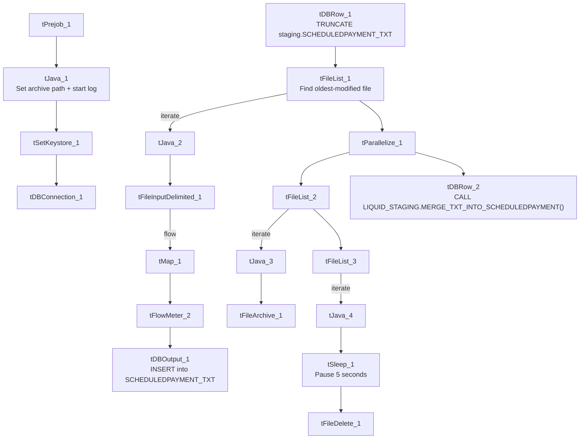

# Talend Job: ScheduledPayment_Text_Load

## Overview

This job loads scheduled-payment records (payment arrangements, transaction status, amounts, surcharges, execution/bounce details, and payment method) into Snowflake. It follows the standard truncate → load → merge → archive/delete pattern, with two small deviations: it deliberately processes the oldest file first, and it pauses for five seconds before deleting the source file.

## Detail table

| Field | Value |
|---|---|
| Job name | ScheduledPayment_Text_Load |
| Version | 0.1 |
| Project | LATITUDE |
| Author | jmach@harriscollect.com |
| Created | 2025-07-01T10:41:45.613-0700 |
| Last Modified | 2025-10-02T10:50:11.984-0700 |

## Step-by-step data flow

1. **Set up.** `tPrejob_1` triggers `tJava_1`, which appends today's date to `context.archiveDir` and opens a log file; this chains into `tSetKeystore_1` and `tDBConnection_1`.
2. **Empty the staging table.** `tDBRow_1` runs `TRUNCATE TABLE LIQUID_STAGING.SCHEDULEDPAYMENT_TXT;` (this one *does* qualify its schema, unlike several peer jobs in this batch).
3. **Find the file.** `tFileList_1` lists files in `context.sourceDir` (skipping `*.txt`), explicitly sorted by modified date, ascending — processing the oldest matching file first, the same explicit-ordering pattern seen in `Dialer_CallTracking_Load`.
4. **Read and reshape the file.** `tFileInputDelimited_1` reads the file as pipe-delimited (`|~|`/`|$|`), **ISO-8859-15** encoded (unlike most peers in this batch, which use US-ASCII), with a header row, covering payment ID, account/debtor ID, transaction type/status, amount, surcharge, execution/bounce timestamps and results, and payment method. `tMap_1` maps these onto the `SCHEDULEDPAYMENT_TXT` schema, adding `LOAD_DT`.
5. **Load staging.** Mapped rows pass through a row counter (`tFlowMeter_2`) into `tDBOutput_1`, inserting into `SCHEDULEDPAYMENT_TXT`.
6. **Merge and clean up — in parallel.** Once the file-list subjob completes, `tParallelize_1` splits into: `tDBRow_2` calling `CALL LIQUID_STAGING.MERGE_TXT_INTO_SCHEDULEDPAYMENT();` (note the explicit schema qualifier on the procedure call itself — see Issues observed), and a file-listing chain that archives (`tFileList_2` → `tFileArchive_1`) and, after a brief pause, deletes (`tFileList_3` → `tSleep_1` → `tFileDelete_1`).

## Settings tables

### Source: `tFileInputDelimited_1`

| Setting | Value | What it means |
|---|---|---|
| FILENAME | `context.filePath` | Reads whichever file `tFileList_1` just found. |
| FIELDSEPARATOR / ROWSEPARATOR | `\|~\|` / `\|$\|` | Standard project pipe-delimited format. |
| ENCODING | ISO-8859-15 | Western European encoding — differs from the US-ASCII used by most jobs in this batch. |
| REMOVE_EMPTY_ROW | true | Blank rows in the source file are skipped rather than loaded. |
| DIRECTORY ordering (`tFileList_1`) | `ORDER_BY_MODIFIEDDATE=true`, ascending | Explicitly processes the oldest untouched file first. |

### Target: `tDBOutput_1`

| Setting | Value | What it means |
|---|---|---|
| Table | SCHEDULEDPAYMENT_TXT | Staging table for scheduled-payment records. |
| Output action | INSERT | Adds rows only. |

### Merge step: `tDBRow_2`

| Setting | Value | What it means |
|---|---|---|
| Query | `CALL LIQUID_STAGING.MERGE_TXT_INTO_SCHEDULEDPAYMENT();` | Snowflake procedure that folds staged rows into the permanent `SCHEDULEDPAYMENT` table — explicitly schema-qualified, unlike the unqualified `CALL <procedure>();` form used by most peer jobs. |

### Pre-delete pause: `tSleep_1`

| Setting | Value | What it means |
|---|---|---|
| PAUSE | 5 (seconds) | Job waits 5 seconds before deleting the source file — possibly to let a concurrent process (e.g. the archive step) finish releasing its file handle. |

## Dependencies & configuration

- **Triggers/depends on other jobs:** none found — no `tRunJob` links.
- **Context variables used:** `context.sourceDir`, `context.archiveDir`, `context.filePath`, `context.fileName`, `context.logDir`, `context.keystorePath` (all `Directories_0.1`). Uses the shared Snowflake connection object, not `LEGACY_DW_*` variables directly.
- **Hardcoded values found:** `tFileInputDelimited_1.TEMP_DIR`, `tFileArchive_1.SOURCE_FILE`, `tFileDelete_1.DIRECTORY`/`PATH`, and `tSetKeystore_1.SSL_TRUSTSERVER_TRUSTSTORE` are fixed paths rather than context variables.

## Glossary

| Component type | Plain-English meaning |
|---|---|
| `tPrejob` / `tParallelize` | Setup-before-main-start, concurrent branches (see job_Address_Text_Load.md). |
| `tFileList` | Lists files for the job to loop over (see job_Address_Text_Load.md). |
| `tFileInputDelimited` | Reads a delimited text file (see job_Address_Text_Load.md). |
| `tMap` | Maps/transforms columns (see job_Address_Text_Load.md). |
| `tFlowMeter` | Counts rows passing a point, for logging (see job_Address_Text_Load.md). |
| `tDBOutput` / `tSnowflakeOutput` | Writes rows into Snowflake (see job_Address_Text_Load.md). |
| `tDBRow` / `tSnowflakeRow` | Runs a single SQL statement (see job_Address_Text_Load.md). |
| `tJava` | Custom Java code block (see job_Address_Text_Load.md). |
| `tFileArchive` | Zips a file into an archive location (see job_Address_Text_Load.md). |
| `tFileDelete` | Deletes a file from disk (see job_Address_Text_Load.md). |
| `tSetKeystore` | Configures the SSL keystore for the Snowflake connection (see job_Address_Text_Load.md). |
| `tSleep` | *(Not covered in the reference docs.)* Pauses job execution for a fixed number of seconds — here, a 5-second delay is inserted between listing the file for deletion and actually deleting it. |

## Issues observed

- **Encoding differs from most peer jobs in this batch.** `tFileInputDelimited_1` uses ISO-8859-15 here, while `Customer_Table_Text_Load`, `Dialer_CallTracking_Load`, `LetterRequest_Table_Text_Load`, `Phones_Consent_Table_Text_Load`, and `cmi_Score_Text_Load` all use US-ASCII. Worth confirming this is intentional (e.g., scheduled-payment files can contain accented characters that others don't).
- **The merge call is schema-qualified** (`CALL LIQUID_STAGING.MERGE_TXT_INTO_SCHEDULEDPAYMENT();`) while every other job in this batch calls its merge procedure unqualified (`CALL MERGE_TXT_INTO_<TABLE>();`). Functionally likely equivalent if the default schema is already `LIQUID_STAGING`, but it's an inconsistency worth flagging for anyone maintaining these procedures.
- **A 5-second `tSleep_1` delay before file deletion** is unique to this job among the 9 documented here — its purpose isn't stated in the metadata; confirm with the team whether it's working around a file-lock or timing issue.
- **File pickup order deviates from the norm** — explicitly oldest-first, like `Dialer_CallTracking_Load`, rather than the default unordered listing most peer jobs use.
- **`tFileDelete_1.FAILON` is `false`**, meaning a failed delete won't fail the job.
- **The merge procedure's own logic is outside Talend** and not visible in this metadata.
