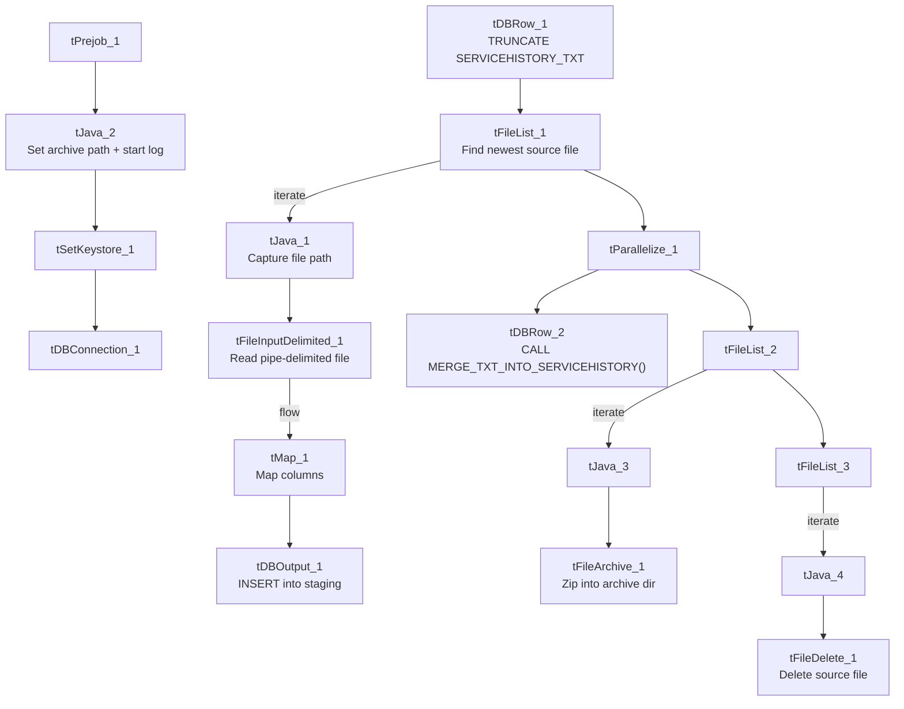

# Talend Job: ServiceHistory_Text_Load

## Overview

This job loads service-request history records — third-party data/verification service requests made against debtor accounts, along with their cost, batch, and response details — from a shared folder into Snowflake. It follows the project's standard truncate-load-merge-archive pattern exactly (see `job_Address_Text_Load.md`), with no notable structural deviations. It has no scheduling information in this metadata — something outside Talend decides when it runs.

## Detail table

| Field | Value |
|---|---|
| Job name | ServiceHistory_Text_Load |
| Version | 0.1 |
| Project | LATITUDE |
| Author | jmach@harriscollect.com |
| Created | 2024-11-21T14:01:01.406-0800 |
| Last Modified | 2025-10-02T10:57:17.878-0700 |

## Step-by-step data flow

1. **Set up.** `tPrejob_1` starts the job; `tJava_2` appends today's date to `context.archiveDir` and opens a log file; `tSetKeystore_1` configures the SSL client keystore; `tDBConnection_1` opens the Snowflake connection.
2. **Empty the staging table.** In a separate, parallel start point, `tDBRow_1` runs `TRUNCATE TABLE SERVICEHISTORY_TXT;`.
3. **Find and read the file.** `tFileList_1` lists files in `context.sourceDir` (skipping `.txt`); `tJava_1` captures the found path into `context.filePath`; `tFileInputDelimited_1` reads it as a pipe-delimited, US-ASCII-encoded file (using the repository schema named `svchist`) with a header row.
4. **Transform and load.** `tMap_1` maps the file's columns (request ID, account/debtor IDs, creation/returned dates, service ID, requestor, cost, system year/month, batch/profile/package IDs, response batch ID, type name, etc.) onto the `SERVICEHISTORY_TXT` schema, adding `LOAD_DT`. The mapped rows go directly into `tDBOutput_1`, which inserts them into Snowflake.
5. **Merge and clean up — in parallel.** `tParallelize_1` splits into two branches once the file has been listed:
   - **Merge branch:** `tDBRow_2` calls `CALL MERGE_TXT_INTO_SERVICEHISTORY();`.
   - **Cleanup branch:** the source file is listed again and archived (`tFileArchive_1`, zipped into `context.archiveDir`); it's also listed a third time and deleted (`tFileDelete_1`).

## Settings tables

### Source: `tFileInputDelimited_1`

| Setting | Value | What it means |
|---|---|---|
| FILENAME | `context.filePath` | Reads whichever file `tFileList_1` just found. |
| FIELDSEPARATOR / ROWSEPARATOR | `\|~\|` / `\|$\|` | The project's standard pipe-delimited format. |
| CSVROWSEPARATOR | `\r\n` | Only relevant if CSV mode were used (it isn't here); same as `LetterType_Text_Load`, differs from most peers' `\n`. |
| ESCAPE_CHAR / TEXT_ENCLOSURE | (empty) / (empty) | No quote/escape character is configured, same as `LetterType_Text_Load` and unlike most peer jobs which use `"` for both. |
| HEADER | 1 | First line is a header, not data. |
| ENCODING | US-ASCII | Plain ASCII, not ISO-8859-15. |
| SCHEMA:REPOSITORY_SCHEMA_TYPE | `svchist` (repository schema) | Uses a centrally-defined column layout. |
| EXCLUDEFILEMASK (on `tFileList_1`) | `*.txt` | `.txt` files are skipped. |

### Target: `tDBOutput_1`

| Setting | Value | What it means |
|---|---|---|
| Table | SERVICEHISTORY_TXT | Loads the staging copy of the service-history table. |
| Output action | INSERT | Adds rows only. |
| Table action | NONE | Truncation is handled separately by `tDBRow_1`. |

### Merge step: `tDBRow_2`

| Setting | Value | What it means |
|---|---|---|
| Query | `CALL MERGE_TXT_INTO_SERVICEHISTORY();` | Folds staged rows into the permanent table; its own logic lives in Snowflake. |

## Dependencies & configuration

- **Triggers/depends on other jobs:** none found — no `tRunJob` links.
- **Context variables used:** `context.sourceDir`, `context.archiveDir`, `context.filePath`, `context.fileName`, `context.logDir`, `context.keystorePath` (all `Directories_0.1`).
- **LEGACY_DW usage:** none — this job uses the shared Snowflake connection object, not `LEGACY_DW_0.1` variables directly.

## Glossary

| Component type | Plain-English meaning |
|---|---|
| `tPrejob` / `tParallelize` | Job-flow control. (see `job_Address_Text_Load.md`) |
| `tFileList` | Lists files in a folder so the job can loop over them. (see `job_Address_Text_Load.md`) |
| `tFileInputDelimited` | Reads a delimited text file row by row. (see `job_Address_Text_Load.md`) |
| `tMap` | Maps/transforms columns from input to output. (see `job_Address_Text_Load.md`) |
| `tDBOutput` / `tSnowflakeOutput` | Writes rows into a Snowflake table. (see `job_Address_Text_Load.md`) |
| `tDBRow` / `tSnowflakeRow` | Runs a single SQL statement — used here for `TRUNCATE` and `CALL <procedure>`. (see `job_Address_Text_Load.md`) |
| `tJava` | A small block of custom Java code. (see `job_Address_Text_Load.md`) |
| `tFileArchive` | Compresses a file into a `.zip` and archives it. (see `job_Address_Text_Load.md`) |
| `tFileDelete` | Deletes a file from disk. (see `job_Address_Text_Load.md`) |
| `tSetKeystore` | Configures the SSL keystore for the Snowflake connection. (see `job_Address_Text_Load.md`) |

## Issues observed

- **No quote/escape character configured** (`ESCAPE_CHAR`/`TEXT_ENCLOSURE` both empty), same pattern as `LetterType_Text_Load` — worth confirming this is safe if any text field (e.g., `RequestedProgram`, comments) could ever contain a pipe character.
- **No row counter (`tFlowMeter`)** between `tMap_1` and `tDBOutput_1`, unlike some peer jobs.
- **No explicit error handling on the merge step** (no `tDie`/`tWarn`), same as most peers.
- **The merge procedure's own logic is outside Talend**, same caveat as every other job that calls a `MERGE_TXT_INTO_*` procedure.
