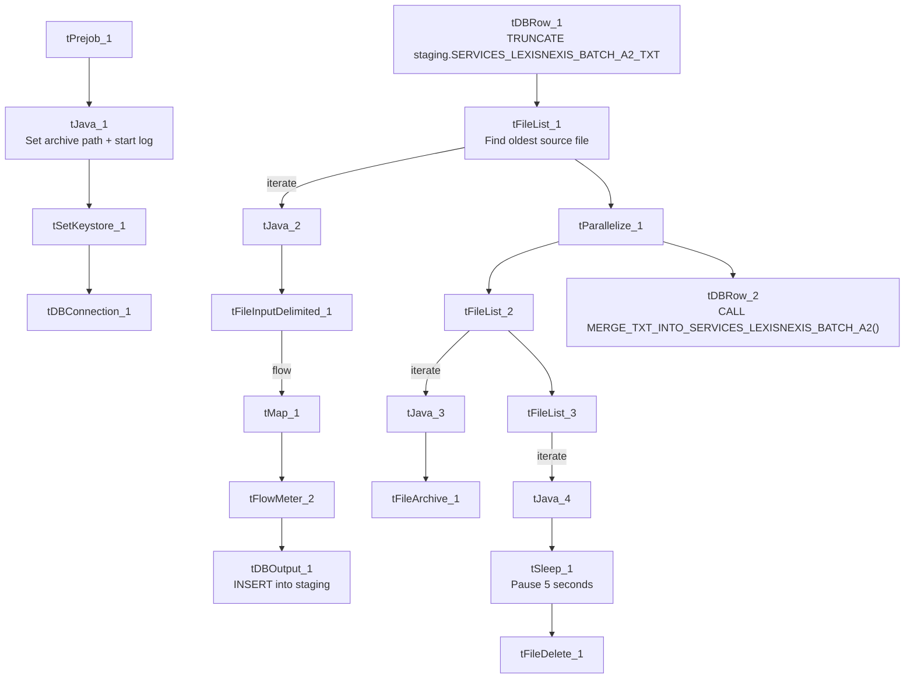

# Talend Job: Services_LexisNexis_Batch_A2_Text_Load

## Overview

This job loads a batch of LexisNexis phone-append results (up to five candidate phone numbers per subject, each with a name, type, and switch type) into Snowflake, following the project's standard truncate → load → merge → archive/delete pattern. Its only real deviation from the norm is an extra five-second pause inserted just before the source file is deleted.

## Detail table

| Field | Value |
|---|---|
| Job name | Services_LexisNexis_Batch_A2_Text_Load |
| Version | 0.1 |
| Project | LATITUDE |
| Author | jmach@harriscollect.com |
| Created | 2025-06-26T10:30:23.616-0700 |
| Last Modified | 2025-10-02T11:02:55.154-0700 |

## Step-by-step data flow

1. **Set up.** `tPrejob_1` → `tJava_1` (appends today's date to `context.archiveDir`, opens a log file) → `tSetKeystore_1` → `tDBConnection_1`.
2. **Empty the staging table.** `tDBRow_1` runs `TRUNCATE TABLE LIQUID_STAGING.SERVICES_LEXISNEXIS_BATCH_A2_TXT;`.
3. **Find and read the file.** `tFileList_1` lists files in `context.sourceDir` (excluding `*.txt`), **sorted by modified date, oldest first**; `tJava_2` captures the path; `tFileInputDelimited_1` reads it (`|~|`/`|$|`, quoted with `"`, header row, ISO-8859-15 encoding, `DIE_ON_ERROR`=false).
4. **Transform and load staging.** `tMap_1` maps `ID`, `RequestID`, and the five `subj_phone_*`/`subj_phone_name_*`/`subj_phone_type_*`/`subj_phone_typeNSwitchType` column groups onto the staging schema, adding `LOAD_DT`. Rows pass through `tFlowMeter_2` into `tDBOutput_1`, which inserts them into staging.
5. **Merge and clean up — in parallel.** `tParallelize_1` splits into:
   - **Merge branch:** `tDBRow_2` runs `CALL MERGE_TXT_INTO_SERVICES_LEXISNEXIS_BATCH_A2();`.
   - **Cleanup branch:** `tFileList_2` → `tJava_3` (captures path + name) → `tFileArchive_1` (zips into `context.archiveDir`); and `tFileList_3` → `tJava_4` (captures path + name) → **`tSleep_1` (pauses 5 seconds)** → `tFileDelete_1` (deletes the source file).

## Settings tables

### Source: `tFileInputDelimited_1`

| Setting | Value | What it means |
|---|---|---|
| FILENAME | `context.filePath` | Reads whichever file `tFileList_1` just found. |
| FIELDSEPARATOR / ROWSEPARATOR | `\|~\|` / `\|$\|` | Standard project pipe-delimited format. |
| ENCODING | ISO-8859-15 | Standard for most peer jobs. |
| DIE_ON_ERROR | false | Malformed rows are skipped/logged rather than failing the job. |
| ORDER_BY_MODIFIEDDATE (on `tFileList_1`) | true, ascending | Oldest unprocessed file is picked up first. |
| TEMP_DIR | `"C:/Talend-Studio-.../workspace"` | Hardcoded Windows path. |

### Target: `tDBOutput_1`

| Setting | Value | What it means |
|---|---|---|
| Table | SERVICES_LEXISNEXIS_BATCH_A2_TXT | Loads into the staging copy of the table. |
| Output action | INSERT | Adds rows only. |
| Table action | NONE | Table structure untouched. |

### Merge step: `tDBRow_2`

| Setting | Value | What it means |
|---|---|---|
| Query | `CALL MERGE_TXT_INTO_SERVICES_LEXISNEXIS_BATCH_A2();` | Runs the Snowflake merge procedure; the name follows the project's standard convention (matches the staging table name minus its `_TXT` suffix). |

### Delay before delete: `tSleep_1`

| Setting | Value | What it means |
|---|---|---|
| PAUSE | 5 (seconds) | Pauses the job for 5 seconds between capturing the file to delete and actually deleting it — the only `tSleep` component found across this batch of 9 jobs. |

## Dependencies & configuration

- **Triggers/depends on other jobs:** none found — no `tRunJob` links.
- **Context variables used:** `context.sourceDir`, `context.archiveDir`, `context.filePath`, `context.fileName`, `context.logDir`, `context.keystorePath` (all `Directories_0.1`). Uses the shared Snowflake connection object, not `LEGACY_DW_0.1` variables directly.

## Glossary

| Component type | Plain-English meaning |
|---|---|
| `tPrejob` / `tParallelize` | Job-flow control (see job_Address_Text_Load.md). |
| `tSnowflakeConnection` (`tDBConnection`) | Opens the shared Snowflake connection (see job_Bankruptcy_Text_Load.md). |
| `tFileList` | Lists files for iteration (see job_Address_Text_Load.md). |
| `tFileInputDelimited` | Reads a delimited text file (see job_Address_Text_Load.md). |
| `tMap` | Maps/transforms columns (see job_Address_Text_Load.md). |
| `tFlowMeter` | Counts rows passing through (see job_Address_Text_Load.md). |
| `tDBOutput` / `tSnowflakeOutput` | Writes rows to Snowflake (see job_Address_Text_Load.md). |
| `tDBRow` / `tSnowflakeRow` | Runs a single SQL statement (see job_Address_Text_Load.md). |
| `tJava` | Custom Java code block (see job_Address_Text_Load.md). |
| `tFileArchive` | Zips a file into an archive location (see job_Address_Text_Load.md). |
| `tSleep` | **Not covered in the reference docs.** Pauses job execution for a fixed number of seconds (here, 5) before letting the flow continue to the next component. Used here immediately before `tFileDelete_1`, possibly to avoid a race condition with a file handle from the read step not yet being released — the metadata doesn't record the original reason. |
| `tFileDelete` | Deletes a file (see job_Address_Text_Load.md). |
| `tSetKeystore` | Configures the SSL keystore (see job_Address_Text_Load.md). |

## Issues observed

- **The 5-second `tSleep_1` pause before deletion is unique to this job** among the 9 reviewed — its purpose (likely to let a file handle release, or to accommodate some downstream timing dependency) isn't documented anywhere in the metadata. Worth asking the team why it was added here specifically.
- **Hardcoded, machine-specific paths** on `tFileInputDelimited_1.TEMP_DIR`, `tFileArchive_1.SOURCE_FILE`, `tFileDelete_1.DIRECTORY`/`PATH`, and `tSetKeystore_1.SSL_TRUSTSERVER_TRUSTSTORE` — the same project-wide pattern seen elsewhere.
- **No `tDie`/`tWarn` check on the merge result** — same as most peer jobs (only `cmi_Hermes_Recommendations_Load` and a handful of others have this).
