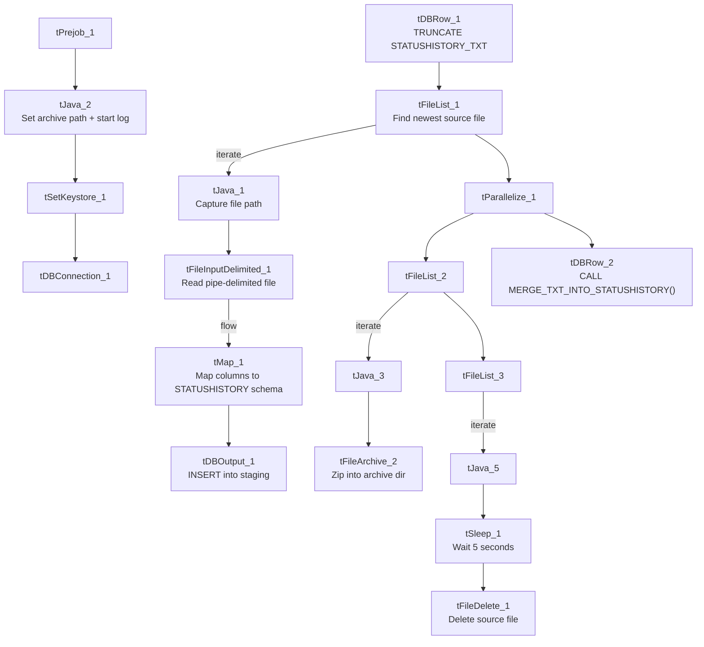

# Talend Job: StatusHistory_Text_Load

## Overview

This job follows the project's standard text-load pattern: it watches a shared folder for a new account-status-change history file, loads it into a Snowflake staging table, merges the staged rows into the permanent table via a stored procedure, and then archives and deletes the source file. Its one notable deviation from peer jobs is a deliberate 5-second pause (`tSleep_1`) inserted just before the file-delete step.

## Detail table

| Field | Value |
|---|---|
| Job name | StatusHistory_Text_Load |
| Version | 0.1 |
| Project | LATITUDE |
| Author | jmach@harriscollect.com |
| Created | 2024-11-22T10:18:14.551-0800 |
| Last Modified | 2025-10-02T11:05:44.255-0700 |

## Step-by-step data flow

1. **Set up.** `tPrejob_1` triggers `tJava_2`, which appends today's date to `context.archiveDir` and starts a log file, then hands off to `tSetKeystore_1` and `tDBConnection_1` (Snowflake connect).
2. **Empty the staging table.** `tDBRow_1` runs `TRUNCATE TABLE STATUSHISTORY_TXT;` (unqualified — no `LIQUID_STAGING.` prefix).
3. **Find the file.** `tFileList_1` lists files in `context.sourceDir`, skipping `.txt` files. `tJava_1` captures the match into `context.filePath`.
4. **Read and reshape.** `tFileInputDelimited_1` reads the file as pipe-delimited (`|~|`/`|$|`), US-ASCII-encoded, with a header row (`DIE_ON_ERROR = false`). `tMap_1` maps a small set of columns — `ID`, `AccountID`, `DateChanged`, `UserName`, `OldStatus`, `NewStatus` — onto the target schema, adding `LOAD_DT`.
5. **Load staging.** Mapped rows flow into `tDBOutput_1`, which inserts them into `STATUSHISTORY_TXT` (`INSERT`, no table-structure changes).
6. **Merge into the permanent table — in parallel with cleanup.** `tParallelize_1` splits into:
   - **Merge branch:** `tDBRow_2` runs `CALL MERGE_TXT_INTO_STATUSHISTORY();`.
   - **Archive sub-branch:** the source file is re-listed (`tFileList_2`) and archived (`tFileArchive_2`, zipped into `context.archiveDir/<filename>.zip`).
   - **Delete sub-branch:** `tFileList_2` also feeds `tFileList_3` (on success), which lists the file again, captures its path, and — unlike every other job in this batch — waits 5 seconds (`tSleep_1`) before finally deleting it (`tFileDelete_1`).

## Settings tables

### Source: `tFileInputDelimited_1`

| Setting | Value | What it means |
|---|---|---|
| FILENAME | `context.filePath` | Reads whichever file `tFileList_1` found. |
| FIELDSEPARATOR / ROWSEPARATOR | `\|~\|` / `\|$\|` | Standard custom-delimited format. |
| HEADER | 1 | First line is a header row. |
| ENCODING | US-ASCII | Not ISO-8859-15. |
| DIE_ON_ERROR | false | Malformed rows route to the reject schema instead of failing the job. |

### Target: `tDBOutput_1`

| Setting | Value | What it means |
|---|---|---|
| Table | STATUSHISTORY_TXT | Staging table for account status-change history. |
| Output action | INSERT | Adds rows only. |
| Table action | NONE | No structural changes; truncation handled by `tDBRow_1`. |

### Merge step: `tDBRow_2`

| Setting | Value | What it means |
|---|---|---|
| Query | `CALL MERGE_TXT_INTO_STATUSHISTORY();` | Snowflake stored procedure that folds staged rows into the permanent table; logic is outside Talend. |

### Delay: `tSleep_1`

| Setting | Value | What it means |
|---|---|---|
| PAUSE | 5 (seconds) | Pauses the job for 5 seconds before proceeding to `tFileDelete_1`. No comment or explanation is captured in the metadata for why this delay exists — see Issues observed. |

## Dependencies & configuration

- **Triggers/depends on other jobs:** none — no `tRunJob` links found.
- **Context variables used:** `context.sourceDir`, `context.archiveDir`, `context.filePath`, `context.fileName`, `context.logDir`, `context.keystorePath` (all `Directories_0.1`). It uses the shared Snowflake connection object (`tDBConnection_1`), not `LEGACY_DW_0.1` variables — no `LEGACY_DW_` entries appear in `context_vars_referenced`.
- **Hardcoded values found:** `tFileInputDelimited_1.TEMP_DIR`, `tFileArchive_2.SOURCE_FILE`, `tFileDelete_1.DIRECTORY`/`PATH`, `tSetKeystore_1.SSL_TRUSTSERVER_TRUSTSTORE` — the same `C:/Talend-Studio-20211109_1610-V8.0.1/...` machine-specific paths seen in most jobs.

## Glossary

| Component type | Plain-English meaning |
|---|---|
| `tPrejob` / `tParallelize` | Job-flow control (see `job_Address_Text_Load.md`). |
| `tFileList` | Lists files in a folder to loop over (see `job_Address_Text_Load.md`). |
| `tFileInputDelimited` | Reads a delimited text file row by row (see `job_Address_Text_Load.md`). |
| `tMap` | Maps/transforms input columns to output columns (see `job_Address_Text_Load.md`). |
| `tDBOutput` / `tSnowflakeOutput` | Writes rows into a Snowflake table (see `job_Address_Text_Load.md`). |
| `tDBRow` / `tSnowflakeRow` | Runs a single SQL statement against Snowflake (see `job_Address_Text_Load.md`). |
| `tJava` / `tJavaRow` | Custom Java code snippets (see `job_Address_Text_Load.md`). |
| `tFileArchive` | Zips a file into an archive location (see `job_Address_Text_Load.md`). |
| `tFileDelete` | Deletes a file from disk (see `job_Address_Text_Load.md`). |
| `tSetKeystore` | Configures the SSL keystore for the Snowflake connection (see `job_Address_Text_Load.md`). |
| `tSleep` | Pauses the job for a fixed number of seconds before continuing — not used in any of the 3 reference docs; this is the only job in this batch that includes it. |

## Issues observed

- **A hardcoded 5-second pause (`tSleep_1`) appears only in this job**, right before deleting the source file, with no comment explaining its purpose. A plausible reason is to give the parallel archive branch (`tFileArchive_2`) time to finish reading the file before it's deleted, but this can't be confirmed from the metadata — worth asking the team whether this was a deliberate race-condition fix or leftover debugging code.
- **File encoding is US-ASCII**, not ISO-8859-15 like `Address_Text_Load`.
- **The `TRUNCATE` statement is unqualified** (`STATUSHISTORY_TXT` rather than `LIQUID_STAGING.STATUSHISTORY_TXT`) — same pattern flagged in several peer jobs.
- **No `tDie`/`tWarn` on the merge step** — a failed merge surfaces only as a generic Talend error.
- **Standard hardcoded machine-specific paths** present across `tFileInputDelimited_1`, `tFileArchive_2`, `tFileDelete_1`, and `tSetKeystore_1` — the same project-wide pattern.
