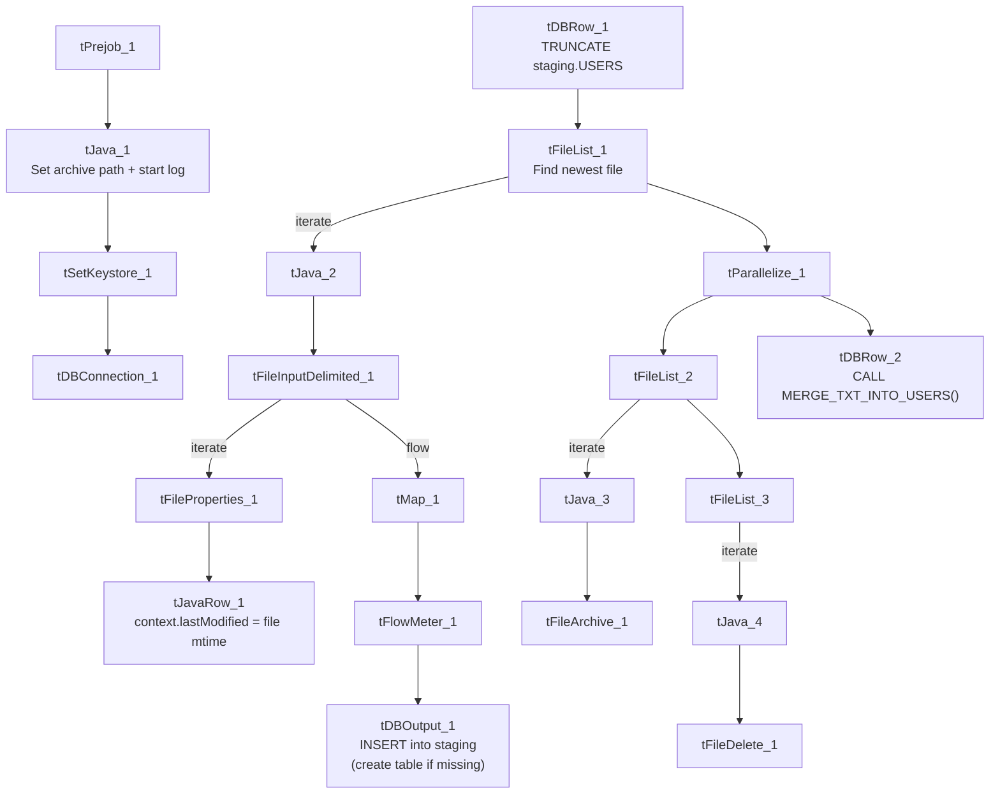

# Talend Job: Users_Text_Load

## Overview

This job loads Latitude application user-account records (login names, roles, branch/desk assignment, dialer credentials, login history) into Snowflake. It follows the standard truncate → load → merge → archive/delete pattern, with the notable difference that its Snowflake load step is configured to create the target table if it doesn't already exist, rather than assuming it's already there.

## Detail table

| Field | Value |
|---|---|
| Job name | Users_Text_Load |
| Version | 0.1 |
| Project | LATITUDE |
| Author | jmach@harriscollect.com |
| Created | 2026-08-04T09:31:34.618-0700 |
| Last Modified | 2026-08-04T11:23:02.228-0700 |

## Step-by-step data flow

1. **Set up.** `tPrejob_1` starts the job; `tJava_1` sets the dated archive path and opens the log; `tSetKeystore_1` configures the SSL keystore; `tDBConnection_1` opens the Snowflake connection.
2. **Empty the staging table.** `tDBRow_1` runs `TRUNCATE TABLE LIQUID_STAGING.USERS;`.
3. **Find the file.** `tFileList_1` lists files in `context.sourceDir` (skipping `.txt`), sorted by last-modified date. The match becomes `context.filePath` (`tJava_2`).
4. **Read and reshape.** `tFileInputDelimited_1` reads the file as pipe-delimited (`|~|`/`|$|`), ISO-8859-15 encoded, with a header row, and with `REMOVE_EMPTY_ROW` set to true (blank rows in the file are dropped rather than loaded — a setting not seen in the other jobs reviewed). It also feeds `tFileProperties_1`, whose last-modified timestamp is captured into `context.lastModified` by `tJavaRow_1`. `tMap_1` maps the file's columns (plus `LOAD_DT` and `Last_Modified`) onto the `Users` schema.
5. **Load staging.** Mapped rows pass through a row counter (`tFlowMeter_1`) into `tDBOutput_1`, which inserts them into the staging table — and, unlike most peer jobs, is configured to create the table first if it doesn't exist (`tableAction`=`CREATE_IF_NOT_EXISTS`).
6. **Merge and cleanup — in parallel.** `tParallelize_1` splits into:
   - **Merge branch:** `tDBRow_2` runs `CALL MERGE_TXT_INTO_USERS();`. No `tDie`/`tWarn` reacts to the result.
   - **Cleanup branch:** the file is listed again, archived as a `.zip` into `context.archiveDir` (`tFileArchive_1`), and deleted (`tFileDelete_1`, with `FAILON`=true).

## Settings tables

### Source: `tFileInputDelimited_1`

| Setting | Value | What it means |
|---|---|---|
| FILENAME | `context.filePath` | Reads whichever file `tFileList_1` just found. |
| FIELDSEPARATOR / ROWSEPARATOR | `\|~\|` / `\|$\|` | Standard pipe-delimited format. |
| ENCODING | ISO-8859-15 | Matches `Address_Text_Load`. |
| REMOVE_EMPTY_ROW | true | Blank lines in the source file are skipped rather than becoming empty rows — not seen set this way in the other jobs reviewed. |
| DIE_ON_ERROR | true | A parse error fails the job. |
| EXCLUDEFILEMASK (on `tFileList_1`) | `*.txt` | `.txt` files skipped. |

### Target: `tDBOutput_1`

| Setting | Value | What it means |
|---|---|---|
| Table | Users | Loads into the staging copy of this table — note mixed-case name, unlike the all-caps table names (`CARRIER`, `INSURANCE`, etc.) used elsewhere. |
| Output action | INSERT | Adds rows only. |
| Table action | CREATE_IF_NOT_EXISTS | Creates the table automatically if it's missing — every other load job reviewed sets this to `NONE`, assuming the table already exists. |

### Truncate & merge: `tDBRow_1` / `tDBRow_2`

| Setting | Value | What it means |
|---|---|---|
| Query (`tDBRow_1`) | `TRUNCATE TABLE LIQUID_STAGING.USERS;` | Empties staging before load. |
| Query (`tDBRow_2`) | `CALL MERGE_TXT_INTO_USERS();` | Folds staged rows into the permanent `USERS` table. |

### Cleanup: `tFileDelete_1`

| Setting | Value | What it means |
|---|---|---|
| FAILON | true | A failed delete fails the job — matches `DeskChangeHistory_Text_Load`, unlike jobs that tolerate a failed delete. |

## Dependencies & configuration

- **Triggers/depends on other jobs:** none found — no `tRunJob` links.
- **Context variables used:** `context.sourceDir`, `context.archiveDir`, `context.filePath`, `context.fileName`, `context.logDir`, `context.keystorePath`, plus the job-local `context.lastModified` (all `Directories_0.1`). Uses the shared Snowflake connection object, not `LEGACY_DW_0.1` directly.
- **Hardcoded values found:** `tFileInputDelimited_1.TEMP_DIR`, `tFileArchive_1.SOURCE_FILE`, `tFileDelete_1.DIRECTORY`/`PATH`, and `tSetKeystore_1.SSL_TRUSTSERVER_TRUSTSTORE` — the same fixed Windows paths seen project-wide.

## Glossary

| Component type | Plain-English meaning |
|---|---|
| `tPrejob` / `tParallelize` | Job-flow control (see `job_Address_Text_Load.md`). |
| `tFileList` | Lists files to loop over (see `job_Address_Text_Load.md`). |
| `tFileInputDelimited` | Reads a delimited text file (see `job_Address_Text_Load.md`). |
| `tFileProperties` | Reads file-system metadata like last-modified time (see `job_Address_Text_Load.md`). |
| `tJavaRow` | Custom code capturing a single value — here, the file's mtime (see `job_cmi_Hermes_Recommendations_Load.md`). |
| `tMap` | Maps/transforms columns (see `job_Address_Text_Load.md`). |
| `tFlowMeter` | Counts rows passing a point in the flow (see `job_Address_Text_Load.md`). |
| `tDBOutput` / `tSnowflakeOutput` | Writes rows to Snowflake (see `job_Address_Text_Load.md`). |
| `tDBRow` / `tSnowflakeRow` | Runs a single SQL statement (see `job_Address_Text_Load.md`). |
| `tJava` | Custom Java code blocks (see `job_Address_Text_Load.md`). |
| `tFileArchive` | Zips a file into an archive location (see `job_Address_Text_Load.md`). |
| `tFileDelete` | Deletes a file from disk (see `job_Address_Text_Load.md`). |
| `tSetKeystore` | Configures the SSL keystore for Snowflake (see `job_Address_Text_Load.md`). |

## Issues observed

- **`tDBOutput_1.tableAction` is `CREATE_IF_NOT_EXISTS`**, unlike every other load job reviewed in this batch (`NONE`). This is plausible for a table containing application user accounts that may have been added to Snowflake more recently than the older reference tables, but it also means a schema drift (e.g. a missing column) could silently auto-create a table with an unexpected structure rather than failing loudly — worth confirming this is intentional.
- **Table name is mixed-case (`Users`)** rather than the all-caps convention (`CARRIER`, `INSURANCE`, `RESULT_TXT`, etc.) used by every other table in this batch — cosmetic, but worth normalizing if these are ever scripted/compared programmatically (Snowflake is case-insensitive for unquoted identifiers, so this is unlikely to cause a functional issue, only a readability one).
- **`tFileInputDelimited_1.REMOVE_EMPTY_ROW` is true**, unlike other jobs reviewed — if the source file legitimately uses blank lines as a delimiter for something, this could silently drop data; more likely it's just tolerance for stray blank lines.
- **`tFileDelete_1.FAILON` is true**, a stricter setting than several peer jobs.
- **No merge-result checking** — no `tDie`/`tWarn` reacts to the merge outcome.
- **Hardcoded, machine-specific paths** exist alongside the parameterized ones — the same project-wide pattern.
