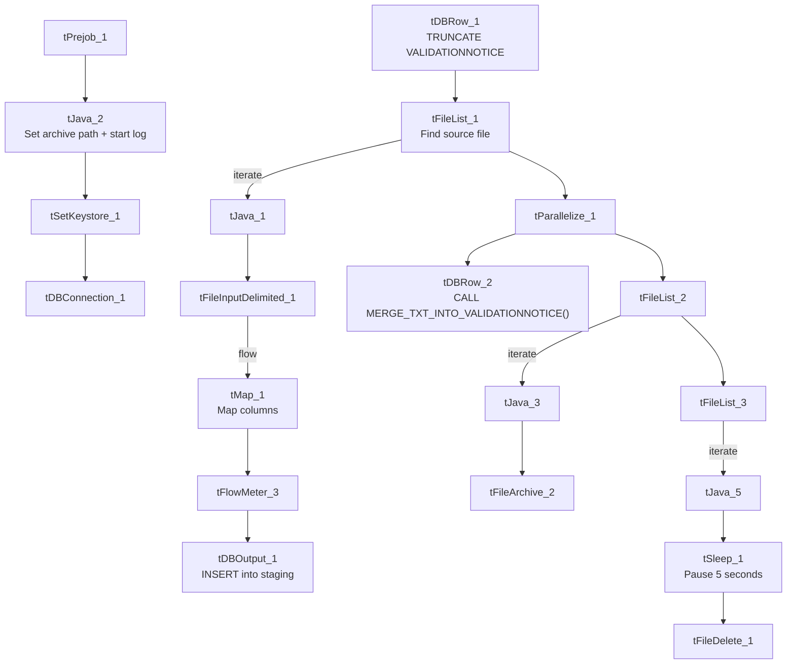

# Talend Job: ValidationNotice_Text_Load

## Overview

This job loads FDCPA validation-notice records (which notice was sent to which account, when, and whether the validation period has completed) from a shared folder into Snowflake. It follows the project's standard load pattern — truncate staging, read the file, load staging, merge into the permanent table, archive/delete the source — with one small deviation: it pauses for 5 seconds (`tSleep_1`) between finding the file for deletion and actually deleting it, something no other job in this batch does.

## Detail table

| Field | Value |
|---|---|
| Job name | ValidationNotice_Text_Load |
| Version | 0.1 |
| Project | LATITUDE |
| Author | jmach@harriscollect.com |
| Created | 2025-11-21T13:35:03.918-0800 |
| Last Modified | 2025-11-21T13:48:37.547-0800 |

## Step-by-step data flow

1. **Set up.** `tPrejob_1` starts the job; `tJava_2` appends today's date to `context.archiveDir` and opens a log file; `tSetKeystore_1` configures the SSL client keystore; `tDBConnection_1` opens the Snowflake connection.
2. **Empty the staging table.** `tDBRow_1` runs `TRUNCATE TABLE VALIDATIONNOTICE;`, then triggers the file-processing chain.
3. **Find the file.** `tFileList_1` lists files in `context.sourceDir` (skipping `.txt` files); the match becomes `context.filePath` (`tJava_1`).
4. **Read and reshape.** `tFileInputDelimited_1` reads the pipe-delimited file (`|~|`/`|$|`, US-ASCII encoding, header row, `DIE_ON_ERROR` false). `tMap_1` maps its columns (`NOTICEID`, `ACCOUNTID`, `LETTERREQUESTID`, `VALIDATIONNOTICESENTDATE`, `VALIDATIONPERIODEXPIRATION`, `VALIDATIONPERIODCOMPLETED`, `LASTUPDATED`, `STATUS`, `VALIDATIONNOTICETYPE`, `DEBTORID`) onto the target schema, adding `LOAD_DT`.
5. **Load staging.** Rows pass through `tFlowMeter_3` (row counter) into `tDBOutput_1`, which inserts them into `VALIDATIONNOTICE`.
6. **Merge and clean up — in parallel.** `tParallelize_1` splits into:
   - **Merge branch:** `tDBRow_2` runs `CALL MERGE_TXT_INTO_VALIDATIONNOTICE();`. No `tDie`/`tWarn` check follows it.
   - **Cleanup branch:** the source file is listed again and archived (`tFileArchive_2`); separately, it's listed again, and — unlike other jobs — the job pauses for 5 seconds (`tSleep_1`) right before deleting it (`tFileDelete_1`, `FAILON` false).

## Settings tables

### Source: `tFileInputDelimited_1`

| Setting | Value | What it means |
|---|---|---|
| FILENAME | `context.filePath` | Reads whichever file `tFileList_1` found. |
| FIELDSEPARATOR / ROWSEPARATOR | `\|~\|` / `\|$\|` | The project's standard pipe-delimited format. |
| ENCODING | US-ASCII | Plain ASCII. |
| DIE_ON_ERROR | false | A malformed row is rejected rather than failing the job (rejects captured via the `customer` reject schema). |

### Target: `tDBOutput_1`

| Setting | Value | What it means |
|---|---|---|
| Table | VALIDATIONNOTICE | Staging table written to. |
| Output action | INSERT | Adds rows only. |
| Table action | NONE | Structure untouched — truncation is the separate `tDBRow_1` step. |

### Merge step: `tDBRow_2`

| Setting | Value | What it means |
|---|---|---|
| Query | `CALL MERGE_TXT_INTO_VALIDATIONNOTICE();` | Snowflake stored procedure folding staged rows into the permanent table. Body not visible in this metadata. |

### Delay before delete: `tSleep_1`

| Setting | Value | What it means |
|---|---|---|
| PAUSE | 5 (seconds) | The job waits 5 seconds after locating the file for deletion before actually deleting it — unique to this job in this batch. The reason isn't recorded in the metadata; possibly a workaround for a slow file-handle release or network-share timing issue. |

## Dependencies & configuration

- **Triggers/depends on other jobs:** none — no `tRunJob` links found.
- **Context variables used:** `context.sourceDir`, `context.archiveDir`, `context.filePath`, `context.fileName`, `context.logDir`, `context.keystorePath` (all `Directories_0.1`).
- **Snowflake connection:** uses the shared connection object, not `LEGACY_DW_*` context variables directly.

## Glossary

| Component type | Plain-English meaning |
|---|---|
| `tPrejob` / `tParallelize` | Setup-before-main-flow, and concurrent branches (see `job_Address_Text_Load.md`). |
| `tFileList` | Lists files in a folder to loop over (see `job_Address_Text_Load.md`). |
| `tFileInputDelimited` | Reads a delimited text file row by row (see `job_Address_Text_Load.md`). |
| `tMap` | Maps/transforms columns (see `job_Address_Text_Load.md`). |
| `tFlowMeter` | Counts rows passing through a point in the job (see `job_Address_Text_Load.md`). |
| `tSnowflakeOutput` (`tDBOutput`) | Writes rows into Snowflake (see `job_Address_Text_Load.md`). |
| `tSnowflakeRow` (`tDBRow`) | Runs a single SQL statement — `TRUNCATE` and `CALL <procedure>` here (see `job_Address_Text_Load.md`). |
| `tJava` | Custom Java code for small tasks (see `job_Address_Text_Load.md`). |
| `tFileArchive` | Zips a file into an archive location (see `job_Address_Text_Load.md`). |
| `tFileDelete` | Deletes a file from disk (see `job_Address_Text_Load.md`). |
| `tSetKeystore` | Configures the SSL keystore for the Snowflake connection (see `job_Address_Text_Load.md`). |
| `tSleep` | Pauses the job for a fixed number of seconds before continuing — a simple, unconditional delay (not to be confused with `tWaitForFile`, which waits for a condition). |

## Issues observed

- **Unexplained 5-second sleep before file deletion** (`tSleep_1`). No other job in this batch has this step. It may be a deliberate workaround for a timing issue (e.g., giving a network file handle time to release) or leftover from troubleshooting — worth asking the team whether it's still needed.
- **Component numbering gap**: the archive component is named `tFileArchive_2` with no `tFileArchive_1` present anywhere in the job — suggesting this job was cloned from another job and an original archive component was deleted. Cosmetic only, but can be confusing when cross-referencing logs.
- **Hardcoded machine-specific paths**: `tFileInputDelimited_1.TEMP_DIR`, `tFileArchive_2.SOURCE_FILE`, `tFileDelete_1.DIRECTORY`/`PATH`, and `tSetKeystore_1.SSL_TRUSTSERVER_TRUSTSTORE` are all fixed `C:/Talend-Studio-20211109_1610-V8.0.1/...` or `C:/clientTrustStore.trustStore` paths rather than context variables — the same pattern flagged project-wide.
- **No explicit error handling on the merge step** — no `tDie`/`tWarn` reacting to whether the merge succeeded.
