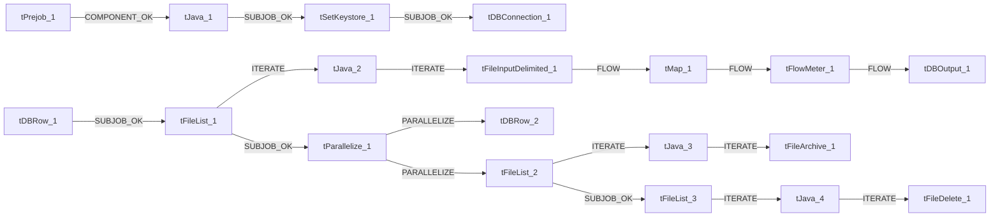

# Talend Job: Voapps_Response_Load

- **Project**: LATITUDE
- **Version**: 0.1
- **Job Type**: Standard

- **Author**: jmach@harriscollect.com
- **Created**: 2026-02-18T14:28:47.819-0800
- **Last Modified**: 2026-02-23T08:36:13.831-0800

## Components

| # | Component | Type | Key Parameters |
|---|-----------|------|----------------|
| 1 | tDBConnection_1 | `tSnowflakeConnection` | `COMPONENT_NAME`=tSnowflakeConnection, `FAMILY`=Cloud/Snowflake, `START`=false, `STARTABLE`=true, `SUBTREE_START`=true |
| 2 | tPrejob_1 | `tPrejob` | `CONNECTION_FORMAT`=row |
| 3 | tJava_1 | `tJava` | `CODE`=context.archiveDir = context.archiveDir + TalendDa, `IMPORT`=//import java.util.List;, `CONNECTION_FORMAT`=row |
| 4 | tSetKeystore_1 | `tSetKeystore` | `SET_TRUSTSTORE`=false, `SET_TRUSTSTORE_KEYSTORE`=false, `TRUSTSTORE_TYPE`=JKS, `SSL_TRUSTSERVER_TRUSTSTORE`="C:/clientTrustStore.trustStore", `KEYSTORE_TYPE`=PKCS12 |
| 5 | tFileList_1 | `tFileList` | `DIRECTORY`=context.sourceDir, `LIST_MODE`=FILES, `INCLUDSUBDIR`=false, `CASE_SENSITIVE`=YES, `ERROR`=false |
| 6 | tJava_2 | `tJava` | `CODE`=context.filePath=((String)globalMap.get("tFileList, `IMPORT`=//import java.util.List;, `CONNECTION_FORMAT`=row |
| 7 | tFileInputDelimited_1 | `tFileInputDelimited` | `COMPONENT_NAME`=tFileInputDelimited, `VERSION`=0.102 (ALPHA), `FAMILY`=File/Input, `START`=false, `STARTABLE`=true |
| 8 | tMap_1 | `tMap` | `LINK_STYLE`=AUTO, `DIE_ON_ERROR`=true, `LKUP_PARALLELIZE`=false, `LEVENSHTEIN`=0, `JACCARD`=0 |
| 9 | tFlowMeter_1 | `tFlowMeter` | `USEROWLABEL`=true, `METTERLABEL`="MyLabel", `ABSOLUTE`=Absolute, `CONNECTION_FORMAT`=row |
| 10 | tDBOutput_1 | `tSnowflakeOutput` | `CONNECTION_FORMAT`=row, `PROPERTIES`={"@id":4,"@type":"org.talend.components.snowflake. |
| 11 | tDBRow_1 | `tSnowflakeRow` | `PROPERTIES`={"@id":3,"@type":"org.talend.components.snowflake. |
| 12 | tParallelize_1 | `tParallelize` | `WAIT_FOR`=All, `SLEEPTIME`=100, `DIE_ON_ERROR`=false, `CONNECTION_FORMAT`=row |
| 13 | tDBRow_2 | `tSnowflakeRow` | `CONNECTION_FORMAT`=row, `PROPERTIES`={"@id":3,"@type":"org.talend.components.snowflake. |
| 14 | tFileList_2 | `tFileList` | `DIRECTORY`=context.sourceDir, `LIST_MODE`=FILES, `INCLUDSUBDIR`=false, `CASE_SENSITIVE`=YES, `ERROR`=false |
| 15 | tJava_3 | `tJava` | `CODE`=context.filePath = ((String)globalMap.get("tFileLi, `IMPORT`=//import java.util.List;, `CONNECTION_FORMAT`=row |
| 16 | tFileArchive_1 | `tFileArchive` | `SOURCE`=context.sourceDir, `SOURCE_FILE`="C:/Talend-Studio-20211109_1610-V8.0.1/workspace/s, `SUB_DIRECTROY`=false, `TARGET`=context.archiveDir + context.fileName+".zip", `MKDIR`=true |
| 17 | tFileList_3 | `tFileList` | `DIRECTORY`=context.sourceDir, `LIST_MODE`=FILES, `INCLUDSUBDIR`=false, `CASE_SENSITIVE`=YES, `ERROR`=false |
| 18 | tJava_4 | `tJava` | `CODE`=context.filePath = ((String)globalMap.get("tFileLi, `IMPORT`=//import java.util.List;, `CONNECTION_FORMAT`=row |
| 19 | tFileDelete_1 | `tFileDelete` | `FILENAME`=context.filePath, `DIRECTORY`="C:/Talend-Studio-20211109_1610-V8.0.1/workspace/d, `PATH`="C:/Talend-Studio-20211109_1610-V8.0.1/workspace/d, `FAILON`=false, `FOLDER`=false |

## Schemas

### tFileInputDelimited_1

| Column | Type | Nullable | Length |
|--------|------|----------|--------|
| phone_number | id_String | Yes | -1 |
| voapps_target_date | id_String | Yes | -1 |
| voapps_caller_number | id_String | Yes | -1 |
| voapps_message_id | id_String | Yes | -1 |
| voapps_zip_code | id_String | Yes | -1 |
| voapps_voice_append | id_String | Yes | -1 |
| hermes_request_id | id_String | Yes | -1 |
| file_number | id_String | Yes | -1 |
| voapps_result | id_String | Yes | -1 |
| voapps_code | id_String | Yes | -1 |
| voapps_timestamp | id_String | Yes | -1 |
| phone_number | id_String | Yes | -1 |
| voapps_target_date | id_String | Yes | -1 |
| voapps_caller_number | id_String | Yes | -1 |
| voapps_message_id | id_String | Yes | -1 |
| voapps_zip_code | id_String | Yes | -1 |
| voapps_voice_append | id_String | Yes | -1 |
| hermes_request_id | id_String | Yes | -1 |
| file_number | id_String | Yes | -1 |
| voapps_result | id_String | Yes | -1 |
| voapps_code | id_String | Yes | -1 |
| voapps_timestamp | id_String | Yes | -1 |
| errorCode | id_String | Yes | 255 |
| errorMessage | id_String | Yes | 255 |

### tMap_1

| Column | Type | Nullable | Length |
|--------|------|----------|--------|
| FILE_NAME | id_String | Yes | 16777216 |
| LOAD_DTTM | id_Date | Yes | -1 |
| PHONE_NUMBER | id_String | Yes | 16777216 |
| VOAPPS_TARGET_DATE | id_String | Yes | 16777216 |
| VOAPPS_CALLER_NUMBER | id_String | Yes | 16777216 |
| VOAPPS_MESSAGE_ID | id_String | Yes | 16777216 |
| VOAPPS_ZIP_CODE | id_String | Yes | 16777216 |
| VOAPPS_VOICE_APPEND | id_String | Yes | 16777216 |
| HERMES_REQUEST_ID | id_String | Yes | 16777216 |
| FILE_NUMBER | id_String | Yes | 16777216 |
| VOAPPS_RESULT | id_String | Yes | 16777216 |
| VOAPPS_CODE | id_String | Yes | 16777216 |
| VOAPPS_TIMESTAMP | id_String | Yes | 16777216 |

### tFlowMeter_1

| Column | Type | Nullable | Length |
|--------|------|----------|--------|
| FILE_NAME | id_String | Yes | 16777216 |
| LOAD_DTTM | id_Date | Yes | -1 |
| PHONE_NUMBER | id_String | Yes | 16777216 |
| VOAPPS_TARGET_DATE | id_String | Yes | 16777216 |
| VOAPPS_CALLER_NUMBER | id_String | Yes | 16777216 |
| VOAPPS_MESSAGE_ID | id_String | Yes | 16777216 |
| VOAPPS_ZIP_CODE | id_String | Yes | 16777216 |
| VOAPPS_VOICE_APPEND | id_String | Yes | 16777216 |
| HERMES_REQUEST_ID | id_String | Yes | 16777216 |
| FILE_NUMBER | id_String | Yes | 16777216 |
| VOAPPS_RESULT | id_String | Yes | 16777216 |
| VOAPPS_CODE | id_String | Yes | 16777216 |
| VOAPPS_TIMESTAMP | id_String | Yes | 16777216 |

### tDBOutput_1

| Column | Type | Nullable | Length |
|--------|------|----------|--------|
| FILE_NAME | id_String | Yes | 16777216 |
| LOAD_DTTM | id_Date | Yes | -1 |
| PHONE_NUMBER | id_String | Yes | 16777216 |
| VOAPPS_TARGET_DATE | id_String | Yes | 16777216 |
| VOAPPS_CALLER_NUMBER | id_String | Yes | 16777216 |
| VOAPPS_MESSAGE_ID | id_String | Yes | 16777216 |
| VOAPPS_ZIP_CODE | id_String | Yes | 16777216 |
| VOAPPS_VOICE_APPEND | id_String | Yes | 16777216 |
| HERMES_REQUEST_ID | id_String | Yes | 16777216 |
| FILE_NUMBER | id_String | Yes | 16777216 |
| VOAPPS_RESULT | id_String | Yes | 16777216 |
| VOAPPS_CODE | id_String | Yes | 16777216 |
| VOAPPS_TIMESTAMP | id_String | Yes | 16777216 |
| columnName | id_String | No | 255 |
| rowNumber | id_String | No | 255 |
| category | id_String | No | 255 |
| character | id_String | No | 255 |
| errorMessage | id_String | No | 255 |
| byteOffset | id_String | No | 255 |
| line | id_String | No | 255 |
| sqlState | id_String | No | 255 |
| code | id_String | No | 255 |

### tDBRow_1

| Column | Type | Nullable | Length |
|--------|------|----------|--------|
| errorCode | id_String | No | 255 |
| errorMessage | id_String | No | 255 |

### tDBRow_2

| Column | Type | Nullable | Length |
|--------|------|----------|--------|
| errorCode | id_String | No | 255 |
| errorMessage | id_String | No | 255 |

## Data Flow

