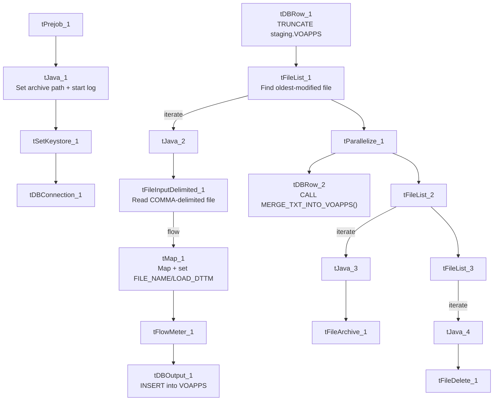

# Talend Job: Voapps_Response_Load

## Overview

This job loads response records from VoApps (a ringless-voicemail/message-drop vendor) — target date, caller number, message ID, delivery result and code, and the linked Hermes recommendation request — into Snowflake. It follows the overall truncate → load → merge → archive/delete pattern, but the source file format is a notable deviation from most other LATITUDE text-load jobs: it's a **comma-delimited** file, not the project's usual `|~|`/`|$|` pipe-delimited format.

## Detail table

| Field | Value |
|---|---|
| Job name | Voapps_Response_Load |
| Version | 0.1 |
| Project | LATITUDE |
| Author | jmach@harriscollect.com |
| Created | 2026-02-18T14:28:47.819-0800 |
| Last Modified | 2026-02-23T08:36:13.831-0800 |

## Step-by-step data flow

1. **Set up.** `tPrejob_1` triggers `tJava_1`, which appends today's date to `context.archiveDir` and opens a log file; this chains into `tSetKeystore_1` and `tDBConnection_1`.
2. **Empty the staging table.** `tDBRow_1` runs `TRUNCATE TABLE LIQUID_STAGING.VOAPPS;` (schema-qualified, and note the staging table name is simply `VOAPPS`, not `VOAPPS_TXT` like most peer jobs' `<NAME>_TXT` staging tables — see Issues observed).
3. **Find the file.** `tFileList_1` lists files in `context.sourceDir` (skipping `*.txt`), explicitly sorted by modified date, ascending — processes the oldest file first, same pattern as `Dialer_CallTracking_Load` and `ScheduledPayment_Text_Load`.
4. **Read the file.** `tFileInputDelimited_1` reads it with `FIELDSEPARATOR: ","` and `ROWSEPARATOR: "\n"` — a plain comma-separated, newline-delimited file, not the project's usual pipe format — US-ASCII encoded, with `DIE_ON_ERROR: true` (a malformed row stops the job, stricter than most peers). Columns cover phone number, VoApps target date, caller number, message ID, zip code, voice-append flag, the linked Hermes request ID, file number, and the delivery result/code/timestamp.
5. **Transform.** `tMap_1` maps these onto the `VOAPPS` schema, adding `FILE_NAME` and `LOAD_DTTM` columns (note the column is `LOAD_DTTM`, not the `LOAD_DT` used by most peer jobs — see Issues observed).
6. **Load staging.** Mapped rows pass through a row counter (`tFlowMeter_1`) into `tDBOutput_1`, inserting into `VOAPPS`.
7. **Merge and clean up — in parallel.** Once the file-list subjob completes, `tParallelize_1` splits into: `tDBRow_2` calling `CALL MERGE_TXT_INTO_VOAPPS();`, and a file-listing chain (`tFileList_2` → archive via `tFileArchive_1`; then `tFileList_3` → delete via `tFileDelete_1`).

## Settings tables

### Source: `tFileInputDelimited_1`

| Setting | Value | What it means |
|---|---|---|
| FILENAME | `context.filePath` | Reads whichever file `tFileList_1` just found. |
| FIELDSEPARATOR | `,` | Comma-separated — **not** the project's usual `\|~\|` pipe format. |
| ROWSEPARATOR | `\n` | Plain newline-delimited rows — not the project's usual `\|$\|`. |
| HEADER | 1 | First line is a header. |
| ENCODING | US-ASCII | Plain ASCII text. |
| DIE_ON_ERROR | true | A malformed row fails the job immediately. |
| DIRECTORY ordering (`tFileList_1`) | `ORDER_BY_MODIFIEDDATE=true`, ascending | Explicitly processes the oldest untouched file first. |

### Target: `tDBOutput_1`

| Setting | Value | What it means |
|---|---|---|
| Table | VOAPPS | Staging table for VoApps response records — note the name has no `_TXT` suffix, unlike most peer staging tables. |
| Output action | INSERT | Adds rows only. |

### Merge step: `tDBRow_2`

| Setting | Value | What it means |
|---|---|---|
| Query | `CALL MERGE_TXT_INTO_VOAPPS();` | Snowflake procedure that folds staged rows into the permanent `VOAPPS` table. |

## Dependencies & configuration

- **Triggers/depends on other jobs:** none found — no `tRunJob` links.
- **Context variables used:** `context.sourceDir`, `context.archiveDir`, `context.filePath`, `context.fileName`, `context.logDir`, `context.keystorePath` (all `Directories_0.1`). Uses the shared Snowflake connection object, not `LEGACY_DW_*` variables directly.
- **Related jobs:** the loaded `hermes_request_id` column suggests this job's output is consumed alongside `cmi_Hermes_Recommendations_Load` / `Hermes_Latitude_Recommendations` data, though no direct `tRunJob` link exists between them in this metadata.
- **Hardcoded values found:** `tSetKeystore_1.SSL_TRUSTSERVER_TRUSTSTORE`, `tFileInputDelimited_1.TEMP_DIR`, `tFileArchive_1.SOURCE_FILE`, and `tFileDelete_1.DIRECTORY`/`PATH` are fixed paths rather than context variables.

## Glossary

| Component type | Plain-English meaning |
|---|---|
| `tPrejob` / `tParallelize` | Setup-before-main-start, concurrent branches (see job_Address_Text_Load.md). |
| `tFileList` | Lists files for the job to loop over (see job_Address_Text_Load.md). |
| `tFileInputDelimited` | Reads a delimited text file (see job_Address_Text_Load.md). |
| `tMap` | Maps/transforms columns (see job_Address_Text_Load.md). |
| `tFlowMeter` | Counts rows passing a point, for logging (see job_Address_Text_Load.md). |
| `tDBOutput` / `tSnowflakeOutput` | Writes rows into Snowflake (see job_Address_Text_Load.md). |
| `tDBRow` / `tSnowflakeRow` | Runs a single SQL statement (see job_Address_Text_Load.md). |
| `tJava` | Custom Java code block (see job_Address_Text_Load.md). |
| `tFileArchive` | Zips a file into an archive location (see job_Address_Text_Load.md). |
| `tFileDelete` | Deletes a file from disk (see job_Address_Text_Load.md). |
| `tSetKeystore` | Configures the SSL keystore for the Snowflake connection (see job_Address_Text_Load.md). |

## Issues observed

- **Source file format deviates from the project standard.** This job reads a comma-separated, newline-delimited file, while nearly every other LATITUDE text-load job uses the custom `\|~\|`/`\|$\|` pipe format. This is presumably because VoApps (an external vendor) delivers its response file in its own native CSV export format rather than the internal Latitude export format — worth confirming with the team, since it means this job's input file cannot be treated interchangeably with other "Text_Load" source files.
- **Staging table name lacks the usual `_TXT` suffix** (`VOAPPS` rather than `VOAPPS_TXT`) — a minor naming inconsistency versus peer jobs.
- **Timestamp column is named `LOAD_DTTM`, not `LOAD_DT`** like every other job in this batch — worth confirming this isn't simply a typo/inconsistency in the target schema design, since downstream reporting that expects a consistent `LOAD_DT` column name across staging tables would need to special-case this table.
- **`DIE_ON_ERROR` is `true`** on the file reader, stricter than most peer jobs.
- **File pickup order deviates from the norm** — explicitly oldest-first rather than default unordered listing.
- **The merge procedure's own logic is outside Talend** and not visible in this metadata.
