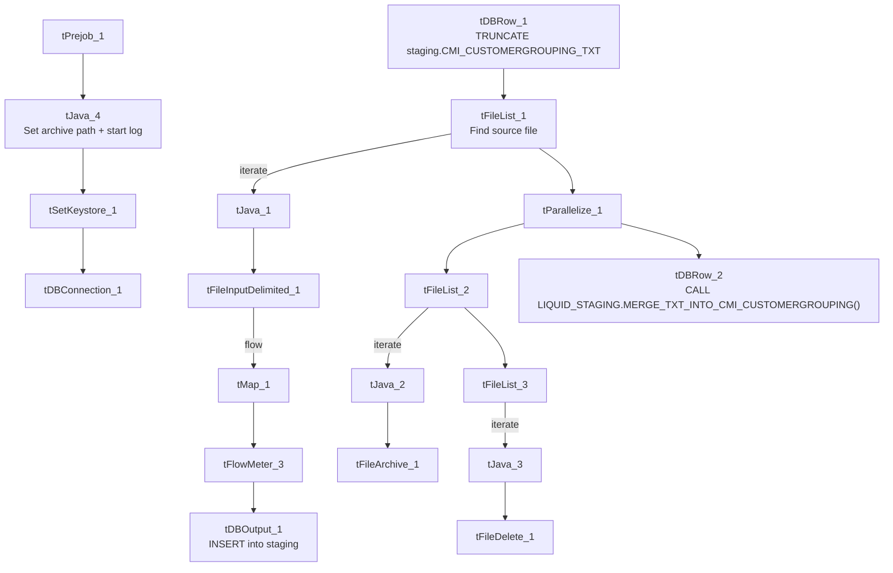

# Talend Job: cmi_CustomerGrouping_Text_Load

## Overview

This job loads a customer/account grouping reference table (`CMI_CUSTOMERGROUPING` — division, region, market, channel, department, plus "old" versions of several of those fields) into Snowflake. It follows the project's standard truncate → load → merge → archive/delete pattern with no notable deviations in flow structure.

## Detail table

| Field | Value |
|---|---|
| Job name | cmi_CustomerGrouping_Text_Load |
| Version | 0.1 |
| Project | LATITUDE |
| Author | jmach@harriscollect.com |
| Created | 2024-12-03T12:31:21.830-0800 |
| Last Modified | 2026-06-22T09:55:45.657-0700 |

## Step-by-step data flow

1. **Set up.** `tPrejob_1` → `tJava_4` (appends today's date to `context.archiveDir`, opens a log file) → `tSetKeystore_1` → `tDBConnection_1`.
2. **Empty the staging table.** `tDBRow_1` runs `TRUNCATE TABLE LIQUID_STAGING.CMI_CUSTOMERGROUPING_TXT;`.
3. **Find and read the file.** `tFileList_1` lists files in `context.sourceDir` (excluding `*.txt`, no particular sort order); `tJava_1` captures the path; `tFileInputDelimited_1` reads it (`|~|`/`|$|`, header row, US-ASCII encoding, `DIE_ON_ERROR`=true).
4. **Transform and load staging.** `tMap_1` maps the grouping/hierarchy columns (current values like `DIVISION`, `REGION`, `MARKET`, `CHANNEL`, `DEPARTMENT`, `MSO`, `ACCTGRP1`/`2`, plus prior values like `OLD_DIVISION`, `OLD_REGION`, `OLD_MARKET`, `OLD_CHANNEL`, `OLD_MSO`, `OLD_GOALSROLLUP`, `OLD_CUSTOMERNAME`) onto the staging schema, adding `LOAD_DT`. Rows pass through `tFlowMeter_3` into `tDBOutput_1`, which inserts them into staging.
5. **Merge and clean up — in parallel.** `tParallelize_1` splits into:
   - **Merge branch:** `tDBRow_2` runs `CALL LIQUID_STAGING.MERGE_TXT_INTO_CMI_CUSTOMERGROUPING();`.
   - **Cleanup branch:** `tFileList_2` → `tJava_2` (captures path + name) → `tFileArchive_1` (zips into `context.archiveDir`); and `tFileList_3` → `tJava_3` (captures path + name) → `tFileDelete_1` (deletes the source file).

## Settings tables

### Source: `tFileInputDelimited_1`

| Setting | Value | What it means |
|---|---|---|
| FILENAME | `context.filePath` | Reads whichever file `tFileList_1` just found. |
| FIELDSEPARATOR / ROWSEPARATOR | `\|~\|` / `\|$\|` | Standard project pipe-delimited format. |
| ENCODING | US-ASCII | Plain ASCII. |
| DIE_ON_ERROR | true | A malformed row fails the job immediately. |
| TEMP_DIR | `"C:/Talend-Studio-.../workspace"` | Hardcoded Windows path. |

### Target: `tDBOutput_1`

| Setting | Value | What it means |
|---|---|---|
| Table | CMI_CUSTOMERGROUPING_TXT | Loads into the staging copy of the table. |
| Output action | INSERT | Adds rows only. |
| Table action | NONE | Table structure untouched. |

### Merge step: `tDBRow_2`

| Setting | Value | What it means |
|---|---|---|
| Query | `CALL LIQUID_STAGING.MERGE_TXT_INTO_CMI_CUSTOMERGROUPING();` | Runs the Snowflake merge procedure, explicitly schema-qualified (like `Bankruptcy_Text_Load` and `Livevox_Daily_Load`) rather than unqualified as most peer jobs call it. |

## Dependencies & configuration

- **Triggers/depends on other jobs:** none found — no `tRunJob` links.
- **Context variables used:** `context.sourceDir`, `context.archiveDir`, `context.filePath`, `context.fileName`, `context.logDir`, `context.keystorePath` (all `Directories_0.1`). Uses the shared Snowflake connection object, not `LEGACY_DW_0.1` variables directly.

## Glossary

| Component type | Plain-English meaning |
|---|---|
| `tPrejob` / `tParallelize` | Job-flow control (see job_Address_Text_Load.md). |
| `tSnowflakeConnection` (`tDBConnection`) | Opens the shared Snowflake connection (see job_Bankruptcy_Text_Load.md). |
| `tFileList` | Lists files for iteration (see job_Address_Text_Load.md). |
| `tFileInputDelimited` | Reads a delimited text file (see job_Address_Text_Load.md). |
| `tMap` | Maps/transforms columns (see job_Address_Text_Load.md). |
| `tFlowMeter` | Counts rows passing through (see job_Address_Text_Load.md). |
| `tDBOutput` / `tSnowflakeOutput` | Writes rows to Snowflake (see job_Address_Text_Load.md). |
| `tDBRow` / `tSnowflakeRow` | Runs a single SQL statement (see job_Address_Text_Load.md). |
| `tJava` | Custom Java code block (see job_Address_Text_Load.md). |
| `tFileArchive` | Zips a file into an archive location (see job_Address_Text_Load.md). |
| `tFileDelete` | Deletes a file (see job_Address_Text_Load.md). |
| `tSetKeystore` | Configures the SSL keystore (see job_Address_Text_Load.md). |

## Issues observed

- **Merge procedure call is schema-qualified (`LIQUID_STAGING.MERGE_TXT_INTO_CMI_CUSTOMERGROUPING`)**, while most peer jobs (`HH_Violation_Text_Load`, `Services_LexisNexis_Batch_A2_Text_Load`, `cmi_dialer_SubscriberStatusHistory_Text_Load`) call the equivalent procedure unqualified — a naming/style inconsistency across the project, not necessarily a functional issue.
- **No `tDie`/`tWarn` check on the merge result** — same as most peer jobs.
- **Hardcoded, machine-specific paths** on `tFileInputDelimited_1.TEMP_DIR`, `tFileArchive_1.SOURCE_FILE`, `tFileDelete_1.DIRECTORY`/`PATH`, and `tSetKeystore_1.SSL_TRUSTSERVER_TRUSTSTORE` — the same project-wide pattern seen elsewhere.
