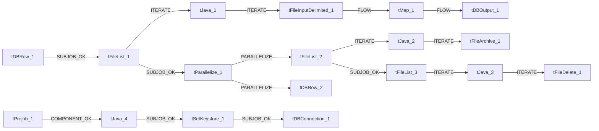

# Talend Job: cmi_Customer_Ext_Text_Load

- **Project**: LATITUDE
- **Version**: 0.1
- **Job Type**: Standard

- **Author**: jmach@harriscollect.com
- **Created**: 2025-03-18T15:04:42.721-0700
- **Last Modified**: 2026-07-30T10:14:48.462-0700

## Components

| # | Component | Type | Key Parameters |
|---|-----------|------|----------------|
| 1 | tDBConnection_1 | `tSnowflakeConnection` | `CONNECTION_FORMAT`=row, `PROPERTIES`={"@id":2,"@type":"org.talend.components.snowflake. |
| 2 | tFileList_1 | `tFileList` | `DIRECTORY`=context.sourceDir, `LIST_MODE`=FILES, `INCLUDSUBDIR`=false, `CASE_SENSITIVE`=NO, `ERROR`=false |
| 3 | tJava_1 | `tJava` | `CODE`=context.filePath=((String)globalMap.get("tFileList, `IMPORT`=//import java.util.List;, `CONNECTION_FORMAT`=row |
| 4 | tFileInputDelimited_1 | `tFileInputDelimited` | `USE_EXISTING_DYNAMIC`=false, `FILENAMETEXT`="When the input source is a stream or a zip file,f, `FILENAME`=context.filePath, `CSV_OPTION`=false, `ROWSEPARATOR`="|$|" |
| 5 | tMap_1 | `tMap` | `LINK_STYLE`=AUTO, `DIE_ON_ERROR`=true, `LKUP_PARALLELIZE`=false, `LEVENSHTEIN`=0, `JACCARD`=0 |
| 6 | tDBOutput_1 | `tSnowflakeOutput` | `CONNECTION_FORMAT`=row, `PROPERTIES`={"@id":4,"@type":"org.talend.components.snowflake. |
| 7 | tDBRow_1 | `tSnowflakeRow` | `CONNECTION_FORMAT`=row, `PROPERTIES`={"@id":3,"@type":"org.talend.components.snowflake. |
| 8 | tPrejob_1 | `tPrejob` | `CONNECTION_FORMAT`=row |
| 9 | tFileList_2 | `tFileList` | `DIRECTORY`=context.sourceDir, `LIST_MODE`=FILES, `INCLUDSUBDIR`=false, `CASE_SENSITIVE`=NO, `ERROR`=false |
| 10 | tJava_2 | `tJava` | `CODE`=context.filePath = ((String)globalMap.get("tFileLi, `IMPORT`=//import java.util.List;, `CONNECTION_FORMAT`=row |
| 11 | tFileArchive_1 | `tFileArchive` | `SOURCE`=context.sourceDir, `SOURCE_FILE`="C:/Talend-Studio-20211109_1610-V8.0.1/workspace/s, `SUB_DIRECTROY`=false, `TARGET`=context.archiveDir + context.fileName+".zip", `MKDIR`=true |
| 12 | tFileList_3 | `tFileList` | `DIRECTORY`=context.sourceDir, `LIST_MODE`=FILES, `INCLUDSUBDIR`=false, `CASE_SENSITIVE`=NO, `ERROR`=false |
| 13 | tJava_3 | `tJava` | `CODE`=context.filePath = ((String)globalMap.get("tFileLi, `IMPORT`=//import java.util.List;, `CONNECTION_FORMAT`=row |
| 14 | tFileDelete_1 | `tFileDelete` | `FILENAME`=context.filePath, `DIRECTORY`="C:/Talend-Studio-20211109_1610-V8.0.1/workspace/d, `PATH`="C:/Talend-Studio-20211109_1610-V8.0.1/workspace/d, `FAILON`=false, `FOLDER`=false |
| 15 | tParallelize_1 | `tParallelize` | `WAIT_FOR`=All, `SLEEPTIME`=100, `DIE_ON_ERROR`=false, `CONNECTION_FORMAT`=row |
| 16 | tJava_4 | `tJava` | `CODE`=context.archiveDir = context.archiveDir + TalendDa, `IMPORT`=//import java.util.List;, `CONNECTION_FORMAT`=row |
| 17 | tDBRow_2 | `tSnowflakeRow` | `CONNECTION_FORMAT`=row, `PROPERTIES`={"@id":3,"@type":"org.talend.components.snowflake. |
| 18 | tSetKeystore_1 | `tSetKeystore` | `SET_TRUSTSTORE`=false, `SET_TRUSTSTORE_KEYSTORE`=false, `TRUSTSTORE_TYPE`=JKS, `SSL_TRUSTSERVER_TRUSTSTORE`="C:/clientTrustStore.trustStore", `KEYSTORE_TYPE`=PKCS12 |

## Schemas

### tFileInputDelimited_1

| Column | Type | Nullable | Length |
|--------|------|----------|--------|
| CUSTOMER | id_String | Yes | 7 |
| LetterPhone | id_String | Yes | 10 |
| EmailPhone | id_String | Yes | 10 |
| SMSPhone | id_String | Yes | 10 |
| IsDebtBuyer | id_Integer | Yes | -1 |
| WorkCodebtors | id_Integer | Yes | -1 |
| MinimumScoreForLetter | id_Integer | Yes | -1 |
| CombiningType | id_String | Yes | 2 |
| LetterCombiningMiscExtraTitle | id_String | Yes | 30 |
| LetterAccountNumberMiscExtraTitle | id_String | Yes | 50 |
| LetterAccountNumberMasking | id_Integer | Yes | -1 |
| LetterSettlementPercentage | id_Integer | Yes | -1 |
| LetterPhone_CoDebtor | id_String | Yes | 10 |
| EmailPhone_CoDebtor | id_String | Yes | 10 |
| SMSPhone_CoDebtor | id_String | Yes | 10 |
| ExcludeEquipmentBalance | id_Integer | Yes | -1 |
| NeedPendingBankruptcyStatus | id_Integer | Yes | -1 |
| RemitOverpayments | id_Integer | Yes | -1 |
| HouseDesk | id_String | Yes | 10 |
| ExcludeEquipmentBalance_Itemization | id_Integer | Yes | -1 |
| EMAILALLOWEDFLAG | id_Integer | Yes | -1 |
| SMSALLOWEDFLAG | id_Integer | Yes | -1 |
| EMAILMINBAL | id_String | Yes | 20 |
| SMSMINBAL | id_String | Yes | 20 |
| FDCPAFLAG | id_Integer | Yes | -1 |
| CAGOODBYEFLAG | id_Integer | Yes | -1 |
| LEGALFIRMFLAG | id_Integer | Yes | -1 |
| PMTSITEURL | id_String | Yes | 100 |
| FLOATBOTID | id_String | Yes | 50 |
| CUSTOMER | id_String | Yes | 7 |
| LetterPhone | id_String | Yes | 10 |
| EmailPhone | id_String | Yes | 10 |
| SMSPhone | id_String | Yes | 10 |
| IsDebtBuyer | id_Integer | Yes | -1 |
| WorkCodebtors | id_Integer | Yes | -1 |
| MinimumScoreForLetter | id_Integer | Yes | -1 |
| CombiningType | id_String | Yes | 2 |
| LetterCombiningMiscExtraTitle | id_String | Yes | 30 |
| LetterAccountNumberMiscExtraTitle | id_String | Yes | 50 |
| LetterAccountNumberMasking | id_Integer | Yes | -1 |
| LetterSettlementPercentage | id_Integer | Yes | -1 |
| LetterPhone_CoDebtor | id_String | Yes | 10 |
| EmailPhone_CoDebtor | id_String | Yes | 10 |
| SMSPhone_CoDebtor | id_String | Yes | 10 |
| ExcludeEquipmentBalance | id_Integer | Yes | -1 |
| NeedPendingBankruptcyStatus | id_Integer | Yes | -1 |
| RemitOverpayments | id_Integer | Yes | -1 |
| HouseDesk | id_String | Yes | 10 |
| ExcludeEquipmentBalance_Itemization | id_Integer | Yes | -1 |
| EMAILALLOWEDFLAG | id_Integer | Yes | -1 |
| SMSALLOWEDFLAG | id_Integer | Yes | -1 |
| EMAILMINBAL | id_String | Yes | 20 |
| SMSMINBAL | id_String | Yes | 20 |
| FDCPAFLAG | id_Integer | Yes | -1 |
| CAGOODBYEFLAG | id_Integer | Yes | -1 |
| LEGALFIRMFLAG | id_Integer | Yes | -1 |
| PMTSITEURL | id_String | Yes | 100 |
| FLOATBOTID | id_String | Yes | 50 |
| errorCode | id_String | Yes | 255 |
| errorMessage | id_String | Yes | 255 |

### tMap_1

| Column | Type | Nullable | Length |
|--------|------|----------|--------|
| LOAD_DT | id_Date | Yes | -1 |
| CUSTOMER | id_String | No | 7 |
| LETTERPHONE | id_String | Yes | 10 |
| EMAILPHONE | id_String | Yes | 10 |
| SMSPHONE | id_String | Yes | 10 |
| ISDEBTBUYER | id_Integer | Yes | 38 |
| WORKCODEBTORS | id_Integer | Yes | 38 |
| MINIMUMSCOREFORLETTER | id_Integer | Yes | 38 |
| COMBININGTYPE | id_String | Yes | 2 |
| LETTERCOMBININGMISCEXTRATITLE | id_String | Yes | 30 |
| LETTERACCOUNTNUMBERMISCEXTRATITLE | id_String | Yes | 50 |
| LETTERACCOUNTNUMBERMASKING | id_Integer | Yes | 38 |
| LETTERSETTLEMENTPERCENTAGE | id_Integer | Yes | 38 |
| LETTERPHONE_CODEBTOR | id_String | Yes | 10 |
| EMAILPHONE_CODEBTOR | id_String | Yes | 10 |
| SMSPHONE_CODEBTOR | id_String | Yes | 10 |
| EXCLUDEEQUIPMENTBALANCE | id_Integer | Yes | 38 |
| NEEDPENDINGBANKRUPTCYSTATUS | id_Integer | Yes | 38 |
| REMITOVERPAYMENTS | id_Integer | Yes | 38 |
| HOUSEDESK | id_String | Yes | 10 |
| EXCLUDEEQUIPMENTBALANCE_ITEMIZATION | id_Integer | Yes | 38 |
| EMAILALLOWEDFLAG | id_Integer | Yes | 38 |
| SMSALLOWEDFLAG | id_Integer | Yes | 38 |
| EMAILMINBAL | id_String | Yes | 20 |
| SMSMINBAL | id_String | Yes | 20 |
| FDCPAFLAG | id_Integer | Yes | 38 |
| CAGOODBYEFLAG | id_Integer | Yes | 38 |
| LEGALFIRMFLAG | id_Integer | Yes | 38 |
| PMTSITEURL | id_String | Yes | 100 |
| FLOATBOTID | id_String | Yes | 50 |

### tDBOutput_1

| Column | Type | Nullable | Length |
|--------|------|----------|--------|
| LOAD_DT | id_Date | Yes | -1 |
| CUSTOMER | id_String | No | 7 |
| LETTERPHONE | id_String | Yes | 10 |
| EMAILPHONE | id_String | Yes | 10 |
| SMSPHONE | id_String | Yes | 10 |
| ISDEBTBUYER | id_Integer | Yes | 38 |
| WORKCODEBTORS | id_Integer | Yes | 38 |
| MINIMUMSCOREFORLETTER | id_Integer | Yes | 38 |
| COMBININGTYPE | id_String | Yes | 2 |
| LETTERCOMBININGMISCEXTRATITLE | id_String | Yes | 30 |
| LETTERACCOUNTNUMBERMISCEXTRATITLE | id_String | Yes | 50 |
| LETTERACCOUNTNUMBERMASKING | id_Integer | Yes | 38 |
| LETTERSETTLEMENTPERCENTAGE | id_Integer | Yes | 38 |
| LETTERPHONE_CODEBTOR | id_String | Yes | 10 |
| EMAILPHONE_CODEBTOR | id_String | Yes | 10 |
| SMSPHONE_CODEBTOR | id_String | Yes | 10 |
| EXCLUDEEQUIPMENTBALANCE | id_Integer | Yes | 38 |
| NEEDPENDINGBANKRUPTCYSTATUS | id_Integer | Yes | 38 |
| REMITOVERPAYMENTS | id_Integer | Yes | 38 |
| HOUSEDESK | id_String | Yes | 10 |
| EXCLUDEEQUIPMENTBALANCE_ITEMIZATION | id_Integer | Yes | 38 |
| EMAILALLOWEDFLAG | id_Integer | Yes | 38 |
| SMSALLOWEDFLAG | id_Integer | Yes | 38 |
| EMAILMINBAL | id_String | Yes | 20 |
| SMSMINBAL | id_String | Yes | 20 |
| FDCPAFLAG | id_Integer | Yes | 38 |
| CAGOODBYEFLAG | id_Integer | Yes | 38 |
| LEGALFIRMFLAG | id_Integer | Yes | 38 |
| PMTSITEURL | id_String | Yes | 100 |
| FLOATBOTID | id_String | Yes | 50 |
| columnName | id_String | No | 255 |
| rowNumber | id_String | No | 255 |
| category | id_String | No | 255 |
| character | id_String | No | 255 |
| errorMessage | id_String | No | 255 |
| byteOffset | id_String | No | 255 |
| line | id_String | No | 255 |
| sqlState | id_String | No | 255 |
| code | id_String | No | 255 |

### tDBRow_1

| Column | Type | Nullable | Length |
|--------|------|----------|--------|
| errorCode | id_String | No | 255 |
| errorMessage | id_String | No | 255 |

### tDBRow_2

| Column | Type | Nullable | Length |
|--------|------|----------|--------|
| errorCode | id_String | No | 255 |
| errorMessage | id_String | No | 255 |

## Data Flow

