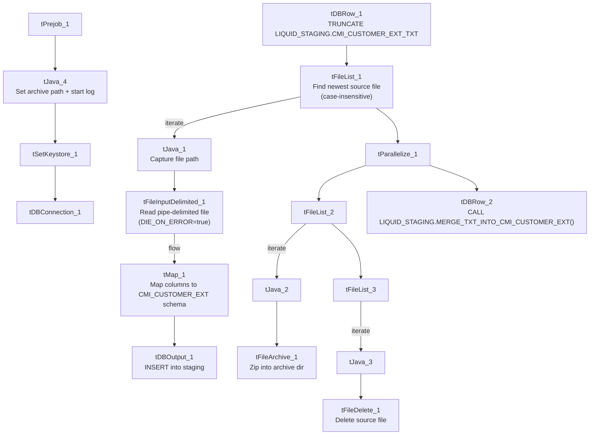

# Talend Job: cmi_Customer_Ext_Text_Load

## Overview

This job follows the project's standard text-load pattern: it watches a shared folder for a new "customer extension" configuration file (per-client rules like letter phone numbers, minimum score for a letter, email/SMS eligibility flags, FDCPA/legal-firm flags, payment-site URL, etc.), loads it into a Snowflake staging table, merges the staged rows into the permanent table via a stored procedure, and then archives and deletes the source file. It has no `tDie`/`tWarn` reacting to the merge outcome.

## Detail table

| Field | Value |
|---|---|
| Job name | cmi_Customer_Ext_Text_Load |
| Version | 0.1 |
| Project | LATITUDE |
| Author | jmach@harriscollect.com |
| Created | 2025-03-18T15:04:42.721-0700 |
| Last Modified | 2026-07-30T10:14:48.462-0700 |

## Step-by-step data flow

1. **Set up.** `tPrejob_1` triggers `tJava_4`, which appends today's date to `context.archiveDir` and starts a log file, then hands off to `tSetKeystore_1` and `tDBConnection_1` (Snowflake connect).
2. **Empty the staging table.** `tDBRow_1` runs `TRUNCATE TABLE LIQUID_STAGING.CMI_CUSTOMER_EXT_TXT;` (schema-qualified, unlike several peer jobs' unqualified truncates).
3. **Find the file.** `tFileList_1` lists files in `context.sourceDir` (note: `CASE_SENSITIVE = NO` here, unlike most peer jobs' `tFileList` components, which use `YES`), skipping `.txt` files. `tJava_1` captures the match into `context.filePath`.
4. **Read and reshape.** `tFileInputDelimited_1` reads the file as pipe-delimited (`|~|`/`|$|`), US-ASCII-encoded, with a header row. `DIE_ON_ERROR = true` here — a malformed row fails the job immediately rather than routing to a reject flow. `tMap_1` maps ~29 customer-configuration columns onto the target schema, adding `LOAD_DT`.
5. **Load staging.** Mapped rows flow into `tDBOutput_1`, which inserts them into `CMI_CUSTOMER_EXT_TXT` (`INSERT`, no table-structure changes).
6. **Merge into the permanent table — in parallel with cleanup.** `tParallelize_1` splits into:
   - **Merge branch:** `tDBRow_2` runs `CALL LIQUID_STAGING.MERGE_TXT_INTO_CMI_CUSTOMER_EXT();` (also schema-qualified).
   - **Cleanup branch:** the source file is re-listed, archived (`tFileArchive_1`, zipped into `context.archiveDir/<filename>.zip`), and — via a separate file-list/capture — deleted (`tFileDelete_1`).

## Settings tables

### Source: `tFileInputDelimited_1`

| Setting | Value | What it means |
|---|---|---|
| FILENAME | `context.filePath` | Reads whichever file `tFileList_1` found. |
| FIELDSEPARATOR / ROWSEPARATOR | `\|~\|` / `\|$\|` | Standard custom-delimited format. |
| HEADER | 1 | First line is a header row. |
| ENCODING | US-ASCII | Not ISO-8859-15. |
| DIE_ON_ERROR | true | A malformed row fails the whole job rather than routing to a reject output — differs from `PDC_Text_Load`, `Promises_Text_Load`, and `StatusHistory_Text_Load`, which all set this to `false`. |
| CASE_SENSITIVE (on `tFileList_1`) | NO | File-name matching in the source folder is case-insensitive here, unlike most peer jobs' file lists. |

### Target: `tDBOutput_1`

| Setting | Value | What it means |
|---|---|---|
| Table | CMI_CUSTOMER_EXT_TXT | Staging table for the per-client customer-extension configuration data. |
| Output action | INSERT | Adds rows only. |
| Table action | NONE | No structural changes; truncation handled by `tDBRow_1`. |

### Merge step: `tDBRow_2`

| Setting | Value | What it means |
|---|---|---|
| Query | `CALL LIQUID_STAGING.MERGE_TXT_INTO_CMI_CUSTOMER_EXT();` | Snowflake stored procedure that folds staged rows into the permanent table; logic is outside Talend. |

## Dependencies & configuration

- **Triggers/depends on other jobs:** none — no `tRunJob` links found.
- **Context variables used:** `context.sourceDir`, `context.archiveDir`, `context.filePath`, `context.fileName`, `context.logDir`, `context.keystorePath` (all `Directories_0.1`). It uses the shared Snowflake connection object (`tDBConnection_1`), not `LEGACY_DW_0.1` variables — no `LEGACY_DW_` entries appear in `context_vars_referenced`.
- **Hardcoded values found:** `tFileInputDelimited_1.TEMP_DIR`, `tFileArchive_1.SOURCE_FILE`, `tFileDelete_1.DIRECTORY`/`PATH`, `tSetKeystore_1.SSL_TRUSTSERVER_TRUSTSTORE` — the same `C:/Talend-Studio-20211109_1610-V8.0.1/...` machine-specific paths seen in most jobs.

## Glossary

| Component type | Plain-English meaning |
|---|---|
| `tPrejob` / `tParallelize` | Job-flow control (see `job_Address_Text_Load.md`). |
| `tFileList` | Lists files in a folder to loop over (see `job_Address_Text_Load.md`). |
| `tFileInputDelimited` | Reads a delimited text file row by row (see `job_Address_Text_Load.md`). |
| `tMap` | Maps/transforms input columns to output columns (see `job_Address_Text_Load.md`). |
| `tDBOutput` / `tSnowflakeOutput` | Writes rows into a Snowflake table (see `job_Address_Text_Load.md`). |
| `tDBRow` / `tSnowflakeRow` | Runs a single SQL statement against Snowflake (see `job_Address_Text_Load.md`). |
| `tJava` / `tJavaRow` | Custom Java code snippets (see `job_Address_Text_Load.md`). |
| `tFileArchive` | Zips a file into an archive location (see `job_Address_Text_Load.md`). |
| `tFileDelete` | Deletes a file from disk (see `job_Address_Text_Load.md`). |
| `tSetKeystore` | Configures the SSL keystore for the Snowflake connection (see `job_Address_Text_Load.md`). |

## Issues observed

- **`tFileList_1`/`tFileList_2`/`tFileList_3` are case-insensitive (`CASE_SENSITIVE = NO`)** here, unlike most peer text-load jobs which set this to `YES`. This means a file named e.g. `Customer_Ext.TXT` would also be excluded by the `*.txt` exclusion mask here, where a case-sensitive job might not exclude it — worth confirming this difference is intentional.
- **`DIE_ON_ERROR = true`** on the file reader means a single malformed row aborts the entire load, unlike `PDC_Text_Load`/`Promises_Text_Load`/`StatusHistory_Text_Load`, which route bad rows to a reject flow instead. Given this file drives per-client behavior flags (FDCPA compliance, legal-firm status, email/SMS eligibility), failing loudly on bad data may be a deliberate safety choice rather than an oversight — but it's inconsistent with peer jobs' handling.
- **Both the `TRUNCATE` and merge `CALL` are schema-qualified** (`LIQUID_STAGING.CMI_CUSTOMER_EXT_TXT` / `LIQUID_STAGING.MERGE_TXT_INTO_CMI_CUSTOMER_EXT()`), unlike `CBR_Metro2_Accounts_Table_Text_Load`, `PDC_Text_Load`, `Promises_Text_Load`, and `StatusHistory_Text_Load`, which all omit the schema prefix. Functionally likely equivalent, but the inconsistency suggests these jobs weren't all built from a single, strictly enforced template.
- **File encoding is US-ASCII**, not ISO-8859-15 like `Address_Text_Load`.
- **No `tDie`/`tWarn` on the merge step** — a failed merge surfaces only as a generic Talend error.
- **Standard hardcoded machine-specific paths** present across `tFileInputDelimited_1`, `tFileArchive_1`, `tFileDelete_1`, and `tSetKeystore_1` — the same project-wide pattern.
