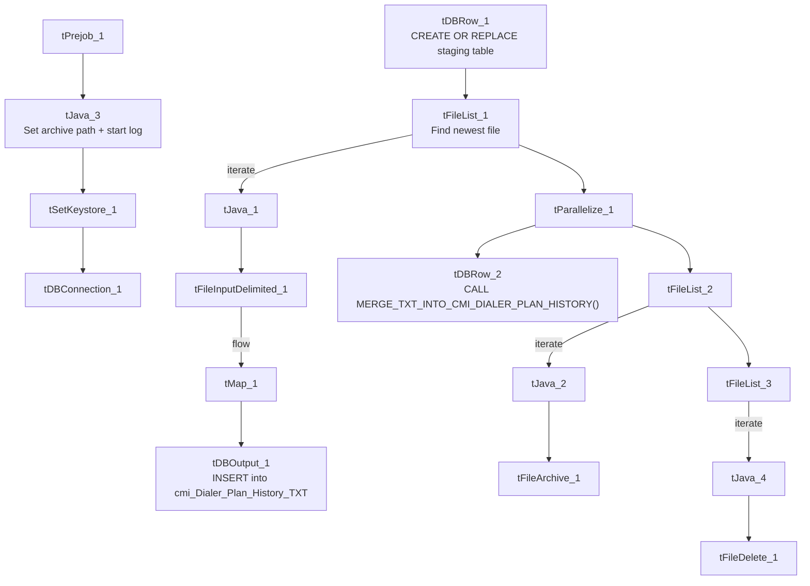

# Talend Job: cmi_Dialer_Plan_History_Table_Text_Load

## Overview

This job loads dialer "plan history" records (which dialer call list an account was on, and the activity date) into Snowflake. It follows the same overall shape as the other text-load jobs — read a file, load a staging table, merge into a permanent table, archive/delete the source — but instead of truncating an existing staging table, it drops and rebuilds the staging table from scratch on every run.

## Detail table

| Field | Value |
|---|---|
| Job name | cmi_Dialer_Plan_History_Table_Text_Load |
| Version | 0.1 |
| Project | LATITUDE |
| Author | jmach@harriscollect.com |
| Created | 2024-10-31T09:10:12.456-0700 |
| Last Modified | 2025-09-29T10:41:21.603-0700 |

## Step-by-step data flow

1. **Set up.** `tPrejob_1` starts the job; `tJava_3` sets the dated archive path and opens the log; `tSetKeystore_1` configures the SSL keystore; `tDBConnection_1` opens the Snowflake connection.
2. **Rebuild the staging table.** `tDBRow_1` runs `create or replace TABLE CMI_DIALER_PLAN_HISTORY_TXT (LOAD_DT DATE, ACCOUNTID NUMBER(38,0), DIALERLISTNAME VARCHAR(16777216), ACTIVITYDATE DATE);` — this drops and recreates the table with a fixed structure on every run, rather than truncating an existing table (see Issues observed).
3. **Find the file.** `tFileList_1` lists files in `context.sourceDir` (skipping `.txt`), sorted by last-modified date. The match becomes `context.filePath` (`tJava_1`).
4. **Read and reshape.** `tFileInputDelimited_1` reads the file as pipe-delimited (`|~|`/`|$|`), US-ASCII encoded, with a header row. `tMap_1` maps the file's three columns (`AccountID`, `DialerListName`, `ActivityDate`) plus `LOAD_DT` onto the staging schema.
5. **Load staging.** The mapped rows flow directly into `tDBOutput_1` (no row-counter component here), which inserts them into `cmi_Dialer_Plan_History_TXT`.
6. **Merge and cleanup — in parallel.** `tParallelize_1` splits into:
   - **Merge branch:** `tDBRow_2` runs `CALL MERGE_TXT_INTO_CMI_DIALER_PLAN_HISTORY();`. No `tDie`/`tWarn` reacts to the result.
   - **Cleanup branch:** the file is listed again, archived as a `.zip` into `context.archiveDir` (`tFileArchive_1`), and deleted (`tFileDelete_1`).

## Settings tables

### Source: `tFileInputDelimited_1`

| Setting | Value | What it means |
|---|---|---|
| FILENAME | `context.filePath` | Reads whichever file `tFileList_1` just found. |
| FIELDSEPARATOR / ROWSEPARATOR | `\|~\|` / `\|$\|` | Standard pipe-delimited format. |
| ENCODING | US-ASCII | Matches `Carrier_Text_Load`/`Insurance_Text_Load`. |
| SCHEMA_REJECT | repository schema `"customer"` | Mismatched — same copy-paste artifact seen in `Carrier_Text_Load`, `Result_Table_Text_Load`, and `cmi_renkim_ReturnHistory_Text_Load`. |
| EXCLUDEFILEMASK (on `tFileList_1`) | `*.txt` | `.txt` files skipped. |

### Target: `tDBOutput_1`

| Setting | Value | What it means |
|---|---|---|
| Table | cmi_Dialer_Plan_History_TXT | Loads rows into this table. |
| Output action | INSERT | Adds rows only. |
| Table action | NONE | No table create/drop/truncate at this step — that's handled separately, and unusually, by `tDBRow_1` (see below). |

### "Truncate" step: `tDBRow_1`

| Setting | Value | What it means |
|---|---|---|
| Query | `create or replace TABLE CMI_DIALER_PLAN_HISTORY_TXT (LOAD_DT DATE, ACCOUNTID NUMBER(38,0), DIALERLISTNAME VARCHAR(16777216), ACTIVITYDATE DATE);` | Drops and recreates the staging table with a hardcoded 4-column structure, instead of a `TRUNCATE TABLE` used by every other load job reviewed. No schema qualifier is present (relies on the connection's default schema). |

### Merge step: `tDBRow_2`

| Setting | Value | What it means |
|---|---|---|
| Query | `CALL MERGE_TXT_INTO_CMI_DIALER_PLAN_HISTORY();` | Folds staged rows into the permanent table. Note the procedure name drops "_Table" from the job name and "_TXT" from the staging table name. |

## Dependencies & configuration

- **Triggers/depends on other jobs:** none found — no `tRunJob` links.
- **Context variables used:** `context.sourceDir`, `context.archiveDir`, `context.filePath`, `context.fileName`, `context.logDir`, `context.keystorePath` (all `Directories_0.1`). Uses the shared Snowflake connection object, not `LEGACY_DW_0.1` directly.
- **Hardcoded values found:** `tFileInputDelimited_1.TEMP_DIR`, `tFileArchive_1.SOURCE_FILE`, `tFileDelete_1.DIRECTORY`/`PATH`, and `tSetKeystore_1.SSL_TRUSTSERVER_TRUSTSTORE` — the same fixed Windows paths seen project-wide. In addition, the staging table's column definitions are hardcoded directly into the `tDBRow_1` SQL text (see Issues observed).

## Glossary

| Component type | Plain-English meaning |
|---|---|
| `tPrejob` / `tParallelize` | Job-flow control (see `job_Address_Text_Load.md`). |
| `tFileList` | Lists files to loop over (see `job_Address_Text_Load.md`). |
| `tFileInputDelimited` | Reads a delimited text file (see `job_Address_Text_Load.md`). |
| `tMap` | Maps/transforms columns (see `job_Address_Text_Load.md`). |
| `tDBOutput` / `tSnowflakeOutput` | Writes rows to Snowflake (see `job_Address_Text_Load.md`). |
| `tDBRow` / `tSnowflakeRow` | Runs a single SQL statement (see `job_Address_Text_Load.md`) — here, `CREATE OR REPLACE TABLE` and `CALL <procedure>`. |
| `tJava` | Custom Java code blocks (see `job_Address_Text_Load.md`). |
| `tFileArchive` | Zips a file into an archive location (see `job_Address_Text_Load.md`). |
| `tFileDelete` | Deletes a file from disk (see `job_Address_Text_Load.md`). |
| `tSetKeystore` | Configures the SSL keystore for Snowflake (see `job_Address_Text_Load.md`). |

## Issues observed

- **This is the only job in this batch that drops and rebuilds its staging table** (`CREATE OR REPLACE TABLE ...`) rather than truncating an existing one. Functionally this achieves the same "start empty" result, but it means the table's column definitions (`LOAD_DT DATE, ACCOUNTID NUMBER(38,0), DIALERLISTNAME VARCHAR(16777216), ACTIVITYDATE DATE`) live only in this SQL text rather than in a persistent Snowflake DDL history — if the table's structure ever needs to change, it has to change here and stay in sync with whatever the merge procedure and the mapped schema expect.
- **No schema qualifier** on the `CREATE OR REPLACE TABLE` statement, so it depends on the Snowflake connection's default/current schema rather than explicitly targeting `LIQUID_STAGING` — same category of concern as `Result_Table_Text_Load`'s unqualified `TRUNCATE`.
- **Reject-schema mismatch** ("customer" reject schema) — same copy-paste artifact flagged in `Carrier_Text_Load`.
- **No row-counter (`tFlowMeter`) between the map and the load**, unlike several peer jobs.
- **No merge-result checking** — no `tDie`/`tWarn` reacts to the merge outcome.
- **Hardcoded, machine-specific paths** exist alongside the parameterized ones — the same project-wide pattern.
