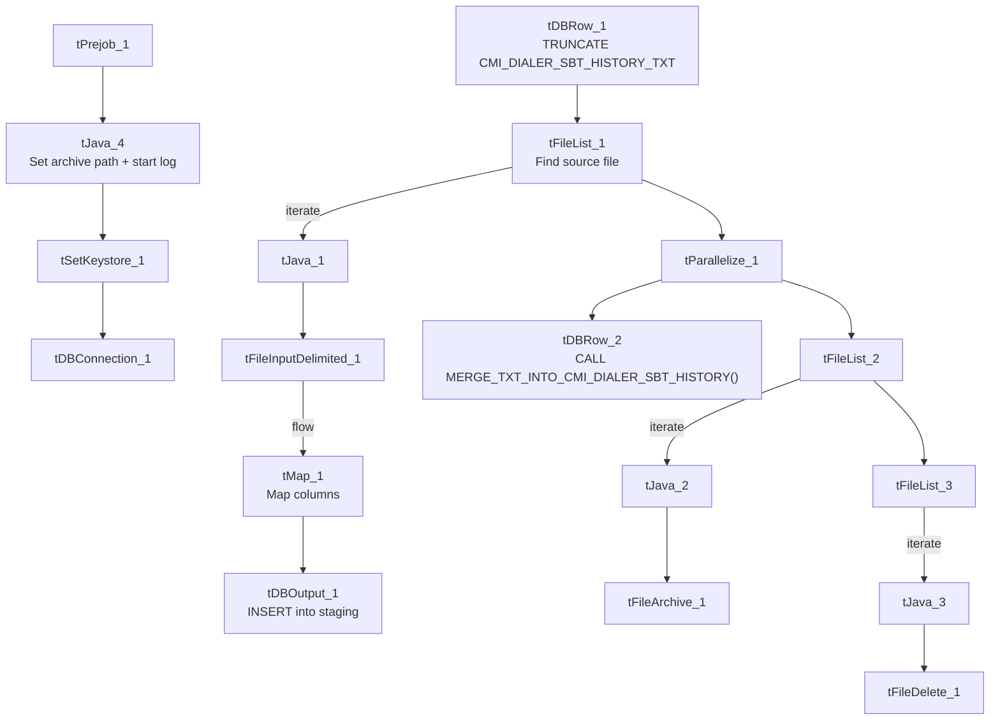

# Talend Job: cmi_Dialer_SBT_History_Table_Text_Load

## Overview

This job loads SMS/text ("SBT" — likely "SMS/Bulk Text") dialer message history (delivery status, timestamps, message content metadata, and the account/debtor it relates to) from a shared folder into Snowflake. It follows the project's standard load pattern: truncate the staging table, read the source file, load into staging, merge into the permanent table via a stored procedure, then archive and delete the source file.

## Detail table

| Field | Value |
|---|---|
| Job name | cmi_Dialer_SBT_History_Table_Text_Load |
| Version | 0.1 |
| Project | LATITUDE |
| Author | jmach@harriscollect.com |
| Created | 2024-11-05T10:39:49.444-0800 |
| Last Modified | 2025-09-29T21:30:00.095-0700 |

## Step-by-step data flow

1. **Set up.** `tPrejob_1` starts the job; `tJava_4` appends today's date to `context.archiveDir` and opens a log file; `tSetKeystore_1` configures the SSL client keystore; `tDBConnection_1` opens the Snowflake connection.
2. **Empty the staging table.** `tDBRow_1` runs `TRUNCATE TABLE CMI_DIALER_SBT_HISTORY_TXT;`, then triggers the file-processing chain.
3. **Find the file.** `tFileList_1` lists files in `context.sourceDir` (skipping `.txt` files); the match becomes `context.filePath` (`tJava_1`).
4. **Read and reshape.** `tFileInputDelimited_1` reads the file using the repository schema "sbtdial" — pipe-delimited (`|~|`/`|$|`), US-ASCII encoding, header row, `DIE_ON_ERROR` true. `tMap_1` maps its columns (`ID`, `MobileNo`, `MessageId`, `DeliveryStatus`, `DeliveryStatusCode`, `Message`, `MessageCategory`, `Direction`, `ReferenceId`, `CommunicationCode`, `ReceivedAt`/`ReadAt`/`SentAt`/`DeliveredAt` timestamps (UTC and local variants), `TotalMessageSegments`, `AccountID`, `DateLoaded`, `FullFileName`, `DebtorSeq`) onto the equivalent target schema, adding `LOAD_DT`.
5. **Load staging.** The mapped rows flow directly into `tDBOutput_1`, which inserts them into `CMI_DIALER_SBT_HISTORY_TXT` (no row counter on this path).
6. **Merge and clean up — in parallel.** `tParallelize_1` splits into:
   - **Merge branch:** `tDBRow_2` runs `CALL MERGE_TXT_INTO_CMI_DIALER_SBT_HISTORY();`. No `tDie`/`tWarn` check follows it.
   - **Cleanup branch:** the source file is listed again, archived (`tFileArchive_1`), then separately listed and deleted (`tFileDelete_1`, `FAILON` false).

## Settings tables

### Source: `tFileInputDelimited_1`

| Setting | Value | What it means |
|---|---|---|
| FILENAME | `context.filePath` | Reads whichever file `tFileList_1` found. |
| Schema | Repository schema "sbtdial" | Uses a shared, pre-defined column layout for SMS/dialer history. |
| FIELDSEPARATOR / ROWSEPARATOR | `\|~\|` / `\|$\|` | The project's standard pipe-delimited format. |
| CSVROWSEPARATOR | `\n` | Underlying line ending within each row. |
| ENCODING | US-ASCII | Plain ASCII. |
| DIE_ON_ERROR | true | A malformed row fails the whole job. |

### Target: `tDBOutput_1`

| Setting | Value | What it means |
|---|---|---|
| Table | CMI_DIALER_SBT_HISTORY_TXT | Staging table written to. |
| Output action | INSERT | Adds rows only. |
| Table action | NONE | Structure untouched — truncation is the separate `tDBRow_1` step. |

### Merge step: `tDBRow_2`

| Setting | Value | What it means |
|---|---|---|
| Query | `CALL MERGE_TXT_INTO_CMI_DIALER_SBT_HISTORY();` | Snowflake stored procedure folding staged rows into the permanent table. Body not visible in this metadata. |

## Dependencies & configuration

- **Triggers/depends on other jobs:** none — no `tRunJob` links found.
- **Context variables used:** `context.sourceDir`, `context.archiveDir`, `context.filePath`, `context.fileName`, `context.logDir`, `context.keystorePath` (all `Directories_0.1`).
- **Snowflake connection:** uses the shared connection object, not `LEGACY_DW_*` context variables directly.

## Glossary

| Component type | Plain-English meaning |
|---|---|
| `tPrejob` / `tParallelize` | Setup-before-main-flow, and concurrent branches (see `job_Address_Text_Load.md`). |
| `tFileList` | Lists files in a folder to loop over (see `job_Address_Text_Load.md`). |
| `tFileInputDelimited` | Reads a delimited text file row by row (see `job_Address_Text_Load.md`). |
| `tMap` | Maps/transforms columns (see `job_Address_Text_Load.md`). |
| `tSnowflakeOutput` (`tDBOutput`) | Writes rows into Snowflake (see `job_Address_Text_Load.md`). |
| `tSnowflakeRow` (`tDBRow`) | Runs a single SQL statement — `TRUNCATE` and `CALL <procedure>` here (see `job_Address_Text_Load.md`). |
| `tJava` | Custom Java code for small tasks (see `job_Address_Text_Load.md`). |
| `tFileArchive` | Zips a file into an archive location (see `job_Address_Text_Load.md`). |
| `tFileDelete` | Deletes a file from disk (see `job_Address_Text_Load.md`). |
| `tSetKeystore` | Configures the SSL keystore for the Snowflake connection (see `job_Address_Text_Load.md`). |

## Issues observed

- **Hardcoded machine-specific paths**: `tFileInputDelimited_1.TEMP_DIR`, `tFileArchive_1.SOURCE_FILE`, `tFileDelete_1.DIRECTORY`/`PATH`, and `tSetKeystore_1.SSL_TRUSTSERVER_TRUSTSTORE` are all fixed `C:/Talend-Studio-20211109_1610-V8.0.1/...` or `C:/clientTrustStore.trustStore` paths rather than context variables — the same pattern flagged project-wide.
- **No row counter (`tFlowMeter`)** on the load path.
- **No explicit error handling on the merge step** — no `tDie`/`tWarn` reacting to whether `MERGE_TXT_INTO_CMI_DIALER_SBT_HISTORY()` succeeded.
- **The merge procedure's own logic is outside Talend** — its body isn't part of this metadata.
