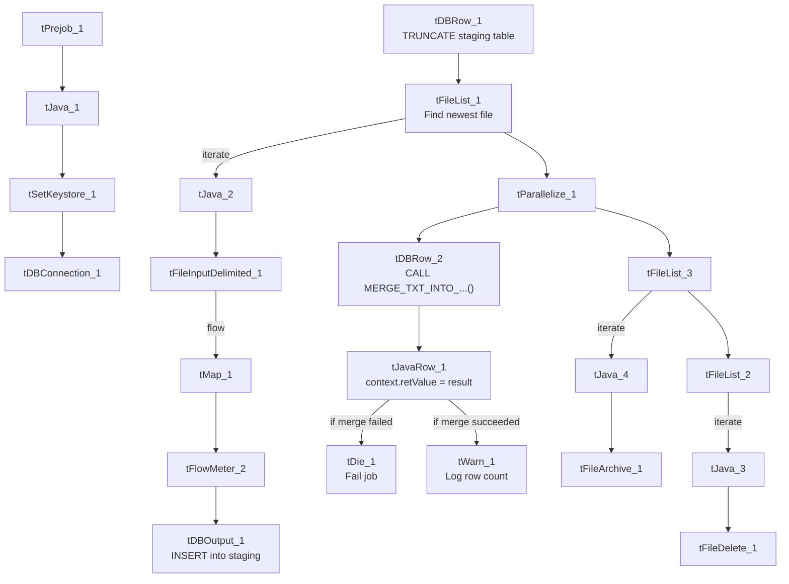

# Talend Job: cmi_Hermes_Recommendations_Load

## Overview

This job loads Hermes contact-channel recommendations (which channel — e.g. phone number — to try next for a given account) into Snowflake. It follows the same overall pattern as `Address_Text_Load` — truncate a staging table, load the current file, merge into the permanent table, archive/delete the source file — but it's one of only 8 jobs in the project that explicitly checks whether that Snowflake merge succeeded and reacts differently depending on the outcome (fail the job vs. just log a count), which makes it a good example of the project's error-handling pattern.

## Detail table

| Field | Value |
|---|---|
| Job name | cmi_Hermes_Recommendations_Load |
| Version | 0.1 |
| Project | LATITUDE |
| Author | jmach@harriscollect.com |
| Created | 2026-03-04T10:25:20.254-0800 |
| Last Modified | 2026-03-04T16:11:38.780-0800 |

## Step-by-step data flow

1. **Set up.** `tJava_1` prepares logging; `tSetKeystore_1` configures the SSL keystore; `tDBConnection_1` opens the Snowflake connection.
2. **Empty the staging table.** `tDBRow_1` runs `TRUNCATE TABLE LIQUID_STAGING.CMI_HERMES_RECOMMENDATIONS;`.
3. **Find and read the file.** `tFileList_1` finds the newest matching file in `context.sourceDir` (skipping `.txt` files); `tFileInputDelimited_1` reads it as a pipe-delimited, US-ASCII-encoded file with a header row.
4. **Transform.** `tMap_1` maps the file's columns onto the recommendation schema (`ID`, `NUMBER`, `PROPOSED_CHANNEL`, `PHONENUMBER`, `HERMES_REQUEST_ID`, `CREATEDWHEN_UTC`, `UPDATEDWHEN_UTC`, `PROCESS_OUTCOME`, `COMMENTS`, plus `LOAD_DT`).
5. **Load staging.** Mapped rows pass through a row counter (`tFlowMeter_2`) into `tDBOutput_1`, which inserts them into the staging table. (Its schema also carries Snowflake's built-in reject-row columns — `columnName`, `rowNumber`, `errorMessage`, `sqlState`, etc. — for rows that fail to load; see Glossary.)
6. **Merge and check the result — in parallel with archiving.** `tParallelize_1` splits into two branches that run at the same time:
   - **Merge branch:** `tDBRow_2` calls `CALL MERGE_TXT_INTO_CMI_HERMES_RECOMMENDATIONS();` — a Snowflake stored procedure that folds the staged rows into the permanent table and returns a value. `tJavaRow_1` copies that return value into `context.retValue`. Depending on that value, the job either runs `tDie_1` (fails the job with the message `"MERGE failed - error code " + context.retValue`, exit code 4) or `tWarn_1` (logs `"<count> rows inserted or updated"`, severity code 42, without failing the job). **Which specific value routes to which branch is not captured in this metadata** — only that both are wired as `RUN_IF` branches off the same code (see Issues observed).
   - **Cleanup branch:** the source file is listed again, deleted (`tFileDelete_1`), and separately listed and archived (`tFileArchive_1`) into `context.archiveDir`.

## Settings tables

### Source: `tFileInputDelimited_1`

| Setting | Value | What it means |
|---|---|---|
| FILENAME | `context.filePath` | Reads whichever file `tFileList_1` just found. |
| FIELDSEPARATOR / ROWSEPARATOR | `\|~\|` / `\|$\|` | Same custom pipe-delimited format used across this project's "text load" jobs. |
| ENCODING | US-ASCII | Notably plain ASCII here, not ISO-8859-15 like `Address_Text_Load` — worth confirming this is intentional if the file can ever contain non-ASCII characters (e.g., accented names). |

### Target: `tDBOutput_1`

| Setting | Value | What it means |
|---|---|---|
| Table | CMI_HERMES_RECOMMENDATIONS | Loads into the staging copy of this table (schema `LIQUID_STAGING`, per the preceding `TRUNCATE`). |
| Output action | INSERT | Adds rows only — no update/delete at this step. |

### Merge & result check: `tDBRow_2` → `tJavaRow_1` → `tDie_1` / `tWarn_1`

| Setting | Value | What it means |
|---|---|---|
| Query (`tDBRow_2`) | `CALL MERGE_TXT_INTO_CMI_HERMES_RECOMMENDATIONS();` | Runs the Snowflake procedure that merges staged rows into the permanent table. |
| `tDie_1` message | `"MERGE failed - error code " + context.retValue` (exit code 4) | Fails the job outright if the merge reports an error. |
| `tWarn_1` message | `context.retValue + " rows inserted or updated"` (severity 42) | Logs a row count and continues if the merge succeeded — this job does not hard-fail on a successful merge. |

## Dependencies & configuration

- **Triggers/depends on other jobs:** none — no `tRunJob` links found.
- **Context variables used:** `context.sourceDir`, `context.archiveDir`, `context.filePath`, `context.fileName`, `context.logDir`, `context.keystorePath` (all `Directories_0.1`). Like `Address_Text_Load`, it uses the shared Snowflake connection object rather than referencing `LEGACY_DW_0.1` variables by name.
- **Related jobs:** `cmi_VoApp_Results_Load`, `Dialer_CallTracking_Load`, `master_prediction_proposal_Load`, and `PatientInfo_Text_Load` follow the same truncate → load → merge → die/warn pattern (see `05_operational_runbook.md`).

## Glossary

| Component type | Plain-English meaning |
|---|---|
| `tDie` | Fails the job immediately with a specific message and exit code — used here when the merge procedure reports failure. |
| `tWarn` | Logs a warning message without failing the job — used here to record how many rows the merge affected when it succeeds. |
| `tJavaRow` | A small custom-code step that runs once per row (or, as used here, once to capture a single returned value) — here it copies the merge procedure's return value into a context variable so `tDie`/`tWarn` can react to it. |
| Snowflake reject columns (`columnName`, `rowNumber`, `errorMessage`, `sqlState`, `code`, etc.) | Extra schema columns Snowflake's output component adds automatically to capture details about any row that fails to load — not part of the actual `CMI_HERMES_RECOMMENDATIONS` business data. |

(See `job_Address_Text_Load.md` for the shared components — `tFileList`, `tFileInputDelimited`, `tMap`, `tFlowMeter`, `tFileArchive`, `tFileDelete`, `tSetKeystore` — which behave the same way here.)

## Issues observed

- **The pass/fail condition itself isn't in the metadata.** The job clearly branches on `context.retValue` (one path to `tDie_1`, one to `tWarn_1`, both wired as `RUN_IF` links), but the actual condition expression on each link isn't captured by the extractor — only that both branches exist. Confirm the exact success/failure threshold with the job's author or in Talend Studio directly before relying on this write-up for incident response.
- **File encoding differs from other jobs in the project** (US-ASCII here vs. ISO-8859-15 in `Address_Text_Load` and most peers) — flagging in case this is accidental rather than intentional, since a non-ASCII character in a Hermes file would fail to load without an obvious explanation.
- **The merge procedure's own logic is outside Talend**, same caveat as every other job that calls a `MERGE_TXT_INTO_*` procedure (see `04_data_lineage_map.md`).
