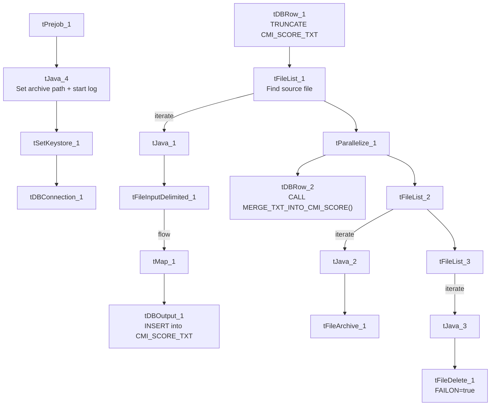

# Talend Job: cmi_Score_Text_Load

## Overview

This job loads collectability/propensity scores per account (an original score, an adjusted score, and a dollar-value score, plus the date the score was added) into Snowflake. It follows the standard truncate → load → merge → archive/delete pattern, with a small formatting quirk in the file reader's escape/enclosure settings.

## Detail table

| Field | Value |
|---|---|
| Job name | cmi_Score_Text_Load |
| Version | 0.1 |
| Project | LATITUDE |
| Author | jmach@harriscollect.com |
| Created | 2024-11-20T08:30:38.291-0800 |
| Last Modified | 2025-09-29T21:45:27.299-0700 |

## Step-by-step data flow

1. **Set up.** `tPrejob_1` triggers `tJava_4`, which appends today's date to `context.archiveDir` and opens a log file; this chains into `tSetKeystore_1` and `tDBConnection_1`.
2. **Empty the staging table.** `tDBRow_1` runs `TRUNCATE TABLE CMI_SCORE_TXT;` (no explicit schema prefix — see Issues observed).
3. **Find the file.** `tFileList_1` lists files in `context.sourceDir` (skipping `*.txt`), with no explicit sort order.
4. **Read and reshape the file.** `tFileInputDelimited_1` reads the file as pipe-delimited (`|~|` fields, `|$|` rows), US-ASCII encoded, with a header row, covering account ID, original score, adjusted score, dollar score, and date added. Its `ESCAPE_CHAR` and `TEXT_ENCLOSURE` settings are both configured as empty strings, unlike most peer jobs which set both to a double quote (`"`) — see Issues observed. `tMap_1` maps these onto the `CMI_SCORE_TXT` schema, adding `LOAD_DT`.
5. **Load staging.** Mapped rows flow directly into `tDBOutput_1` (no row counter), inserting into `CMI_SCORE_TXT`.
6. **Merge and clean up — in parallel.** Once the file-list subjob completes, `tParallelize_1` splits into: `tDBRow_2` calling `CALL MERGE_TXT_INTO_CMI_SCORE();`, and a file-listing chain (`tFileList_2` → archive via `tFileArchive_1`; then `tFileList_3` → delete via `tFileDelete_1`, with `FAILON: true` — a failed delete here does fail the job, unlike most peer jobs).

## Settings tables

### Source: `tFileInputDelimited_1`

| Setting | Value | What it means |
|---|---|---|
| FILENAME | `context.filePath` | Reads whichever file `tFileList_1` just found. |
| FIELDSEPARATOR / ROWSEPARATOR | `\|~\|` / `\|$\|` | Standard project pipe-delimited format. |
| ESCAPE_CHAR / TEXT_ENCLOSURE | `""` / `""` (empty) | No escape or text-enclosure character is configured — unlike most peer jobs, which use `"` for both. |
| ENCODING | US-ASCII | Plain ASCII text. |

### Target: `tDBOutput_1`

| Setting | Value | What it means |
|---|---|---|
| Table | CMI_SCORE_TXT | Staging table for score records. |
| Output action | INSERT | Adds rows only. |

### Merge step: `tDBRow_2`

| Setting | Value | What it means |
|---|---|---|
| Query | `CALL MERGE_TXT_INTO_CMI_SCORE();` | Snowflake procedure that folds staged rows into the permanent `CMI_SCORE` table. |

### Delete step: `tFileDelete_1`

| Setting | Value | What it means |
|---|---|---|
| FAILON | true | Unlike most peer jobs, a failed delete of the source file **does** fail this job. |

## Dependencies & configuration

- **Triggers/depends on other jobs:** none found — no `tRunJob` links.
- **Context variables used:** `context.sourceDir`, `context.archiveDir`, `context.filePath`, `context.fileName`, `context.logDir`, `context.keystorePath` (all `Directories_0.1`). Uses the shared Snowflake connection object, not `LEGACY_DW_*` variables directly.
- **Hardcoded values found:** `tFileInputDelimited_1.TEMP_DIR`, `tFileArchive_1.SOURCE_FILE`, `tFileDelete_1.DIRECTORY`/`PATH`, and `tSetKeystore_1.SSL_TRUSTSERVER_TRUSTSTORE` are fixed paths rather than context variables.

## Glossary

| Component type | Plain-English meaning |
|---|---|
| `tPrejob` / `tParallelize` | Setup-before-main-start, concurrent branches (see job_Address_Text_Load.md). |
| `tFileList` | Lists files for the job to loop over (see job_Address_Text_Load.md). |
| `tFileInputDelimited` | Reads a delimited text file (see job_Address_Text_Load.md). |
| `tMap` | Maps/transforms columns (see job_Address_Text_Load.md). |
| `tDBOutput` / `tSnowflakeOutput` | Writes rows into Snowflake (see job_Address_Text_Load.md). |
| `tDBRow` / `tSnowflakeRow` | Runs a single SQL statement (see job_Address_Text_Load.md). |
| `tJava` | Custom Java code block (see job_Address_Text_Load.md). |
| `tFileArchive` | Zips a file into an archive location (see job_Address_Text_Load.md). |
| `tFileDelete` | Deletes a file from disk (see job_Address_Text_Load.md). |
| `tSetKeystore` | Configures the SSL keystore for the Snowflake connection (see job_Address_Text_Load.md). |

## Issues observed

- **`ESCAPE_CHAR`/`TEXT_ENCLOSURE` are both empty** on the file reader, unlike most peer jobs which use `"` for both — meaning a value in this file that happens to contain a literal `|~|` or `|$|` sequence (or an embedded quote) has no defined escaping. Worth confirming with the team that score data can never legitimately contain those sequences.
- **The staging truncate doesn't qualify its schema** (`TRUNCATE TABLE CMI_SCORE_TXT;`, no `LIQUID_STAGING.` prefix) — same pattern as several other jobs in this batch.
- **`tFileDelete_1.FAILON` is `true`** here, unlike most peer jobs (`false`) — a failed file delete will fail this job outright, a stricter posture worth being aware of operationally.
- **No row-count logging** — no `tFlowMeter` component between `tMap_1` and `tDBOutput_1`.
- **The merge procedure's own logic is outside Talend** and not visible in this metadata.
