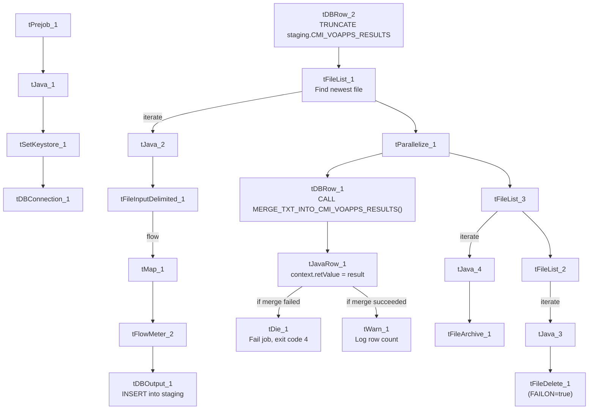

# Talend Job: cmi_VoApp_Results_Load

## Overview

This job loads VoApps voicemail-drop campaign results (call outcome, timestamps, phone/message IDs, processed outcome, comments) into Snowflake. Like `cmi_Hermes_Recommendations_Load`, it follows the project's standard truncate-load-merge-archive pattern but is one of the 8 jobs project-wide that explicitly checks whether the Snowflake merge succeeded and reacts differently (fail the job vs. log a count) depending on the outcome. It has no scheduling information in this metadata — something outside Talend decides when it runs.

## Detail table

| Field | Value |
|---|---|
| Job name | cmi_VoApp_Results_Load |
| Version | 0.1 |
| Project | LATITUDE |
| Author | jmach@harriscollect.com |
| Created | 2026-03-09T14:41:43.423-0700 |
| Last Modified | 2026-03-09T16:58:05.377-0700 |

## Step-by-step data flow

1. **Set up.** `tPrejob_1` starts the job; `tJava_1` appends today's date to `context.archiveDir` and opens a log file; `tSetKeystore_1` configures the SSL client keystore; `tDBConnection_1` opens the Snowflake connection.
2. **Empty the staging table.** In a separate, parallel start point, `tDBRow_2` runs `TRUNCATE TABLE LIQUID_STAGING.CMI_VOAPPS_RESULTS;` (note: the truncate step is named `tDBRow_2` here and the merge step `tDBRow_1` — the numbering is swapped relative to most peer jobs).
3. **Find and read the file.** `tFileList_1` lists files in `context.sourceDir` (ordered by modified date, skipping `.txt`); `tJava_2` captures the found path into `context.filePath`; `tFileInputDelimited_1` reads it as a pipe-delimited, US-ASCII-encoded file (using the repository schema named `voresult`) with a header row.
4. **Transform and load.** `tMap_1` maps the file's columns (result ID, phone number, VoApps target date/caller number/message ID/zip/voice-append/result/code/timestamp, Hermes request ID, file number, created/processed timestamps, processed outcome, comment) onto the `CMI_VOAPPS_RESULTS` schema, adding `LOAD_DT`. The mapped rows pass through a row counter (`tFlowMeter_2`) into `tDBOutput_1`, which inserts them into Snowflake.
5. **Merge and check the result — in parallel with cleanup.** Once the file has been listed, `tParallelize_1` splits into two branches:
   - **Merge branch:** `tDBRow_1` calls `CALL MERGE_TXT_INTO_CMI_VOAPPS_RESULTS();`, a Snowflake procedure that folds the staged rows into the permanent table and returns a value. `tJavaRow_1` copies that return value into `context.retValue`. Depending on that value, the job either runs `tDie_1` (fails the job with `"MERGE failed - error code " + context.retValue`, exit code 4) or `tWarn_1` (logs `"<count> rows inserted or updated"`, severity code 42, without failing the job). As with `cmi_Hermes_Recommendations_Load`, **the exact condition that routes to one branch vs. the other isn't captured in this metadata** — only that both `RUN_IF` branches exist off the same step.
   - **Cleanup branch:** the source file is listed again, archived (`tFileArchive_1`, zipped into `context.archiveDir`), and separately listed and deleted (`tFileDelete_1`) — with `FAILON` set to `true` here (see Issues observed).

## Settings tables

### Source: `tFileInputDelimited_1`

| Setting | Value | What it means |
|---|---|---|
| FILENAME | `context.filePath` | Reads whichever file `tFileList_1` just found. |
| FIELDSEPARATOR / ROWSEPARATOR | `\|~\|` / `\|$\|` | The project's standard pipe-delimited format. |
| CSVROWSEPARATOR | `\|$\|` | Set to the same value as `ROWSEPARATOR` rather than the usual `\n`/`\r\n` seen in peer jobs — since `CSV_OPTION` is `false`, this setting isn't actually exercised, but it's an inconsistency worth flagging. |
| HEADER | 1 | First line is a header, not data. |
| ENCODING | US-ASCII | Plain ASCII, not ISO-8859-15. |
| SCHEMA:REPOSITORY_SCHEMA_TYPE | `voresult` (repository schema) | Uses a centrally-defined column layout. |
| EXCLUDEFILEMASK (on `tFileList_1`) | `*.txt` | `.txt` files are skipped. |

### Target: `tDBOutput_1`

| Setting | Value | What it means |
|---|---|---|
| Table | CMI_VOAPPS_RESULTS | Loads the staging copy of this table (schema `LIQUID_STAGING`, per the preceding `TRUNCATE`). |
| Output action | INSERT | Adds rows only. |

### Merge & result check: `tDBRow_1` → `tJavaRow_1` → `tDie_1` / `tWarn_1`

| Setting | Value | What it means |
|---|---|---|
| Query (`tDBRow_1`) | `CALL MERGE_TXT_INTO_CMI_VOAPPS_RESULTS();` | Runs the Snowflake procedure that merges staged rows into the permanent table and returns a value (`RETVALUE`, a `Long`). |
| `tDie_1` message | `"MERGE failed - error code " + context.retValue` (exit code 4) | Fails the job outright if the merge reports an error. |
| `tWarn_1` message | `context.retValue + " rows inserted or updated"` (severity 42) | Logs a row count and continues if the merge succeeded. |

### Cleanup: `tFileDelete_1`

| Setting | Value | What it means |
|---|---|---|
| FAILON | **true** | If deleting the source file fails, this job fails — unlike every other assigned job, which sets `FAILON` to `false` (log and continue). |

## Dependencies & configuration

- **Triggers/depends on other jobs:** none — no `tRunJob` links found.
- **Context variables used:** `context.sourceDir`, `context.archiveDir`, `context.filePath`, `context.fileName`, `context.logDir`, `context.keystorePath` (all `Directories_0.1`), plus the job-local `context.retValue` used to carry the merge procedure's return code between components.
- **LEGACY_DW usage:** none — this job uses the shared Snowflake connection object, not `LEGACY_DW_0.1` variables directly.
- **Related jobs:** as noted in `job_cmi_Hermes_Recommendations_Load.md`, this job is grouped with `cmi_Hermes_Recommendations_Load`, `Dialer_CallTracking_Load`, `master_prediction_proposal_Load`, and `PatientInfo_Text_Load` as the project's die/warn-on-merge-result pattern jobs.

## Glossary

| Component type | Plain-English meaning |
|---|---|
| `tPrejob` / `tParallelize` | Job-flow control. (see `job_Address_Text_Load.md`) |
| `tFileList` | Lists files in a folder so the job can loop over them. (see `job_Address_Text_Load.md`) |
| `tFileInputDelimited` | Reads a delimited text file row by row. (see `job_Address_Text_Load.md`) |
| `tMap` | Maps/transforms columns from input to output. (see `job_Address_Text_Load.md`) |
| `tFlowMeter` | Counts rows passing through a point in the job. (see `job_Address_Text_Load.md`) |
| `tDBOutput` / `tSnowflakeOutput` | Writes rows into a Snowflake table. (see `job_Address_Text_Load.md`) |
| `tDBRow` / `tSnowflakeRow` | Runs a single SQL statement — used here for `TRUNCATE` and `CALL <procedure>`. (see `job_Address_Text_Load.md`) |
| `tJava` / `tJavaRow` | Custom code blocks — `tJava` for setup/path capture, `tJavaRow` here to copy the merge procedure's return value into `context.retValue`. (see `job_cmi_Hermes_Recommendations_Load.md`) |
| `tFileArchive` | Compresses a file into a `.zip` and archives it. (see `job_Address_Text_Load.md`) |
| `tFileDelete` | Deletes a file from disk. (see `job_Address_Text_Load.md`) |
| `tSetKeystore` | Configures the SSL keystore for the Snowflake connection. (see `job_Address_Text_Load.md`) |
| `tDie` | Fails the job immediately with a specific message and exit code — used here when the merge reports failure. (see `job_cmi_Hermes_Recommendations_Load.md`) |
| `tWarn` | Logs a warning without failing the job — used here to record the merge's row count on success. (see `job_cmi_Hermes_Recommendations_Load.md`) |

## Issues observed

- **The pass/fail condition itself isn't in the metadata.** As with `cmi_Hermes_Recommendations_Load`, the job clearly branches on `context.retValue` (one `RUN_IF` path to `tDie_1`, one to `tWarn_1`), but the actual condition expression on each link isn't captured by the extractor. Confirm the exact success/failure threshold with the job's author or in Talend Studio directly.
- **`tFileDelete_1` has `FAILON` set to `true`**, unlike every other assigned job (which sets it to `false`, logging a failed delete without stopping the job). Combined with the merge-result check, this job is stricter about failure than most peers — worth confirming this is intentional given VoApps results likely feed downstream reporting.
- **Component numbering is swapped**: the truncate step is `tDBRow_2` and the merge step is `tDBRow_1`, the reverse of the usual convention seen in peer jobs (where `tDBRow_1` truncates and `tDBRow_2` merges). Purely cosmetic, but worth noting for anyone cross-referencing by component name.
- **`CSVROWSEPARATOR` is set to `|$|`** (the same as `ROWSEPARATOR`) rather than the `\n`/`\r\n` seen in every other assigned job — harmless since CSV mode isn't enabled, but an inconsistency worth flagging if the CSV path is ever turned on.
- **The merge procedure's own logic is outside Talend**, same caveat as every other job that calls a `MERGE_TXT_INTO_*` procedure.
