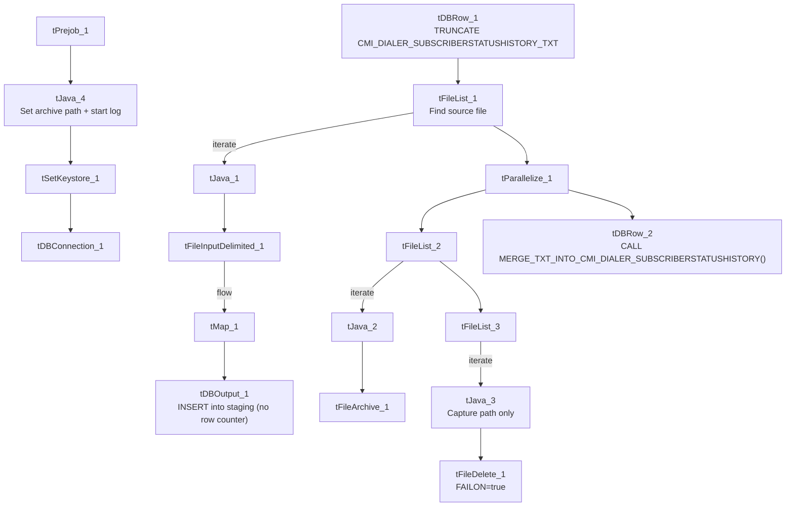

# Talend Job: cmi_dialer_SubscriberStatusHistory_Text_Load

## Overview

This job loads a history of dialer subscriber SMS/text opt-in and opt-out status changes (`CMI_DIALER_SUBSCRIBERSTATUSHISTORY` — company code, phone number, event timestamp, and various opt-in/opt-out flags) into Snowflake. It follows the project's standard truncate → load → merge → archive/delete pattern, with one small gap compared to peers: it has no row-count (`tFlowMeter`) component in its load path.

## Detail table

| Field | Value |
|---|---|
| Job name | cmi_dialer_SubscriberStatusHistory_Text_Load |
| Version | 0.1 |
| Project | LATITUDE |
| Author | jmach@harriscollect.com |
| Created | 2025-10-07T08:30:13.203-0700 |
| Last Modified | 2026-07-12T14:09:46.200-0700 |

## Step-by-step data flow

1. **Set up.** `tPrejob_1` → `tJava_4` (appends today's date to `context.archiveDir`, opens a log file) → `tSetKeystore_1` → `tDBConnection_1`.
2. **Empty the staging table.** `tDBRow_1` runs `TRUNCATE TABLE CMI_DIALER_SUBSCRIBERSTATUSHISTORY_TXT;` (no `LIQUID_STAGING.` schema prefix).
3. **Find and read the file.** `tFileList_1` lists files in `context.sourceDir` (excluding `*.txt`, no particular sort order); `tJava_1` captures the path; `tFileInputDelimited_1` reads it (`|~|`/`|$|`, header row, US-ASCII encoding, `DIE_ON_ERROR`=true).
4. **Transform and load staging.** `tMap_1` maps `SUBSCRIBERSTATUSHISTORYID`, `COMPANYCODE`, `PHONENUMBER`, `EVENTOCCURREDAT`, `STATUSCHANGEDFROM`, and the opt-in/opt-out flags (`OPTEDIN`, `OPTINPENDING`, `OPTINDELIVERED`, `OPTOUTOVERRIDE`, `CANOPTIN`) onto the staging schema, adding `LOAD_DT`. Rows flow **directly** into `tDBOutput_1` — there is no `tFlowMeter` row-count step in this job's load path, unlike most peers.
5. **Merge and clean up — in parallel.** `tParallelize_1` splits into:
   - **Merge branch:** `tDBRow_2` runs `CALL MERGE_TXT_INTO_CMI_DIALER_SUBSCRIBERSTATUSHISTORY();`.
   - **Cleanup branch:** `tFileList_2` → `tJava_2` (captures path + name) → `tFileArchive_1` (zips into `context.archiveDir`); and `tFileList_3` → `tJava_3` (captures path **only**, no `fileName` — but this branch only feeds `tFileDelete_1`, which doesn't need `fileName`, so this isn't a functional gap) → `tFileDelete_1` (deletes the source file; `FAILON`=true, like `HH_Violation_Text_Load`).

## Settings tables

### Source: `tFileInputDelimited_1`

| Setting | Value | What it means |
|---|---|---|
| FILENAME | `context.filePath` | Reads whichever file `tFileList_1` just found. |
| FIELDSEPARATOR / ROWSEPARATOR | `\|~\|` / `\|$\|` | Standard project pipe-delimited format. |
| ENCODING | US-ASCII | Plain ASCII. |
| DIE_ON_ERROR | true | A malformed row fails the job immediately. |
| TEMP_DIR | `"C:/Talend-Studio-.../workspace"` | Hardcoded Windows path. |

### Target: `tDBOutput_1`

| Setting | Value | What it means |
|---|---|---|
| Table | CMI_DIALER_SUBSCRIBERSTATUSHISTORY_TXT | Loads into the staging copy of the table. |
| Output action | INSERT | Adds rows only. |
| Table action | NONE | Table structure untouched. |

### Merge step: `tDBRow_2`

| Setting | Value | What it means |
|---|---|---|
| Query | `CALL MERGE_TXT_INTO_CMI_DIALER_SUBSCRIBERSTATUSHISTORY();` | Runs the Snowflake merge procedure, unqualified — the project's more common style. |

### Delete: `tFileDelete_1`

| Setting | Value | What it means |
|---|---|---|
| FAILON | true | If deleting the source file fails, the job fails outright — stricter than the project default of `false` (seen in `Bankruptcy_Text_Load`, `Debtor_Table_Text_Load`, `MiscExtra_Text_Load`, etc.), but consistent with `HH_Violation_Text_Load`. |

## Dependencies & configuration

- **Triggers/depends on other jobs:** none found — no `tRunJob` links.
- **Context variables used:** `context.sourceDir`, `context.archiveDir`, `context.filePath`, `context.fileName`, `context.logDir`, `context.keystorePath` (all `Directories_0.1`). Uses the shared Snowflake connection object, not `LEGACY_DW_0.1` variables directly.

## Glossary

| Component type | Plain-English meaning |
|---|---|
| `tPrejob` / `tParallelize` | Job-flow control (see job_Address_Text_Load.md). |
| `tSnowflakeConnection` (`tDBConnection`) | Opens the shared Snowflake connection (see job_Bankruptcy_Text_Load.md). |
| `tFileList` | Lists files for iteration (see job_Address_Text_Load.md). |
| `tFileInputDelimited` | Reads a delimited text file (see job_Address_Text_Load.md). |
| `tMap` | Maps/transforms columns (see job_Address_Text_Load.md). |
| `tDBOutput` / `tSnowflakeOutput` | Writes rows to Snowflake (see job_Address_Text_Load.md). |
| `tDBRow` / `tSnowflakeRow` | Runs a single SQL statement (see job_Address_Text_Load.md). |
| `tJava` | Custom Java code block (see job_Address_Text_Load.md). |
| `tFileArchive` | Zips a file into an archive location (see job_Address_Text_Load.md). |
| `tFileDelete` | Deletes a file (see job_Address_Text_Load.md). |
| `tSetKeystore` | Configures the SSL keystore (see job_Address_Text_Load.md). |

## Issues observed

- **No `tFlowMeter` row-count component** between `tMap_1` and `tDBOutput_1` — every other Text_Load job in this batch of 9 includes one at this point in the flow; this job's row-count activity would not be logged the same way.
- **`TRUNCATE TABLE CMI_DIALER_SUBSCRIBERSTATUSHISTORY_TXT;` omits the `LIQUID_STAGING.` schema prefix** used explicitly in several peer jobs — likely resolves correctly if the connection's default schema is `LIQUID_STAGING`, but worth confirming.
- **`tFileDelete_1.FAILON` is `true`**, a stricter setting than most peers (only shared with `HH_Violation_Text_Load` among this batch) — a failed delete here fails the whole job.
- **This job handles consent/opt-in data** (`OPTEDIN`, `OPTOUTOVERRIDE`, `CANOPTIN`) which is typically subject to TCPA-related compliance requirements; nothing in the metadata indicates special handling (encryption, access restriction) beyond the standard load pattern — worth confirming this matches the organization's data-handling policy for consent records.
- **Hardcoded, machine-specific paths** on `tFileInputDelimited_1.TEMP_DIR`, `tFileArchive_1.SOURCE_FILE`, `tFileDelete_1.DIRECTORY`/`PATH`, and `tSetKeystore_1.SSL_TRUSTSERVER_TRUSTSTORE` — the same project-wide pattern seen elsewhere.
