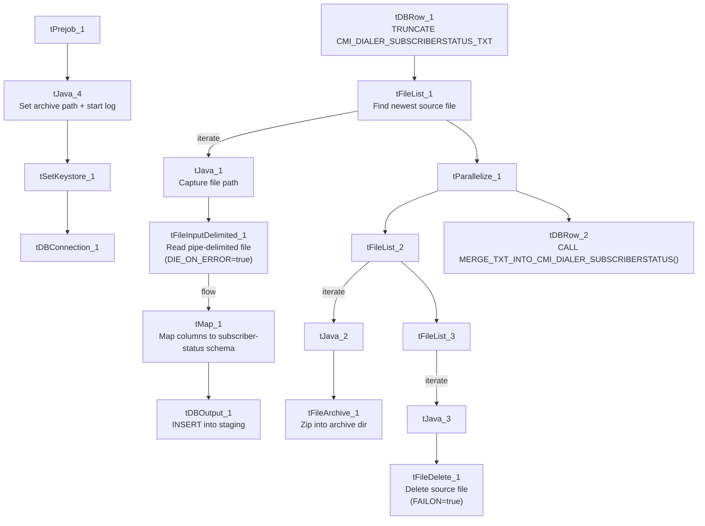

# Talend Job: cmi_dialer_SubscriberStatus_Text_Load

## Overview

This job follows the project's standard text-load pattern: it watches a shared folder for a new dialer subscriber-status file (phone number opt-in/opt-out state for outbound dialing/texting), loads it into a Snowflake staging table, merges the staged rows into the permanent table via a stored procedure, and then archives and deletes the source file. Its one notable deviation from peer jobs is that its file-delete step is configured to fail the job if the delete itself fails, rather than log-and-continue.

## Detail table

| Field | Value |
|---|---|
| Job name | cmi_dialer_SubscriberStatus_Text_Load |
| Version | 0.1 |
| Project | LATITUDE |
| Author | jmach@harriscollect.com |
| Created | 2024-11-06T09:59:10.313-0800 |
| Last Modified | 2026-07-12T13:56:39.605-0700 |

## Step-by-step data flow

1. **Set up.** `tPrejob_1` triggers `tJava_4`, which appends today's date to `context.archiveDir` and starts a log file, then hands off to `tSetKeystore_1` and `tDBConnection_1` (Snowflake connect).
2. **Empty the staging table.** `tDBRow_1` runs `TRUNCATE TABLE CMI_DIALER_SUBSCRIBERSTATUS_TXT;` (unqualified — no `LIQUID_STAGING.` prefix).
3. **Find the file.** `tFileList_1` lists files in `context.sourceDir`, skipping `.txt` files. `tJava_1` captures the match into `context.filePath`.
4. **Read and reshape.** `tFileInputDelimited_1` reads the file as pipe-delimited (`|~|`/`|$|`), US-ASCII-encoded, with a header row. `DIE_ON_ERROR = true` — a malformed row fails the job immediately. `tMap_1` maps the subscriber-status columns (`SubscriberStatusID`, `PhoneNumber`, `OptedIn`, `OptInPending`, `CanAutoOptIn`, `OptInDelivered`, `OptOutOverride`, `CompanyCode`) onto the target schema, adding `LOAD_DT`.
5. **Load staging.** Mapped rows flow into `tDBOutput_1`, which inserts them into `CMI_DIALER_SUBSCRIBERSTATUS_TXT` (`INSERT`, no table-structure changes).
6. **Merge into the permanent table — in parallel with cleanup.** `tParallelize_1` splits into:
   - **Merge branch:** `tDBRow_2` runs `CALL MERGE_TXT_INTO_CMI_DIALER_SUBSCRIBERSTATUS();`.
   - **Cleanup branch:** the source file is re-listed, archived (`tFileArchive_1`, zipped into `context.archiveDir/<filename>.zip`), and — via a separate file-list/capture — deleted (`tFileDelete_1`). Unlike every other job in this batch, `tFileDelete_1`'s `FAILON` setting is `true` here — see Issues observed.

## Settings tables

### Source: `tFileInputDelimited_1`

| Setting | Value | What it means |
|---|---|---|
| FILENAME | `context.filePath` | Reads whichever file `tFileList_1` found. |
| FIELDSEPARATOR / ROWSEPARATOR | `\|~\|` / `\|$\|` | Standard custom-delimited format. |
| HEADER | 1 | First line is a header row. |
| ENCODING | US-ASCII | Not ISO-8859-15. |
| DIE_ON_ERROR | true | A malformed row fails the whole job rather than routing to a reject output. |

### Target: `tDBOutput_1`

| Setting | Value | What it means |
|---|---|---|
| Table | CMI_DIALER_SUBSCRIBERSTATUS_TXT | Staging table for phone-number opt-in/opt-out status used by the outbound dialer. |
| Output action | INSERT | Adds rows only. |
| Table action | NONE | No structural changes; truncation handled by `tDBRow_1`. |

### Merge step: `tDBRow_2`

| Setting | Value | What it means |
|---|---|---|
| Query | `CALL MERGE_TXT_INTO_CMI_DIALER_SUBSCRIBERSTATUS();` | Snowflake stored procedure that folds staged rows into the permanent table; logic is outside Talend. |

### Cleanup: `tFileDelete_1`

| Setting | Value | What it means |
|---|---|---|
| FAILON | true | If deleting the source file fails (e.g., it's locked or already gone), **this job fails** — unlike every other job in this batch (`CBR_Metro2_Accounts_Table_Text_Load`, `Deceased_Text_Load`, `PDC_Text_Load`, `Promises_Text_Load`, `StatusHistory_Text_Load`, `cmi_Customer_Ext_Text_Load`), which all set `FAILON = false` and simply log the outcome. |

## Dependencies & configuration

- **Triggers/depends on other jobs:** none — no `tRunJob` links found.
- **Context variables used:** `context.sourceDir`, `context.archiveDir`, `context.filePath`, `context.fileName`, `context.logDir`, `context.keystorePath` (all `Directories_0.1`). It uses the shared Snowflake connection object (`tDBConnection_1`), not `LEGACY_DW_0.1` variables — no `LEGACY_DW_` entries appear in `context_vars_referenced`.
- **Hardcoded values found:** `tFileInputDelimited_1.TEMP_DIR`, `tFileArchive_1.SOURCE_FILE`, `tFileDelete_1.DIRECTORY`/`PATH`, `tSetKeystore_1.SSL_TRUSTSERVER_TRUSTSTORE` — the same `C:/Talend-Studio-20211109_1610-V8.0.1/...` machine-specific paths seen in most jobs.

## Glossary

| Component type | Plain-English meaning |
|---|---|
| `tPrejob` / `tParallelize` | Job-flow control (see `job_Address_Text_Load.md`). |
| `tFileList` | Lists files in a folder to loop over (see `job_Address_Text_Load.md`). |
| `tFileInputDelimited` | Reads a delimited text file row by row (see `job_Address_Text_Load.md`). |
| `tMap` | Maps/transforms input columns to output columns (see `job_Address_Text_Load.md`). |
| `tDBOutput` / `tSnowflakeOutput` | Writes rows into a Snowflake table (see `job_Address_Text_Load.md`). |
| `tDBRow` / `tSnowflakeRow` | Runs a single SQL statement against Snowflake (see `job_Address_Text_Load.md`). |
| `tJava` / `tJavaRow` | Custom Java code snippets (see `job_Address_Text_Load.md`). |
| `tFileArchive` | Zips a file into an archive location (see `job_Address_Text_Load.md`). |
| `tFileDelete` | Deletes a file from disk (see `job_Address_Text_Load.md`). |
| `tSetKeystore` | Configures the SSL keystore for the Snowflake connection (see `job_Address_Text_Load.md`). |

## Issues observed

- **`tFileDelete_1.FAILON = true`** is unique to this job among the batch — every peer job sets it `false` (log-and-continue). This means a locked/already-removed source file will fail this job outright, which could cause unnecessary alerting/retries if the underlying cause is benign (e.g., a race with antivirus or backup software), or could be an intentional stricter-compliance choice for dialer opt-in/opt-out data specifically. Worth confirming intent with the team.
- **`DIE_ON_ERROR = true`** on the file reader, same as `cmi_Customer_Ext_Text_Load`, differs from `PDC_Text_Load`/`Promises_Text_Load`/`StatusHistory_Text_Load`.
- **The `TRUNCATE` statement is unqualified** (`CMI_DIALER_SUBSCRIBERSTATUS_TXT` rather than `LIQUID_STAGING.CMI_DIALER_SUBSCRIBERSTATUS_TXT`) — same pattern flagged in several peer jobs.
- **File encoding is US-ASCII**, not ISO-8859-15 like `Address_Text_Load`.
- **No `tDie`/`tWarn` on the merge step** — a failed merge surfaces only as a generic Talend error (note this is a separate, unrelated fact from the `tFileDelete_1.FAILON` behavior above).
- **Standard hardcoded machine-specific paths** present across `tFileInputDelimited_1`, `tFileArchive_1`, `tFileDelete_1`, and `tSetKeystore_1` — the same project-wide pattern.
