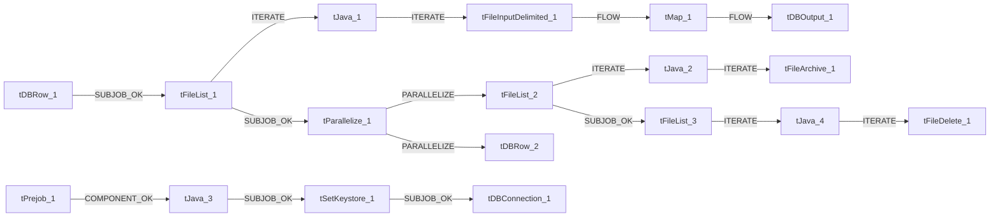

# Talend Job: letter_Text_Load

- **Project**: LATITUDE
- **Version**: 0.1
- **Job Type**: Standard

- **Author**: jmach@harriscollect.com
- **Created**: 2024-12-05T10:06:59.722-0800
- **Last Modified**: 2025-09-30T19:49:47.394-0700

## Components

| # | Component | Type | Key Parameters |
|---|-----------|------|----------------|
| 1 | tDBConnection_1 | `tSnowflakeConnection` | `CONNECTION_FORMAT`=row, `PROPERTIES`={"@id":2,"@type":"org.talend.components.snowflake. |
| 2 | tFileList_1 | `tFileList` | `DIRECTORY`=context.sourceDir, `LIST_MODE`=FILES, `INCLUDSUBDIR`=false, `CASE_SENSITIVE`=YES, `ERROR`=false |
| 3 | tJava_1 | `tJava` | `CODE`=context.filePath=((String)globalMap.get("tFileList, `IMPORT`=//import java.util.List;, `CONNECTION_FORMAT`=row |
| 4 | tFileInputDelimited_1 | `tFileInputDelimited` | `USE_EXISTING_DYNAMIC`=false, `FILENAMETEXT`="When the input source is a stream or a zip file,f, `FILENAME`=context.filePath, `CSV_OPTION`=false, `ROWSEPARATOR`="|$|" |
| 5 | tMap_1 | `tMap` | `LINK_STYLE`=AUTO, `DIE_ON_ERROR`=true, `LKUP_PARALLELIZE`=false, `LEVENSHTEIN`=0, `JACCARD`=0 |
| 6 | tDBOutput_1 | `tSnowflakeOutput` | `CONNECTION_FORMAT`=row, `PROPERTIES`={"@id":3,"@type":"org.talend.components.snowflake. |
| 7 | tDBRow_1 | `tSnowflakeRow` | `CONNECTION_FORMAT`=row, `PROPERTIES`={"@id":3,"@type":"org.talend.components.snowflake. |
| 8 | tDBRow_2 | `tSnowflakeRow` | `CONNECTION_FORMAT`=row, `PROPERTIES`={"@id":3,"@type":"org.talend.components.snowflake. |
| 9 | tPrejob_1 | `tPrejob` | `CONNECTION_FORMAT`=row |
| 10 | tFileList_2 | `tFileList` | `DIRECTORY`=context.sourceDir, `LIST_MODE`=FILES, `INCLUDSUBDIR`=false, `CASE_SENSITIVE`=YES, `ERROR`=false |
| 11 | tJava_2 | `tJava` | `CODE`=context.filePath = ((String)globalMap.get("tFileLi, `IMPORT`=//import java.util.List;, `CONNECTION_FORMAT`=row |
| 12 | tFileArchive_1 | `tFileArchive` | `SOURCE`=context.sourceDir, `SOURCE_FILE`="C:/Talend-Studio-20211109_1610-V8.0.1/workspace/s, `SUB_DIRECTROY`=false, `TARGET`=context.archiveDir + context.fileName+".zip", `MKDIR`=true |
| 13 | tFileList_3 | `tFileList` | `DIRECTORY`=context.sourceDir, `LIST_MODE`=FILES, `INCLUDSUBDIR`=false, `CASE_SENSITIVE`=YES, `ERROR`=false |
| 14 | tJava_4 | `tJava` | `CODE`=context.filePath = ((String)globalMap.get("tFileLi, `IMPORT`=//import java.util.List;, `CONNECTION_FORMAT`=row |
| 15 | tFileDelete_1 | `tFileDelete` | `FILENAME`=context.filePath, `DIRECTORY`="C:/Talend-Studio-20211109_1610-V8.0.1/workspace/d, `PATH`="C:/Talend-Studio-20211109_1610-V8.0.1/workspace/d, `FAILON`=false, `FOLDER`=false |
| 16 | tParallelize_1 | `tParallelize` | `WAIT_FOR`=All, `SLEEPTIME`=100, `DIE_ON_ERROR`=false, `CONNECTION_FORMAT`=row |
| 17 | tJava_3 | `tJava` | `CODE`=context.archiveDir = context.archiveDir + TalendDa, `IMPORT`=//import java.util.List;, `CONNECTION_FORMAT`=row |
| 18 | tSetKeystore_1 | `tSetKeystore` | `SET_TRUSTSTORE`=false, `SET_TRUSTSTORE_KEYSTORE`=false, `TRUSTSTORE_TYPE`=JKS, `SSL_TRUSTSERVER_TRUSTSTORE`="C:/clientTrustStore.trustStore", `KEYSTORE_TYPE`=PKCS12 |

## Schemas

### tFileInputDelimited_1

| Column | Type | Nullable | Length |
|--------|------|----------|--------|
| CODE | id_String | No | 5 |
| CTL | id_String | Yes | 3 |
| OUTSIDESERVICE | id_String | Yes | 20 |
| DESCRIPTION | id_String | Yes | 50 |
| DOCUMENTNAME | id_String | Yes | 30 |
| ALLOWCLOSED | id_Integer | No | 38 |
| ALLOWCOLLECTOR | id_Integer | No | 38 |
| ALLOWOUTSIDE | id_Integer | No | 38 |
| ALLOWZERO | id_Integer | No | 38 |
| FEE | id_String | Yes | 20 |
| DOCDATA | id_String | Yes | 8388608 |
| TYPE | id_String | Yes | 5 |
| ALLOWFIRST30 | id_Integer | Yes | 38 |
| ALLOWAFTER30 | id_Integer | Yes | 38 |
| COPYCUSTOMER | id_Integer | No | 38 |
| SAVEIMAGE | id_Integer | No | 38 |
| LETTERID | id_Integer | No | 38 |
| EMAILSUBJECT | id_String | Yes | 50 |
| DATECREATED | id_String | No | 30 |
| DATEUPDATED | id_String | No | 30 |
| VENDORLETTER | id_Integer | No | 38 |
| LINKEDLETTER | id_Integer | No | 38 |
| ALLOWACCTHOLD | id_Integer | No | 38 |
| ONLYLETTER | id_Integer | No | 38 |
| ISLETTERENABLED | id_Integer | No | 38 |
| ISEMAILENABLED | id_Integer | No | 38 |
| ISSMSENABLED | id_Integer | No | 38 |
| EMAILTEMPLATE | id_String | Yes | 16777216 |
| SMSTEMPLATE | id_String | Yes | 16777216 |
| EMAILQUERYID | id_Integer | Yes | 38 |
| SMSQUERYID | id_Integer | Yes | 38 |
| ATTACHMENTNAME | id_String | Yes | 50 |
| SMSEXTTEMPLATEID | id_String | Yes | 50 |
| CODE | id_String | No | 5 |
| CTL | id_String | Yes | 3 |
| OUTSIDESERVICE | id_String | Yes | 20 |
| DESCRIPTION | id_String | Yes | 50 |
| DOCUMENTNAME | id_String | Yes | 30 |
| ALLOWCLOSED | id_Integer | No | 38 |
| ALLOWCOLLECTOR | id_Integer | No | 38 |
| ALLOWOUTSIDE | id_Integer | No | 38 |
| ALLOWZERO | id_Integer | No | 38 |
| FEE | id_String | Yes | 20 |
| DOCDATA | id_String | Yes | 8388608 |
| TYPE | id_String | Yes | 5 |
| ALLOWFIRST30 | id_Integer | Yes | 38 |
| ALLOWAFTER30 | id_Integer | Yes | 38 |
| COPYCUSTOMER | id_Integer | No | 38 |
| SAVEIMAGE | id_Integer | No | 38 |
| LETTERID | id_Integer | No | 38 |
| EMAILSUBJECT | id_String | Yes | 50 |
| DATECREATED | id_String | No | 30 |
| DATEUPDATED | id_String | No | 30 |
| VENDORLETTER | id_Integer | No | 38 |
| LINKEDLETTER | id_Integer | No | 38 |
| ALLOWACCTHOLD | id_Integer | No | 38 |
| ONLYLETTER | id_Integer | No | 38 |
| ISLETTERENABLED | id_Integer | No | 38 |
| ISEMAILENABLED | id_Integer | No | 38 |
| ISSMSENABLED | id_Integer | No | 38 |
| EMAILTEMPLATE | id_String | Yes | 16777216 |
| SMSTEMPLATE | id_String | Yes | 16777216 |
| EMAILQUERYID | id_Integer | Yes | 38 |
| SMSQUERYID | id_Integer | Yes | 38 |
| ATTACHMENTNAME | id_String | Yes | 50 |
| SMSEXTTEMPLATEID | id_String | Yes | 50 |
| errorCode | id_String | Yes | 255 |
| errorMessage | id_String | Yes | 255 |

### tMap_1

| Column | Type | Nullable | Length |
|--------|------|----------|--------|
| LOAD_DT | id_Date | Yes | -1 |
| CODE | id_String | No | 5 |
| CTL | id_String | Yes | 3 |
| OUTSIDESERVICE | id_String | Yes | 20 |
| DESCRIPTION | id_String | Yes | 50 |
| DOCUMENTNAME | id_String | Yes | 30 |
| ALLOWCLOSED | id_Integer | No | -1 |
| ALLOWCOLLECTOR | id_Integer | No | -1 |
| ALLOWOUTSIDE | id_Integer | No | -1 |
| ALLOWZERO | id_Integer | No | -1 |
| FEE | id_String | Yes | 20 |
| DOCDATA | id_String | Yes | 8388608 |
| TYPE | id_String | Yes | 5 |
| ALLOWFIRST30 | id_Integer | Yes | -1 |
| ALLOWAFTER30 | id_Integer | Yes | -1 |
| COPYCUSTOMER | id_Integer | No | -1 |
| SAVEIMAGE | id_Integer | No | -1 |
| LETTERID | id_Integer | No | -1 |
| EMAILSUBJECT | id_String | Yes | 50 |
| DATECREATED | id_String | No | 30 |
| DATEUPDATED | id_String | No | 30 |
| VENDORLETTER | id_Integer | No | -1 |
| LINKEDLETTER | id_Integer | No | -1 |
| ALLOWACCTHOLD | id_Integer | No | 38 |
| ONLYLETTER | id_Integer | No | 38 |
| ISLETTERENABLED | id_Integer | No | 38 |
| ISEMAILENABLED | id_Integer | No | 38 |
| ISSMSENABLED | id_Integer | No | 38 |
| EMAILTEMPLATE | id_String | Yes | 16777216 |
| SMSTEMPLATE | id_String | Yes | 16777216 |
| EMAILQUERYID | id_Integer | Yes | 38 |
| SMSQUERYID | id_Integer | Yes | 38 |
| ATTACHMENTNAME | id_String | Yes | 50 |
| SMSEXTTEMPLATEID | id_String | Yes | 50 |

### tDBOutput_1

| Column | Type | Nullable | Length |
|--------|------|----------|--------|
| LOAD_DT | id_Date | Yes | -1 |
| CODE | id_String | No | 5 |
| CTL | id_String | Yes | 3 |
| OUTSIDESERVICE | id_String | Yes | 20 |
| DESCRIPTION | id_String | Yes | 50 |
| DOCUMENTNAME | id_String | Yes | 30 |
| ALLOWCLOSED | id_Integer | No | -1 |
| ALLOWCOLLECTOR | id_Integer | No | -1 |
| ALLOWOUTSIDE | id_Integer | No | -1 |
| ALLOWZERO | id_Integer | No | -1 |
| FEE | id_String | Yes | 20 |
| DOCDATA | id_String | Yes | 8388608 |
| TYPE | id_String | Yes | 5 |
| ALLOWFIRST30 | id_Integer | Yes | -1 |
| ALLOWAFTER30 | id_Integer | Yes | -1 |
| COPYCUSTOMER | id_Integer | No | -1 |
| SAVEIMAGE | id_Integer | No | -1 |
| LETTERID | id_Integer | No | -1 |
| EMAILSUBJECT | id_String | Yes | 50 |
| DATECREATED | id_String | No | 30 |
| DATEUPDATED | id_String | No | 30 |
| VENDORLETTER | id_Integer | No | -1 |
| LINKEDLETTER | id_Integer | No | -1 |
| ALLOWACCTHOLD | id_Integer | No | 38 |
| ONLYLETTER | id_Integer | No | 38 |
| ISLETTERENABLED | id_Integer | No | 38 |
| ISEMAILENABLED | id_Integer | No | 38 |
| ISSMSENABLED | id_Integer | No | 38 |
| EMAILTEMPLATE | id_String | Yes | 16777216 |
| SMSTEMPLATE | id_String | Yes | 16777216 |
| EMAILQUERYID | id_Integer | Yes | 38 |
| SMSQUERYID | id_Integer | Yes | 38 |
| ATTACHMENTNAME | id_String | Yes | 50 |
| SMSEXTTEMPLATEID | id_String | Yes | 50 |
| columnName | id_String | No | 255 |
| rowNumber | id_String | No | 255 |
| category | id_String | No | 255 |
| character | id_String | No | 255 |
| errorMessage | id_String | No | 255 |
| byteOffset | id_String | No | 255 |
| line | id_String | No | 255 |
| sqlState | id_String | No | 255 |
| code | id_String | No | 255 |

### tDBRow_1

| Column | Type | Nullable | Length |
|--------|------|----------|--------|
| errorCode | id_String | No | 255 |
| errorMessage | id_String | No | 255 |

### tDBRow_2

| Column | Type | Nullable | Length |
|--------|------|----------|--------|
| errorCode | id_String | No | 255 |
| errorMessage | id_String | No | 255 |

## Data Flow

