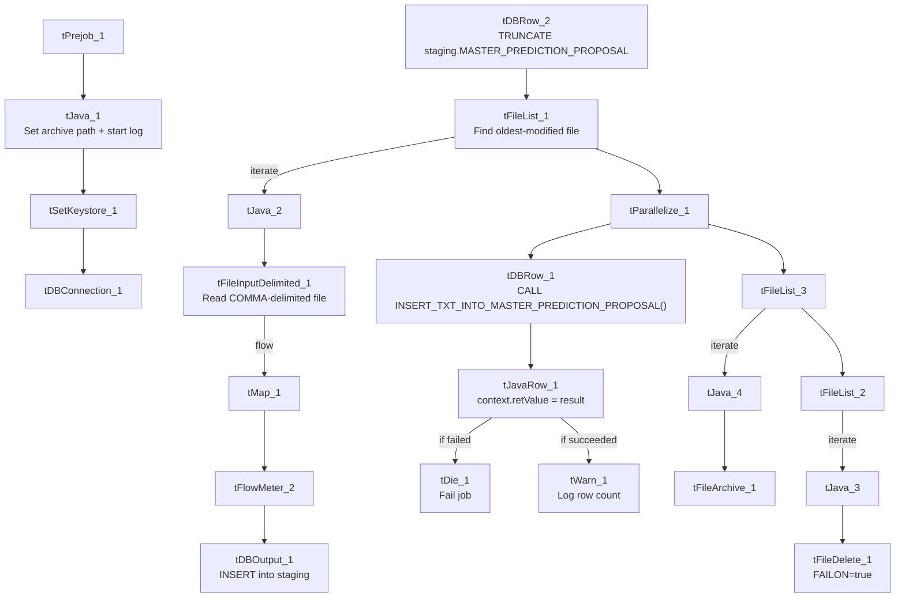

# Talend Job: master_prediction_proposal_Load

## Overview

This job loads predicted-outreach proposals (which contact channel and message template to try next for an account, the associated phone number, subteam, text type, and a proposed settlement amount, plus VoApps-specific fields for voice message delivery) into Snowflake. It follows the truncate → load → check-result → archive/delete pattern seen in other jobs with explicit merge-result handling, but with one important difference: the step that folds staged rows into the permanent table is an **`INSERT` stored procedure, not a `MERGE`** — the only job in this set of 9 where that's true.

## Detail table

| Field | Value |
|---|---|
| Job name | master_prediction_proposal_Load |
| Version | 0.1 |
| Project | LATITUDE |
| Author | jmach@harriscollect.com |
| Created | 2026-03-11T14:43:22.039-0700 |
| Last Modified | 2026-03-12T19:47:23.647-0700 |

## Step-by-step data flow

1. **Set up.** `tPrejob_1` triggers `tJava_1`, which appends today's date to `context.archiveDir` and opens a log file; this chains into `tSetKeystore_1` and `tDBConnection_1`.
2. **Empty the staging table.** `tDBRow_2` runs `TRUNCATE TABLE LIQUID_STAGING.MASTER_PREDICTION_PROPOSAL;` (component named `_2`, not `_1` — see Issues observed for the numbering quirk, same pattern as `Dialer_CallTracking_Load`).
3. **Find the file.** `tFileList_1` lists files in `context.sourceDir` (skipping `*.txt`), explicitly sorted by modified date, ascending — oldest file first, the same pattern used by `Dialer_CallTracking_Load`, `ScheduledPayment_Text_Load`, and `Voapps_Response_Load`.
4. **Read the file.** `tFileInputDelimited_1` reads it with `FIELDSEPARATOR: ","` and `ROWSEPARATOR: "\n"` — comma-delimited, not the project's usual pipe format (the same deviation seen in `Voapps_Response_Load`, and unsurprising given this data includes the same VoApps-related columns). US-ASCII encoded, `DIE_ON_ERROR: false`.
5. **Transform.** `tMap_1` maps the columns (account number, proposed channel, template, phone number, subteam, text type, settlement amount, and the VoApps target date/caller number/message ID/zip code/voice-append flag/Hermes request ID) onto the `MASTER_PREDICTION_PROPOSAL` schema, adding `LOAD_DT`.
6. **Load staging.** Mapped rows pass through a row counter (`tFlowMeter_2`) into `tDBOutput_1`, inserting into `MASTER_PREDICTION_PROPOSAL`.
7. **Insert into the permanent table and check the result — in parallel with cleanup.** Once the file-list subjob completes, `tParallelize_1` splits into:
   - **Insert branch:** `tDBRow_1` calls `CALL INSERT_TXT_INTO_MASTER_PREDICTION_PROPOSAL();` — note the procedure name itself says `INSERT_TXT_INTO_...`, not `MERGE_TXT_INTO_...` like every other job in this project. `tJavaRow_1` copies the returned value into `context.retValue`, and the job runs `tDie_1` (fails the job: `"MERGE failed - error code " + context.retValue"`, exit code 4 — note the error message text still says "MERGE failed" even though the underlying procedure is an insert, likely copy-pasted from the standard pattern) or `tWarn_1` (logs `"<count> rows inserted or updated"`, severity 42) depending on the outcome.
   - **Cleanup branch:** the source file is listed again (`tFileList_3`), archived (`tFileArchive_1`); a second listing (`tFileList_2`) drives deletion (`tFileDelete_1`, with `FAILON: true`).

## Settings tables

### Source: `tFileInputDelimited_1`

| Setting | Value | What it means |
|---|---|---|
| FILENAME | `context.filePath` | Reads whichever file `tFileList_1` just found. |
| FIELDSEPARATOR | `,` | Comma-separated — not the project's usual `\|~\|` pipe format. |
| ROWSEPARATOR | `\n` | Plain newline-delimited rows. |
| ENCODING | US-ASCII | Plain ASCII text. |
| DIRECTORY ordering (`tFileList_1`) | `ORDER_BY_MODIFIEDDATE=true`, ascending | Explicitly processes the oldest untouched file first. |

### Target: `tDBOutput_1`

| Setting | Value | What it means |
|---|---|---|
| Table | MASTER_PREDICTION_PROPOSAL | Staging table for prediction/proposal records. |
| Output action | INSERT | Adds rows only. |

### Insert step & result check: `tDBRow_1` → `tJavaRow_1` → `tDie_1` / `tWarn_1`

| Setting | Value | What it means |
|---|---|---|
| Query (`tDBRow_1`) | `CALL INSERT_TXT_INTO_MASTER_PREDICTION_PROPOSAL();` | Runs a Snowflake procedure that inserts staged rows into the permanent table — an `INSERT`, not a `MERGE`, which is the naming convention every other `MERGE_TXT_INTO_*` procedure in the project follows. |
| `tDie_1` message | `"MERGE failed - error code " + context.retValue` (exit code 4) | Fails the job if the procedure reports an error. The message text says "MERGE failed" even though the procedure is an insert — likely reused boilerplate from the standard pattern. |
| `tWarn_1` message | `context.retValue + " rows inserted or updated"` (severity 42) | Logs a row count and continues on success. |

## Dependencies & configuration

- **Triggers/depends on other jobs:** none found — no `tRunJob` links.
- **Context variables used:** `context.sourceDir`, `context.archiveDir`, `context.filePath`, `context.fileName`, `context.logDir`, `context.keystorePath`, `context.retValue` (all `Directories_0.1` plus the job-local `retValue`). Uses the shared Snowflake connection object, not `LEGACY_DW_*` variables directly.
- **Related jobs:** the loaded `hermes_request_id` and VoApps columns closely mirror those in `Voapps_Response_Load` and the Hermes recommendation jobs, though no `tRunJob` link exists between them.
- **Hardcoded values found:** `tSetKeystore_1.SSL_TRUSTSERVER_TRUSTSTORE`, `tFileInputDelimited_1.TEMP_DIR`, `tFileDelete_1.DIRECTORY`/`PATH`, and `tFileArchive_1.SOURCE_FILE` are fixed paths rather than context variables.

## Glossary

| Component type | Plain-English meaning |
|---|---|
| `tPrejob` / `tParallelize` | Setup-before-main-start, concurrent branches (see job_Address_Text_Load.md). |
| `tFileList` | Lists files for the job to loop over (see job_Address_Text_Load.md). |
| `tFileInputDelimited` | Reads a delimited text file (see job_Address_Text_Load.md). |
| `tMap` | Maps/transforms columns (see job_Address_Text_Load.md). |
| `tFlowMeter` | Counts rows passing a point, for logging (see job_Address_Text_Load.md). |
| `tDBOutput` / `tSnowflakeOutput` | Writes rows into Snowflake (see job_Address_Text_Load.md). |
| `tDBRow` / `tSnowflakeRow` | Runs a single SQL statement (see job_Address_Text_Load.md). |
| `tJava` / `tJavaRow` | Custom code blocks; `tJavaRow` here captures the insert procedure's return value (see job_cmi_Hermes_Recommendations_Load.md). |
| `tDie` | Fails the job immediately with a message and exit code (see job_cmi_Hermes_Recommendations_Load.md). |
| `tWarn` | Logs a warning without failing the job (see job_cmi_Hermes_Recommendations_Load.md). |
| `tFileArchive` | Zips a file into an archive location (see job_Address_Text_Load.md). |
| `tFileDelete` | Deletes a file from disk (see job_Address_Text_Load.md). |
| `tSetKeystore` | Configures the SSL keystore for the Snowflake connection (see job_Address_Text_Load.md). |

## Issues observed

- **This job calls an `INSERT` procedure, not a `MERGE` procedure — unlike every other load job in the project.** `INSERT_TXT_INTO_MASTER_PREDICTION_PROPOSAL()` inserts staged rows rather than reconciling (matching/updating/inserting) them the way `MERGE_TXT_INTO_*` procedures do elsewhere. **This raises a real question of whether reprocessing the same source file (or reprocessing after a failed run) would insert duplicate rows into the permanent `MASTER_PREDICTION_PROPOSAL` table**, since there's no merge-key matching to prevent it. This should be confirmed with whoever owns the Snowflake procedure — is there deduplication logic inside the procedure itself, or is this table expected to only ever receive strictly new, never-repeated rows?
- **The `tDie_1` failure message says "MERGE failed"** even though the procedure being called is an insert — cosmetic, but could mislead someone triaging a failure log into looking for merge-specific issues that don't apply here.
- **Component numbering is reversed from the usual convention** (`tDBRow_1` = the insert/proc call, `tDBRow_2` = the truncate) — same quirk as `Dialer_CallTracking_Load`.
- **Source file format deviates from the project standard** — comma-delimited rather than the usual `\|~\|`/`\|$\|` pipe format, consistent with `Voapps_Response_Load`'s similar VoApps-related data.
- **The exact pass/fail threshold on `context.retValue` isn't in the metadata** — same caveat as the other `tDie`/`tWarn` jobs in this project.
- **File pickup order deviates from the norm** — explicitly oldest-first.
