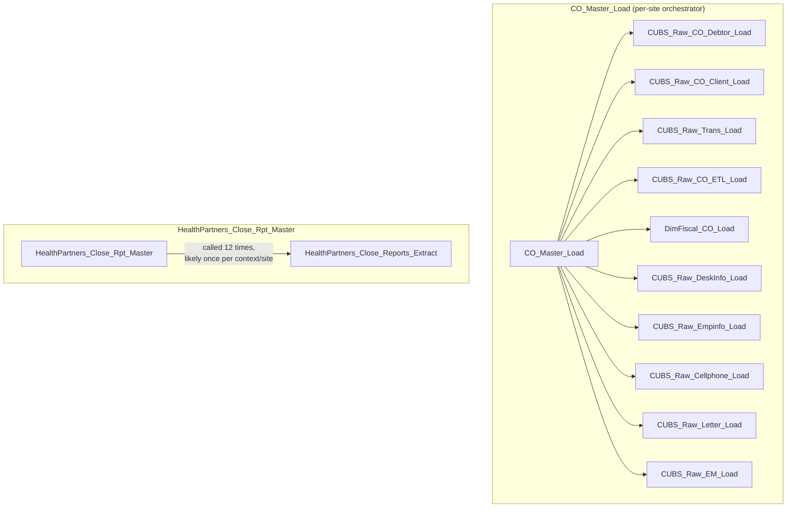

# Data Lineage Map — EDW2SF Project

## Overview

A source system feeds a Talend job, the job lands rows in a Snowflake (or, for a few jobs, a different target) table, and from there the trail goes cold unless a downstream report/export job picks that table back up. This project also has a layer of **job-to-job orchestration** — a handful of jobs call other jobs via `tRunJob` rather than everything running independently. The table below is built directly from each job's Snowflake/file output components in the extracted metadata, not inferred from job names alone.

## Orchestration chains (job → job via `tRunJob`)

14 jobs call at least one other job. The two clearest full pipelines:

Other orchestration links found: `CUBS_Raw_Debtor_Load` → one `CUBS_Raw_<Site>_Debtor_Load` job per site (DC, HH, CO, CHI, PRE); `CUBS_Raw_ETL_Load` → one `CUBS_Raw_<Site>_ETL_Load` per site (DC, HH, CO, CHI, PRE, TOL); `DimCellphone_Load`, `EMail_Address_Load`, `CUBS_PostDates_Load`, `Export_Hermes_APC_Master_Prediction`, and `Extract_Hermes_Master_Prediction` each call one shared job multiple times (`CUBS_Raw_Cellphone_Load`, `CUBS_Raw_EMail_Address_Load`, `CUBS_Raw_PostDate_Load`, and `master_prediction_proposal_cubs_extract` respectively) — most likely once per site/context, though the exact context passed on each call is unable to determine from metadata without inspecting each `tRunJob`'s `CONTEXT_NAME`/`PROCESS:PROCESS_TYPE_CONTEXT` individually (see each job's own doc). `DimDeskInfo_Load`, `DimEmployeeInfo_Load`, `Fact_Electronic_Media_Load`, and `PaymentPlan_Load` each call `CUBS_Raw_File_Load` once.

Notably, only **one** site (`CO`) has its own full `<Site>_Master_Load` orchestrator in this metadata. If CHI, DC, HH, PRE, and TOL run the same per-site sequence of jobs, whatever triggers them (an external scheduler, or Master jobs not present in this export) is unable to determine from metadata — verify with team.

## Job → target table/file (full list)

| Job | Target(s) |
|---|---|
| `ADP_Employee_Load` | `ADP_EMPLOYEE` |
| `ADP_Employee_Raw_Load` | `TRANSFORM_EMPLOYEE_IMPORT_RAW` |
| `ADP_Payroll_Load` | `ADP_PAYROLL` |
| `ADP_Roster_Load` | `ADP_ROSTER` |
| `Activity_Load_Daily` | `ACTIVITY` |
| `Activity_Load_Legacy` | `ACTIVITY_BACKFILL` |
| `AgentKPI_Daily_Load` | `AGENTKPI_DAILYV3` |
| `Avita_Monthly_Report_Extract` | writes a file (no Snowflake table) |
| `Backfill_Debtor_Cell_Phone_f83` | `DEBTOR_CELL_PHONE_F83` |
| `Backfill_Debtor_Phones` | `DEBTOR_PHONE_SP` |
| `Bad_Phone_Load` | `BADPHN_DONOTCALL_STAGING` |
| `CFDAILY_Load` | `CFDAILY`, `CFDAILY` |
| `CHI_E_Media_Load` | `CHI_ELECTRONICSMEDIA` |
| `CLT_XFR_DT_Load` | `CLT_XFR_DT_CATCHUP` |
| `CO_DEBTOR_SPECIAL_BACKFILL_LOAD` | `CO_DEBTOR_SPECIAL` |
| `CO_Debtor_TrueUp` | `CUBS_DEBTOR_RAW_CO_CURRENT` |
| `CO_E_Media_Load` | `CO_ELECTRONICSMEDIA` |
| `CO_Master_Load` | orchestrator only — see chain above |
| `CREATE_RAW_CUBS_CLIENT` | — |
| `CRPLoad` | `CRPDATA` |
| `CUBS_EMail_Address_Load` | `DIM_ELECTRONIC_MEDIA` |
| `CUBS_PostDates_Load` | orchestrator only — see chain above |
| `CUBS_Raw_Activity_Load` | `CUBS_ACTIVITY_RAW_CURRENT` |
| `CUBS_Raw_CHI_Client_Load` | `CUBS_CLIENT_RAW_CURRENT` |
| `CUBS_Raw_CHI_Debtor_Load` | `CUBS_DEBTOR_RAW_CHI_CURRENT` |
| `CUBS_Raw_CHI_Debtor_Load_No_Delete` | `CUBS_DEBTOR_RAW_CHI_CURRENT` |
| `CUBS_Raw_CHI_Debtor_Load_Upsert` | `CUBS_DEBTOR_RAW_CHI_CURRENT` |
| `CUBS_Raw_CHI_ETL_Load` | `CUBS_ETL_RAW_CURRENT` |
| `CUBS_Raw_CO_Client_Load` | `CUBS_CLIENT_RAW_CURRENT` |
| `CUBS_Raw_CO_Debtor_Load` | `CUBS_DEBTOR_RAW_CO_CURRENT` |
| `CUBS_Raw_CO_Debtor_Load_No_Delete` | `CUBS_DEBTOR_RAW_CO_CURRENT` |
| `CUBS_Raw_CO_Debtor_Load_Upsert` | `CUBS_DEBTOR_RAW_CO_CURRENT` |
| `CUBS_Raw_CO_ETL_Load` | `CUBS_ETL_RAW_CURRENT` |
| `CUBS_Raw_Cellphone_Load` | `CUBS_CELLPHONE_RAW` |
| `CUBS_Raw_Client_Load` | `CUBS_CLIENT_RAW_CURRENT` |
| `CUBS_Raw_DC_Client_Load` | `CUBS_CLIENT_RAW_CURRENT` |
| `CUBS_Raw_DC_Debtor_Load` | `CUBS_DEBTOR_RAW_DC_CURRENT` |
| `CUBS_Raw_DC_Debtor_Load_No_Delete` | `CUBS_DEBTOR_RAW_DC_CURRENT` |
| `CUBS_Raw_DC_Debtor_Load_Upsert` | `CUBS_DEBTOR_RAW_DC_CURRENT` |
| `CUBS_Raw_DC_ETL_Load` | `CUBS_ETL_RAW_CURRENT` |
| `CUBS_Raw_Debtor_Load` | orchestrator only — see chain above |
| `CUBS_Raw_Debtor_Load_Test` | orchestrator only — see chain above |
| `CUBS_Raw_DeskInfo_Load` | `CUBS_DESKINFO_RAW` |
| `CUBS_Raw_EM_Load` | `CUBS_EM_RAW_CURRENT` |
| `CUBS_Raw_EMail_Address_Load` | `DIM_ELECTRONIC_MEDIA` |
| `CUBS_Raw_ETL_Load` | orchestrator only — see chain above |
| `CUBS_Raw_Empinfo_Load` | `CUBS_EMPINFO_RAW_CURRENT` |
| `CUBS_Raw_File_Load` | — |
| `CUBS_Raw_HH_Client_Load` | `CUBS_CLIENT_RAW_CURRENT` |
| `CUBS_Raw_HH_Debtor_Load` | `CUBS_DEBTOR_RAW_HH_CURRENT` |
| `CUBS_Raw_HH_Debtor_Load_No_Delete` | `CUBS_DEBTOR_RAW_HH_CURRENT` |
| `CUBS_Raw_HH_Debtor_Load_Upsert` | `CUBS_DEBTOR_RAW_HH_CURRENT` |
| `CUBS_Raw_HH_ETL_Load` | `CUBS_ETL_RAW_CURRENT` |
| `CUBS_Raw_Letter_Load` | `CUBS_LETTER_RAW_CURRENT` |
| `CUBS_Raw_PRE_Client_Load` | `CUBS_CLIENT_RAW_CURRENT` |
| `CUBS_Raw_PRE_Debtor_Load` | `CUBS_DEBTOR_RAW_PRE_CURRENT` |
| `CUBS_Raw_PRE_Debtor_Load_No_Delete` | `CUBS_DEBTOR_RAW_PRE_CURRENT` |
| `CUBS_Raw_PRE_Debtor_Load_Upsert` | `CUBS_DEBTOR_RAW_PRE_CURRENT` |
| `CUBS_Raw_PRE_ETL_Load` | `CUBS_ETL_RAW_CURRENT` |
| `CUBS_Raw_Payplan_Load` | `CUBS_PAYPLAN_RAW_CURRENT` |
| `CUBS_Raw_PostDate_Load` | `CUBS_POSTDATE_RAW_CURRENT` |
| `CUBS_Raw_TOL_Client_Load` | `CUBS_CLIENT_RAW_CURRENT` |
| `CUBS_Raw_TOL_Debtor_Load` | `CUBS_DEBTOR_RAW_TOL_CURRENT` |
| `CUBS_Raw_TOL_ETL_Load` | `CUBS_ETL_RAW_CURRENT` |
| `CUBS_Raw_Trans_Load` | `CUBS_TRANS_RAW_CURRENT` |
| `CUBS_Raw_Trans_Load_Special` | `CUBS_TRANS_RAW_CURRENT` |
| `CallDetail_40_Load_History` | `I3_CALLDETAIL_40` |
| `Call_Campaign_Results_Extract` | writes a file (no Snowflake table) |
| `Callminer_HH_Metadata_Daily_Extract` | writes a file (no Snowflake table) |
| `Carle_Asset_Scrub` | writes a file (no Snowflake table) |
| `City_of_Phi_C1A_PDR_Extract` | writes a file (no Snowflake table) |
| `Client_NonCUBS_Attributes` | `CLIENT_ATTRIBUTES` |
| `Collector_Payment_Detail_Load` | `COLLECTOR_PAYMENT_DETAIL` |
| `Columbia_Doctors_Legal_Rpt` | writes a file (no Snowflake table) |
| `Copy_of_i3_DialerCallListTOL_Load_Backup` | `I3_DIALERCALLLIST_CO` |
| `DC_Call_Contact_Exceptions_1` | writes a file (no Snowflake table) |
| `DC_Call_Contact_Exceptions_2` | — |
| `DC_E_Media_Load` | `DC_ELECTRONICSMEDIA` |
| `DC_SSN_Extract` | writes a file (no Snowflake table) |
| `DEBTOR_UPDATES_20230807` | `DEBTOR_UPDATE_20230807`, `DEBTOR_UPDATE_20230807` |
| `DIMDEBTOR_FISCALS_20230713` | `DIMDEBTOR_FISCALS` |
| `DNIS_Load` | `I3_DNIS` |
| `DNIS_Org_Load` | `I3_DNIS_ORG` |
| `Daily_Fee_Projection_Load` | `TRANSFORM_DAILY_FEE_MANUALS` |
| `Debtor_Deleted_Load` | `DEBTOR_DELETED` |
| `Debtor_Derived_Load` | — |
| `Debtor_Status_Load` | `DEBTOR_STATUS_UPDATE` |
| `Debtor_Status_Load_MSSQL` | — |
| `Debtor_Strat_Backfill` | `TMP_DIMDEBTOR_BACKFILL`, `TMP_DIMDEBTOR_BACKFILL` |
| `Dialer_Grp_Transform_Inputs_Load` | `DIALERGRP_TRANSFORM_AGG_OVERRIDE`, `DIALERGRP_TRANSFORM_LOOKUP_DISTRIBUTION` |
| `DimCellphone_Load` | orchestrator only — see chain above |
| `DimClient_Load` | `DIMCLIENT`, `DIMDEPARTMENT`, `DIMGLCODE`, `STG_DIM_CLIENT` |
| `DimDate_Load` | `DIMDATE` |
| `DimDebtor_Load` | `DIMDEBTOR`, `STG_DIM_DEBTOR` |
| `DimDebtor_NewFields_Load` | `DIMDEBTOR_NEWFIELDS` |
| `DimDepartment_and_GL_Load` | `DIMDEPARTMENT`, `DIMGLCODE` |
| `DimDeskInfo_Load` | orchestrator only — see chain above |
| `DimEmployeeInfo_Load` | orchestrator only — see chain above |
| `DimFiscal_CHI_Load` | — |
| `DimFiscal_CO_Load` | — |
| `DimFiscal_DC_Load` | — |
| `DimFiscal_HH_B_TrueUp` | `DIMFISCAL_HH_B_TRUEUP` |
| `DimFiscal_HH_Load` | — |
| `DimFiscal_PRE_Load` | — |
| `DimFiscal_TOL_Load` | — |
| `DimScore_Load` | `FISCAL_HH_E`, `FISCAL_HH_C`, `SUNGARD_SCORE` |
| `DimStatus_Load` | `DIMSTATUSCODE` |
| `DoNotCall_Load` | `DNC_DONOTCALL_STAGING` |
| `DoNotCall_Load_Full` | `DNC_DONOTCALL_STAGING` |
| `EMail_Address_Load` | orchestrator only — see chain above |
| `ERC_Event_Report_Load` | `ERC_EVENT_REPORT` |
| `ETR_Load` | `ETR` |
| `EmployeeHrsWorked_Load` | `EMPLOYEEHRSWORKED` |
| `EmployeeRates_Load` | `EMPLOYEERATES` |
| `Employee_Collector_Load` | `EMPLOYEE_COLLECTOR` |
| `EncryptValue_ContextVariable` | — |
| `Encrypt_CHI_Fiscal_Tax_Code` | `TMP_CHI_TAXCODE` |
| `Encrypt_CO_Fiscal_A_F18_A` | `DIMFISCAL_CO_A_UPDATE` |
| `Equibli_Extract` | writes a file (no Snowflake table) |
| `Export_Hermes_APC_Master_Prediction` | orchestrator only — see chain above |
| `Extract_CHI_Hermes_Decile` | writes a file (no Snowflake table) |
| `Extract_CO_Hermes_Decile` | writes a file (no Snowflake table) |
| `Extract_DC_Hermes_Decile` | writes a file (no Snowflake table) |
| `Extract_DDNPII` | — |
| `Extract_Equabli_GOV` | writes a file (no Snowflake table) |
| `Extract_Equabli_HC_Validation_Score` | writes a file (no Snowflake table) |
| `Extract_Equabli_Reports` | writes a file (no Snowflake table) |
| `Extract_Equibli_Test` | writes a file (no Snowflake table) |
| `Extract_HH_Hermes_Decile` | writes a file (no Snowflake table) |
| `Extract_HH_Hermes_ValDecile` | writes a file (no Snowflake table) |
| `Extract_Hermes_Master_Prediction` | orchestrator only — see chain above |
| `Extract_Letter_Count` | — |
| `Extract_Letter_Count_to_Hyper` | — |
| `Extract_MSSQL_COCHI_Debtor` | `CHI_DEBTOR` |
| `Extract_No_Dialer_Test_CHI` | writes a file (no Snowflake table) |
| `Extract_No_Dialer_Test_CO` | writes a file (no Snowflake table) |
| `Extract_No_Dialer_Test_DC` | writes a file (no Snowflake table) |
| `Extract_No_Dialer_Test_HH` | writes a file (no Snowflake table) |
| `Extract_No_Dialer_Test_TOL` | writes a file (no Snowflake table) |
| `Extract_PRE_Hermes_Decile` | writes a file (no Snowflake table) |
| `Extract_ProInsights_Data` | writes a file (no Snowflake table) |
| `Extract_TOL_Hermes_Decile` | writes a file (no Snowflake table) |
| `FactLetter_Load` | `FACTLETTERS` |
| `FactPaymentManager_Load` | `FACTPAYMENTMANAGER` |
| `FactPostDates_Load` | `FACTPOSTDATES` |
| `FactTrans_Load` | `FACTTRANS` |
| `FactTrans_TCODE_COLLECTOR_Load` | `TRANS_TCODE_COLLECTOR` |
| `Fact_Electronic_Media_Load` | orchestrator only — see chain above |
| `Fran_Bai_Backlog` | writes a file (no Snowflake table) |
| `HH_DEBTOR_SPECIAL_20231016_LOAD` | `HH_DEBTOR_LAST_BILL_DT` |
| `HH_EMedia_Load` | `HH_EMESSAGE` |
| `HH_E_Media_Load` | `HH_ELECTRONICSMEDIA` |
| `HH_TRANS_NORTHSHORE_LOAD` | `HH_TRANS_NORTHSHORE` |
| `HH_VAL_LTR_DATE_Backfill` | `TMP_HH_VAL_LTR_DATE` |
| `HOPE_Credit_Request` | `CREDIT_REQUEST` |
| `HOPE_Goals_Load` | `HOPE_GOALS` |
| `HOPE_Notes_Load` | `NOTES` |
| `HOPE_SPTransactions_Load` | `TRANS` |
| `HOPE_Transactions_Load` | `HOPE_TRANSACTION` |
| `HUB_Departments_Load` | `DEPARTMENTS` |
| `HUB_HH_Employee_Load` | `HH_EMPLOYEES` |
| `HUB_Segments_Load` | `SEGMENTS` |
| `HUB_Teams_Load` | `TEAMS` |
| `HUB_TempTransaction_Load` | `TRANSACTIONTEMP` |
| `HUB_Transactions_Load` | `TRANSACTIONS` |
| `HealthPartners_Close_Reports_Extract` | writes a file (no Snowflake table) |
| `HealthPartners_Close_Rpt_Master` | orchestrator only — see chain above |
| `I3_CALLDETAIL_DEDOR_LOAD` | `I3_CALLDETAIL_40` |
| `IDOR_Amnesty_Extract` | writes a file (no Snowflake table) |
| `INPUT_DIALER_LIST_GOV_Load` | `INPUT_DIALER_LIST_UNIONED_GOV` |
| `INPUT_DIALER_LIST_HC_Load` | `INPUT_DIALER_LIST_UNIONED_HC` |
| `ISO_Request_Export` | writes a file (no Snowflake table) |
| `Initial_Ins_Discovery_V2_Decrypted` | writes a file (no Snowflake table) |
| `Initial_Insurance_Discovery_File` | writes a file (no Snowflake table) |
| `Ins_Cvg_Debtor_NPI_Load` | `INS_CVG_DEBTOR_NPI` |
| `Insurance_Discovery_Load` | `INSURANCE_DISCOVERY` |
| `Insurance_Discovery_Scrub_Extract` | writes a file (no Snowflake table) |
| `Insurance_Discovery_Test` | writes a file (no Snowflake table) |
| `Insurance_Report_Extract` | writes a file (no Snowflake table) |
| `LW_COC_Water_Scrub` | writes a file (no Snowflake table) |
| `LW_Carle_Asset_Scrub` | writes a file (no Snowflake table) |
| `LW_Dashboard_Base_Report` | writes a file (no Snowflake table) |
| `LW_Dashboard_By_Agent` | writes a file (no Snowflake table) |
| `LW_Dashboard_By_Metric` | writes a file (no Snowflake table) |
| `LW_Delaware_Focus_Attributes` | writes a file (no Snowflake table) |
| `LW_Delaware_Focus_Attributes_Granular` | writes a file (no Snowflake table) |
| `LW_Delaware_Scorecard_Report` | writes a file (no Snowflake table) |
| `LW_Deleware_Audit_Scorecard` | writes a file (no Snowflake table) |
| `LW_HPS_Audit_Scorecard` | writes a file (no Snowflake table) |
| `LW_HPS_Focus_Attributes` | writes a file (no Snowflake table) |
| `LW_HPS_Focus_Attributes_Granular` | writes a file (no Snowflake table) |
| `LW_Insurance_Pmt_Tracking` | writes a file (no Snowflake table) |
| `LW_Lurie_Audit_Scorecard` | writes a file (no Snowflake table) |
| `LW_Lurie_Focus_Attributes` | writes a file (no Snowflake table) |
| `LW_Lurie_Focus_Attributes_Granular` | writes a file (no Snowflake table) |
| `LW_Manual_Audit_Scorecard` | writes a file (no Snowflake table) |
| `LW_ProMedica_Scrub` | writes a file (no Snowflake table) |
| `LW_Property_Scrub` | writes a file (no Snowflake table) |
| `LW_REPORTS` | writes a file (no Snowflake table) |
| `LW_REPORTS_2` | writes a file (no Snowflake table) |
| `LW_TPL_PMT_REPORT` | writes a file (no Snowflake table) |
| `Last4SSN_Extract` | `LAST4SSN` |
| `LegalMatch_Extract` | writes a file (no Snowflake table) |
| `Legal_Asset_Scrub_Champaign_County_Extract` | writes a file (no Snowflake table) |
| `Legal_Asset_Scrub_Illinois_Counties_Extract` | writes a file (no Snowflake table) |
| `Legal_Asset_Scrub_Illinois_Counties_Extract_2` | writes a file (no Snowflake table) |
| `Legal_Asset_Scrub_KDOR_Extract` | writes a file (no Snowflake table) |
| `Livevox_Daily_Load` | `LIVEVOX_CALLS` |
| `Livevox_Sample_Load` | `LIVEVOX_CALLS` |
| `LoadLegalRpt20231130` | writes a file (no Snowflake table) |
| `Load_837_Files` | — |
| `Load_Attunely_Data` | `ATTUNELY_PERFORM_DATA` |
| `Load_Debtor_New_Columns` | `SPRING_FOUR` |
| `Load_Employee_Collector_History` | `EMPLOYEE_COLLECTOR_HISTORY` |
| `Load_Evergreen_Hours` | `EVERGREEN_AGENT_HOURS` |
| `Load_HH_Debtor_Special_20251222` | `HH_DEBTOR_SPECIAL_20251222` |
| `Load_Misc_Dims` | `DIMLOGON`, `DIMDESKINFO`, `DIMEMPLOYEEINFO` |
| `Load_PCI_Letter_Disp_Desc` | `PCI_Letter_Disp` |
| `MBoich_Experian_Extracts` | writes a file (no Snowflake table) |
| `Mail_Merge_Load` | `MAIL_MERGE` |
| `MaxRTE_Request_Export` | writes a file (no Snowflake table) |
| `MaxRTE_Result_Load` | `MAXRTE_RESPONSE_LOG` |
| `Migrating_Clients_20260424` | `UTILITY_CLIENT_EXCLUDE_LIST` |
| `Northwestern_Future_Appts` | `NORTHWESTERN_UPCOMING_APPTS` |
| `Notes_Load` | `NOTES` |
| `PA_Turnpike_Load` | `PA_TURNPIKE` |
| `PCI_LETTERS_TO_DELETE` | `PCI_LETTERS_TO_DELETE` |
| `PCI_Letter_Load` | `PCI_LETTERS` |
| `PDC_Plan_Txn_Backfill` | `TMP_TRANS_BACKFILE`, `TMP_TRANS_BACKFILE` |
| `PRE_E_Media_Load` | `PRE_ELECTRONICSMEDIA` |
| `PV_PostDate_Export_Load` | `PV_POSTDATE` |
| `PaymentPlan_Legacy_Load` | `PAYMENTPLAN` |
| `PaymentPlan_Load` | orchestrator only — see chain above |
| `PaymentVision_Activity_Load` | `PAYMENTVISION_ACTIVITY` |
| `ProInsight_Analytics_Load` | `PROINSIGHT_ANALYTICS` |
| `ProInsight_CCU_Scorecard_Load` | `PROINSIGHT_CCU_SCORECARD` |
| `ProInsight_CCU_Scorecard_V2_Load` | `PROINSIGHT_CCU_V2_SCORECARD` |
| `ProInsight_HPS_Scorecard_Load` | `PROINSIGHT_HPS_SCORECARD` |
| `ProInsight_Scorecard_Load` | `PROINSIGHT_SCORECARD` |
| `Raw_PCI_Letter_Load` | `PCI_LETTERS`, `DEBTOR_ADDRESSES` |
| `SMS_IC_Inbound_Load` | `TEXTS_IC_INBOUND` |
| `SMS_IC_Outbound_Load` | `TEXTS_IC_OUTBOUND` |
| `SMS_IC_Outbound_Load_Backfill` | `TEXTS_IC_OUTBOUND` |
| `SMS_Inbound_Load` | `TEXTS_SBT_INBOUND` |
| `SMS_Outbound_Load` | `TEXTS_SBT_OUTBOUND` |
| `Semaphore_Check` | — |
| `SendGrid_Report_Load` | `FACT_EMAILS_SENDGRID` |
| `Skip_Costs_Load` | `SKIP_COSTS` |
| `TEST_Avita_Monthly_Report_Extract` | writes a file (no Snowflake table) |
| `TEST_Date_Params` | — |
| `TEST_Email_Alerts` | — |
| `Test_Decryption` | writes a file (no Snowflake table) |
| `Test_Encryption` | writes a file (no Snowflake table) |
| `Top_N_Accounts_All_Extract` | writes a file (no Snowflake table) |
| `Top_N_Accounts_Extract` | writes a file (no Snowflake table) |
| `Touchstar_DNC_Load` | `TOUCHSTAR_DONOTCALL_STAGING` |
| `Trans_History_Load` | `TEMP_TRANS` |
| `VAT_1394_Load` | `VAT_1394` |
| `VA_Tax_Inventory_Report` | writes a file (no Snowflake table) |
| `VA_Tax_Report_Load` | `VA_TAX_RECON_REPORT` |
| `VA_Tax_Report_Split` | writes a file (no Snowflake table) |
| `Voapp_File_Load` | `VOAPPS` |
| `i3_AgentActivityLog_Load` | `I3_AGENTACTIVITYLOG` |
| `i3_AgentQueueStats_Load` | `I3_AGENTQUEUESTATS` |
| `i3_AgentStats` | `I3_AGENTSTATS` |
| `i3_CRC_Load` | `I3_CRC` |
| `i3_CallDetail_40_Load` | `I3_CALLDETAIL_40` |
| `i3_CallDetail_40_Load_Copy` | `I3_CALLDETAIL_40` |
| `i3_CallDetail_viw_Load` | `I3_CALLDETAIL_VIW` |
| `i3_CallHistory_Load` | `I3_CALLHISTORY` |
| `i3_Call_Detail_View_Init_Load` | — |
| `i3_Campaign_Type_Load` | `I3_CAMPAIGN_TYPE` |
| `i3_DialerCallListCHI_Load` | `I3_DIALERCALLLIST_CHI` |
| `i3_DialerCallListCO_Load` | `I3_DIALERCALLLIST_CO` |
| `i3_DialerCallListCO_Load_Backup` | `I3_DIALERCALLLIST_CO` |
| `i3_DialerCallListDC_Load` | `I3_DIALERCALLLIST_DC` |
| `i3_DialerCallListDC_Load_Backup` | `I3_DIALERCALLLIST_DC` |
| `i3_DialerCallListHH_Load` | `I3_DIALERCALLLIST_HH` |
| `i3_DialerCallListHH_Load_Backup` | `I3_DIALERCALLLIST_HH` |
| `i3_DialerCallListPRE_Load` | `I3_DIALERCALLLIST_PRE` |
| `i3_DialerCallListTOL_Load` | `I3_DIALERCALLLIST_TOL` |
| `i3_DialerCallListTOL_Load_Backup` | `I3_DIALERCALLLIST_TOL` |
| `i3_DialerCallList_DEDOR_Load` | `I3_DIALERCALLLIST_DEDOR` |
| `i3_Individual_Load` | `I3_INDIVIDUAL` |
| `i3_InteractionCustomAttributes_Load` | `I3_INTERACTIONCUSTOMATTRIBUTES` |
| `i3_InteractionSummaryEx_Load` | `I3_INTERACTIONSUMMARYEX` |
| `i3_InteractionSummary_Load` | `I3_INTERACTIONSUMMARY` |
| `i3_InteractionWrapup_Load` | `I3_INTERACTIONWRAPUP` |
| `master_prediction_proposal_cubs_extract` | writes a file (no Snowflake table) |

## Gaps

- **Stored-procedure/merge bodies are invisible to this trace**: wherever a job calls a Snowflake procedure to merge staging into a final table, that procedure's own SQL lives in Snowflake, not in this metadata.
- **Which context is active on each `tRunJob` call is not captured in this summary** — several orchestrator jobs call the same target job many times (e.g. 12 times for `HealthPartners_Close_Reports_Extract`), almost certainly once per site or partner, but confirming exactly which context/parameters differ per call requires opening each `tRunJob` component individually.
- **Qlik/Tableau consumption is entirely undocumented.** A `TableauVariables` context group and one `TableauOutput` component exist, but no Qlik metadata was supplied, so downstream BI consumption of these tables is unable to determine from metadata.
- **34 jobs write neither a Snowflake table nor a file** in what this metadata captures — some are pure orchestrators (expected), but others may write through a component type this extraction didn't specifically track (e.g. `tSnowflakeOutputBulkExec`, `TableauOutput`, or a JDBC-generic write) or may only read/validate. Each such job's own doc should be checked before assuming it does nothing.

