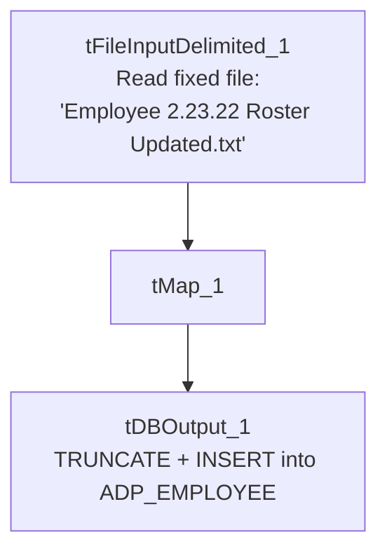

# Talend Job: ADP_Employee_Load

## Overview

Loads ADP employee-roster data (name, hire/termination dates, job title, department, position, supervisor, pay rate) from a single hardcoded local file into the Snowflake `ADP_EMPLOYEE` table, replacing the table's contents on each run. The job is extremely minimal — just three components, no connection-management, logging, archiving, or error-handling components at all — and its source filename embeds a specific date ("2.23.22"), strongly suggesting this was built as a one-time or occasional manual load rather than a recurring scheduled job (contrast with `ADP_Employee_Raw_Load`, its more fully-built near-namesake in this same project).

## Detail table

| Field | Value |
|---|---|
| Job name | ADP_Employee_Load |
| Version | 0.1 |
| Project | EDW2SF |
| Author | jmach@harriscollect.com |
| Created | 2022-02-24T15:42:32.335-0800 |
| Last Modified | 2025-09-24T11:00:52.060-0700 |

## Step-by-step data flow

This job has no `tPrejob`/`tPostjob`, no `tDBConnection`/`tDBClose`, and no logging setup — just a straight-line, three-component flow:

1. `tFileInputDelimited_1` reads a fixed file, `"C:/Data/Employee 2.23.22 Roster Updated.txt"` (tab-delimited, header row present, `DIE_ON_ERROR=false`), using a repository schema generically labeled `"...- metadata"` rather than anything employee-specific.
2. `tMap_1` maps the ~17 source columns down to 16 output columns (`FIRST_NAME`, `LAST_NAME`, `PAYROLL_NAME`, `HIRE_DATE`, `TERMINATION_DATE`, `JOB_TITLE_DESC`, `HOME_DEPT_DESC`, `RPT_TO_NAME`, `WFH`, `PRIMARY_ADDR_STATE`, `SUPERVISOR`, `PAY_DESC`, `POSITION_ID`, `FILE_NUMBER`, `SENIORITY_DATE`, `JOB_FUNCTION_DESC`, `PAYROLL_ID`).
3. `tDBOutput_1` writes the rows into Snowflake table `ADP_EMPLOYEE` (`INSERT`, `tableAction=TRUNCATE` — the table is fully cleared and reloaded in a single component step, not via a separate `tDBRow` TRUNCATE like other ADP jobs in this project).

## Settings tables

### Source: `tFileInputDelimited_1`

| Setting | Value | What it means |
|---|---|---|
| FILENAME | `"C:/Data/Employee 2.23.22 Roster Updated.txt"` | A fixed, dated local path — not a context variable, not a directory loop. Points to a specific snapshot file from February 2022. |
| FIELDSEPARATOR / HEADER | `\t` / 1 header row | Tab-delimited with a header row skipped. |
| SCHEMA | Repository schema `"...- metadata"` | Generically labeled, not tied to "employee" specifically (contrast with `ADP_Employee_Raw_Load`'s correctly-labeled `"adp_employee"` schema). |
| DIE_ON_ERROR | `false` | Malformed rows don't fail the job... |
| Reject flow | Not wired | ...but there's no connection to catch or record rejected rows — they're silently dropped. |

### Target: `tDBOutput_1` (`tSnowflakeOutput`)

| Setting | Value | What it means |
|---|---|---|
| Table | `ADP_EMPLOYEE` | Destination table. |
| Output action | `INSERT` | Appends the freshly read rows. |
| Table action | `TRUNCATE` | Clears the table immediately before inserting — a full replace on every run. |

## Dependencies & configuration

- **Triggers/depends on other jobs:** none — no `tRunJob` links found.
- **Context variables used:** none (`context_vars_referenced` is empty) — everything in this job is hardcoded.
- **1 hardcoded developer-workstation path** in `tFileInputDelimited_1.TEMP_DIR` (`C:/Talend-Studio-20211109_1610-V8.0.1/workspace`), the same project-wide risk pattern documented in `05_operational_runbook.md`.

## Glossary

| Component type | Plain-English meaning |
|---|---|
| `tFileInputDelimited` | Reads a delimited (CSV/TSV-style) text file according to a schema. |
| `tMap` | Maps/transforms columns from one schema to another. |
| `tSnowflakeOutput` | Writes rows into a Snowflake table, with configurable insert/truncate behavior. |

## Issues observed

- **The source filename is a fixed, dated snapshot ("Employee 2.23.22 Roster Updated.txt"), not a context variable or directory loop.** This is unambiguously a one-time or occasional manual load rather than a job meant to run repeatedly against fresh files. Unable to determine from metadata whether this job is still actively scheduled; if it is, it would keep reloading the same February 2022 file every time it runs. Verify with the team whether this job is still in active use.
- **No `tPrejob`/`tPostjob`, no `tDBConnection`/`tDBClose`, and no logging components exist anywhere in this job.** Unlike essentially every other job in this project (including its near-namesake `ADP_Employee_Raw_Load`), it's unclear from this metadata how the job obtains its Snowflake connection at all — it may rely on some implicit/default project-level connection not captured in this extraction, or the connection management may simply be missing. Verify directly in Talend Studio.
- **No reject-row handling, no archiving or deletion of the source file, and no downstream merge step** — the job writes directly into `ADP_EMPLOYEE` with `TRUNCATE`+`INSERT` and nothing else. This is a much thinner pattern than `ADP_Employee_Raw_Load`, which loads into a `_RAW` staging table specifically so a separate merge step can run afterward. Whether `ADP_EMPLOYEE` here is itself a final, consumed table or an orphaned intermediate one is unable to determine from metadata alone.
- **The schema label is generic ("metadata") rather than employee-specific**, unlike `ADP_Employee_Raw_Load`'s correctly-labeled `"adp_employee"` schema — a further sign this job's schema/repository wiring was never fully cleaned up, consistent with its one-off character.
