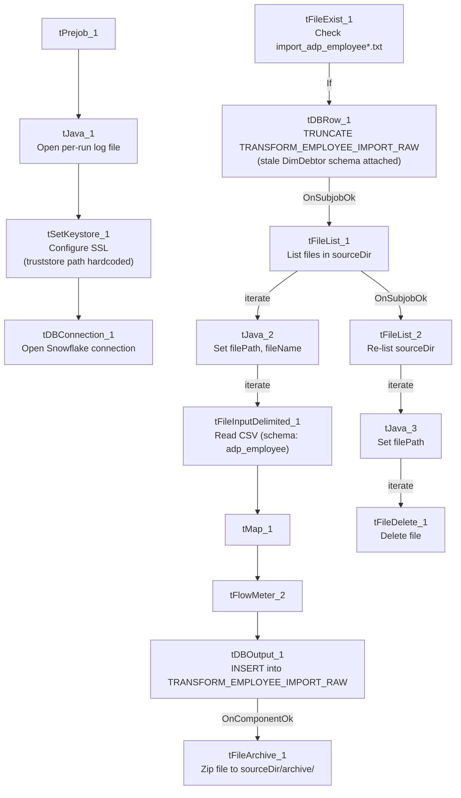

# Talend Job: ADP_Employee_Raw_Load

## Overview

Loads ADP employee-roster export files from a shared source directory into the Snowflake `TRANSFORM_EMPLOYEE_IMPORT_RAW` staging table, archiving each processed file and then deleting all files from the source directory in a separate second pass. The load is gated on a semaphore-style file-existence check (`import_adp_employee*.txt`) before the staging table is truncated and the directory loop begins — a more fully-built, repeatable counterpart to the ad hoc `ADP_Employee_Load` job in this same project.

## Detail table

| Field | Value |
|---|---|
| Job name | ADP_Employee_Raw_Load |
| Version | 0.1 |
| Project | EDW2SF |
| Author | jmach@harriscollect.com |
| Created | 2022-11-04T12:05:49.503-0700 |
| Last Modified | 2025-11-11T21:58:50.068-0800 |

## Step-by-step data flow

**Setup subjob:** `tPrejob_1` → `tJava_1` opens a per-run log file at `context.logDir + jobName + "_" + <timestamp> + ".log"` → `tSetKeystore_1` configures SSL (keystore path via `context.keystorePath`, but the **truststore path is hardcoded** to `"C:/clientTrustStore.trustStore"` — see Issues observed) → `tDBConnection_1` opens the Snowflake connection.

**Main subjob** — runs as a separate top-level chain in this job's diagram, with no visible wiring back to the setup subjob above (see Issues observed):

1. `tFileExist_1` checks whether `context.sourceDir + "import_adp_employee*.txt"` exists.
2. On success (`RUN_IF`), `tDBRow_1` runs `TRUNCATE TABLE TRANSFORM_EMPLOYEE_IMPORT_RAW;` — this component's attached schema is a large, unrelated DimDebtor-style column list (`LOGON`, `DEBTOR`, `CLIENT`, `NAME1`, ...), not an employee schema; since it's just a `TRUNCATE` statement, this is very likely inert copy-paste residue rather than something that affects execution — see Issues observed.
3. On `SUBJOB_OK`, `tFileList_1` lists files in `context.sourceDir` (`EXCLUDEFILEMASK` of `*.txt` is set but `IFEXCLUDE=false`, so the exclusion is not actually applied).
4. For each file (`ITERATE`), `tJava_2` sets `context.filePath`/`context.fileName`, then `tFileInputDelimited_1` reads the CSV using a repository schema correctly labeled `"...- adp_employee"`.
5. `tMap_1` → `tFlowMeter_2` (row count) → `tDBOutput_1` inserts into Snowflake `TRANSFORM_EMPLOYEE_IMPORT_RAW` (`INSERT`, `tableAction=NONE` — the truncate already ran once, upstream of the loop).
6. On `COMPONENT_OK`, `tFileArchive_1` zips the just-processed file to `context.sourceDir + "archive/" + context.fileName + ".zip"` — this runs once per file, inside the loop.

Separately, after `tFileList_1`'s entire iteration finishes (`SUBJOB_OK`), `tFileList_2` re-lists `context.sourceDir` from scratch, then for each file found (`ITERATE`), `tJava_3` sets `context.filePath` and `tFileDelete_1` deletes it. Deletion therefore happens as a **second, independent full pass** over the directory, after every file has already been archived — not paired file-by-file with the archive step.

## Settings tables

### Gate: `tFileExist_1`

| Setting | Value | What it means |
|---|---|---|
| FILE_NAME | `context.sourceDir + "import_adp_employee*.txt"` | A semaphore-style check gating the entire load; if no matching file exists, nothing downstream runs. |

### Source: `tFileInputDelimited_1`

| Setting | Value | What it means |
|---|---|---|
| FILENAME | `context.filePath` | Current file from `tFileList_1`'s iteration. |
| SCHEMA (main + reject) | Repository schema `"...- adp_employee"` | Correctly labeled for this job, unlike some ADP siblings elsewhere in the project. |
| DIE_ON_ERROR | `false` | Malformed rows don't fail the job... |
| Reject flow | Not wired | ...but there is no connection routing rejected rows anywhere — silently dropped. |

### Target: `tDBOutput_1` (`tSnowflakeOutput`)

| Setting | Value | What it means |
|---|---|---|
| Table | `TRANSFORM_EMPLOYEE_IMPORT_RAW` | Raw staging table for employee-roster data. |
| Output action / Table action | `INSERT` / `NONE` | Appends; relies on the separate upstream `tDBRow_1` TRUNCATE to prevent accumulation across runs. |

### Archive/Delete

| Setting | Value | What it means |
|---|---|---|
| `tFileArchive_1.TARGET` | `context.sourceDir + "archive/" + context.fileName + ".zip"` | Per-file zip, run inside the load loop. `PASSWORD` is `***REDACTED***`. |
| `tFileDelete_1.FILENAME` | `context.filePath` (from the second, independent `tFileList_2` pass) | Deletes every file found in a fresh listing of `sourceDir`, taken after all files have already been archived. |

## Dependencies & configuration

- **Triggers/depends on other jobs:** none — no `tRunJob` links found.
- **Context variables used:** `fileName`, `filePath`, `keystorePath`, `logDir`, `sourceDir`.
- **5 hardcoded developer-workstation paths**: `tFileInputDelimited_1.TEMP_DIR`, `tFileArchive_1.SOURCE_FILE` (unused placeholder), `tFileDelete_1.DIRECTORY`/`PATH` (unused placeholders), and `tSetKeystore_1.SSL_TRUSTSERVER_TRUSTSTORE` — all `C:/Talend-Studio-20211109_1610-V8.0.1/...` or `C:/clientTrustStore.trustStore`, the same risk pattern documented project-wide in `05_operational_runbook.md`.

## Glossary

| Component type | Plain-English meaning |
|---|---|
| `tFileExist` | Checks whether a specific file (or file-mask match) exists, without reading it — used here as a load gate. |
| `tFileList` | Lists files in a directory for the job to iterate over one at a time. |
| `tSetKeystore` | Configures SSL keystore/truststore settings used by the job's database connections. |
| `tFileInputDelimited` / `tMap` / `tFlowMeter` / `tSnowflakeOutput` / `tSnowflakeConnection` / `tSnowflakeClose` | Same meanings as in other jobs in this project: read a delimited file, transform columns, count rows, write to Snowflake, and manage the Snowflake connection lifecycle. |
| `tFileArchive` / `tFileDelete` | Zip a processed file to an archive location, then delete files from the source directory. |

## Issues observed

- **`tDBRow_1`'s `TRUNCATE TABLE TRANSFORM_EMPLOYEE_IMPORT_RAW;` statement carries an attached schema that matches an unrelated DimDebtor-style table** (`LOGON`, `DEBTOR`, `CLIENT`, `NAME1`, `ADD1`, ... ~90 columns, tagged `REPOSITORY_SCHEMA_TYPE: "...LEGACY_DIMDEBTOR"`). Since the component only runs a `TRUNCATE` (no columns needed), this almost certainly doesn't affect execution — but it's a clear sign this component was copy-pasted from an unrelated debtor-load job and never had its schema binding cleaned up.
- **The main subjob (`tFileExist_1` → ... → `tFileList_1`) has no incoming wiring from the setup subjob's `tDBConnection_1`.** As drawn, nothing in this job's own diagram guarantees the Snowflake connection is open before `tDBRow_1`'s `TRUNCATE` and the later `tDBOutput_1` insert run. This may work in practice via Talend's own dependency resolution on shared connections, but that isn't visible from this metadata — verify directly in Talend Studio.
- **Archiving happens once per file inside the main load loop, but deletion happens in a separate, independent second full directory listing** (`tFileList_2`) after all files are already archived. If a new file were to land in `context.sourceDir` between the two passes, it could be picked up (and deleted) by the second pass without ever having gone through the archive/load pass, or vice versa. Low likelihood in a well-behaved drop folder, but worth knowing the two loops aren't tied to the same captured file set.
- **`tFileList_1`'s `EXCLUDEFILEMASK` (`*.txt`) is configured but `IFEXCLUDE=false`**, so the exclusion never actually applies — every file in `sourceDir` is picked up regardless of extension, the same non-functioning-exclusion pattern flagged in `ADP_Payroll_Load`.
- **No reject flow is wired from `tFileInputDelimited_1`.** `DIE_ON_ERROR=false` means malformed rows don't fail the job, but they are also not captured anywhere — silently dropped with no record of how many or which ones failed to parse.
