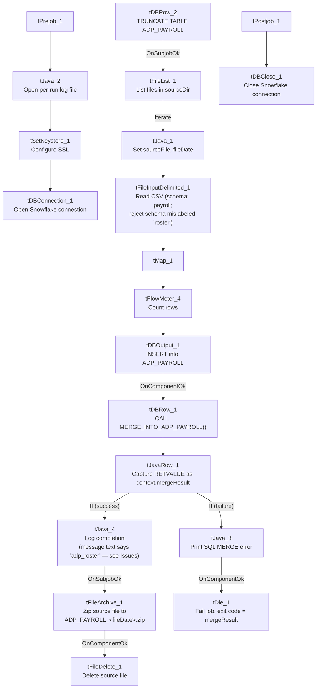

# Talend Job: ADP_Payroll_Load

## Overview

Loads ADP payroll timecard export files (one row per employee per pay-period line item: company code, name, position, hours, dollars) from a local source directory into the Snowflake `ADP_PAYROLL` table, then calls a stored procedure to merge the newly loaded rows into the downstream warehouse table. Follows the same overall truncate-load-merge-archive shape used elsewhere in EDW2SF, but with several naming inconsistencies described below that suggest this job was copied from a similar `ADP_Roster_Load` job and not fully updated.

## Detail table

| Field | Value |
|---|---|
| Job name | ADP_Payroll_Load |
| Version | 0.1 |
| Project | EDW2SF |
| Author | jmach@harriscollect.com |
| Created | 2023-03-21T15:32:42.280-0700 |
| Last Modified | 2025-11-04T10:52:50.025-0800 |

## Step-by-step data flow

**Setup subjob:** `tPrejob_1` → `tJava_2` opens a per-run log file at `context.logDir + jobName + "_" + <timestamp> + ".log"` and redirects `System.out`/`System.err` to it → `tSetKeystore_1` configures SSL trust/keystore from `context.keystorePath` (both passwords redacted) → `tDBConnection_1` opens the Snowflake connection.

**Main subjob:**

1. `tDBRow_2` runs `TRUNCATE TABLE ADP_PAYROLL;` — note this targets `ADP_PAYROLL` directly with **no staging-schema prefix** (see Issues observed).
2. On success, `tFileList_1` lists files in `context.sourceDir` (an `EXCLUDEFILEMASK` of `*.txt` is configured but `IFEXCLUDE` is `false`, so the exclusion is not actually applied — every file in the directory is picked up).
3. For each file, `tJava_1` sets `context.sourceFile` to the full path and derives `context.fileDate` from the filename.
4. `tFileInputDelimited_1` reads the CSV (comma-delimited, header row present, `DIE_ON_ERROR=false`) using a repository schema labeled `"...- payroll"` for well-formed rows. **Its configured reject schema is labeled `"...- roster"`**, not payroll — see Issues observed.
5. `tMap_1` passes the row through to a target schema of 12 output columns (`FILEDATE`, `FILENAME`, `PAYROLL_COMPANY`, `LAST_NAME`, `FIRST_NAME`, `POSITION_ID`, `FILE_NUMBER`, `TC_PAY_DATE`, `TC_DEPARTMENT`, `TC_PAYCODE`, `TC_HOURS`, `TC_DOLLARS`); `DIE_ON_ERROR=true` here, so a mapping/lookup failure fails the job outright.
6. `tFlowMeter_4` counts rows passing through (labeled "MyLabel", not renamed for this job).
7. `tDBOutput_1` inserts the rows into Snowflake table `ADP_PAYROLL` (`INSERT`, no table-recreate action).
8. On success, `tDBRow_1` calls `CALL MERGE_INTO_ADP_PAYROLL();` — note the procedure name follows a `MERGE_INTO_<table>` convention (see Issues observed for how this differs from other EDW2SF jobs).
9. `tJavaRow_1` reads the procedure's `RETVALUE` and stores it as `context.mergeResult`.
10. The flow then branches on two ordered `RUN_IF` conditions off `tJavaRow_1` (the branch conditions themselves aren't captured in this metadata, but the component wiring and message content make the intent clear):
    - **Success branch:** `tJava_4` prints a completion message, then on subjob-ok, `tFileArchive_1` zips the source file to `context.archiveDir + "ADP_PAYROLL_" + context.fileDate + ".zip"` (correctly named `ADP_PAYROLL_...`), then `tFileDelete_1` deletes the original source file.
    - **Failure branch:** `tJava_3` prints `"SQL MERGE error: %d"` with the merge result code, then `tDie_1` fails the job with message `"Job " + jobName + " failed."` and exit code = `context.mergeResult`.

**Teardown subjob:** `tPostjob_1` → `tDBClose_1` closes the Snowflake connection.

## Settings tables

### Source: `tFileInputDelimited_1`

| Setting | Value | What it means |
|---|---|---|
| FILENAME | `context.sourceFile` | The current file from `tFileList_1`'s iteration. |
| FIELDSEPARATOR / HEADER | `,` / 1 header row | Standard comma-delimited CSV with a header row skipped. |
| SCHEMA (main) | Repository schema `"...- payroll"` | The expected column layout for a well-formed payroll row (10 business columns, listed twice in this job's extracted schema — likely because both the main and reject schema branches were captured under one field — plus `errorCode`/`errorMessage` reject columns). |
| SCHEMA_REJECT | Repository schema `"...- roster"` | **Mislabeled** — this is a payroll job but its reject schema is named for a roster job. See Issues observed. |
| DIE_ON_ERROR | `false` | Malformed rows do not fail the job... |
| Reject flow | Not wired | ...but no connection routes rejected rows anywhere in this job. See Issues observed — rejected rows are silently dropped. |

### Target: `tDBOutput_1` (`tSnowflakeOutput`)

| Setting | Value | What it means |
|---|---|---|
| Table | `ADP_PAYROLL` | Destination table for the raw loaded rows. |
| Output action | `INSERT` | Appends rows; relies on the earlier `TRUNCATE` to prevent duplicate accumulation across runs. |
| Table action | `NONE` | Table is not recreated/altered by this job. |

### Merge step: `tDBRow_1` (`tSnowflakeRow`)

| Setting | Value | What it means |
|---|---|---|
| Query | `CALL MERGE_INTO_ADP_PAYROLL();` | Calls a stored procedure (not shown in this metadata) that presumably merges the freshly loaded `ADP_PAYROLL` staging rows into a final warehouse table. |
| Result handling | `RETVALUE` → `context.mergeResult` → branch to success/failure logging | A non-zero (or otherwise "bad") return code routes to the failure branch and fails the job with that code. |

## Dependencies & configuration

- **Triggers/depends on other jobs:** none — no `tRunJob` links found.
- **Context variables used:** `sourceDir`, `sourceFile`, `fileDate`, `fileName` (referenced in `tJava_4`'s log message but not set anywhere in this job's own components — see Issues observed), `archiveDir`, `logDir`, `keystorePath`, `mergeResult` (set internally from the merge procedure's return value).
- **4 hardcoded developer-workstation paths** in `tFileInputDelimited_1.TEMP_DIR`, `tFileArchive_1.SOURCE_FILE`, and `tFileDelete_1.DIRECTORY`/`PATH` (all `C:/Talend-Studio-20211109_1610-V8.0.1/workspace/...`) — same portability risk documented project-wide in `05_operational_runbook.md`.

## Glossary

| Component type | Plain-English meaning |
|---|---|
| `tFileList` | Lists files in a directory for the job to iterate over one at a time. |
| `tFileInputDelimited` | Reads a delimited (CSV-style) text file according to a schema. |
| `tMap` | Maps/transforms columns from one schema to another. |
| `tFlowMeter` | Counts rows passing through a point in the flow, for logging/monitoring. |
| `tSnowflakeOutput` / `tSnowflakeRow` / `tSnowflakeConnection` / `tSnowflakeClose` | Write rows to a Snowflake table / run an arbitrary SQL statement or stored-procedure call against Snowflake / open and close the Snowflake connection used throughout the job. |
| `tJavaRow` | Runs custom Java code once per input row (here, used just once to unpack a stored procedure's single return value). |
| `tFileArchive` / `tFileDelete` | Zip a processed file to an archive location, then delete the original from the source directory. |
| `tDie` / `tWarn` | Same as elsewhere in this project: `tDie` ends the job with a specific failure message and exit code. |

## Issues observed

- **The reject schema on `tFileInputDelimited_1` is labeled `"...- roster"`, not `"...- payroll"`.** This job is `ADP_Payroll_Load`; its main input schema is correctly labeled "payroll," but the reject schema appears to have been copied from an `ADP_Roster_Load` job and never repointed. Whether this causes an actual column-mismatch failure on a rejected row depends on how similar the two repository schemas are — unable to determine from this metadata; verify directly in the Talend repository.
- **No reject flow is wired from `tFileInputDelimited_1`.** `DIE_ON_ERROR` is `false`, so malformed rows don't fail the job, but there is also no connection carrying rejected rows anywhere (no file, no log, no table) — they are silently dropped with no record of how many rows, or which ones, failed to parse.
- **The success-branch logging in `tJava_4` refers to the wrong job.** Its `System.out` messages read `"%d rows merged into dw.adp_roster"` and `"Archiving ... to file " + context.archiveDir + "ADP_ROSTER_" + context.fileDate + ".zip"` — both say "roster," not "payroll." This appears to be copy-paste leftover from an `ADP_Roster_Load` job. It is a **cosmetic/log-message bug only**: the actual archive step (`tFileArchive_1.TARGET`) is correctly configured as `context.archiveDir + "ADP_PAYROLL_" + context.fileDate + ".zip"`, so the real archived file is named correctly — only the printed log line is misleading, which could confuse anyone reading the run log to diagnose an issue.
- **`context.fileName` is referenced in `tJava_4`'s log message but is never set anywhere in this job.** Only `context.sourceFile` and `context.fileDate` are assigned (in `tJava_1`). Unable to determine from this job's own metadata whether `fileName` is set globally elsewhere (e.g., a shared context default) or is simply an unset/blank value at that point in the log line; verify with the team.
- **The merge stored procedure is named `MERGE_INTO_ADP_PAYROLL()`**, following a `MERGE_INTO_<table>` convention. Not a functional issue on its own, but worth knowing that EDW2SF does not use a single consistent merge-procedure naming convention project-wide (see `job_Mail_Merge_Load.md` and others for different conventions) — verify per job rather than assuming.
- **`TRUNCATE TABLE ADP_PAYROLL;` has no staging-schema prefix.** If `ADP_PAYROLL` in this connection's default schema is also the table downstream reports query directly (rather than a dedicated staging table), there could be a brief window where the table is empty mid-run — unable to confirm from metadata alone whether `ADP_PAYROLL` is a staging table or the final warehouse table; verify with the team before assuming it's safe to query during a run.
