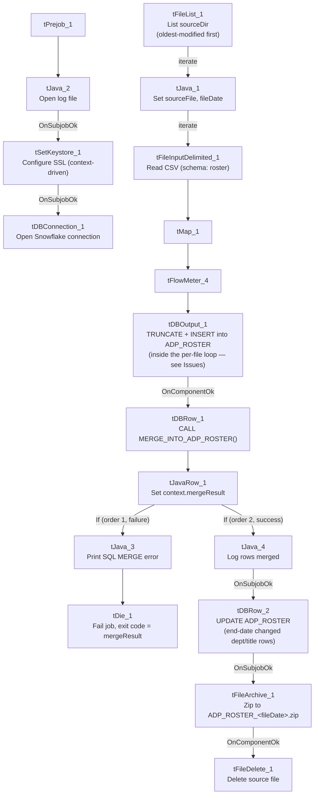

# Talend Job: ADP_Roster_Load

## Overview

Loads ADP employee-roster export files (department, job title, position status, seniority, termination reason, etc.) from a source directory into the Snowflake `ADP_ROSTER` table, then runs a merge procedure and a follow-up update that end-dates a debtor's — rather, an employee's — prior department/title record whenever a newer file shows it changed (a simple slowly-changing-dimension pattern). Sibling in shape to `ADP_Payroll_Load` (same author, same overall truncate→load→merge→archive design) but for roster/position data instead of payroll timecards, and with one structurally significant difference — see Issues observed.

## Detail table

| Field | Value |
|---|---|
| Job name | ADP_Roster_Load |
| Version | 0.1 |
| Project | EDW2SF |
| Author | jmach@harriscollect.com |
| Created | 2023-02-09T10:42:34.769-0800 |
| Last Modified | 2026-03-24T10:08:27.094-0700 |

## Step-by-step data flow

**Setup subjob:** `tPrejob_1` → `tJava_2` opens a per-run log file → `tSetKeystore_1` configures SSL (both `SSL_TRUSTSERVER_TRUSTSTORE` and `SSL_KEYSTORE` use `context.keystorePath` here — correctly parameterized, unlike several sibling jobs in this batch that hardcode the truststore path) → `tDBConnection_1` opens the Snowflake connection.

**Main subjob** — a separate top-level chain with no visible wiring back to the setup subjob:

1. `tFileList_1` lists files in `context.sourceDir`, ordered by modified date ascending (`ORDER_BY_MODIFIEDDATE=true`, `ORDER_ACTION_ASC=true` — oldest-modified file processed first if more than one is present). `EXCLUDEFILEMASK="*.txt"` is set but `IFEXCLUDE=false`, so it's not actually applied.
2. For each file (`ITERATE`), `tJava_1` sets `context.sourceFile` and derives `context.fileDate` from the filename (the parsing code is truncated in this metadata beyond `.substrin...` — see Issues observed).
3. `tFileInputDelimited_1` reads the CSV (comma-delimited, header row, `TRIMALL=true`, `DIE_ON_ERROR=false`) using a repository schema correctly labeled `"...- roster"` for both main and reject rows.
4. `tMap_1` → `tFlowMeter_4` (row count) → `tDBOutput_1` inserts into Snowflake `ADP_ROSTER` (`INSERT`, **`tableAction=TRUNCATE`** — see Issues observed, this sits inside the per-file loop).
5. On `COMPONENT_OK`, `tDBRow_1` calls `CALL MERGE_INTO_ADP_ROSTER();` → `tJavaRow_1` captures `RETVALUE` into `context.mergeResult`, which then branches on two ordered `RUN_IF` conditions (branch logic not captured in this metadata, but component wiring and message content make the intent clear):
   - **Order 1 (failure path):** `tJava_3` prints `"SQL MERGE error: %d"` → `tDie_1` fails the job with message `"Job " + jobName + " failed."` and exit code = `context.mergeResult`.
   - **Order 2 (success path):** `tJava_4` prints `"%d rows merged into dw.adp_roster"` → on `SUBJOB_OK`, `tDBRow_2` runs an `UPDATE` against `DW.ADP_ROSTER` that end-dates a prior department/title record whenever a later file shows the employee's department or title changed (a lightweight SCD-2-style tracking update using `LAG`/`LEAD` window functions over `FILE_DATE`) → on `SUBJOB_OK`, `tFileArchive_1` zips the source file to `context.archiveDir + "ADP_ROSTER_" + context.fileDate + ".zip"` → on `COMPONENT_OK`, `tFileDelete_1` deletes `context.sourceFile`.

## Settings tables

### Source: `tFileInputDelimited_1`

| Setting | Value | What it means |
|---|---|---|
| FIELDSEPARATOR / TRIMALL | `,` / `true` | Comma-delimited, all fields trimmed of whitespace. |
| SCHEMA (main + reject) | Repository schema `"...- roster"` | Correctly labeled for both branches, unlike `ADP_Payroll_Load`'s mismatched reject schema. |
| DIE_ON_ERROR | `false` | Malformed rows don't fail the job... |
| Reject flow | Not wired | ...but no connection routes rejected rows anywhere — silently dropped. |

### Target: `tDBOutput_1` (`tSnowflakeOutput`)

| Setting | Value | What it means |
|---|---|---|
| Table | `ADP_ROSTER` | Destination table. |
| Output action / Table action | `INSERT` / **`TRUNCATE`** | Table is cleared immediately before each insert — and because this component sits inside the per-file `ITERATE` loop, that TRUNCATE fires on every file processed, not once before the loop starts. See Issues observed. |

### Merge & SCD update: `tDBRow_1` / `tDBRow_2`

| Setting | Value | What it means |
|---|---|---|
| Query 1 (`tDBRow_1`) | `CALL MERGE_INTO_ADP_ROSTER();` | Merges freshly loaded `ADP_ROSTER` rows into whatever final table the procedure targets (not shown in this metadata). |
| Query 2 (`tDBRow_2`) | `UPDATE DW.ADP_ROSTER ar SET ar.END_DATE = DATEADD('D',-1,z.END_DATE) FROM (...LAG/LEAD over FILE_DATE partitioned by FILE_NUMBER_PAY_STATEMENTS...) WHERE ar.IS_CURRENT = 0 AND ar.TERMINATION_DATE IS NULL AND ...` | Closes out ("end-dates") a prior roster record the day before a later file shows the employee's department or title changed — a simple type-2 history-tracking pattern. |

## Dependencies & configuration

- **Triggers/depends on other jobs:** none — no `tRunJob` links found.
- **Context variables used:** `archiveDir`, `fileDate`, `fileName`, `keystorePath`, `logDir`, `mergeResult`, `sourceDir`, `sourceFile`.
- **4 hardcoded developer-workstation paths** in `tFileInputDelimited_1.TEMP_DIR`, `tFileArchive_1.SOURCE_FILE`, and `tFileDelete_1.DIRECTORY`/`PATH` — same risk documented project-wide in `05_operational_runbook.md`.

## Glossary

| Component type | Plain-English meaning |
|---|---|
| `tFileList` / `tFileInputDelimited` / `tMap` / `tFlowMeter` | Same as elsewhere in this project: list files, read a delimited file, transform columns, count rows. |
| `tSnowflakeOutput` / `tSnowflakeRow` / `tSnowflakeConnection` | Write rows to Snowflake / run an arbitrary SQL statement or procedure call / open the Snowflake connection. |
| `tJavaRow` | Runs custom Java code once per input row — here, unpacking a stored procedure's single return value. |
| `tFileArchive` / `tFileDelete` | Zip a processed file to an archive location, then delete the original. |
| `tDie` | Ends the job with a specific failure message and exit code. |

## Issues observed

- **`tDBOutput_1`'s `tableAction` is `TRUNCATE`, and this component sits inside the per-file `ITERATE` loop from `tFileList_1`** — unlike `ADP_Payroll_Load` and `ADP_Employee_Raw_Load`, which run one explicit `TRUNCATE TABLE` via a separate `tDBRow` component *before* their file loops start. If more than one file is ever present in `context.sourceDir` at once, each iteration's `TRUNCATE` wipes out the previous iteration's just-inserted rows — only the last file processed (per `tFileList_1`'s oldest-modified-first ordering, meaning the file with the *newest* modified timestamp survives, processed last) would actually remain in `ADP_ROSTER` after the job finishes. This is a concrete correctness risk if `sourceDir` is ever allowed to hold more than one roster file between runs — verify with the team whether that's guaranteed never to happen, or whether this table has in fact only ever been loaded from single-file directories.
- **Because the merge, SCD update, archive, and delete steps are all wired downstream of `tDBOutput_1` (which is itself inside the per-file loop), they too appear to run once per file** rather than once after all files are loaded — compounding the risk above if multiple files are ever present at once.
- **Same non-functioning `EXCLUDEFILEMASK` pattern** as other jobs in this project (`IFEXCLUDE=false`).
- **No reject flow wired from `tFileInputDelimited_1`**; `DIE_ON_ERROR=false`, so malformed rows are silently dropped with no record.
- **`tJava_1`'s file-date-parsing code is truncated in this metadata** (ends at `.substrin...`) — the full logic deriving `context.fileDate` from the filename isn't visible. Unable to determine from metadata whether it correctly extracts the date in all cases; verify directly in Talend Studio if `fileDate`-based filenames (e.g., the archive name) ever look wrong.
