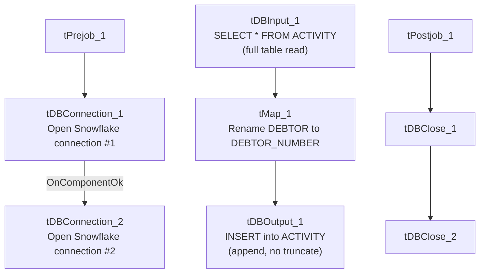

# Talend Job: Activity_Load_Daily

## Overview

Reads all rows from a Snowflake table named `ACTIVITY` (collector-activity records: logon, debtor, activity type/date/description/amount) and writes them back into a Snowflake table also named `ACTIVITY`, renaming one column (`DEBTOR` → `DEBTOR_NUMBER`) along the way. Two separate Snowflake connections are opened in this job, which strongly suggests source and target are actually in different schemas (e.g., a staging schema and the legacy warehouse schema both using the name `ACTIVITY`) — but this job's own metadata does not show which connection either the input or output component actually uses, so that can't be confirmed here (see Issues observed).

## Detail table

| Field | Value |
|---|---|
| Job name | Activity_Load_Daily |
| Version | 0.1 |
| Project | EDW2SF |
| Author | jmach@harriscollect.com |
| Created | 2022-07-28T10:46:11.236-0700 |
| Last Modified | 2022-07-28T11:20:52.239-0700 |

## Step-by-step data flow

**Setup subjob:** `tPrejob_1` → `tDBConnection_1` opens a Snowflake connection → on `COMPONENT_OK`, `tDBConnection_2` opens a **second, separate** Snowflake connection.

**Teardown subjob:** `tPostjob_1` → `tDBClose_1` → `tDBClose_2`.

**Main subjob** — a separate top-level chain, with no visible wiring connecting it to either connection above:

1. `tDBInput_1` reads the Snowflake table `ACTIVITY` in full (no filter query — a plain table read of all 14 source columns, including `FILEDATE`, `LOGON`, `DIMLOGON`, `DEBTOR`, `DEBTOR_IDX`, `ACTIVITY`, `ACTIVITY_DATE`, `ACTIVITY_TYPE`, `ACTIVITY_DESC`, `ACTIVITY_AMT`, `MATCH_FLG`, `NTC_FLG`, `CUSTOM_DATE`, `UPDATE_KEY`).
2. `tMap_1` renames `DEBTOR` → `DEBTOR_NUMBER` and drops `FILEDATE` from the output (13 columns).
3. `tDBOutput_1` inserts the rows into a Snowflake table also named `ACTIVITY` (`INSERT`, `tableAction=NONE` — a pure append, no truncate anywhere in this job).

## Settings tables

### Source: `tDBInput_1` (`tSnowflakeInput`)

| Setting | Value | What it means |
|---|---|---|
| Table | `ACTIVITY` | Read with no `query` filter — every row in the table is pulled on every run. |
| Connection binding | Not captured in this job's metadata | Which of the two open Snowflake connections this component actually uses is unable to determine from metadata — see Issues observed. |

### Target: `tDBOutput_1` (`tSnowflakeOutput`)

| Setting | Value | What it means |
|---|---|---|
| Table | `ACTIVITY` | Same table name as the source. |
| Output action / Table action | `INSERT` / `NONE` | Pure append — no truncate step exists anywhere in this job. |

## Dependencies & configuration

- **Triggers/depends on other jobs:** none — no `tRunJob` links found.
- **Context variables used:** none (`context_vars_referenced` is empty).
- **No hardcoded developer-workstation paths** found in this job.

## Glossary

| Component type | Plain-English meaning |
|---|---|
| `tSnowflakeConnection` / `tSnowflakeClose` | Open/close a Snowflake database connection used by other components in the job. |
| `tSnowflakeInput` / `tSnowflakeOutput` | Run a query (or full-table read) against Snowflake / write rows into a Snowflake table. |
| `tMap` | Maps/transforms columns from one schema to another. |

## Issues observed

- **Two Snowflake connections (`tDBConnection_1`, `tDBConnection_2`) are opened, but neither `tDBInput_1` nor `tDBOutput_1` shows an explicit connection binding in its captured parameters, and both source and target reference a table literally named `ACTIVITY`.** This could be a legitimate staging-schema-to-warehouse-schema copy (reading `ACTIVITY` from one schema, writing `ACTIVITY` into another — a common pattern elsewhere in this project), or it could be a same-schema round-trip. **Unable to determine from this metadata which connection each component actually uses** — verify directly in Talend Studio before assuming this is a cross-schema copy.
- **`tDBInput_1`'s query has no filter (`query: ""`, a full-table read), and `tDBOutput_1` has no truncate (`tableAction=NONE`, a pure append).** With no incremental key check (unlike `i3_CallDetail_40_Load`'s `MAX(InsertKey)` pattern) and no truncate step anywhere in this job, rerunning it would re-read the entire source `ACTIVITY` table and duplicate every row already present in the target.
- **No wiring connects the main data-flow subjob (`tDBInput_1` → `tMap_1` → `tDBOutput_1`) to the `tPrejob_1` setup chain** in this job's diagram — the same disconnected-diagram pattern seen in several other jobs in this batch.
- **No error handling of any kind** (no `tDie`/`tWarn`/`tSendMail`) — a failure here would only surface as a generic Talend execution error.
- **This job's "modified" date (2022-07-28) is the same day as its "created" date and has never been touched again**, unlike its apparent counterpart `Activity_Load_Legacy` (last modified 2025-09-24). Combined with the full-table-read/no-truncate risk above, it's worth confirming with the team whether `Activity_Load_Daily` is actually still scheduled to run daily, or has been superseded.
