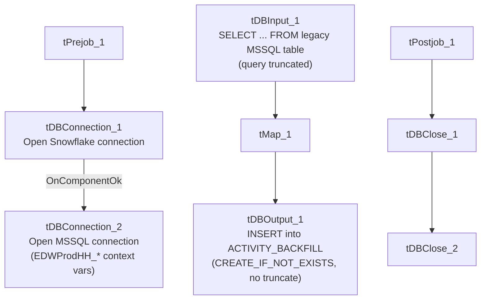

# Talend Job: Activity_Load_Legacy

## Overview

Loads collector-activity records from the legacy EDWProdHH MSSQL database into a Snowflake `ACTIVITY_BACKFILL` table, parsing a `LOGON` value out of the leading portion of `DEBTOR_IDX` and pulling activity type/date/amount fields. The target table's `_BACKFILL` suffix and `CREATE_IF_NOT_EXISTS` table action (rather than `TRUNCATE`) suggest this is a one-time or occasional backfill mechanism, distinct from the ongoing `Activity_Load_Daily` job that loads a plain `ACTIVITY` table in this same project.

## Detail table

| Field | Value |
|---|---|
| Job name | Activity_Load_Legacy |
| Version | 0.1 |
| Project | EDW2SF |
| Author | jmach@harriscollect.com |
| Created | 2022-07-27T12:42:31.732-0700 |
| Last Modified | 2025-09-24T10:59:56.211-0700 |

## Step-by-step data flow

**Setup subjob:** `tPrejob_1` → `tDBConnection_1` opens a Snowflake connection → on `COMPONENT_OK`, `tDBConnection_2` opens an MSSQL connection using `context.EDWProdHH_Server`/`Port`/`Schema`/`Database`/`Login` (password `***REDACTED***`).

**Teardown subjob:** `tPostjob_1` → `tDBClose_1` (Snowflake) → `tDBClose_2` (MSSQL).

**Main subjob** — a separate top-level chain, with no visible wiring back to the setup subjob's connections:

1. `tDBInput_1` (`tMSSqlInput`, reusing the shared `tDBConnection_2`) runs a fixed `SELECT` against the legacy source. The visible portion of the query derives `LOGON` via `SUBSTRING(DEBTOR_IDX,1,CHARINDEX('-',DEBTOR_IDX)-1)`, casts `DimLogOn` to `DIMLOGON`, aliases `DEBTOR` as `DEBTOR_NUMBER`, converts `CUSTOM_DATE` to `ACTIVITY_DATE`, and derives `ACTIVITY_TYPE` via `COALESCE([TYPE],'')` — **the query text is truncated in this metadata beyond that point**, so the full column list and any `WHERE` clause are not visible (see Issues observed).
2. `tMap_1` passes the 13 columns through unchanged.
3. `tDBOutput_1` inserts the rows into Snowflake `ACTIVITY_BACKFILL` (`INSERT`, `tableAction=CREATE_IF_NOT_EXISTS` — creates the table only if it doesn't already exist; does not clear existing rows).

## Settings tables

### Source: `tDBInput_1` (`tMSSqlInput`)

| Setting | Value | What it means |
|---|---|---|
| Connection | Shared `tDBConnection_2` | Reuses the job's single MSSQL connection. |
| Query | Fixed `SELECT` deriving `LOGON`/`DIMLOGON`/`DEBTOR_NUMBER`/`ACTIVITY_DATE`/`ACTIVITY_TYPE` from a legacy activity table (full text truncated in metadata) | The visible portion shows the transformation logic but not the full column list or any filtering `WHERE` clause. |

### Target: `tDBOutput_1` (`tSnowflakeOutput`)

| Setting | Value | What it means |
|---|---|---|
| Table | `ACTIVITY_BACKFILL` | A separately named table from `Activity_Load_Daily`'s plain `ACTIVITY` target. |
| Output action / Table action | `INSERT` / `CREATE_IF_NOT_EXISTS` | Creates the table only if missing — does **not** clear existing data on each run, unlike the `TRUNCATE` pattern used by most load jobs in this project. |

## Dependencies & configuration

- **Triggers/depends on other jobs:** none — no `tRunJob` links found.
- **Context variables used:** `EDWProdHH_Database`, `EDWProdHH_Login`, `EDWProdHH_Port`, `EDWProdHH_Schema`, `EDWProdHH_Server`.
- **No hardcoded developer-workstation paths** found in this job.

## Glossary

| Component type | Plain-English meaning |
|---|---|
| `tSnowflakeConnection` / `tSnowflakeClose` | Open/close a Snowflake database connection. |
| `tMSSqlConnection` / `tMSSqlInput` / `tMSSqlClose` | Open a Microsoft SQL Server connection, run a query against it, and close it. |
| `tSnowflakeOutput` | Writes rows into a Snowflake table, with configurable table-creation behavior. |
| `tMap` | Maps/transforms columns from one schema to another. |

## Issues observed

- **The captured `tDBInput_1.QUERY` text is truncated** (visible portion ends at `...ACTIVITY_TYP...`) — the full column list, and critically any `WHERE` clause bounding the extract to a specific backfill window or date range, is not visible in this metadata. Unable to determine whether this job is scoped to a specific backfill period or would re-pull the entire legacy activity history on every run; verify directly in Talend Studio.
- **`tDBOutput_1`'s table action is `CREATE_IF_NOT_EXISTS`, not `TRUNCATE`.** Combined with the unknown query scope above, rerunning this job could duplicate rows in `ACTIVITY_BACKFILL` if the source query isn't itself filtered to new/unprocessed data — there is no incremental key check (e.g., a max-date/max-key pattern like `i3_CallDetail_40_Load` or `CHI_E_Media_Load`) visible in this job's own metadata.
- **No wiring connects the main data flow to the `tPrejob_1`/`tDBConnection` setup chain** in this job's diagram — the same disconnected-diagram pattern seen in `Activity_Load_Daily` and several other jobs in this batch.
- **No error handling** (no `tDie`/`tWarn`/`tSendMail`) — a failure here surfaces only as a generic Talend execution error.
- **This job's name ("_Legacy") and its "_BACKFILL"-suffixed target table**, alongside `Activity_Load_Daily`'s separate, differently-shaped pipeline into the plain `ACTIVITY` table, suggest these are two distinct activity-loading mechanisms (an ongoing daily job and an occasional legacy backfill) rather than interchangeable variants of one template. Unlike this project's site-code job families (CHI/CO/DC/etc.), these two are not simple copies of each other.
