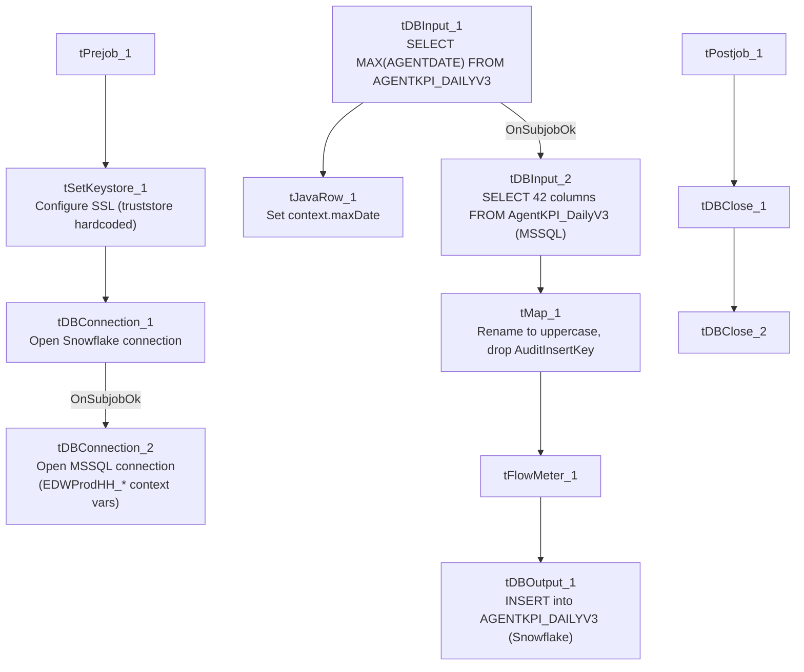

# Talend Job: AgentKPI_Daily_Load

## Overview

Loads call-center agent KPI/scorecard metrics (talk time, idle/DND/wrap time, inbound/outbound call and contact counts across dialer/manual/IMC channels) from the EDWProdHH MSSQL `AgentKPI_DailyV3` table into the Snowflake `AGENTKPI_DAILYV3` table. Uses an incremental-load pattern keyed on `AGENTDATE`: it first checks the maximum date already loaded into Snowflake, though — as with `i3_CallDetail_40_Load` in this same project — the metadata does not show that value actually being used to filter the source query (see Issues observed).

## Detail table

| Field | Value |
|---|---|
| Job name | AgentKPI_Daily_Load |
| Version | 0.1 |
| Project | EDW2SF |
| Author | jmach@harriscollect.com |
| Created | 2022-03-22T10:03:44.607-0700 |
| Last Modified | 2025-11-12T06:46:30.930-0800 |

## Step-by-step data flow

**Setup subjob:** `tPrejob_1` → `tSetKeystore_1` configures SSL (`SSL_TRUSTSERVER_TRUSTSTORE` hardcoded to `"C:/clientTrustStore.trustStore"`, `SSL_KEYSTORE` via `context.keystorePath`) → `tDBConnection_1` opens the Snowflake connection → on `SUBJOB_OK`, `tDBConnection_2` opens the MSSQL connection using `context.EDWProdHH_*` variables (password `***REDACTED***`).

**Teardown subjob:** `tPostjob_1` → `tDBClose_1` (Snowflake) → `tDBClose_2` (MSSQL).

**Main subjob:**

1. `tDBInput_1` runs `SELECT CAST(COALESCE(MAX(AGENTDATE),'2010-01-01') AS VARCHAR(10)) AS MAX_DATE FROM AGENTKPI_DAILYV3;` against Snowflake.
2. `tJavaRow_1` captures that value into `context.maxDate`.
3. On `SUBJOB_OK`, `tDBInput_2` (`tMSSqlInput`, shared `tDBConnection_2`) runs a fixed `SELECT` of 42 named columns from `AgentKPI_DailyV3` (`UserName`, `AgentDate`, `PayrollID`, `Supervisor`, `Manager`, `Department`, call-time and contact/success metrics across dialer/manual/inbound/IMC channels, `AuditInsertKey`, etc.). **The captured query text is truncated in this metadata** (ends at `...CAST(NonDia...`) and does not visibly reference `context.maxDate` in the portion available — see Issues observed.
4. `tMap_1` renames the 42 source columns to uppercase target columns and **drops `AuditInsertKey`** (41 output columns).
5. `tFlowMeter_1` counts rows passing through.
6. `tDBOutput_1` inserts the rows into Snowflake `AGENTKPI_DAILYV3` (`INSERT`, no table-recreate action).

## Settings tables

### Incremental check: `tDBInput_1` / `tJavaRow_1`

| Setting | Value | What it means |
|---|---|---|
| Query | `SELECT CAST(COALESCE(MAX(AGENTDATE),'2010-01-01') AS VARCHAR(10)) AS MAX_DATE FROM AGENTKPI_DAILYV3;` | Finds the latest date already loaded (defaulting to 2010-01-01 if the table is empty). |
| Result handling | `MAX_DATE` → `context.maxDate` | Intended to bound the MSSQL extract to newer rows only. |

### Source: `tDBInput_2` (`tMSSqlInput`)

| Setting | Value | What it means |
|---|---|---|
| Connection | Shared `tDBConnection_2` | Reuses the job's single MSSQL connection. |
| Table | `AgentKPI_DailyV3` | Source agent-KPI table. |
| Query | Fixed `SELECT` of 42 named columns (truncated in metadata) | The visible portion does not show a `WHERE` clause referencing `context.maxDate` — see Issues observed. |

### Target: `tDBOutput_1` (`tSnowflakeOutput`)

| Setting | Value | What it means |
|---|---|---|
| Table | `AGENTKPI_DAILYV3` | Destination table in Snowflake. |
| Output action | `INSERT` | Appends — there is no `TRUNCATE` step in this job, consistent with an incremental-append design, assuming the max-date check is actually applied upstream. |

## Dependencies & configuration

- **Triggers/depends on other jobs:** none — no `tRunJob` links found.
- **Context variables used:** `EDWProdHH_Database`, `EDWProdHH_Login`, `EDWProdHH_Port`, `EDWProdHH_Schema`, `EDWProdHH_Server`, `keystorePath`, `maxDate` (computed internally).
- **1 hardcoded developer-workstation path** in `tSetKeystore_1.SSL_TRUSTSERVER_TRUSTSTORE` (`"C:/clientTrustStore.trustStore"`).

## Glossary

| Component type | Plain-English meaning |
|---|---|
| `tSetKeystore` | Configures SSL keystore/truststore settings used by the job's database connections. |
| `tSnowflakeConnection` / `tSnowflakeClose` / `tSnowflakeInput` / `tSnowflakeOutput` | Open/close a Snowflake connection, run a query and return results, write rows to a table. |
| `tMSSqlConnection` / `tMSSqlInput` / `tMSSqlClose` | Open a Microsoft SQL Server connection, run a query against it, and close it. |
| `tJavaRow` | Runs custom Java code once per input row — here, unpacking a single query result into a context variable. |
| `tMap` / `tFlowMeter` | Map/transform columns; count rows passing a point in the flow. |

## Issues observed

- **The incremental-load logic may not actually be applied**, the same uncertainty documented in `i3_CallDetail_40_Load`. The job computes `context.maxDate` from Snowflake before reading MSSQL, strongly suggesting the intent is to pull only rows dated after the last load — but the captured `tDBInput_2.QUERY` text is truncated after the column list (`...CAST(NonDia...`) and does not show a `WHERE` clause referencing `context.maxDate` in the visible portion. **Unable to determine from this metadata whether the query is actually filtered** — if it isn't, every run re-reads and re-inserts the entire source table, duplicating all previously loaded rows in Snowflake (there is no `TRUNCATE` before the `INSERT`). Verify directly in Talend Studio.
- **`tSetKeystore_1.SSL_TRUSTSERVER_TRUSTSTORE` is hardcoded** to `"C:/clientTrustStore.trustStore"` rather than a context variable, unlike `ADP_Roster_Load`'s equivalent component (which uses `context.keystorePath` for both keystore and truststore) — an inconsistent pattern that also appears in `Avita_Monthly_Report_Extract` and `CFDAILY_Load` in this same batch.
- **No error/row-count logging specific to this job's business outcome** (no `tWarn`/`tDie`/`tSendMail`) — a load failure would only surface as a generic Talend execution error.
