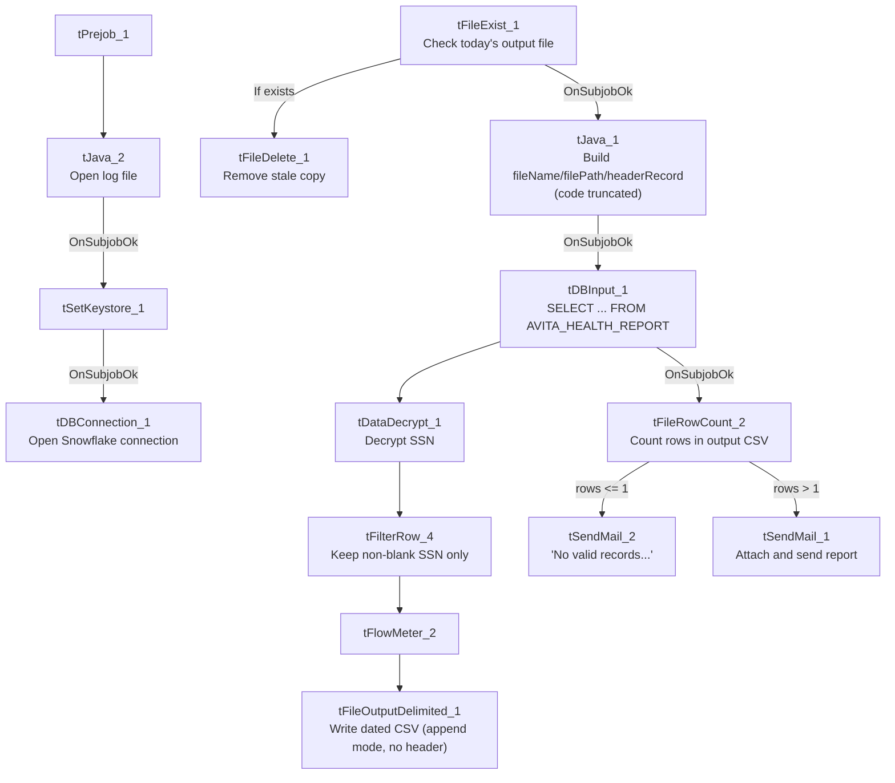

# Talend Job: Avita_Monthly_Report_Extract

## Overview

Extracts a monthly patient/debtor report for the "Avita Health System" client from a Snowflake publish-schema view (`EDWPRODHH.PUB_LWASHINGTON.AVITA_HEALTH_REPORT`), decrypts an encrypted SSN column, filters out rows with a blank SSN, writes the result to a dated CSV, and emails it (or a "no records" notice) to configured recipients before deleting the local CSV copy. This is one of the 12 jobs in this project that sends email on completion (see `05_operational_runbook.md`).

## Detail table

| Field | Value |
|---|---|
| Job name | Avita_Monthly_Report_Extract |
| Version | 0.1 |
| Project | EDW2SF |
| Author | jmach@harriscollect.com |
| Created | 2025-05-22T09:47:59.054-0700 |
| Last Modified | 2025-10-20T09:17:38.054-0700 |

## Step-by-step data flow

**Setup subjob:** `tPrejob_1` → `tJava_2` opens a per-run log file → on `SUBJOB_OK`, `tSetKeystore_1` configures SSL (truststore path hardcoded, keystore via `context.keystorePath`) → on `SUBJOB_OK`, `tDBConnection_1` opens the Snowflake connection.

**Main subjob** — a separate top-level chain, gated on today's output file not already existing:

1. `tFileExist_1` checks whether today's dated output file (`context.outputDir + "Avita_Monthly_Report_" + <today's date> + ".csv"`) already exists.
2. If it does (`RUN_IF`), `tFileDelete_1` removes the stale copy first. Either way, on `SUBJOB_OK`, `tJava_1` builds the target `fileName`/`filePath`/`headerRecord` strings (code truncated in this metadata after building `headerRecord` — see Issues observed).
3. On `SUBJOB_OK`, `tDBInput_1` runs a fixed `SELECT` of 23 named columns (`CLIENT`, `NAME1`, `ADD1`, `CITY`, `ST`, `ZIP`, `DEBTORNUMBER`, `PACKET`, `DOB`, `"C.D.#"`, `SSN`, `STATUS`, `ASGN_AMT`, `ASGN_COLL`, `TOTAL_BAL`, `"QUALIFYING MEMBER PACKET TOTAL"`, employer info, admit/discharge dates, an `"AVITA HEALTH SYSTEM"` flag column, `DT_ASSIGNED`) from `EDWPRODHH.PUB_LWASHINGTON.AVITA_HEALTH_REPORT`.
4. `tDataDecrypt_1` decrypts the `SSN` column (AES; `SECRET_KEY`/`PASSWORD_M1`/`SECRET_TYPE` all `***REDACTED***`, key file at `context.cryptoPath + "dimdbtr.crypt"`, `DIE_ON_ERROR=false`).
5. `tFilterRow_4` keeps only rows where `input_row.SSN.trim().compareTo("") > 0` (excludes blank-SSN rows).
6. `tFlowMeter_2` counts rows, then `tFileOutputDelimited_1` writes the CSV to `context.outputDir + "Avita_Monthly_Report_" + <today's date> + ".csv"` (comma-delimited, `INCLUDEHEADER=false`, `APPEND=true` — see Issues observed).

Separately, `tDBInput_1` → `SUBJOB_OK` → `tFileRowCount_2` counts rows in the just-written CSV, then branches: `RUN_IF rows_le_1` → `tSendMail_2` ("No valid records for this month's Avita Health report."); `RUN_IF rows_gt_1` → `tSendMail_1` (attaches and sends the file, "The Avita Health monthly report is attached.").

## Settings tables

### Source: `tDBInput_1` (`tSnowflakeInput`)

| Setting | Value | What it means |
|---|---|---|
| Query | `SELECT CLIENT, NAME1, ADD1, CITY, ST, ZIP, DEBTORNUMBER, PACKET, DOB, "C.D.#", SSN, STATUS, ASGN_AMT, ASGN_COLL, TOTAL_BAL, "QUALIFYING MEMBER PACKET TOTAL", EMP1_NAME, EMP1_ADDR, EMP1_CSZ, EMP1_PHN, ADMIT_DATE, DISCHARGE_DATE, "AVITA HEALTH SYSTEM", DT_ASSIGNED FROM EDWPRODHH.PUB_LWASHINGTON.AVITA_HEALTH_REPORT;` | Pulls the full monthly Avita report dataset from a dedicated publish-schema view. |

### Decrypt & filter: `tDataDecrypt_1` / `tFilterRow_4`

| Setting | Value | What it means |
|---|---|---|
| CRYPTO_METHOD | `AES` | SSN column is stored encrypted and decrypted at extract time. |
| SECRET_KEY / PASSWORD_M1 / SECRET_TYPE | `***REDACTED***` | Preserved as redacted — never guessed. |
| CRYPTO_FILE_PATH | `context.cryptoPath + "dimdbtr.crypt"` | Key file name suggests it was originally built for a "DimDebtor" job/table — likely a shared, reused decryption asset rather than a mistake. |
| Filter condition | `input_row.SSN.trim().compareTo("") > 0` | Drops rows with a blank/missing SSN after decryption. |

### Output & mail: `tFileOutputDelimited_1` / `tSendMail_1` / `tSendMail_2` / `tFileRowCount_2`

| Setting | Value | What it means |
|---|---|---|
| FILENAME | `context.outputDir + "Avita_Monthly_Report_" + <today's date> + ".csv"` | Dated output filename. |
| APPEND / INCLUDEHEADER | `true` / `false` | The component itself never writes a header row and appends rather than overwrites — see Issues observed. |
| Row-count gate | `tFileRowCount_2` on the same output file, `<=1` vs `>1` rows | Determines whether the "no records" or "report attached" email is sent — see Issues observed for the off-by-one implication. |
| TO / FROM (both mails) | `context.mailRecipients` / `svc_analytics@harriscollect.com` | `DIE_ON_ERROR=true` on both — a failed send fails the job. |

## Dependencies & configuration

- **Triggers/depends on other jobs:** none — no `tRunJob` links found.
- **Context variables used:** `cryptoPath`, `keystorePath`, `logDir`, `mailRecipients`, `outputDir`.
- **3 hardcoded developer-workstation paths** in `tFileDelete_1.DIRECTORY`/`PATH` and `tSetKeystore_1.SSL_TRUSTSERVER_TRUSTSTORE`.

## Glossary

| Component type | Plain-English meaning |
|---|---|
| `tDataDecrypt` | Decrypts an encrypted column's values using a configured key/algorithm. |
| `tFilterRow` | Keeps or drops rows based on a condition. |
| `tFileOutputDelimited` | Writes rows to a delimited (CSV-style) text file. |
| `tFileRowCount` | Counts the rows in a file, for logging or branching decisions. |
| `tSendMail` | Sends an email — used here to deliver the report or notify that no records qualified. |
| `tFileExist` / `tFileDelete` | Check whether a file exists / delete a file. |

## Issues observed

- **`tFileOutputDelimited_1` has `APPEND=true` and `INCLUDEHEADER=false`, while a separate `tJava_1` component independently builds a `headerRecord` string** (truncated in this metadata) that is never shown being written to the output file by any captured connection. This strongly suggests the intended design is for `tJava_1` to manually write a header line before the component appends data rows — but **unable to determine from this metadata whether the header row is actually written to the CSV**, or whether `headerRecord` is dead code. If the header is never written, the emailed monthly report would ship as a headerless CSV. Verify directly in Talend Studio.
- **The row-count gate branches on "≤1 row" vs. ">1 row" rather than "0 rows" vs. ">0 rows".** If `tFileOutputDelimited_1` does write a header line as a literal data row (consistent with `APPEND=true` and the header-string logic above), a file with exactly one real data row would be misclassified as "no valid records" and never emailed to the client. This is a plausible off-by-one directly tied to the header-writing ambiguity above; verify with the team.
- **`tSetKeystore_1.SSL_TRUSTSERVER_TRUSTSTORE` is hardcoded**, the same pattern flagged in `AgentKPI_Daily_Load` and `CFDAILY_Load` elsewhere in this batch.
- **The crypto key file is named `"dimdbtr.crypt"`**, suggesting the SSN decryption key material was originally built for a "DimDebtor" job/table rather than this Avita-specific extract — likely an intentionally shared decryption asset, but worth confirming with the team that reusing it here is expected rather than accidental.
