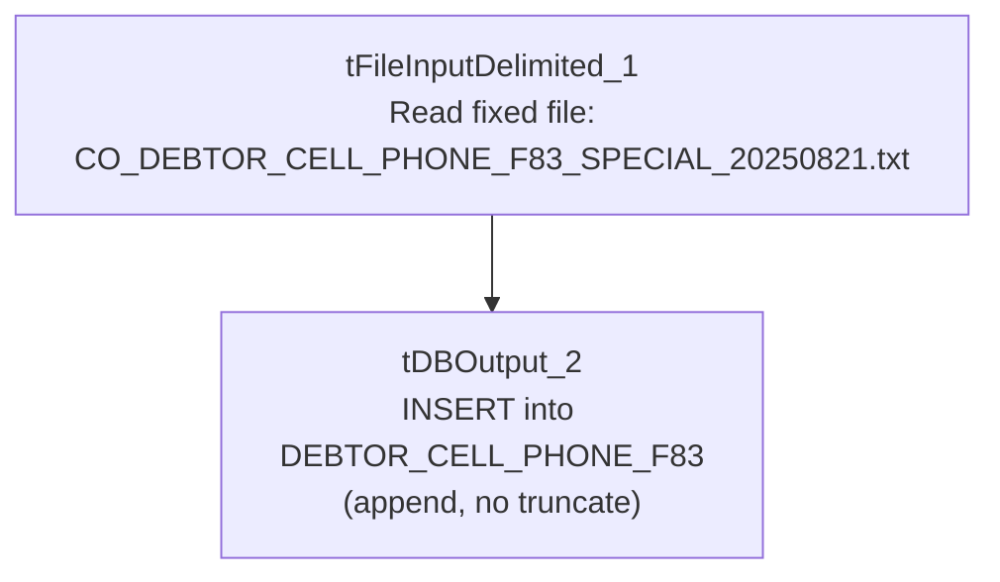

# Talend Job: Backfill_Debtor_Cell_Phone_f83

## Overview

One-time backfill load of debtor cell-phone numbers (logon, debtor number/index, phone) from a single hardcoded, dated source file — `X:/CO_DEBTOR_CELL_PHONE_F83_SPECIAL_20250821.txt` (CO site, dated August 21, 2025) — into the Snowflake `DEBTOR_CELL_PHONE_F83` table. This is an extremely minimal, two-component job with no connection management, logging, or error handling: a manual/ad hoc backfill utility, not a recurring scheduled load.

## Detail table

| Field | Value |
|---|---|
| Job name | Backfill_Debtor_Cell_Phone_f83 |
| Version | 0.1 |
| Project | EDW2SF |
| Author | jmach@harriscollect.com |
| Created | 2025-08-22T15:00:45.696-0700 |
| Last Modified | 2025-09-24T11:08:42.424-0700 |

## Step-by-step data flow

This job has no `tPrejob`/`tPostjob`, no `tDBConnection`/`tDBClose`, and no logging — just a two-component flow:

1. `tFileInputDelimited_1` reads the fixed file `X:/CO_DEBTOR_CELL_PHONE_F83_SPECIAL_20250821.txt` (tab-delimited, header row, `DIE_ON_ERROR=false`) with schema `LOGON`/`DEBTOR`/`DEBTOR_IDX`/`PHONE`.
2. `tDBOutput_2` inserts the rows into Snowflake `DEBTOR_CELL_PHONE_F83` (`INSERT`, `tableAction=NONE` — appends to whatever is already there, no truncate).

## Settings tables

### Source: `tFileInputDelimited_1`

| Setting | Value | What it means |
|---|---|---|
| FILENAME | `"X:/CO_DEBTOR_CELL_PHONE_F83_SPECIAL_20250821.txt"` | A fully hardcoded, dated, site-specific file path. |
| FIELDSEPARATOR / HEADER | `\t` / 1 header row | Tab-delimited, header skipped. |
| DIE_ON_ERROR | `false` | Malformed rows don't fail the job; no reject flow is wired either, so they're silently dropped. |

### Target: `tDBOutput_2` (`tSnowflakeOutput`)

| Setting | Value | What it means |
|---|---|---|
| Table | `DEBTOR_CELL_PHONE_F83` | Destination table. |
| Output action / Table action | `INSERT` / `NONE` | Pure append — no truncate or dedup of any kind. |

## Dependencies & configuration

- **Triggers/depends on other jobs:** none — no `tRunJob` links found.
- **Context variables used:** none — everything is hardcoded.
- **1 hardcoded developer-workstation path** in `tFileInputDelimited_1.TEMP_DIR`.

## Glossary

| Component type | Plain-English meaning |
|---|---|
| `tFileInputDelimited` | Reads a delimited (CSV/TSV-style) text file according to a schema. |
| `tSnowflakeOutput` | Writes rows into a Snowflake table. |

## Issues observed

- **`FILENAME` is a fully hardcoded, dated, site-specific path** (`X:/CO_DEBTOR_CELL_PHONE_F83_SPECIAL_20250821.txt`) rather than a context variable — this is unambiguously a one-time backfill utility built to load one specific extract file, not a job intended to be rerun on a schedule. If it were accidentally re-triggered, it would either fail (the file no longer present) or, if the file still exists, insert the exact same rows again — see next point.
- **`tDBOutput_2`'s table action is `NONE` (append) with no truncate and no dedup/merge step** — rerunning this job against the same source file would duplicate every row already loaded into `DEBTOR_CELL_PHONE_F83`.
- **No `tDBConnection`/`tDBClose` components are present in this job's metadata at all** (the same absence pattern as `ADP_Employee_Load` elsewhere in this batch) — unable to determine from metadata how this job obtains its Snowflake connection.
- **No archiving, deletion, or logging of any kind** — once run, there is no record inside the job itself of when or by whom it was executed, beyond whatever the scheduler/execution log captures externally.
- **"f83" in the job name and filename** appears to be a specific extract/batch identifier — not otherwise defined in the metadata. Likely a client- or ticket-specific reference number; verify with the team if this ever needs to be cross-referenced.
