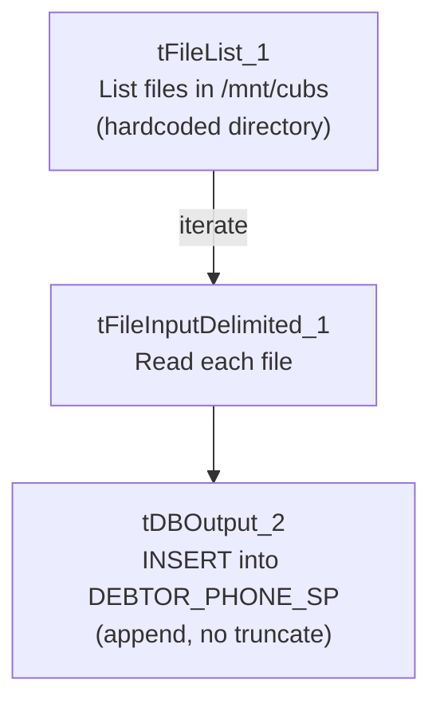

# Talend Job: Backfill_Debtor_Phones

## Overview

A backfill utility very similar to `Backfill_Debtor_Cell_Phone_f83` in this same batch, but generalized to loop over every file in a fixed directory (`/mnt/cubs`) rather than pointing at a single hardcoded file, loading debtor phone numbers into the Snowflake `DEBTOR_PHONE_SP` table. Same minimal, connection-less, no-error-handling shape as its sibling.

## Detail table

| Field | Value |
|---|---|
| Job name | Backfill_Debtor_Phones |
| Version | 0.1 |
| Project | EDW2SF |
| Author | jmach@harriscollect.com |
| Created | 2025-08-21T11:38:51.440-0700 |
| Last Modified | 2025-09-24T11:07:57.239-0700 |

## Step-by-step data flow

This job has no `tPrejob`/`tPostjob`, no `tDBConnection`/`tDBClose`, and no logging — just:

1. `tFileList_1` lists files in `"/mnt/cubs"` (a hardcoded directory, not a context variable — see Issues observed). `EXCLUDEFILEMASK="*.txt"` is set but `IFEXCLUDE=false`, so it's not actually applied.
2. For each file (`ITERATE`), `tFileInputDelimited_1` reads it (tab-delimited, header row, same `LOGON`/`DEBTOR`/`DEBTOR_IDX`/`PHONE` schema as `Backfill_Debtor_Cell_Phone_f83`).
3. `tDBOutput_2` inserts the rows into Snowflake `DEBTOR_PHONE_SP` (`INSERT`, `tableAction=NONE` — appends, no truncate).

## Settings tables

### Source: `tFileList_1` / `tFileInputDelimited_1`

| Setting | Value | What it means |
|---|---|---|
| DIRECTORY | `"/mnt/cubs"` | Hardcoded Linux-style path — not a context variable. |
| FIELDSEPARATOR / HEADER | `\t` / 1 header row | Tab-delimited, header skipped. |
| Schema | `LOGON`, `DEBTOR`, `DEBTOR_IDX`, `PHONE` | Same shape as `Backfill_Debtor_Cell_Phone_f83`'s source. |

### Target: `tDBOutput_2` (`tSnowflakeOutput`)

| Setting | Value | What it means |
|---|---|---|
| Table | `DEBTOR_PHONE_SP` | Destination table — a different target than `Backfill_Debtor_Cell_Phone_f83`'s `DEBTOR_CELL_PHONE_F83`. |
| Output action / Table action | `INSERT` / `NONE` | Pure append — no truncate or dedup. |

## Dependencies & configuration

- **Triggers/depends on other jobs:** none — no `tRunJob` links found.
- **Context variables used:** none.
- **1 hardcoded developer-workstation path** flagged in `tFileInputDelimited_1.TEMP_DIR`; the `DIRECTORY="/mnt/cubs"` hardcoding is not flagged by this extraction's `hardcoded_path_findings` (which appears tuned to the Windows workstation path pattern) but is functionally the same kind of environment-specific hardcoding — see Issues observed.

## Glossary

| Component type | Plain-English meaning |
|---|---|
| `tFileList` | Lists files in a directory for the job to iterate over one at a time. |
| `tFileInputDelimited` | Reads a delimited (CSV/TSV-style) text file according to a schema. |
| `tSnowflakeOutput` | Writes rows into a Snowflake table. |

## Issues observed

- **`DIRECTORY` on `tFileList_1` is hardcoded to `"/mnt/cubs"` rather than a context variable** — the same portability risk as the project-wide `C:/Talend-Studio` hardcoded paths, just not flagged by this extraction's `hardcoded_path_findings` (tuned to the Windows workstation path pattern specifically). Any move of this job to a different runner/host would break it.
- **This job and `Backfill_Debtor_Cell_Phone_f83` load structurally identical schemas** (`LOGON`, `DEBTOR`, `DEBTOR_IDX`, `PHONE`) into two differently-named target tables (`DEBTOR_PHONE_SP` vs. `DEBTOR_CELL_PHONE_F83`) via two different sourcing strategies (directory loop vs. single hardcoded dated file) — they read as two separate one-off backfills rather than a reusable template, despite the near-identical shape. Confirm with the team whether `DEBTOR_PHONE_SP` and `DEBTOR_CELL_PHONE_F83` are genuinely different target tables (e.g., landline vs. cell numbers) or whether one of these jobs is now redundant.
- **Same appended-no-truncate risk as the sibling job**: `tDBOutput_2`'s table action is `NONE`, so rerunning against files already loaded (or leaving already-processed files in `/mnt/cubs`) would duplicate rows, with no dedup/merge step visible.
- **No `tDBConnection`/`tDBClose`, no logging, no error handling** — the same absence pattern as its sibling.
