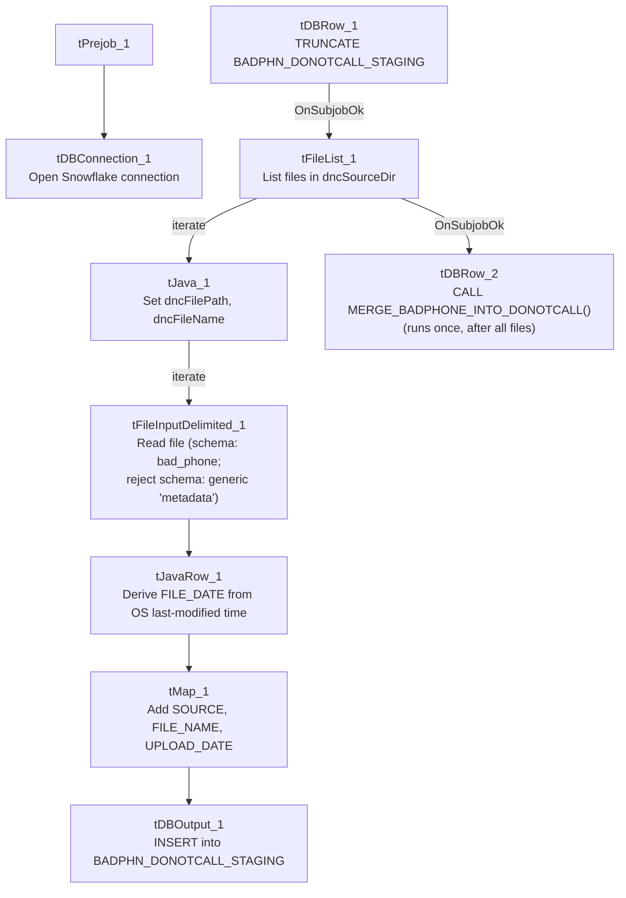

# Talend Job: Bad_Phone_Load

## Overview

Loads "bad phone" / Do-Not-Call source files from a shared directory into a Snowflake staging table (`BADPHN_DONOTCALL_STAGING`), stamping each row with the source file's own OS-level last-modified timestamp, then merges the staged rows into a downstream Do-Not-Call table via a stored procedure. Version 0.2 — one of the few jobs in this batch that has been revised past its initial `0.1`.

## Detail table

| Field | Value |
|---|---|
| Job name | Bad_Phone_Load |
| Version | 0.2 |
| Project | EDW2SF |
| Author | jmach@harriscollect.com |
| Created | 2025-01-14T11:24:17.452-0800 |
| Last Modified | 2025-09-24T11:06:36.459-0700 |

## Step-by-step data flow

**Setup subjob:** `tPrejob_1` → `tDBConnection_1` opens the Snowflake connection.

**Main subjob** — a separate top-level chain, with no visible wiring back to `tDBConnection_1`:

1. `tDBRow_1` runs `TRUNCATE TABLE BADPHN_DONOTCALL_STAGING;`.
2. On `SUBJOB_OK`, `tFileList_1` lists files in `context.dncSourceDir` (`EXCLUDEFILEMASK="*.txt"` set but `IFEXCLUDE=false`, not actually applied).
3. For each file (`ITERATE`), `tJava_1` sets `context.dncFilePath`/`context.dncFileName`, then `tFileInputDelimited_1` reads it (tab-delimited, header row, `REMOVE_EMPTY_ROW=false`, main schema labeled `"...- bad_phone"` but reject schema labeled generically `"...- metadata"` — see Issues observed).
4. `tJavaRow_1` derives `FILE_DATE`/`JAVA_TIMESTAMP` from the source file's OS last-modified attribute (via Java NIO `Files.readAttributes`), alongside `PHONE`/`CONTENT` (the code is truncated in this metadata beyond that point).
5. `tMap_1` adds `SOURCE`, `FILE_NAME`, `UPLOAD_DATE` columns.
6. `tDBOutput_1` inserts the rows into Snowflake `BADPHN_DONOTCALL_STAGING` (`INSERT`, `tableAction=NONE` — the truncate already ran once, upstream of the loop).

Separately, `tFileList_1` → `SUBJOB_OK` → `tDBRow_2` runs `CALL MERGE_BADPHONE_INTO_DONOTCALL();` **after the entire file loop completes** — correctly wired at the `tFileList_1` level (once, after all files), not per-iteration.

## Settings tables

### Truncate: `tDBRow_1`

| Setting | Value | What it means |
|---|---|---|
| Query | `TRUNCATE TABLE BADPHN_DONOTCALL_STAGING;` | Runs once, before the file loop starts — the correct upfront-truncate pattern. |

### Source: `tFileInputDelimited_1`

| Setting | Value | What it means |
|---|---|---|
| SCHEMA (main) | Repository schema `"...- bad_phone"` | Correctly labeled for this job. |
| SCHEMA_REJECT | Repository schema `"...- metadata"` | Generically labeled, not bad-phone-specific — similar mismatched/generic-reject-schema pattern seen elsewhere in this project (e.g. `ADP_Payroll_Load`, `ADP_Employee_Load`). |
| DIE_ON_ERROR | `false` | Malformed rows don't fail the job... |
| Reject flow | Not wired | ...but no connection routes rejected rows anywhere — silently dropped. |

### Derived timestamp: `tJavaRow_1`

| Setting | Value | What it means |
|---|---|---|
| Code (partial) | Reads the source file's OS `lastModifiedTime` via `Files.readAttributes` into `FILE_DATE`/`JAVA_TIMESTAMP` | `FILE_DATE` reflects when the file was last touched on disk, not necessarily a date embedded in its content or filename — see Issues observed. |

### Target & merge: `tDBOutput_1` / `tDBRow_2`

| Setting | Value | What it means |
|---|---|---|
| Table (`tDBOutput_1`) | `BADPHN_DONOTCALL_STAGING` | Staging table; `INSERT`, `tableAction=NONE`. |
| Query (`tDBRow_2`) | `CALL MERGE_BADPHONE_INTO_DONOTCALL();` | Merges staged rows into the downstream Do-Not-Call table, run once after the whole file loop finishes. |

## Dependencies & configuration

- **Triggers/depends on other jobs:** none — no `tRunJob` links found.
- **Context variables used:** `dncFileName`, `dncFilePath`, `dncSourceDir`.
- **1 hardcoded developer-workstation path** in `tFileInputDelimited_1.TEMP_DIR`.

## Glossary

| Component type | Plain-English meaning |
|---|---|
| `tFileList` / `tFileInputDelimited` / `tMap` | List files in a directory, read a delimited file, transform columns. |
| `tJavaRow` | Runs custom Java code once per input row — here, deriving a timestamp from the source file's own OS metadata. |
| `tSnowflakeConnection` / `tSnowflakeRow` / `tSnowflakeOutput` | Open a Snowflake connection, run an arbitrary SQL/procedure call, write rows to a table. |

## Issues observed

- **`tFileInputDelimited_1`'s reject schema is labeled generically `"metadata"` rather than something bad-phone-specific** — a similar mismatched/generic-reject-schema pattern flagged in `ADP_Payroll_Load` (mislabeled "roster") and `ADP_Employee_Load` (generic "metadata" main schema) elsewhere in this project. Whether this causes a real column-mismatch on a rejected row can't be determined from metadata alone.
- **No reject flow is wired from `tFileInputDelimited_1`** despite `DIE_ON_ERROR=false` — malformed rows are silently dropped with no record, the same pattern flagged project-wide in `05_operational_runbook.md`.
- **`tJavaRow_1`'s code is truncated in this metadata** right after establishing `FILE_DATE`/`JAVA_TIMESTAMP` from the file's OS last-modified attribute — the full logic for how `PHONE`/`CONTENT` are derived from the row isn't visible. Verify directly in Talend Studio if phone-number parsing ever looks wrong.
- **Using the file's OS last-modified timestamp (rather than a value from the file's own content or filename) as `FILE_DATE`** means the recorded date reflects whenever the file was last touched on disk — if source files are ever re-transferred or re-saved without preserving their original timestamp, `FILE_DATE` would silently reflect the transfer/save time instead of the true source date. Worth confirming this is the intended behavior with the team.
