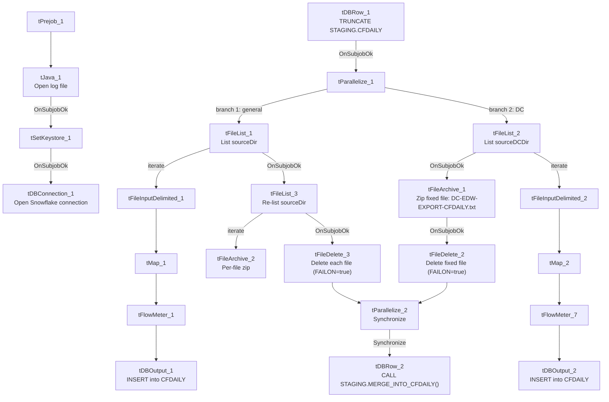

# Talend Job: CFDAILY_Load

## Overview

Loads two parallel branches of "call file" daily records (`CFDAILY` — collector call/callback file tracking: logon, call-file ID, debtor, start/end/total time, activity code, collector initials, port/date/time/sequence) into a shared Snowflake `CFDAILY` table — one branch from a general source directory, one from a DC-site-specific directory — then archives and deletes the source files from both branches and merges the staged rows via a stored procedure once both branches finish. This is the clearest `tParallelize`-based dual-branch loader in this batch.

## Detail table

| Field | Value |
|---|---|
| Job name | CFDAILY_Load |
| Version | 0.1 |
| Project | EDW2SF |
| Author | jmach@harriscollect.com |
| Created | 2025-09-08T12:30:37.554-0700 |
| Last Modified | 2025-11-04T11:08:08.921-0800 |

## Step-by-step data flow

**Setup subjob:** `tPrejob_1` → `tJava_1` opens a per-run log file → on `SUBJOB_OK`, `tSetKeystore_1` (truststore path hardcoded) → on `SUBJOB_OK`, `tDBConnection_1` opens the Snowflake connection.

**Main subjob** — a separate top-level chain:

1. `tDBRow_1` runs `TRUNCATE TABLE STAGING.CFDAILY;` (runs once, before the parallel branches start).
2. On `SUBJOB_OK`, `tParallelize_1` fans out to two branches:
   - **Branch 1 (general, order 1):** `tFileList_1` lists `context.sourceDir` → `ITERATE` → `tFileInputDelimited_1` reads each file (tab-delimited, 15 named columns: `LOGON`, `CFID`, `CFID_IDX`, `DEBTOR`, `ST_TIME`, `ET_TIME`, `TOT_TIME`, `ACT_CODE`, `COL_INITIALS`, `ACT_DATE`, `UNIT_NO`, `CF_PORT`, `CF_DATE`, `CF_TIME`, `CF_SEQ`) → `tMap_1` adds `LOAD_DT` → `tFlowMeter_1` → `tDBOutput_1` inserts into Snowflake `CFDAILY` (`INSERT`, `tableAction=NONE`). Separately, `tFileList_1` → `SUBJOB_OK` → `tFileList_3` **re-lists** `context.sourceDir` from scratch → `ITERATE` → `tFileArchive_2` zips each file to `context.archiveDir + <today's date> + "/" + <filename> + ".zip"`; `tFileList_3` → `SUBJOB_OK` → `tFileDelete_3` deletes each listed file (`FAILON=true`).
   - **Branch 2 (DC, order 2):** `tFileList_2` lists `context.sourceDCDir` → `ITERATE` → `tFileInputDelimited_2` reads each file (same 15-column schema) → `tMap_2` adds `LOAD_DT` → `tFlowMeter_7` → `tDBOutput_2` inserts into the **same** Snowflake `CFDAILY` table. Separately, `tFileList_2` → `SUBJOB_OK` → `tFileArchive_1` zips **a single fixed filename** (`SOURCE=context.sourceDCDir`, `ALL_FILES=false`, `TARGET=context.archiveDir + <date> + "/DC-EDW-EXPORT-CFDAILY.txt.zip"`) → `SUBJOB_OK` → `tFileDelete_2` deletes `context.sourceDCDir + "DC-EDW-EXPORT-CFDAILY.txt"` (`FAILON=true`).
3. Both branches converge on `tParallelize_2`, which `SYNCHRONIZE`s (waits for both `tFileDelete_2` and `tFileDelete_3` via `SUBJOB_OK`) before firing `tDBRow_2`: `CALL STAGING.MERGE_INTO_CFDAILY();`.

## Settings tables

### Truncate & merge: `tDBRow_1` / `tDBRow_2`

| Setting | Value | What it means |
|---|---|---|
| Query 1 | `TRUNCATE TABLE STAGING.CFDAILY;` | Runs once, before `tParallelize_1` fans out — the correct upfront-truncate pattern shared by both branches. |
| Query 2 | `CALL STAGING.MERGE_INTO_CFDAILY();` | Runs once, after `tParallelize_2` confirms both branches' archive/delete steps have finished. |

### Sources: `tFileInputDelimited_1` / `_2`

| Setting | Value | What it means |
|---|---|---|
| DIRECTORY | `context.sourceDir` (branch 1) / `context.sourceDCDir` (branch 2) | Two separate source directories feeding the same target table. |
| Reject flow | Not wired (either branch) | `DIE_ON_ERROR=false`, malformed rows silently dropped. |

### Targets: `tDBOutput_1` / `_2`

| Setting | Value | What it means |
|---|---|---|
| Table (both) | `CFDAILY` | Both branches insert into the same table. |
| Output action / Table action | `INSERT` / `NONE` | Relies entirely on the single upfront `tDBRow_1` truncate (before both branches start) to prevent duplicate accumulation — correctly ordered, unlike `ADP_Roster_Load`'s per-iteration truncate issue elsewhere in this batch. |

### Archive/Delete asymmetry

| Setting | Value | What it means |
|---|---|---|
| Branch 1 (`tFileArchive_2`/`tFileDelete_3`) | Per-file, driven by a fresh `tFileList_3` directory listing | Archives and deletes every file actually found. |
| Branch 2 (`tFileArchive_1`/`tFileDelete_2`) | Single fixed filename `"DC-EDW-EXPORT-CFDAILY.txt"` | Archives/deletes only that exact name — see Issues observed. |

## Dependencies & configuration

- **Triggers/depends on other jobs:** none — no `tRunJob` links found.
- **Context variables used:** `archiveDir`, `keystorePath`, `logDir`, `sourceDCDir`, `sourceDir`.
- **10 hardcoded developer-workstation paths**: `tFileInputDelimited_1`/`_2.TEMP_DIR`, `tFileArchive_1`/`_2.SOURCE_FILE` (unused placeholders), `tFileDelete_2`/`_3.DIRECTORY`/`PATH` (unused placeholders), and `tSetKeystore_1.SSL_TRUSTSERVER_TRUSTSTORE`.

## Glossary

| Component type | Plain-English meaning |
|---|---|
| `tParallelize` | Runs its downstream branches at the same time rather than one after another; a second `tParallelize` with `SYNCHRONIZE` waits for all its incoming branches to finish before continuing. |
| `tFileList` / `tFileInputDelimited` / `tMap` / `tFlowMeter` | List files in a directory, read a delimited file, transform columns, count rows. |
| `tFileArchive` / `tFileDelete` | Zip a processed file to an archive location, then delete files from the source directory. |
| `tSnowflakeRow` | Runs an arbitrary SQL statement or stored-procedure call against Snowflake. |

## Issues observed

- **The DC-specific branch (`tFileArchive_1`/`tFileDelete_2`) archives and deletes a single hardcoded filename** (`"DC-EDW-EXPORT-CFDAILY.txt"`) rather than iterating the directory listing like the general branch does. If the DC extract ever produces more than one file in `context.sourceDCDir`, only that exact filename would be archived/deleted; any other file would be left behind (and, since `IFEXCLUDE=false` on `tFileList_2`, would likely be reloaded again on the next run).
- **`tFileDelete_2` has `FAILON=true`** (the job fails if the file to delete doesn't exist), while `tFileDelete_3` and nearly every other `tFileDelete` component across this batch use `FAILON=false`. An inconsistent error-handling choice; if the DC extract's `tFileInputDelimited_2` step ever processes a file that's already been renamed or moved by the time the delete step runs, this would hard-fail the job rather than continuing quietly.
- **Same non-functioning `EXCLUDEFILEMASK` pattern** (`IFEXCLUDE=false`) on both `tFileList_1` and `tFileList_2`.
- **No reject flow wired from either `tFileInputDelimited` component**; `DIE_ON_ERROR=false`, rows silently dropped.
- **The truncate-before-parallelize / synchronize-before-merge design is correctly ordered** here (unlike `ADP_Roster_Load`'s per-iteration truncate bug documented elsewhere in this batch) — worth noting as the *correct* version of this pattern for comparison.
