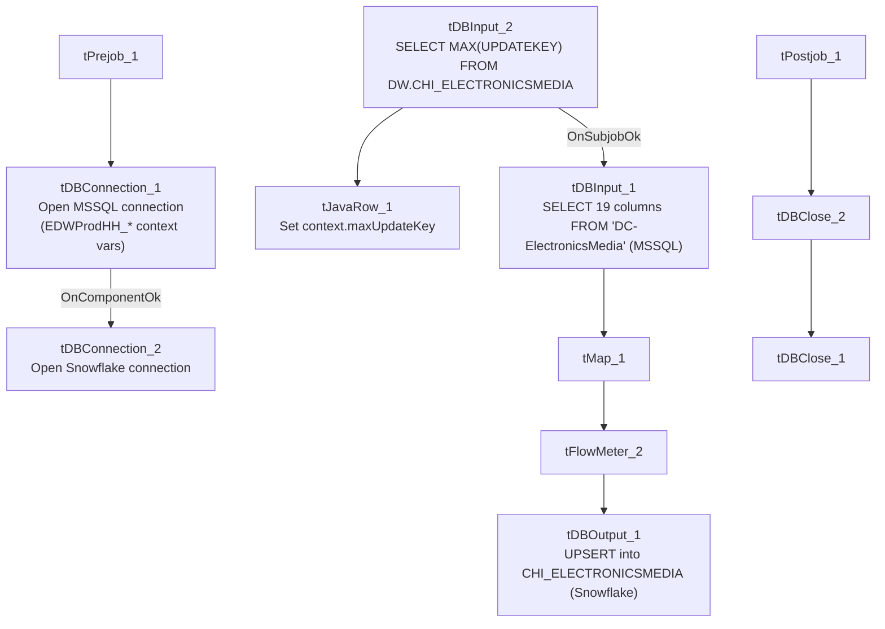

# Talend Job: CHI_E_Media_Load

## Overview

Loads "electronic media" records (letter/notice waterfall and status tracking: status date/time/text/type, content series, source) for the CHI site from an EDWProdHH MSSQL table into the Snowflake `CHI_ELECTRONICSMEDIA` table, upserting on a max-`UpdateKey` incremental check. Notably, the MSSQL source table is literally named `"DC-ElectronicsMedia"` — a DC-site name — even though this is the `CHI_E_Media_Load` job writing into `CHI_ELECTRONICSMEDIA` (see Issues observed).

## Detail table

| Field | Value |
|---|---|
| Job name | CHI_E_Media_Load |
| Version | 0.1 |
| Project | EDW2SF |
| Author | jmach@harriscollect.com |
| Created | 2022-05-17T09:34:47.680-0700 |
| Last Modified | 2025-09-24T11:00:28.089-0700 |

## Step-by-step data flow

**Setup subjob:** `tPrejob_1` → `tDBConnection_1` opens the MSSQL connection using `context.EDWProdHH_*` variables (password `***REDACTED***`) → on `COMPONENT_OK`, `tDBConnection_2` opens the Snowflake connection.

**Teardown subjob:** `tPostjob_1` → `tDBClose_2` (MSSQL) → `tDBClose_1` (Snowflake).

**Main subjob:**

1. `tDBInput_2` (Snowflake) runs `SELECT CAST(COALESCE(MAX(UPDATEKEY),0) AS VARCHAR(10)) AS MAXUPDATEKEY FROM DW.CHI_ELECTRONICSMEDIA;`.
2. `tJavaRow_1` captures the result into `context.maxUpdateKey`.
3. On `SUBJOB_OK`, `tDBInput_1` (`tMSSqlInput`, shared `tDBConnection_1`) runs a fixed `SELECT` of 19 named columns (`LOGON`, `EMID`, `EMID_IDX`, `LETTER_NAME`, `STATUS_DATE`, `STATUS_TIME`, `STATUS`, `STATUS_TEXT`, `STATUS_TYPE`, `WATERFALL`, `UPDATE_DT`, `UPDATE_TIME`, `CURR_SERIES`, `NEW_SERIES`, `CONTENT`, `ORIG_STATUS`, `SOURCE`, `SRC_NAME`, `UpdateKey`) from MSSQL table **`"DC-ElectronicsMedia"`**. **The captured query text is truncated in this metadata** (ends at `...,[...`) and does not show a visible `WHERE` clause referencing `context.maxUpdateKey` — see Issues observed.
4. `tMap_1` → `tFlowMeter_2` (row count) → `tDBOutput_1` upserts the rows into Snowflake `CHI_ELECTRONICSMEDIA` (`outputAction=UPSERT`, `tableAction=NONE`).

## Settings tables

### Source: `tDBInput_1` (`tMSSqlInput`)

| Setting | Value | What it means |
|---|---|---|
| Connection | Shared `tDBConnection_1` | Reuses the job's MSSQL connection. |
| Table | `"DC-ElectronicsMedia"` | The literal source table name — see Issues observed regarding the DC/CHI mismatch. |
| Query | Fixed `SELECT` of 19 columns (truncated in metadata) | No visible `WHERE` clause referencing `context.maxUpdateKey`. |

### Target: `tDBOutput_1` (`tSnowflakeOutput`)

| Setting | Value | What it means |
|---|---|---|
| Table | `CHI_ELECTRONICSMEDIA` | Destination table. |
| Output action | `UPSERT` | Differs from most other jobs' plain `INSERT` — presumably keyed on `UPDATEKEY` or an equivalent natural key to avoid duplicating already-loaded rows on rerun, though the actual upsert key isn't visible in this metadata. |

## Dependencies & configuration

- **Triggers/depends on other jobs:** none — no `tRunJob` links found.
- **Context variables used:** `EDWProdHH_Database`, `EDWProdHH_Login`, `EDWProdHH_Port`, `EDWProdHH_Schema`, `EDWProdHH_Server`, `maxUpdateKey` (computed internally).
- **No hardcoded developer-workstation paths** found in this job.

## Glossary

| Component type | Plain-English meaning |
|---|---|
| `tMSSqlConnection` / `tMSSqlInput` / `tMSSqlClose` | Open a Microsoft SQL Server connection, run a query against it, and close it. |
| `tSnowflakeInput` / `tSnowflakeOutput` / `tSnowflakeConnection` / `tSnowflakeClose` | Run a query against Snowflake and return results / write (or upsert) rows into a table / open and close the connection. |
| `tJavaRow` | Runs custom Java code once per input row — here, unpacking a single query result into a context variable. |
| `tMap` / `tFlowMeter` | Map/transform columns; count rows passing a point in the flow. |

## Issues observed

- **The MSSQL source table is named `"DC-ElectronicsMedia"`, a DC-site name, yet this job is `CHI_E_Media_Load` and writes into `CHI_ELECTRONICSMEDIA`.** Either the source system genuinely stores CHI's electronic-media records in a table that was never renamed from a historical/legacy "DC" name, or this job was copied from an actual DC-site load job and the `TABLE` parameter was never repointed to a CHI-specific source table. **Unable to determine which from metadata alone** — this is a significant, concrete finding since it directly affects which site's data actually lands in `CHI_ELECTRONICSMEDIA`. Verify urgently with the team before trusting this table's site attribution.
- **The incremental max-key check (`context.maxUpdateKey`) is computed, but the captured `tDBInput_1.QUERY` text is truncated after the column list**, with no visible `WHERE` clause using it — the same uncertainty documented in `i3_CallDetail_40_Load` and `AgentKPI_Daily_Load`. However, unlike those two jobs, this one's `outputAction` is `UPSERT` rather than `INSERT`, which would at least prevent duplicate rows even if the full table were re-pulled every run (assuming the upsert key is correctly `UpdateKey` or an equivalent natural key) — so the practical risk here is more likely wasted read/compute cost on a full re-pull than duplicated data, though this can't be fully confirmed without the untruncated query.
- **No error/row-count logging or reject-flow handling** is visible for this job — a failure would only surface as a generic Talend execution error.
