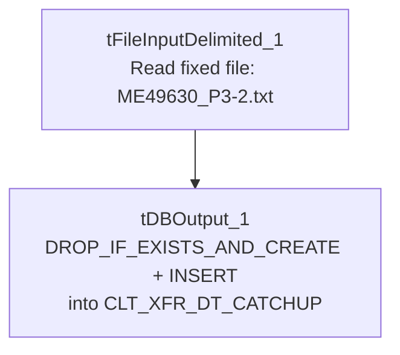

# Talend Job: CLT_XFR_DT_Load

## Overview

Loads a single hardcoded client-transfer-date extract file (`ME49630_P3-2.txt` — a cryptic batch/ticket-style reference not otherwise explained in the metadata) into a Snowflake "catchup" table, `CLT_XFR_DT_CATCHUP`, dropping and recreating the table fresh on each run. Same one-off/manual-utility pattern as the `Backfill_*` jobs and `ADP_Employee_Load` elsewhere in this batch — a two-component job with no connection management, logging, or error handling.

## Detail table

| Field | Value |
|---|---|
| Job name | CLT_XFR_DT_Load |
| Version | 0.1 |
| Project | EDW2SF |
| Author | jmach@harriscollect.com |
| Created | 2023-09-28T14:07:33.036-0700 |
| Last Modified | 2025-09-24T11:09:04.544-0700 |

## Step-by-step data flow

This job has no `tPrejob`/`tPostjob`, no `tDBConnection`/`tDBClose`, and no logging — just:

1. `tFileInputDelimited_1` reads the fixed file `"C:/Data/ME49630_P3-2.txt"` (tab-delimited, header row, `DIE_ON_ERROR=false`) with schema `LOGON`/`DEBTORNUMBER`/`CLT_XFR_DT`.
2. `tDBOutput_1` writes into Snowflake `CLT_XFR_DT_CATCHUP` (`INSERT`, `tableAction=DROP_IF_EXISTS_AND_CREATE` — the table is fully rebuilt each run, not just cleared).

## Settings tables

### Source: `tFileInputDelimited_1`

| Setting | Value | What it means |
|---|---|---|
| FILENAME | `"C:/Data/ME49630_P3-2.txt"` | A fully hardcoded path to a specific file; "ME49630" and "P3-2" are not otherwise explained in this metadata. |
| DIE_ON_ERROR | `false` | Malformed rows don't fail the job; no reject flow is wired either, so they're silently dropped. |

### Target: `tDBOutput_1` (`tSnowflakeOutput`)

| Setting | Value | What it means |
|---|---|---|
| Table | `CLT_XFR_DT_CATCHUP` | Destination table. |
| Output action / Table action | `INSERT` / `DROP_IF_EXISTS_AND_CREATE` | Recreates the table's structure from the job's own schema on every run, rather than just clearing its rows (as `TRUNCATE` would). |

## Dependencies & configuration

- **Triggers/depends on other jobs:** none — no `tRunJob` links found.
- **Context variables used:** none — everything is hardcoded.
- **1 hardcoded developer-workstation path** in `tFileInputDelimited_1.TEMP_DIR`.

## Glossary

| Component type | Plain-English meaning |
|---|---|
| `tFileInputDelimited` | Reads a delimited (CSV/TSV-style) text file according to a schema. |
| `tSnowflakeOutput` | Writes rows into a Snowflake table; here configured to drop and recreate the table each run. |

## Issues observed

- **`FILENAME` is a fully hardcoded path to a specific file with a cryptic name** (`"C:/Data/ME49630_P3-2.txt"`) — the same one-time/manual-utility signature as the `Backfill_*` jobs and `ADP_Employee_Load` in this batch. Unable to determine from metadata what "ME49630" or "P3-2" refer to; verify with the team if this table's provenance is ever questioned.
- **`tDBOutput_1`'s table action is `DROP_IF_EXISTS_AND_CREATE` rather than `TRUNCATE`** — this recreates the table's structure from the job's own schema on every run rather than just clearing its rows. If any downstream object (view, grant, another job) depends on `CLT_XFR_DT_CATCHUP`'s exact table definition or permissions, a drop-and-recreate could silently reset those on each run. It also means rerunning this job against the same 2023-dated source file would simply rebuild an identical table — nothing suggests this job is meant to run more than once.
- **No `tDBConnection`/`tDBClose`, no logging, no error handling** — the same absence pattern as other one-off utilities in this batch (e.g., `ADP_Employee_Load`, `Backfill_Debtor_Cell_Phone_f83`).
