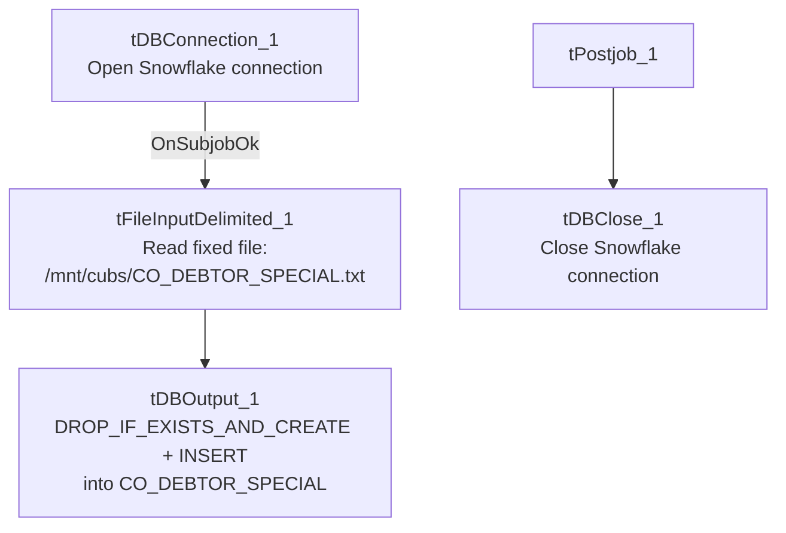

# Talend Job: CO_DEBTOR_SPECIAL_BACKFILL_LOAD

## Overview

Loads "special" CO-site debtor attributes (retention period, statute-of-limitations, retention reason, lien flag) from a fixed file on a shared mount path into a freshly rebuilt Snowflake `CO_DEBTOR_SPECIAL` table. Similar in spirit to `CLT_XFR_DT_Load` and the `Backfill_Debtor_*` jobs elsewhere in this batch, but this one does include basic Snowflake connection lifecycle management (`tDBConnection_1`/`tPostjob_1`/`tDBClose_1`), unlike most of its fully bare-bones one-off siblings.

## Detail table

| Field | Value |
|---|---|
| Job name | CO_DEBTOR_SPECIAL_BACKFILL_LOAD |
| Version | 0.1 |
| Project | EDW2SF |
| Author | jmach@harriscollect.com |
| Created | 2023-02-06T09:46:33.277-0800 |
| Last Modified | 2025-09-24T11:08:21.910-0700 |

## Step-by-step data flow

This job has no `tPrejob_1` component — `tDBConnection_1` is itself the job's starting point:

1. `tDBConnection_1` opens the Snowflake connection.
2. On `SUBJOB_OK`, `tFileInputDelimited_1` reads the fixed file `"/mnt/cubs/CO_DEBTOR_SPECIAL.txt"` (tab-delimited, header row, `DIE_ON_ERROR=false`) with schema `LOGON`/`DEBTOR`/`DEBTOR_IDX`/`RET_PERIOD`/`ST_LIMIT`/`RET_REASON_EM`/`LIEN`.
3. `tDBOutput_1` writes into Snowflake `CO_DEBTOR_SPECIAL` (`INSERT`, `tableAction=DROP_IF_EXISTS_AND_CREATE`).

**Teardown:** `tPostjob_1` → `tDBClose_1`.

## Settings tables

### Source: `tFileInputDelimited_1`

| Setting | Value | What it means |
|---|---|---|
| FILENAME | `"/mnt/cubs/CO_DEBTOR_SPECIAL.txt"` | Hardcoded Linux-style path, not a context variable. |
| DIE_ON_ERROR | `false` | Malformed rows don't fail the job; no reject flow is wired either, so they're silently dropped. |

### Target: `tDBOutput_1` (`tSnowflakeOutput`)

| Setting | Value | What it means |
|---|---|---|
| Table | `CO_DEBTOR_SPECIAL` | Destination table. |
| Output action / Table action | `INSERT` / `DROP_IF_EXISTS_AND_CREATE` | Table is fully rebuilt from the job's own schema every run — the same rebuild-not-clear pattern flagged in `CLT_XFR_DT_Load`. |

## Dependencies & configuration

- **Triggers/depends on other jobs:** none — no `tRunJob` links found.
- **Context variables used:** none — everything is hardcoded.
- **1 hardcoded developer-workstation path** flagged in `tFileInputDelimited_1.TEMP_DIR`; the `FILENAME="/mnt/cubs/CO_DEBTOR_SPECIAL.txt"` hardcoding is not caught by this extraction's `hardcoded_path_findings` (tuned to the Windows workstation path pattern), but carries the same one-off/portability risk — the same situation as `Backfill_Debtor_Phones`'s hardcoded `/mnt/cubs` directory elsewhere in this batch.

## Glossary

| Component type | Plain-English meaning |
|---|---|
| `tFileInputDelimited` | Reads a delimited (CSV/TSV-style) text file according to a schema. |
| `tSnowflakeOutput` / `tSnowflakeConnection` / `tSnowflakeClose` | Write rows into a Snowflake table (here configured to drop and recreate it) / open and close the Snowflake connection. |

## Issues observed

- **`FILENAME` is hardcoded to a fixed path** (`"/mnt/cubs/CO_DEBTOR_SPECIAL.txt"`) rather than a context variable — not caught by this extraction's `hardcoded_path_findings` (tuned to the Windows `C:/Talend-Studio` pattern), but the same portability/one-off risk as the flagged Windows paths elsewhere in this project.
- **`tDBOutput_1`'s table action is `DROP_IF_EXISTS_AND_CREATE`**, the same rebuild-the-table-every-run pattern flagged in `CLT_XFR_DT_Load` — any downstream dependency on `CO_DEBTOR_SPECIAL`'s table definition or grants would be reset on each run.
- **This job has no `tPrejob_1`** (unlike `CLT_XFR_DT_Load` and `ADP_Employee_Load`, which have no connection/teardown components at all, and unlike the fuller jobs in this batch which have both `tPrejob_1` and `tPostjob_1`) — it sits in between, with connection open/close but no logging setup. Not necessarily a defect, just an inconsistent shape relative to other jobs' conventions in this project.
- **No reject-flow wiring, no error handling, no logging** — the same one-off-utility profile as its siblings in this batch.
- **The name "CO_DEBTOR_SPECIAL_BACKFILL_LOAD" and its target table's plain "CO_DEBTOR_SPECIAL" name** (without a "_BACKFILL" suffix, unlike `Activity_Load_Legacy`'s "_BACKFILL"-suffixed target) suggest this might be the primary/only load mechanism for this table rather than a genuine one-time backfill companion to some other ongoing job — but no other job in this batch's metadata references `CO_DEBTOR_SPECIAL`, so it's unable to determine from metadata alone whether an ongoing companion job exists elsewhere in the 289-job project. Verify with the team.
