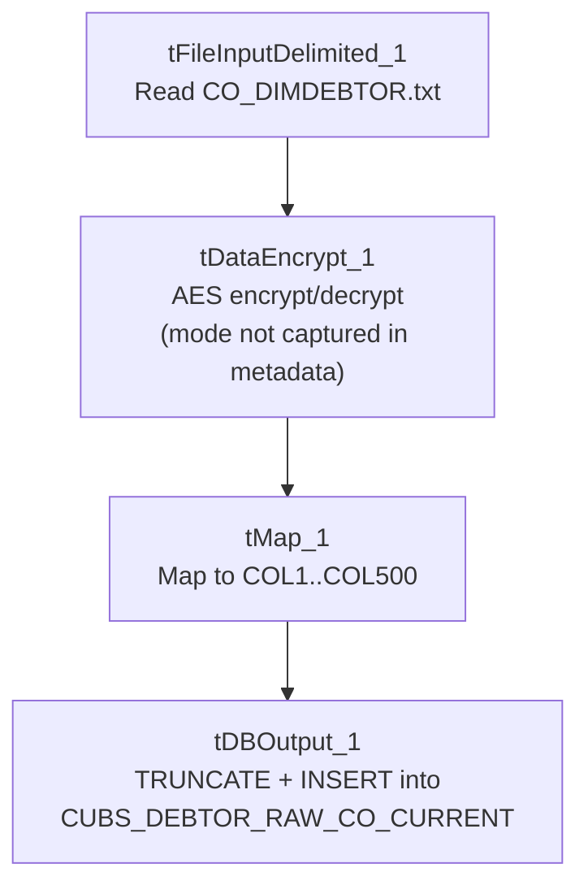

# Talend Job: CO_Debtor_TrueUp

## Overview

Loads a full snapshot of CO (site code) debtor records from a local tab-delimited extract file (`C:/Data/CO_DIMDEBTOR.txt`) into the Snowflake raw staging table `CUBS_DEBTOR_RAW_CO_CURRENT`, truncating and reloading the table every run. The source schema carries roughly 100 named debtor fields (identity, address, SSN, balance/assignment/collection amounts, letter and promise-to-pay history) typical of the CUBS collections system, but the row is routed through a field-level encryption component before it's mapped and loaded, and the destination schema itself is captured only as 500 generically named columns (`COL1`-`COL500`) rather than the real business field names — see Issues observed. Unlike the debtor load referenced from `CO_Master_Load` (`CUBS_Raw_CO_Debtor_Load`), this job is not called by any `tRunJob` in this project's orchestration graph; given its "TrueUp" name, it looks like a standalone reconciliation load run on its own rather than part of the regular nightly pipeline.

## Detail table

| Field | Value |
|---|---|
| Job name | CO_Debtor_TrueUp |
| Version | 0.1 |
| Project | EDW2SF |
| Author | jmach@harriscollect.com |
| Created | 2024-05-09T09:06:02.346-0700 |
| Last Modified | 2025-09-24T11:07:40.952-0700 |

## Step-by-step data flow

This job has no `tPrejob`/`tPostjob`/`tDBConnection` components in its own metadata — it's a single 4-component pipeline:

1. `tFileInputDelimited_1` reads `C:/Data/CO_DIMDEBTOR.txt` (tab-separated, header row present, ISO-8859-15 encoding, `DIE_ON_ERROR=false`) using a repository schema whose label is just an opaque ID plus "- metadata" (not a descriptive name), covering roughly 100 debtor business columns (`DebtorNumber`, `LOGON`, `DimLogon`, `DimClient`, `DEBTOR_IDX`, `CLIENT`, `NAME1`/`NAME2`, address fields, plus ~80 underscore-prefixed fields such as `_SSN`, `_DOB`, `_TOTAL_BAL`, `_PROM_DT`, and letter-history fields).
2. FLOW to `tDataEncrypt_1`, which runs each row through an AES-based encryption/decryption step keyed by a crypto file at `C:/Data/dimdbtr.crypt` (secret type, key, and password all `***REDACTED***`); the schema is identical going in and out, so this step transforms field values in place rather than adding or removing columns.
3. FLOW to `tMap_1` (`DIE_ON_ERROR=true`), which maps the row to an output schema of 500 generically named columns (`FILENAME`, `FILEDATE`, `COL1`...`COL500`).
4. FLOW to `tDBOutput_1` (`tSnowflakeOutput`) — `TRUNCATE` table action, `INSERT` output action, writing into `CUBS_DEBTOR_RAW_CO_CURRENT`.

## Settings tables

### Source: `tFileInputDelimited_1`

| Setting | Value | What it means |
|---|---|---|
| FILENAME | `"C:/Data/CO_DIMDEBTOR.txt"` | Hardcoded local path to the CO site's debtor extract file — not a `context.sourceDir`-style reference. |
| FIELDSEPARATOR / HEADER | `\t` / 1 header row | Tab-delimited file with the header row skipped. |
| SCHEMA | Repository schema `"_cg_VMA4fEe-4IfbB_0n8ZA - metadata"` | The schema's label doesn't name the business content, unlike e.g. `CREATE_RAW_CUBS_CLIENT`'s clearly-named repository schema. |
| DIE_ON_ERROR | `false` | Malformed rows don't fail the job... |
| Reject flow / SCHEMA_REJECT | Not wired; no reject schema defined at all | ...and unlike `ADP_Payroll_Load` (which at least has a mislabeled reject schema), this component defines no reject schema at all — rejected rows are silently dropped with zero visibility. |
| TEMP_DIR | `"C:/Talend-Studio-20211109_1610-V8.0.1/workspace"` | Hardcoded developer-workstation path, the same portability risk documented project-wide in `05_operational_runbook.md`. |

### Transform: `tDataEncrypt_1`

| Setting | Value | What it means |
|---|---|---|
| CRYPTO_METHOD | `AES` | Symmetric encryption algorithm used for whichever field(s) this step processes. |
| CRYPTO_FILE_PATH | `"C:/Data/dimdbtr.crypt"` | Local crypto key/config file read from disk, not a context-variable path. |
| SECRET_TYPE / SECRET_KEY / PASSWORD_M1 | `***REDACTED***` | Preserved as redacted — not guessable from this metadata. |
| GEN_CRYPTO_FILE_CONTROLLER | `false` | This run reads an existing crypto file rather than generating a new one. |
| Mode (encrypt vs. decrypt) | Not captured in this metadata | See Issues observed. |

### Target: `tDBOutput_1` (`tSnowflakeOutput`)

| Setting | Value | What it means |
|---|---|---|
| Table | `CUBS_DEBTOR_RAW_CO_CURRENT` | Destination raw staging table for CO debtor data. |
| Output action | `INSERT` | Appends rows, relying on the preceding truncate. |
| Table action | `TRUNCATE` | Same truncate-then-reload pattern used by most `CUBS_Raw_*` jobs project-wide. |
| Target schema | `FILENAME`, `FILEDATE`, `COL1`...`COL500` | Generic placeholder column names rather than the real business columns named on the source side — see Issues observed. |

## Dependencies & configuration

- **Triggers/depends on other jobs:** none — no `tRunJob` links found in this job, and this job is not listed as a `tRunJob` target of `CO_Master_Load` or any other calling job in `06_dependency_matrix.md` (the analogous per-run CO debtor load in that orchestration is the differently named `CUBS_Raw_CO_Debtor_Load`).
- **Context variables used:** none — `context_vars_referenced` is empty for this job; every path (source file, crypto file, temp dir) is hardcoded rather than parameterized via context, unlike almost every other job in this project.
- **Hardcoded paths:** `tFileInputDelimited_1.TEMP_DIR` is in the formal `hardcoded_path_findings` list; in addition (present in the job's own parameters, though not flagged by that extraction pass) `tFileInputDelimited_1.FILENAME` (`"C:/Data/CO_DIMDEBTOR.txt"`) and `tDataEncrypt_1.CRYPTO_FILE_PATH` (`"C:/Data/dimdbtr.crypt"`) are both local, drive-letter paths rather than `context.sourceDir`-style references.

## Glossary

| Component type | Plain-English meaning |
|---|---|
| `tFileInputDelimited` | Reads a delimited (CSV/TSV-style) text file according to a schema. |
| `tDataEncrypt` | Talend's field-level encryption/decryption component, driven by a crypto key file. |
| `tMap` | Maps/transforms columns from one schema to another. |
| `tSnowflakeOutput` | Writes rows to a Snowflake table, optionally truncating or recreating it first. |

## Issues observed

- **No `tPrejob`/`tPostjob` or explicit `tDBConnection`/`tDBClose` components in this job**, unlike nearly every other job in this project. `tDBOutput_1`'s own `parameters` object is empty, so it's not visible in this metadata where or how its Snowflake connection is actually defined — verify directly in Talend Studio.
- **The destination schema is captured only as 500 generic `COL1`..`COL500` placeholder columns** (plus `FILENAME`/`FILEDATE`), even though the source schema names its fields explicitly (`DebtorNumber`, `NAME1`, `_SSN`, etc.). This may simply be how this extraction captured `tMap_1`'s output schema, or the mapping in Talend Studio may genuinely use generic column names. Unable to determine which from this metadata — if the latter, anyone querying `CUBS_DEBTOR_RAW_CO_CURRENT` downstream would need to reverse-engineer which `COLnn` holds which real value.
- **No reject schema or reject flow at all on `tFileInputDelimited_1`** (not even a mislabeled one, unlike `ADP_Payroll_Load`) — malformed rows are silently dropped with zero record of what or how many failed.
- **`tDataEncrypt_1`'s mode (encrypt vs. decrypt) isn't visible in this metadata.** Given the job runs right after reading a raw text extract and before writing to a raw staging table, it's plausible this step is protecting a sensitive field (e.g. `_SSN`) as it lands in Snowflake — but that's an inference, not something the extracted parameters confirm.
- **Every path in this job (source file, crypto file, temp dir) is hardcoded** rather than driven by a context variable, unlike almost every other job in this project (which typically use `context.sourceDir`/`archiveDir`, etc.). This job would need manual editing to run against any environment other than the one baked into its component settings.
- **Not part of any documented `tRunJob` orchestration** (see `06_dependency_matrix.md`). Given the "TrueUp" name, this looks like a standalone/ad hoc reconciliation job; how and when it's actually triggered is unable to determine from metadata — verify with the team.
