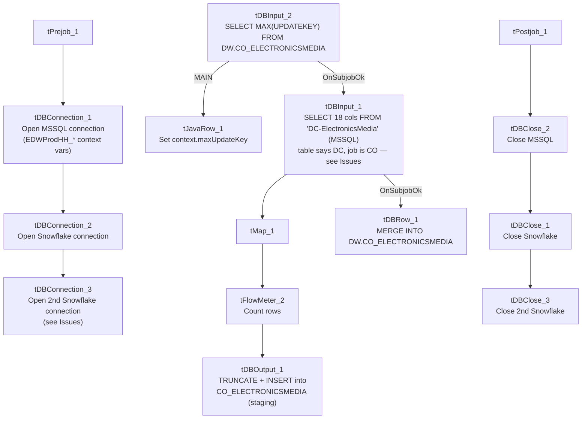

# Talend Job: CO_E_Media_Load

## Overview

Loads electronic-media/letter-status tracking records for the CO site from an MSSQL table into a Snowflake staging table, then merges those staged rows into a corresponding `DW.CO_ELECTRONICSMEDIA` table via an `UPDATEKEY`/`EMID_IDX`-driven upsert. The data represents the status "waterfall" of collection letters/communications (`LETTER_NAME`, `STATUS_DATE`/`TIME`, `STATUS_TEXT`, `WATERFALL`, etc.) associated with debtor accounts. Like `i3_CallDetail_40_Load`, this job computes the maximum already-loaded key from Snowflake before reading the source, suggesting an intended incremental-load design — but as with that job, the captured query text doesn't confirm the filter is actually applied (see Issues observed).

## Detail table

| Field | Value |
|---|---|
| Job name | CO_E_Media_Load |
| Version | 0.1 |
| Project | EDW2SF |
| Author | jmach@harriscollect.com |
| Created | 2022-05-13T14:10:46.398-0700 |
| Last Modified | 2025-09-24T11:06:52.343-0700 |

## Step-by-step data flow

**Setup subjob:** `tPrejob_1` → `tDBConnection_1` opens the MSSQL connection using `context.EDWProdHH_*` variables → `tDBConnection_2` opens a Snowflake connection → `tDBConnection_3` opens a **second, separate** Snowflake connection (see Issues observed).

**Main subjob:**

1. `tDBInput_2` (`tSnowflakeInput`) runs `SELECT CAST(COALESCE(MAX(UPDATEKEY),0) AS VARCHAR(10)) AS MAXUPDATEKEY FROM DW.CO_ELECTRONICSMEDIA;` against Snowflake.
2. `tJavaRow_1` captures that result into `context.maxUpdateKey`.
3. On `tDBInput_2`'s subjob success, `tDBInput_1` (`tMSSqlInput`, reusing `tDBConnection_1`) runs a fixed `SELECT` of 18 named columns from the MSSQL table `"DC-ElectronicsMedia"` — note the table name says **DC**, not CO, despite this being the CO job (see Issues observed). **The captured query text is truncated after the column list and does not visibly reference `context.maxUpdateKey`.**
4. `tMap_1` (`DIE_ON_ERROR=true`) passes all columns through largely unchanged (renaming only `UpdateKey` → `UPDATEKEY`) to `tFlowMeter_2` (labeled "MyLabel", not renamed for this job), which counts rows before `tDBOutput_1` truncates and inserts into the Snowflake staging table `CO_ELECTRONICSMEDIA`.
5. Separately, once `tDBInput_1`'s subjob succeeds, `tDBRow_1` (`tSnowflakeRow`) runs a `MERGE INTO DW.CO_ELECTRONICSMEDIA` statement — matching on `EMID_IDX`, updating matched rows and inserting unmatched ones — reading its source rows explicitly `FROM STAGING.CO_ELECTRONICSMEDIA` (matching the `STAGING.`-prefix convention seen in `CO_Master_Load`'s merge calls).

**Teardown subjob:** `tPostjob_1` → `tDBClose_2` (close MSSQL) → `tDBClose_1` (close first Snowflake connection) → `tDBClose_3` (close second Snowflake connection).

## Settings tables

### Source: `tDBInput_1` (`tMSSqlInput`)

| Setting | Value | What it means |
|---|---|---|
| Connection | Shared `tDBConnection_1` | Reuses the job's MSSQL connection. |
| Table | `"DC-ElectronicsMedia"` | Source table name literally says "DC" — see Issues observed. |
| Query | Fixed `SELECT` of 18 named columns (letter/status/waterfall fields, `UpdateKey`) | The visible portion of the query text does not show a `WHERE UpdateKey > ...`-style clause referencing `context.maxUpdateKey` — same uncertainty documented in `i3_CallDetail_40_Load`. |

### Incremental key check: `tDBInput_2` / `tJavaRow_1`

| Setting | Value | What it means |
|---|---|---|
| Query | `SELECT CAST(COALESCE(MAX(UPDATEKEY),0) AS VARCHAR(10)) AS MAXUPDATEKEY FROM DW.CO_ELECTRONICSMEDIA;` | Finds the highest `UpdateKey` already loaded into the DW table. |
| Result handling | `MAXUPDATEKEY` → `context.maxUpdateKey` | Computed before the MSSQL read — intended for incremental filtering (see Issues observed on whether it's actually applied). |

### Staging target: `tDBOutput_1` (`tSnowflakeOutput`)

| Setting | Value | What it means |
|---|---|---|
| Table | `CO_ELECTRONICSMEDIA` | Snowflake staging table. |
| Output action | `INSERT` | Appends rows. |
| Table action | `TRUNCATE` | Clears the staging table before each load. |

### Merge step: `tDBRow_1` (`tSnowflakeRow`)

| Setting | Value | What it means |
|---|---|---|
| Query | `MERGE INTO DW.CO_ELECTRONICSMEDIA AS tgt USING (SELECT ... FROM STAGING.CO_ELECTRONICSMEDIA) AS src ON (tgt.EMID_IDX = src.EMID_IDX) WHEN MATCHED THEN UPDATE ... WHEN NOT MATCHED THEN INSERT ...` | Classic upsert keyed on `EMID_IDX` (electronic-media record ID) — updates every business column on match, inserts new rows otherwise. Explicitly reads `FROM STAGING.CO_ELECTRONICSMEDIA`, so it depends on `tDBOutput_1` having just loaded that staging table in the same run. |

## Dependencies & configuration

- **Triggers/depends on other jobs:** none — no `tRunJob` links found. This job is also not listed as a `tRunJob` target of `CO_Master_Load` in `06_dependency_matrix.md` — that orchestrator instead calls a differently named `CUBS_Raw_EM_Load` for "EM" data. Unable to determine from metadata whether `CO_E_Media_Load` and `CUBS_Raw_EM_Load` are related or fully independent pipelines.
- **Context variables used:** `EDWProdHH_Server`, `EDWProdHH_Port`, `EDWProdHH_Schema`, `EDWProdHH_Database`, `EDWProdHH_Login` (MSSQL connection details) plus `maxUpdateKey` (computed internally).
- No hardcoded developer-workstation paths found in this job (`hardcoded_path_findings` is empty).

## Glossary

| Component type | Plain-English meaning |
|---|---|
| `tMSSqlConnection` / `tMSSqlInput` / `tMSSqlClose` | Open a Microsoft SQL Server connection, run a query against it, and close it. |
| `tSnowflakeConnection` / `tSnowflakeInput` / `tSnowflakeOutput` / `tSnowflakeRow` / `tSnowflakeClose` | Open/close a Snowflake connection, read rows, write rows, or run an arbitrary SQL statement/stored-procedure call against Snowflake. |
| `tMap` | Maps/transforms columns from one schema to another. |
| `tFlowMeter` | Counts rows passing a point in the flow for logging/monitoring. |
| `tJavaRow` | Runs custom Java code once per input row — here used to unpack a single query result into a context variable. |

## Issues observed

- **The MSSQL source table is named `"DC-ElectronicsMedia"`, not `"CO-ElectronicsMedia"` or similar**, even though this job is `CO_E_Media_Load` and everything downstream (Snowflake staging/DW tables, merge query) is named `CO_ELECTRONICSMEDIA`. This strongly suggests either (a) a single shared "DC" source table actually holds electronic-media data for multiple sites including CO, and only the job's naming is inconsistent, or (b) this job was copied from a DC-specific job and the source `TABLE` parameter was never repointed. Unable to determine which from metadata — worth confirming with the team before assuming CO's e-media data is correctly sourced.
- **Two separate Snowflake connections are opened back-to-back** (`tDBConnection_2` and `tDBConnection_3`) in the setup subjob, and closed as two separate connections (`tDBClose_1`, `tDBClose_3`) in teardown, rather than reusing a single one throughout. Both have empty captured parameters, so it's unable to determine from metadata whether they point to the same or different Snowflake accounts/warehouses — if identical, this is a redundant connection open/close pair.
- **Same incremental-load uncertainty documented in `i3_CallDetail_40_Load`:** `context.maxUpdateKey` is computed from Snowflake before the MSSQL read, but the captured `tDBInput_1.QUERY` text is truncated after the column list and does not show a filtering `WHERE` clause. Unable to confirm from this metadata whether the load is genuinely incremental or re-reads the full source table every run — the `TRUNCATE`+`INSERT` on the staging table prevents duplicate accumulation there regardless, but a non-incremental read would mean wasted read volume every run.
- **No error/row-count logging specific to this job's business outcome** (no `tWarn`/`tDie`/`tSendMail`) — a load or merge failure here would only surface as a generic Talend execution error.
