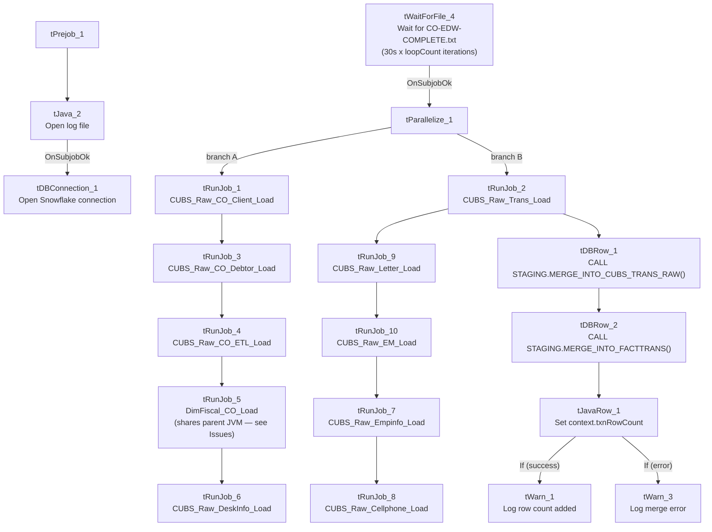

# Talend Job: CO_Master_Load

## Overview

This is the project's clearest orchestrator job: it doesn't move data itself except for two merge calls near the end — its purpose is to wait for the "CO" (site code) daily extract to finish landing, then run 10 other jobs in a defined sequence (some in parallel) to load client, debtor, transaction, and dimension data for the CO site into the Snowflake warehouse. At version 0.5, it's also one of the more actively iterated jobs in the project (most single-purpose EDW2SF jobs are at version 0.1). `CO` is the only site with its own `_Master_Load` orchestrator in this metadata — see `05_operational_runbook.md` for the implication.

## Detail table

| Field | Value |
|---|---|
| Job name | CO_Master_Load |
| Version | 0.5 |
| Project | EDW2SF |
| Author | jmach@harriscollect.com |
| Created | 2024-07-02T11:59:05.595-0700 |
| Last Modified | 2025-09-24T11:09:11.586-0700 |

## Step-by-step data flow

**Setup subjob:** `tPrejob_1` → `tJava_2` opens a per-run log file (same pattern as other jobs in this project) → on success, `tDBConnection_1` opens the job's Snowflake connection.

**Main subjob** — runs independently of the setup subjob and gates everything else on a semaphore file:

1. `tWaitForFile_4` polls `context.sourceDir` every 30 seconds, up to `context.loopCount` iterations, for a file named `CO-EDW-COMPLETE.txt` (or proceeds immediately if it's already present — `INCLUDE_PRESENT=true`). This is the same semaphore-file pattern documented in `Semaphore_Check`, but used here as an active *gate* rather than a passive *checker*.
2. On success, `tParallelize_1` starts two independent branches:
   - **Branch A — client/debtor/reference-data chain:** `tRunJob_1` (**CUBS_Raw_CO_Client_Load**) → `tRunJob_3` (**CUBS_Raw_CO_Debtor_Load**) → `tRunJob_4` (**CUBS_Raw_CO_ETL_Load**) → `tRunJob_5` (**DimFiscal_CO_Load** — note `USE_INDEPENDENT_PROCESS=false`, unlike every other `tRunJob` in this job; see Issues observed) → `tRunJob_6` (**CUBS_Raw_DeskInfo_Load**), each triggered only after the previous one succeeds (`OnSubjobOk`, and `DIE_ON_CHILD_ERROR=true` on all of them).
   - **Branch B — transactions chain:** `tRunJob_2` (**CUBS_Raw_Trans_Load**) succeeds, then triggers two things in order:
     - `tRunJob_9` (**CUBS_Raw_Letter_Load**) → `tRunJob_10` (**CUBS_Raw_EM_Load**) → `tRunJob_7` (**CUBS_Raw_Empinfo_Load**) → `tRunJob_8` (**CUBS_Raw_Cellphone_Load**), a four-job chain unrelated to transactions by name, run here simply because it was wired after `CUBS_Raw_Trans_Load` in this branch.
     - `tDBRow_1` runs `CALL STAGING.MERGE_INTO_CUBS_TRANS_RAW()`, then on success `tDBRow_2` runs `CALL STAGING.MERGE_INTO_FACTTRANS();`, whose `RETVALUE` is captured by `tJavaRow_1` into `context.txnRowCount`, which then branches to either `tWarn_1` ("`<n>` rows added to FACTTRANS") or `tWarn_3` ("`<n>`: an error occurred during MERGE into FactTrans") depending on the (uncaptured) run condition — **both are warnings, not `tDie`**, so a failed transaction merge does not fail this orchestrator job. See Issues observed.

## Settings tables

### Gate: `tWaitForFile_4`

| Setting | Value | What it means |
|---|---|---|
| DIRECTORY / FILEMASK | `context.sourceDir` / `"CO-EDW-COMPLETE.txt"` | Waits specifically for the CO site's completion marker. |
| WAIT / MAX_ITERATIONS | 30 (seconds) / `context.loopCount` | Polls every 30 seconds for up to `loopCount` tries — the actual timeout depends on that context value, not shown in this job's own metadata. |
| ACTION_ON / THEN | `filecreated` / `exitloop` | Stops waiting as soon as the file appears (or, per `INCLUDE_PRESENT=true`, if it's already there). |

### Orchestration: `tRunJob_*` components (representative — all 10 share the same settings except where noted)

| Setting | Value | What it means |
|---|---|---|
| DIE_ON_CHILD_ERROR | `true` (all 10) | If any called sub-job fails, `CO_Master_Load` fails too — but see Issues observed regarding which sub-job actually failed not being obvious from this job's own error message. |
| USE_INDEPENDENT_PROCESS | `true` for 9 of 10; **`false` for `tRunJob_5` (DimFiscal_CO_Load)** | Independent process means the sub-job runs in its own JVM; `DimFiscal_CO_Load` instead runs inside the same JVM as `CO_Master_Load` — see Issues observed. |
| TRANSMIT_ORIGINAL_CONTEXT | `true` (all 10) | Each sub-job receives the parent job's context values. |

### Merge steps: `tDBRow_1` / `tDBRow_2`

| Setting | Value | What it means |
|---|---|---|
| Query 1 | `CALL STAGING.MERGE_INTO_CUBS_TRANS_RAW()` | Merges raw transaction data staged by `CUBS_Raw_Trans_Load` — note the explicit `STAGING.` schema prefix, unlike some other jobs in this project (e.g. `ADP_Payroll_Load`) whose merge calls have no schema prefix. |
| Query 2 | `CALL STAGING.MERGE_INTO_FACTTRANS();` | Merges into the `FACTTRANS` fact table; its `RETVALUE` (row count or status) is captured and only ever logged as a warning, success or failure. |

## Dependencies & configuration

- **This job calls 10 other jobs via `tRunJob`** (in the order described above): `CUBS_Raw_CO_Client_Load`, `CUBS_Raw_CO_Debtor_Load`, `CUBS_Raw_CO_ETL_Load`, `DimFiscal_CO_Load`, `CUBS_Raw_DeskInfo_Load`, `CUBS_Raw_Trans_Load`, `CUBS_Raw_Letter_Load`, `CUBS_Raw_EM_Load`, `CUBS_Raw_Empinfo_Load`, `CUBS_Raw_Cellphone_Load`. See `06_dependency_matrix.md` for the full project-wide orchestration table.
- **Context variables used:** `logDir`, `sourceDir`, `loopCount` (controls how long `tWaitForFile_4` will wait), `txnRowCount` (set internally from the `FACTTRANS` merge result).
- No hardcoded developer-workstation paths found in this job's own components (though several of the 10 sub-jobs it calls do have them — see each sub-job's own doc).

## Glossary

| Component type | Plain-English meaning |
|---|---|
| `tRunJob` | Runs another Talend job as a sub-process (or, if configured not to use an independent process, inline in the same JVM), optionally waiting for it to finish before continuing. |
| `tWaitForFile` | Polls a directory for a specific file to appear, for up to a configured number of attempts, before letting the job continue — used here as an active gate rather than `Semaphore_Check`'s passive alert-only pattern. |
| `tParallelize` | Runs its downstream branches at the same time instead of one after another. |
| `tSnowflakeRow` | Runs an arbitrary SQL statement or stored-procedure call against Snowflake. |
| `tWarn` | Logs a warning without failing the job. |

## Issues observed

- **`DimFiscal_CO_Load` (`tRunJob_5`) is the only one of the 10 called jobs configured with `USE_INDEPENDENT_PROCESS=false`.** This means it runs inside `CO_Master_Load`'s own JVM rather than as a separate process, unlike the other nine. This may be intentional (e.g., to share some in-memory state or avoid JVM startup overhead), or it may be an oversight — unable to determine intent from metadata; if `DimFiscal_CO_Load` has its own resource-heavy processing, running it in-process could affect `CO_Master_Load`'s own memory footprint or error isolation. Worth confirming with the team.
- **If `CO_Master_Load` fails, its own error message won't say which of the 10 sub-jobs actually broke** — `DIE_ON_CHILD_ERROR=true` propagates the failure up, but diagnosing the actual cause requires checking each sub-job's own log output. Given the branching structure (two parallel chains, one of which itself branches twice more), narrowing down the failure point could require checking up to 4-5 separate job logs.
- **Branch B's "transactions" chain includes four jobs that aren't about transactions** (`CUBS_Raw_Letter_Load`, `CUBS_Raw_EM_Load`, `CUBS_Raw_Empinfo_Load`, `CUBS_Raw_Cellphone_Load`, run in that order after `CUBS_Raw_Trans_Load`). This is very likely just how the orchestration graph happened to be wired (sequencing convenience) rather than a real data dependency on transaction load succeeding first — but it does mean a transient failure in `CUBS_Raw_Trans_Load` would also block these four unrelated loads from running this cycle. Unable to determine from metadata whether that coupling is intentional.
- **A failed `FACTTRANS` merge only produces a warning (`tWarn_3`), not a job failure.** Given `FACTTRANS` is presumably a core fact table, a silent/warning-only failure here means the job could report overall success even though the final and arguably most important merge step didn't complete — worth confirming this is the intended behavior, since it differs from the `tDie`-on-merge-failure pattern used in file-load jobs like `ADP_Payroll_Load`.
- **Only the `CO` site has this kind of `_Master_Load` orchestrator** in the extracted metadata. If the other site codes (CHI, DC, HH, PRE, TOL — see `01_system_architecture.md`) are meant to run an equivalent sequence of jobs, that trigger mechanism is not visible here — verify with the team (also flagged in `05_operational_runbook.md`).
