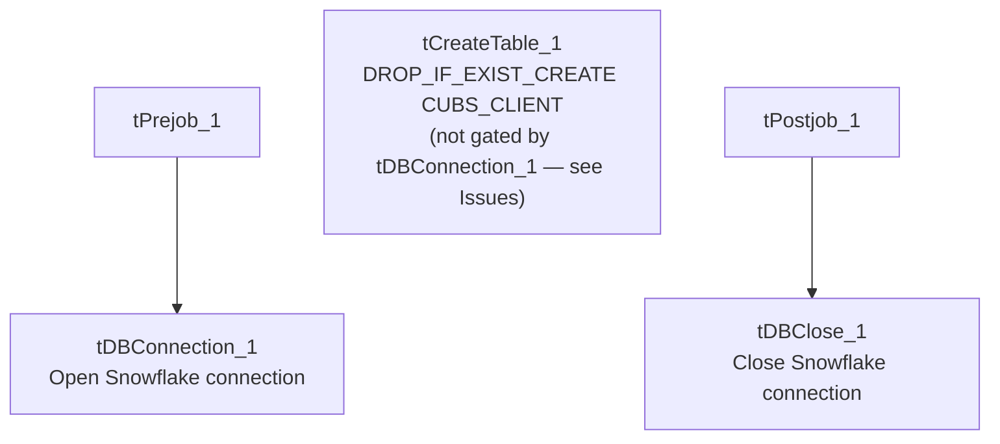

# Talend Job: CREATE_RAW_CUBS_CLIENT

## Overview

This is a DDL-only setup job, not a data load: it drops and recreates the Snowflake table `CUBS_CLIENT` using a repository-defined schema of roughly 160 client/business columns (identity and address, MTD/YTD/total assignment and collection amounts, statement/invoice/letter frequency flags, scoring/dialer/legal-routing flags, and more). It does not populate the table with any data — it only establishes or resets `CUBS_CLIENT`'s structure, presumably ahead of whatever load job (not present in this batch) actually populates it.

## Detail table

| Field | Value |
|---|---|
| Job name | CREATE_RAW_CUBS_CLIENT |
| Version | 0.1 |
| Project | EDW2SF |
| Author | jmach@harriscollect.com |
| Created | 2022-03-25T12:38:59.216-0700 |
| Last Modified | 2025-09-24T11:07:27.514-0700 |

## Step-by-step data flow

**Setup subjob:** `tPrejob_1` → `tDBConnection_1` opens the job's Snowflake connection.

**Table-definition step:** `tCreateTable_1`, configured with `TABLEACTION=DROP_IF_EXIST_CREATE` against table `CUBS_CLIENT` (repository schema `"_71WboKxXEeysS7G80LSq2A - CUBS_CLIENT"`), references the Snowflake connection through its own `CONNECTION_SNOWFLAKE` parameter — but per this job's own `connections` metadata, **there is no trigger link (`OnSubjobOk`/`OnComponentOk`) wiring `tDBConnection_1` to `tCreateTable_1`, nor any trigger leading away from it.** See Issues observed — as captured, `tCreateTable_1` appears to run as its own independent, ungated subjob rather than after the connection is confirmed open.

**Teardown subjob:** `tPostjob_1` → `tDBClose_1` closes the Snowflake connection.

## Settings tables

### DDL step: `tCreateTable_1`

| Setting | Value | What it means |
|---|---|---|
| DBTYPE | `SNOWFLAKE` | Targets a Snowflake table. |
| TABLEACTION | `DROP_IF_EXIST_CREATE` | Drops `CUBS_CLIENT` if it already exists, then creates it fresh from the repository schema — destructive by design; any existing data in `CUBS_CLIENT` is lost every time this job runs. |
| TABLE | `"CUBS_CLIENT"` | Target table name. |
| SCHEMA | Repository schema `"_71WboKxXEeysS7G80LSq2A - CUBS_CLIENT"` (~160 columns) | Client identity/address, assignment & collection MTD/YTD/TOT amounts, statement/invoice/letter frequency flags, scoring/dialer/legal-routing flags, etc. |
| JDBC_URL / PASS / MSSQL_ACTIVE_DIR_AUTH | `***REDACTED***` | Preserved as-is. |
| CONNECTION_SNOWFLAKE | `tDBConnection_1` | References the job's Snowflake connection component by name — but see Issues observed regarding whether execution actually waits for it. |
| Other `DBFILE_*`/`DB_*_VERSION` parameters | Default/inert values for database types this job doesn't use (Access, Firebird, SQLite, MySQL, Oracle, PostgreSQL, Sybase, Vertica) | Standard `tCreateTable` boilerplate left at defaults — not evidence this job touches those other databases. |

## Dependencies & configuration

- **Triggers/depends on other jobs:** none — no `tRunJob` links found.
- **Context variables used:** none — `context_vars_referenced` is empty; this job's connection and table settings are resolved through the referenced repository connection/schema rather than context variables.
- **Hardcoded paths:** 3 findings, all default/inert DB-file paths on `tCreateTable_1` for database types this job doesn't use — `DBFILE_ACCESS` (`"C:/Talend-Studio-20211109_1610-V8.0.1/workspace/in.mdb"`), `DBFILE_FIREBIRD` (`".../in.FDB"`), `DBFILE_SQLITE` (`".../talend.db"`). These use the same Talend workspace path documented project-wide in `05_operational_runbook.md`, but here they are `tCreateTable`'s unused defaults for other DB engines rather than paths this job actually reads or writes.

## Glossary

| Component type | Plain-English meaning |
|---|---|
| `tCreateTable` | Issues a `CREATE TABLE` statement (optionally preceded by a `DROP`) against a database, using a repository-defined column schema — moves no data itself. |
| `tSnowflakeConnection` / `tSnowflakeClose` | Open and close the job's Snowflake connection. |

## Issues observed

- **`tCreateTable_1` has no incoming or outgoing trigger connection in this job's metadata.** The only two connections captured are `tPrejob_1` → `tDBConnection_1` and `tPostjob_1` → `tDBClose_1`; `tCreateTable_1` isn't wired as a target of `tDBConnection_1`'s `OnSubjobOk`/`OnComponentOk`, nor does anything trigger after it. In Talend, a component with no incoming trigger runs as its own independent subjob at job start — so `tCreateTable_1` would plausibly execute in parallel with (not strictly after) `tDBConnection_1` opening the very connection it's configured to reuse (`CONNECTION_SNOWFLAKE: tDBConnection_1`). If `tCreateTable_1` starts before that connection finishes opening, it could fail outright or behave unpredictably. Worth confirming this wiring directly in Talend Studio — the visual canvas may show a trigger this extraction didn't capture, or the job may genuinely have this gap.
- **This job is purely destructive-then-empty:** `DROP_IF_EXIST_CREATE` means any existing `CUBS_CLIENT` data is dropped and the table recreated empty — this job never loads data into it. Running this job unintentionally (e.g., instead of whatever job actually populates `CUBS_CLIENT`) would silently wipe the table with no load step to follow it up. Unable to determine from this metadata which other job(s) populate `CUBS_CLIENT` afterward — verify with the team.
- **No error handling of any kind** (no `tWarn`/`tDie`/`tLogRow`) — a DDL failure here would only surface as a generic Talend execution error.
