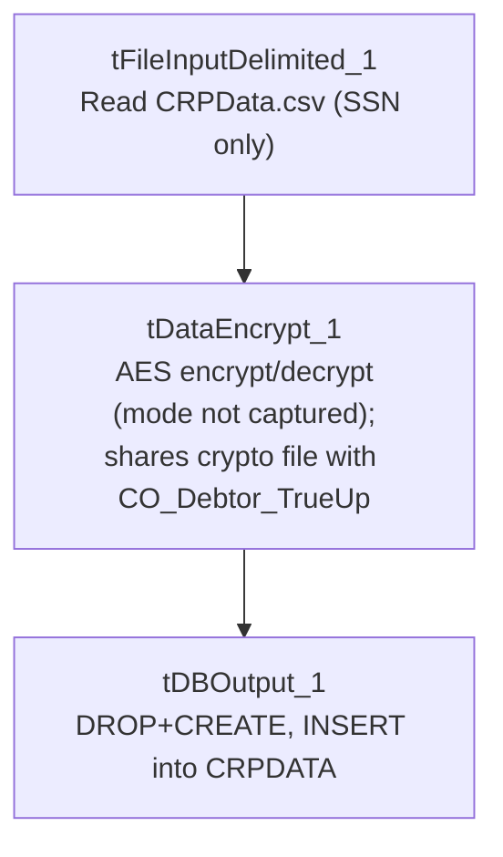

# Talend Job: CRPLoad

## Overview

Loads a flat list of Social Security Numbers from a local CSV file (`C:/Data/CRPData.csv`) through a field-level encryption step and into a Snowflake table `CRPDATA`, dropping and recreating that table on every run. The single-column schema and the "CRP" job name suggest a narrow, purpose-built extract for some external reporting or credit-related process — "CRP" is not otherwise defined anywhere in this job's metadata, verify with the team. This job uses the same crypto file (`dimdbtr.crypt`) as `CO_Debtor_TrueUp` (also in this batch), suggesting the two jobs share an encryption configuration for protecting SSN-type identifiers.

## Detail table

| Field | Value |
|---|---|
| Job name | CRPLoad |
| Version | 0.1 |
| Project | EDW2SF |
| Author | jmach@harriscollect.com |
| Created | 2023-07-11T07:55:41.227-0700 |
| Last Modified | 2023-07-11T09:28:16.397-0700 |

## Step-by-step data flow

This job has no `tPrejob`/`tPostjob`/`tDBConnection` components at all in its metadata — just a 3-component pipeline:

1. `tFileInputDelimited_1` reads `C:/Data/CRPData.csv` (comma-delimited, header row present, `DIE_ON_ERROR=false`) using a schema of a single business column, `SSN` (listed twice in the extracted schema — likely this extraction capturing main and reject schema together, the same pattern seen in `ADP_Payroll_Load`).
2. FLOW to `tDataEncrypt_1`, running the `SSN` value through the same AES/crypto-file setup as `CO_Debtor_TrueUp` (`CRYPTO_FILE_PATH="C:/Data/dimdbtr.crypt"`), leaving the schema unchanged.
3. FLOW to `tDBOutput_1` (`tSnowflakeOutput`), which drops and recreates `CRPDATA` (`DROP_IF_EXISTS_AND_CREATE`) then inserts the encrypted rows.

## Settings tables

### Source: `tFileInputDelimited_1`

| Setting | Value | What it means |
|---|---|---|
| FILENAME | `"C:/Data/CRPData.csv"` | Hardcoded local path, not a context variable. |
| FIELDSEPARATOR / HEADER | `,` / 1 header row | Standard comma-delimited CSV with a header row. |
| Schema | Single column `SSN` (`id_String`), listed twice in the extraction | Consistent with this project's pattern of main+reject schema being captured together (see `ADP_Payroll_Load`). |
| DIE_ON_ERROR / Reject flow | `false` / not wired, no `SCHEMA_REJECT` defined | Malformed rows are silently dropped — no record kept of what or how many failed. |
| TEMP_DIR | `"C:/Talend-Studio-20211109_1610-V8.0.1/workspace"` | Hardcoded developer-workstation path, the same portability risk documented project-wide in `05_operational_runbook.md`. |

### Transform: `tDataEncrypt_1`

| Setting | Value | What it means |
|---|---|---|
| CRYPTO_METHOD | `AES` | Symmetric encryption algorithm. |
| CRYPTO_FILE_PATH | `"C:/Data/dimdbtr.crypt"` | Identical path to `CO_Debtor_TrueUp`'s `tDataEncrypt_1` — the same key/config file is reused across at least these two jobs. |
| SECRET_TYPE / SECRET_KEY / PASSWORD_M1 | `***REDACTED***` | Preserved as-is. |
| Mode (encrypt vs. decrypt) | Not captured in this metadata | See Issues observed. |

### Target: `tDBOutput_1` (`tSnowflakeOutput`)

| Setting | Value | What it means |
|---|---|---|
| Table | `CRPDATA` | Destination table. |
| Output action | `INSERT` | Appends the encrypted rows. |
| Table action | `DROP_IF_EXISTS_AND_CREATE` | The table is fully dropped and recreated (not just truncated) every run — a different pattern than the `TRUNCATE`-only approach used elsewhere in this project (e.g. `CO_E_Media_Load`, `CO_Debtor_TrueUp`) — see Issues observed. |

## Dependencies & configuration

- **Triggers/depends on other jobs:** none — no `tRunJob` links found.
- **Context variables used:** none — `context_vars_referenced` is empty; the source file, crypto file, and temp dir are all hardcoded.
- **Hardcoded paths:** `tFileInputDelimited_1.TEMP_DIR` is in the formal `hardcoded_path_findings` list; in addition (present in the job's own parameters but not flagged by that extraction pass), `tFileInputDelimited_1.FILENAME` and `tDataEncrypt_1.CRYPTO_FILE_PATH` are both local drive-letter paths rather than `context.sourceDir`-style references.

## Glossary

| Component type | Plain-English meaning |
|---|---|
| `tFileInputDelimited` | Reads a delimited (CSV-style) text file according to a schema. |
| `tDataEncrypt` | Talend's field-level encryption/decryption component, driven by a crypto key file. |
| `tSnowflakeOutput` | Writes rows to a Snowflake table, optionally dropping/recreating or truncating it first. |

## Issues observed

- **No `tPrejob`/`tPostjob` or explicit Snowflake connection component in this job** — the same gap documented in `CO_Debtor_TrueUp`. `tDBOutput_1`'s own `parameters` object is empty, so where its Snowflake connection is actually defined isn't visible in this metadata; verify directly in Talend Studio.
- **`CRPDATA`'s table action is `DROP_IF_EXISTS_AND_CREATE` rather than `TRUNCATE`** — the table is fully recreated (not just emptied) every run. If any downstream process depends on the table's structure staying stable between runs (grants, dependent views, or column order), a schema change made outside this job wouldn't survive the next run; and while the job is running, the table briefly doesn't exist at all rather than merely being empty.
- **What "CRP" stands for, and what downstream process consumes `CRPDATA`, isn't explained anywhere in this job's own metadata** — unable to determine from metadata; verify with the team.
- **No error/row-count logging specific to this job's business outcome** (no `tWarn`/`tDie`/`tSendMail`) — a failure here would only show as a generic Talend execution error.
- **Shares its crypto file (`C:/Data/dimdbtr.crypt`) with `CO_Debtor_TrueUp`** (both in this batch) — if that file's location or content changes for one job, the other is also affected; this shared dependency isn't documented anywhere as intentional.
