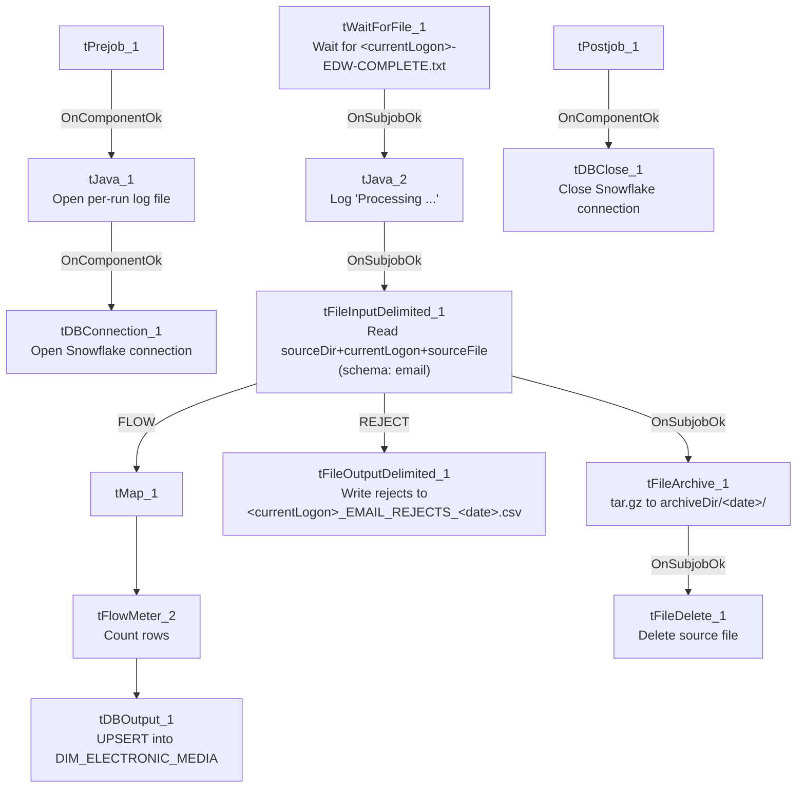

# Talend Job: CUBS_EMail_Address_Load

## Overview

Loads a per-logon email/electronic-media extract file (debtor number, media type, address, authorization status, and related notes/balance fields) into the Snowflake `DIM_ELECTRONIC_MEDIA` dimension table via an UPSERT. The job waits for a per-logon "EDW complete" semaphore file before reading, then archives and deletes the source file once processed. Unlike some other file-load jobs in this project (e.g. `ADP_Payroll_Load`), this job's reject flow is fully wired to a dedicated rejects file rather than silently dropped.

## Detail table

| Field | Value |
|---|---|
| Job name | CUBS_EMail_Address_Load |
| Version | 0.1 |
| Project | EDW2SF |
| Author | jmach@harriscollect.com |
| Created | 2023-01-27T11:11:58.161-0800 |
| Last Modified | 2026-02-04T07:13:12.918-0800 |

## Step-by-step data flow

**Setup subjob:** `tPrejob_1` → `tJava_1` opens a per-run log file at `context.logDir+context.currentLogon+"_"+jobName+"_"+<timestamp>+".log"` → on success, `tDBConnection_1` opens the Snowflake connection.

**Main subjob** — runs independently of the setup subjob, gated on a semaphore file:

1. `tWaitForFile_1` polls `context.sourceDir` every 30 seconds, up to `context.loopCount` iterations, for a file named `context.currentLogon+"-EDW-COMPLETE.txt"` (or proceeds immediately if already present — `INCLUDE_PRESENT=true`). Same gating pattern as `CO_Master_Load`'s `tWaitForFile_4`, but keyed on a per-logon filename rather than a fixed site code.
2. On success, `tJava_2` logs `"Processing " + context.sourceDir+context.currentLogon+context.sourceFile` to the console/log.
3. On success, `tFileInputDelimited_1` reads the comma-delimited file at `context.sourceDir+context.currentLogon+context.sourceFile` (header row present, `DIE_ON_ERROR=false`) using a repository schema labeled `"...- email"` — **the same label is used for both the main and reject schemas**, unlike `ADP_Payroll_Load`'s mismatched reject-schema labeling.
4. **Well-formed rows (FLOW):** `tMap_1` (`DIE_ON_ERROR=true`) maps the 18 raw input columns to an 18-column uppercase target schema (`LOGON`, `DEBTORNUMBER`, `DEBTOR_IDX`, `MEDIA`, `ADDRESS_TYPE`, `MEDIA_ADDRESS`, `ADDR_SOURCE`, `SRC_NAME`, `AUTH_STATUS`, `AUTH_DATE`, `STATUS`, `STATUS_DT`, `ENTRY_DT`, `NT_DATE`, `NT_TIME`, `NT_WHO`, `NOTE_TEXT`, `PL_GROUP`, `TOTAL_BAL`) → `tFlowMeter_2` counts rows (labeled "MyLabel", not renamed) → `tDBOutput_1` **UPSERTs** into Snowflake `DIM_ELECTRONIC_MEDIA`.
5. **Rejected rows (REJECT):** routed to `tFileOutputDelimited_1`, which writes them (with header) to `context.logDir+context.currentLogon+"_EMAIL_REJECTS_"+<date>+".csv"` — a dated, per-logon reject file, so malformed rows are recorded rather than silently dropped.
6. Once `tFileInputDelimited_1` completes (`SUBJOB_OK`, independent of the FLOW/REJECT row outcomes), `tFileArchive_1` tar-gzips the source file to `context.archiveDir+"/"+<date>+"/"+context.currentLogon+context.sourceFile+".tar.gz"`, then on success `tFileDelete_1` deletes the original source file at `context.sourceDir+context.currentLogon+context.sourceFile`.

**Teardown subjob:** `tPostjob_1` → `tDBClose_1` closes the Snowflake connection.

## Settings tables

### Gate: `tWaitForFile_1`

| Setting | Value | What it means |
|---|---|---|
| DIRECTORY / FILEMASK | `context.sourceDir` / `context.currentLogon+"-EDW-COMPLETE.txt"` | Waits for a per-logon completion semaphore, rather than a single fixed site file. |
| WAIT / MAX_ITERATIONS | 30 (seconds) / `context.loopCount` | Same polling shape as `CO_Master_Load`'s `tWaitForFile_4`. |
| INCLUDE_PRESENT | `true` | Proceeds immediately if the semaphore file is already there. |

### Source: `tFileInputDelimited_1`

| Setting | Value | What it means |
|---|---|---|
| FILENAME | `context.sourceDir+context.currentLogon+context.sourceFile` | Per-logon input file path assembled from three context variables. |
| FIELDSEPARATOR / HEADER | `,` / 1 header row | Standard comma-delimited CSV. |
| SCHEMA / SCHEMA_REJECT | Both labeled repository schema `"...- email"` | Main and reject schemas share the same label — consistent, unlike `ADP_Payroll_Load`'s mismatched reject schema. |
| DIE_ON_ERROR | `false` | Malformed rows do not fail the job... |
| Reject flow | Wired to `tFileOutputDelimited_1` | ...and are captured to a dated CSV file rather than silently dropped. |

### Reject output: `tFileOutputDelimited_1`

| Setting | Value | What it means |
|---|---|---|
| FILENAME | `context.logDir+context.currentLogon+"_EMAIL_REJECTS_"+TalendDate.getDate("CCYY-MM-DD")+".csv"` | Dated, per-logon rejects file. |
| INCLUDEHEADER | `true` | Rejects file includes a header row for readability. |

### Archive / cleanup: `tFileArchive_1` / `tFileDelete_1`

| Setting | Value | What it means |
|---|---|---|
| SOURCE / TARGET (`tFileArchive_1`) | `context.sourceDir` / `context.archiveDir+"/"+<date>+"/"+context.currentLogon+context.sourceFile+".tar.gz"` | Archives the processed file into a dated subfolder under `archiveDir`. |
| SOURCE_FILE (`tFileArchive_1`, hardcoded) | `"C:/Talend-Studio-20211109_1610-V8.0.1/workspace/source.csv"` | A hardcoded placeholder unrelated to the actual per-logon file being archived (`TARGET` is correctly context-driven) — see Issues observed. |
| FILENAME (`tFileDelete_1`) | `context.sourceDir+context.currentLogon+context.sourceFile` | Deletes the original source file after it's archived. |

### Target: `tDBOutput_1` (`tSnowflakeOutput`)

| Setting | Value | What it means |
|---|---|---|
| Table | `DIM_ELECTRONIC_MEDIA` | Destination dimension table — name suggests it covers electronic-media addresses generally (email being one media type), not an email-specific table. |
| Output action | `UPSERT` | Inserts new rows or updates matching existing ones — no truncate/staging step, consistent with an incremental dimension load. |
| Table action | `NONE` | Table is not recreated/altered by this job. |

## Dependencies & configuration

- **Triggers/depends on other jobs:** none — no `tRunJob` links found in this job's own metadata, and this job does not appear as a call target anywhere in `06_dependency_matrix.md`'s 65-link `tRunJob` table either.
- **Context variables used:** `archiveDir`, `currentLogon`, `logDir`, `loopCount`, `sourceDir`, `sourceFile`.
- **4 hardcoded developer-workstation paths** in `tFileInputDelimited_1.TEMP_DIR`, `tFileArchive_1.SOURCE_FILE`, and `tFileDelete_1.DIRECTORY`/`PATH` (all `C:/Talend-Studio-20211109_1610-V8.0.1/workspace/...`) — same project-wide portability risk documented in `05_operational_runbook.md`.

## Glossary

| Component type | Plain-English meaning |
|---|---|
| `tWaitForFile` | Polls a directory for a specific file to appear, for up to a configured number of attempts, before letting the job continue. |
| `tFileInputDelimited` | Reads a delimited (CSV-style) text file according to a schema. |
| `tMap` | Maps/transforms columns from one schema to another. |
| `tFlowMeter` | Counts rows passing through a point in the flow, for logging/monitoring. |
| `tFileOutputDelimited` | Writes rows to a delimited text file — here used both as the (unused in this job) main output type pattern and specifically to capture rejected rows. |
| `tSnowflakeOutput` / `tSnowflakeConnection` / `tSnowflakeClose` | Write rows to a Snowflake table / open and close the Snowflake connection used by the job. |
| `tFileArchive` / `tFileDelete` | Zip a processed file to an archive location, then delete the original from the source directory. |
| `tJava` | Runs custom Java code — here used to open a log file and to print a status message. |

## Issues observed

- **This job is not called by any `tRunJob` link captured in the project's metadata** (it doesn't appear in `06_dependency_matrix.md`'s 65-link orchestration table), yet its file path, log filename, and archive path all depend on `context.currentLogon` varying per run. Unable to determine from this job's own metadata how or where `currentLogon` is set for each invocation (e.g., a per-site scheduled task, or a context value set outside this extraction) — verify with the team.
- **`tFileArchive_1.SOURCE_FILE` is a hardcoded placeholder path** (`C:/Talend-Studio-20211109_1610-V8.0.1/workspace/source.csv`) unrelated to the actual file being archived — the component's `TARGET` parameter is correctly built from context variables, so this looks like inert Talend-generated boilerplate rather than a functional bug, but it's part of the same widespread hardcoded-path pattern flagged project-wide in `05_operational_runbook.md`.
- **`tDBOutput_1`'s schema includes a `LOAD_DT` column that is not present in `tMap_1`'s mapped output schema.** Unable to determine from this metadata whether `LOAD_DT` is populated by a Snowflake-side default expression (e.g., a load timestamp) or left null on every upsert — verify directly in the Talend Studio schema/expression settings.
