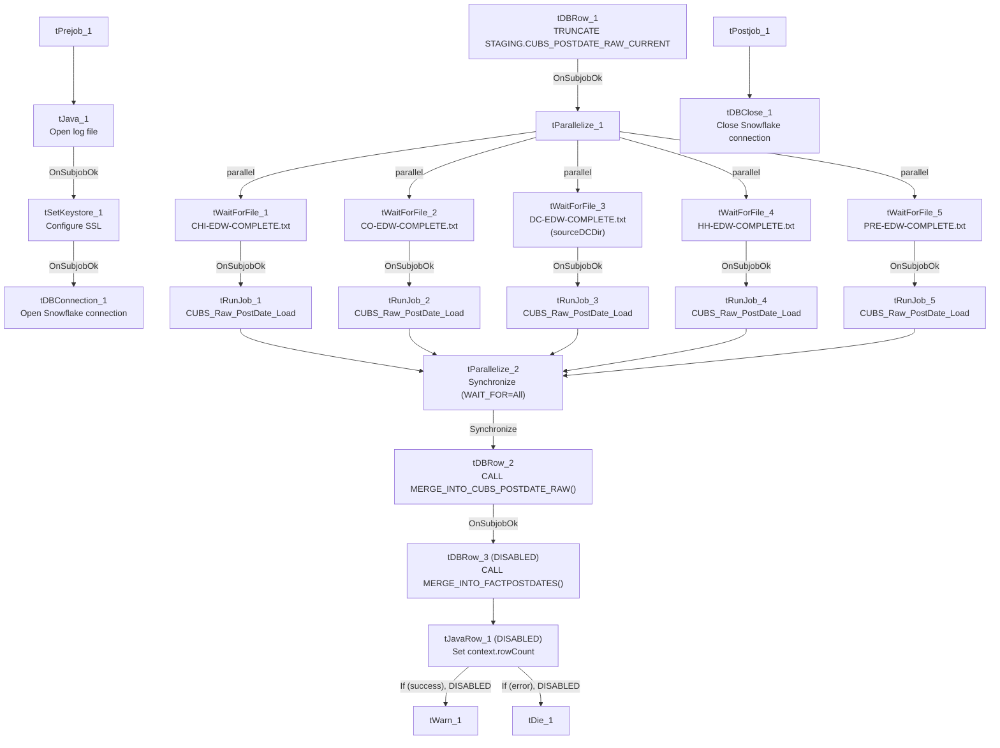

# Talend Job: CUBS_PostDates_Load

## Overview

This job refreshes the CUBS "post-dates" feed (post-dated collection/payment-plan dates keyed by `DEBTOR`/`CLIENT`, alongside a large set of debtor demographic and balance columns inherited from the same legacy `LEGACY_DIMDEBTOR` schema used elsewhere in the project). It truncates the staging table, waits in parallel for five sites' daily-extract completion markers (CHI, CO, DC, HH, PRE), runs `CUBS_Raw_PostDate_Load` once per site once its marker appears, and then merges the combined staging rows forward. Notably, the final fact-table merge and its result-handling logic are all disabled in this version of the job — see Issues observed.

## Detail table

| Field | Value |
|---|---|
| Job name | CUBS_PostDates_Load |
| Version | 0.2 |
| Project | EDW2SF |
| Author | jmach@harriscollect.com |
| Created | 2023-03-07T20:54:09.510-0800 |
| Last Modified | 2025-11-04T11:08:12.709-0800 |

## Step-by-step data flow

**Setup subjob:** `tPrejob_1` → `tJava_1` opens a per-run log file (`context.logDir + jobName + <timestamp> + ".log"`) → on success, `tSetKeystore_1` configures SSL trust/keystore from `context.keystorePath` (passwords redacted) → `tDBConnection_1` opens the Snowflake connection. Per Talend's `tPrejob` semantics, this setup subjob always completes before any other subjob starts, even though the main flow below isn't directly wired off `tDBConnection_1`.

**Main subjob:**

1. `tDBRow_1` runs `TRUNCATE TABLE STAGING.CUBS_POSTDATE_RAW_CURRENT;` — this is a top-level starting component (no incoming link in this job's own connections), so it fires as soon as the setup subjob finishes.
2. On success, `tParallelize_1` starts five `tWaitForFile` branches simultaneously, each polling for a different site's completion marker (30-second interval, up to `MAX_ITERATIONS=720`, `INCLUDE_PRESENT=true` so an already-present file is accepted immediately):
   - `tWaitForFile_1` → `context.sourceDir` + `"CHI-EDW-COMPLETE.txt"` → on success, `tRunJob_1`
   - `tWaitForFile_2` → `context.sourceDir` + `"CO-EDW-COMPLETE.txt"` → `tRunJob_2`
   - `tWaitForFile_3` → `context.sourceDCDir` + `"DC-EDW-COMPLETE.txt"` (note the DC-specific directory variable — see Issues observed) → `tRunJob_3`
   - `tWaitForFile_4` → `context.sourceDir` + `"HH-EDW-COMPLETE.txt"` → `tRunJob_4`
   - `tWaitForFile_5` → `context.sourceDir` + `"PRE-EDW-COMPLETE.txt"` → `tRunJob_5`
3. All five `tRunJob_*` components call the **same** child job, `CUBS_Raw_PostDate_Load`, with identical `CONTEXT_NAME=Default` and `TRANSMIT_ORIGINAL_CONTEXT=true` settings — nothing in this job's own metadata shows a per-site context override being passed to any of the five calls (see Issues observed). `DIE_ON_CHILD_ERROR=true` on all five, so any one site's load failing fails this orchestrator too.
4. `tParallelize_2` synchronizes all five `tRunJob` branches (`WAIT_FOR=All`) before continuing.
5. `tDBRow_2` runs `CALL MERGE_INTO_CUBS_POSTDATE_RAW();` to merge the combined staging rows.
6. On success, `tDBRow_3` would run `CALL MERGE_INTO_FACTPOSTDATES();`, feeding `tJavaRow_1` (captures `RETVALUE` into `context.rowCount`) which branches to `tWarn_1` (success message) or `tDie_1` (failure) — **but all four of these components (`tDBRow_3`, `tJavaRow_1`, `tWarn_1`, `tDie_1`) have `ACTIVATE=false`** in this job's metadata, meaning this entire final stage is disabled and does not run. See Issues observed.

**Teardown subjob:** `tPostjob_1` → `tDBClose_1` closes the Snowflake connection.

## Settings tables

### Staging reset: `tDBRow_1`

| Setting | Value | What it means |
|---|---|---|
| Query | `TRUNCATE TABLE STAGING.CUBS_POSTDATE_RAW_CURRENT;` | Clears the staging table before any site data is loaded, so each run starts from empty. |

### Gates: `tWaitForFile_1`–`tWaitForFile_5`

| Setting | Value | What it means |
|---|---|---|
| WAIT / MAX_ITERATIONS | 30 seconds / 720 | Polls for up to 6 hours (30s × 720) before giving up. |
| DIRECTORY | `context.sourceDir` (CHI/CO/HH/PRE) or `context.sourceDCDir` (DC) | Each branch watches a different directory variable — note the DC branch uses a distinct variable name from the other four. |
| FILEMASK | `"<SITE>-EDW-COMPLETE.txt"` | Site-specific completion marker, same convention used by `Semaphore_Check` and `CO_Master_Load`. |
| ACTION_ON / THEN / INCLUDE_PRESENT | `filecreated` / `exitloop` / `true` | Proceeds as soon as the file appears, or immediately if it's already there. |

### Orchestration: `tRunJob_1`–`tRunJob_5`

| Setting | Value | What it means |
|---|---|---|
| PROCESS | `CUBS_Raw_PostDate_Load` (all 5) | All five branches call the identical child job — confirmed against `06_dependency_matrix.md`, which shows `CUBS_PostDates_Load → CUBS_Raw_PostDate_Load` called 5 times. |
| CONTEXT_NAME | `Default` (all 5) | No per-call context override is visible in this job's own metadata. |
| DIE_ON_CHILD_ERROR | `true` (all 5) | Any one site's child-job failure fails this orchestrator. |
| USE_INDEPENDENT_PROCESS | `true` (all 5) | Each child job runs in its own JVM process. |

### Merge steps: `tDBRow_2` / `tDBRow_3` (disabled)

| Setting | Value | What it means |
|---|---|---|
| `tDBRow_2` query | `CALL MERGE_INTO_CUBS_POSTDATE_RAW();` | Merges the five sites' staged rows — this step is active and runs every execution. |
| `tDBRow_3` query | `CALL MERGE_INTO_FACTPOSTDATES();` | Would merge into the `FACTPOSTDATES` fact table, but `ACTIVATE=false` — **this step does not execute**. |
| `tJavaRow_1` / `tWarn_1` / `tDie_1` | All `ACTIVATE=false` | The row-count capture and success/failure logging built around the fact-table merge are likewise disabled. |

### SSL setup: `tSetKeystore_1`

| Setting | Value | What it means |
|---|---|---|
| SSL_KEYSTORE | `context.keystorePath` | Client keystore path for the Snowflake connection. |
| SSL_KEYSTORE_PASSWORD / SSL_TRUSTSERVER_PASSWORD / NEED_CLIENT_AUTH | `***REDACTED***` | Preserved as redacted — actual values not present in source metadata. |
| SSL_TRUSTSERVER_TRUSTSTORE | `"C:/clientTrustStore.trustStore"` | Hardcoded developer-workstation path — see Dependencies & configuration. |

## Dependencies & configuration

- **Calls other jobs:** `CUBS_Raw_PostDate_Load`, 5 times (once per site branch) — confirmed in `06_dependency_matrix.md`.
- **Not called by any job** in this export's `tRunJob` matrix; presumably scheduled independently.
- **Context variables used:** `keystorePath`, `logDir`, `rowCount` (set only if the disabled `tJavaRow_1` were active), `sourceDCDir`, `sourceDir`.
- **Hardcoded path finding:** `tSetKeystore_1.SSL_TRUSTSERVER_TRUSTSTORE = "C:/clientTrustStore.trustStore"` — same project-wide pattern documented in `05_operational_runbook.md`.

## Glossary

| Component type | Plain-English meaning |
|---|---|
| `tPrejob` / `tPostjob` | Run once before/after the rest of the job, regardless of other wiring. |
| `tJava` | Runs a block of custom Java code — here, opening a per-run log file. |
| `tSnowflakeConnection` / `tSnowflakeClose` | Open/close the shared Snowflake connection used by other components. |
| `tSnowflakeRow` | Runs an arbitrary SQL statement or stored-procedure call against Snowflake. |
| `tWaitForFile` | Polls a directory for a specific file to appear, for up to a configured number of attempts. |
| `tParallelize` | Runs its downstream branches at the same time; can also synchronize (wait for all branches) before continuing. |
| `tRunJob` | Runs another Talend job as a sub-process, optionally waiting for it to finish. |
| `tJavaRow` | Runs custom Java code once per input row — here, to unpack a stored procedure's return value. |
| `tWarn` / `tDie` | Log a warning without failing the job / fail the job with a specific message and exit code. |
| `tSetKeystore` | Configures the SSL keystore/truststore used by subsequent secure connections. |

## Issues observed

- **The `FACTPOSTDATES` merge and its entire result-handling chain are disabled (`ACTIVATE=false`)** on `tDBRow_3`, `tJavaRow_1`, `tWarn_1`, and `tDie_1`. As currently configured, this job only refreshes `STAGING.CUBS_POSTDATE_RAW_CURRENT` via `tDBRow_2`; the fact table merge that would presumably follow never actually runs. Unable to determine from metadata whether `FACTPOSTDATES` is refreshed by some other job/process or is simply stale — verify with the team before assuming it's kept in sync.
- **TOL is not among the five sites this job waits for or loads** (only CHI, CO, DC, HH, PRE), despite being one of the six site codes documented project-wide in `01_system_architecture.md`. Unable to determine from metadata whether TOL's post-dates are loaded by a separate, undocumented process or simply aren't loaded.
- **Context variable naming inconsistency for the DC site path:** this job uses `context.sourceDCDir`, while `Semaphore_Check` (a different job in this project) uses `context.sourceDirDC` for the apparently equivalent DC-specific source directory. Unable to confirm from metadata whether these are actually the same underlying value under two names, or genuinely different paths — verify with the team.
- **All five `tRunJob` calls invoke the identical child job with `CONTEXT_NAME=Default` and no visible per-site override.** How the single `CUBS_Raw_PostDate_Load` child job differentiates which site's data to process on each of the five calls is not visible in this job's own metadata — verify directly in Talend Studio (the child job may resolve its own source path from a context variable set at the environment/run level rather than passed explicitly here).
