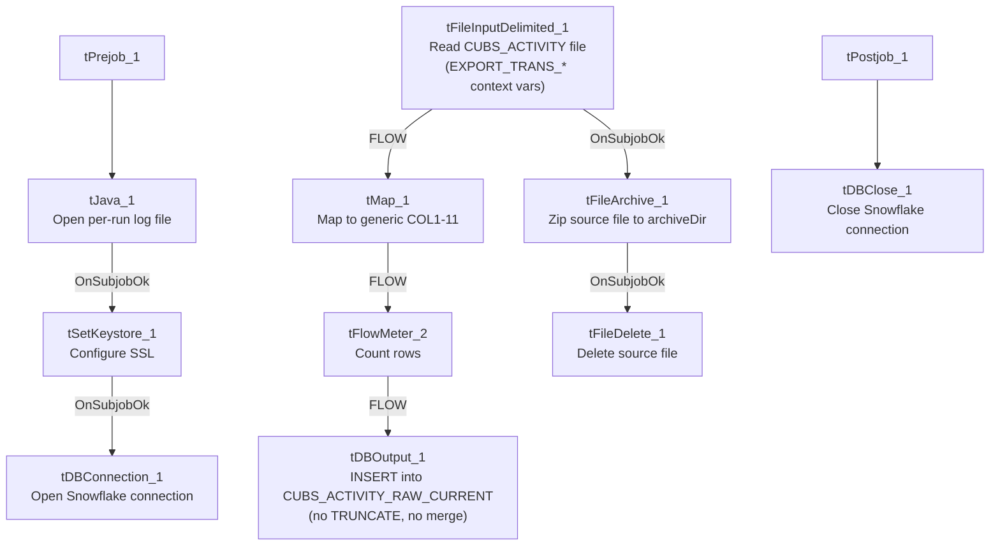

# Talend Job: CUBS_Raw_Activity_Load

## Overview

Loads CUBS collection "activity" records (per-debtor activity log entries: logon, debtor ID, activity code, date, type, description, dollar amount, and match/notice flags) from a delimited export file into the Snowflake `CUBS_ACTIVITY_RAW_CURRENT` staging table, then archives and deletes the source file. Structurally this follows the same read → map → count → insert → archive → delete shape used throughout the `CUBS_Raw_*` family, but several of its settings (context variable names, reject schema) appear to reference the "Trans" export rather than "Activity" — see Issues observed.

## Detail table

| Field | Value |
|---|---|
| Job name | CUBS_Raw_Activity_Load |
| Version | 0.1 |
| Project | EDW2SF |
| Author | jmach@harriscollect.com |
| Created | 2023-01-06T11:29:30.090-0800 |
| Last Modified | 2025-11-04T11:08:06.074-0800 |

## Step-by-step data flow

**Setup subjob:** `tPrejob_1` → `tJava_1` opens a per-run log file at `context.logDir + context.currentLogon + "_" + jobName + <timestamp> + ".log"` → on success, `tSetKeystore_1` configures SSL trust/keystore from `context.keystorePath` (passwords redacted) → `tDBConnection_1` opens the Snowflake connection.

**Main subjob:**

1. `tFileInputDelimited_1` reads `context.sourceDir + context.EXPORT_TRANS_File` — note this file-load job uses the `EXPORT_TRANS_*` context variable family (`EXPORT_TRANS_RowSeparator`, `EXPORT_TRANS_FieldSeparator`, `EXPORT_TRANS_Header`, `EXPORT_TRANS_Encoding`) even though the job is `CUBS_Raw_Activity_Load`, not a transaction load — see Issues observed. Main schema is the repository's `CUBS_ACTIVITY` schema (11 business columns: `_LOGON`, `_DEBTOR`, `_DEBTOR_IDX`, `_ACTIVITY`, `_DATE`, `_TYPE`, `_DESCRIPTION`, `_AMOUNT`, `_MATCH_FLG`, `_NTC_FLG`, `_CUSTOM_DATE`); reject schema is labeled `CUBS_TRANSACTION`. `DIE_ON_ERROR=false`, but no reject flow is wired anywhere in this job.
2. On `FLOW`, `tMap_1` passes the row through to a generic output schema (`FILENAME`, `FILEDATE`, `COL1`–`COL11`) — the meaningful business column names from step 1 are not preserved past this point.
3. `tFlowMeter_2` counts rows (label "MyLabel", not customized for this job).
4. `tDBOutput_1` inserts the rows into Snowflake table `CUBS_ACTIVITY_RAW_CURRENT` (`INSERT`, `tableAction=NONE`) — there is no `TRUNCATE` step anywhere in this job and no merge call afterward, despite the table name implying a full "current" refresh. See Issues observed.
5. Separately, off `tFileInputDelimited_1`'s own `SUBJOB_OK` (not the DB insert's success): `tFileArchive_1` zips the source file to `context.archiveDir + "/" + <date> + "/" + context.EXPORT_TRANS_File + ".tar.gz"` (password redacted, though `ENCRYPT_FILES=false` so the password is not actually applied), then on success `tFileDelete_1` deletes the original source file.

**Teardown subjob:** `tPostjob_1` → `tDBClose_1` closes the Snowflake connection.

## Settings tables

### Source: `tFileInputDelimited_1`

| Setting | Value | What it means |
|---|---|---|
| FILENAME | `context.sourceDir + context.EXPORT_TRANS_File` | The file path is built from `EXPORT_TRANS_File`, not an `EXPORT_ACTIVITY_File`-style variable — see Issues observed. |
| Main schema | Repository `CUBS_ACTIVITY` (11 columns: `_LOGON`, `_DEBTOR`, `_DEBTOR_IDX`, `_ACTIVITY`, `_DATE`, `_TYPE`, `_DESCRIPTION`, `_AMOUNT`, `_MATCH_FLG`, `_NTC_FLG`, `_CUSTOM_DATE`) | Correctly Activity-specific, unlike the surrounding context variables. |
| Reject schema | Repository `CUBS_TRANSACTION` | Mislabeled — a transaction schema used as the reject path for an activity file. |
| DIE_ON_ERROR / reject flow | `false` / not wired | Malformed rows don't fail the job but are silently dropped — no reject connection exists. |
| TEMP_DIR | `"C:/Talend-Studio-20211109_1610-V8.0.1/workspace"` | Hardcoded developer-workstation path — see Dependencies & configuration. |

### Target: `tDBOutput_1` (`tSnowflakeOutput`)

| Setting | Value | What it means |
|---|---|---|
| Table | `CUBS_ACTIVITY_RAW_CURRENT` | Destination staging table. |
| Output action | `INSERT` | Appends rows; no `TRUNCATE` precedes it and no merge stored procedure follows it in this job. |
| Table action | `NONE` | Table is not recreated/altered. |

### Archive/Delete: `tFileArchive_1` / `tFileDelete_1`

| Setting | Value | What it means |
|---|---|---|
| TARGET (`tFileArchive_1`) | `context.archiveDir + "/" + <CCYYMMDD> + "/" + context.EXPORT_TRANS_File + ".tar.gz"` | Archives under a date-stamped subfolder. |
| PASSWORD (`tFileArchive_1`) | `***REDACTED***` | Set but unused, since `ENCRYPT_FILES=false`. |
| Trigger | Off `tFileInputDelimited_1`'s `SUBJOB_OK`, not off `tDBOutput_1` | Archive+delete happens as soon as the file is read, before the Snowflake insert is confirmed — see Issues observed. |

## Dependencies & configuration

- **Triggers/depends on other jobs:** none — `runjob_targets` is empty, and this job does not appear as a `tRunJob` target in `06_dependency_matrix.md`, so its trigger mechanism (standalone schedule vs. an undocumented caller) is not visible in this export.
- **Context variables used:** `EXPORT_TRANS_Encoding`, `EXPORT_TRANS_FieldSeparator`, `EXPORT_TRANS_File`, `EXPORT_TRANS_Header`, `EXPORT_TRANS_RowSeparator`, `archiveDir`, `currentLogon`, `keystorePath`, `logDir`, `sourceDir`.
- **5 hardcoded developer-workstation path findings:** `tFileInputDelimited_1.TEMP_DIR`, `tFileArchive_1.SOURCE_FILE`, `tFileDelete_1.DIRECTORY`, `tFileDelete_1.PATH` (all `C:/Talend-Studio-20211109_1610-V8.0.1/workspace/...`), and `tSetKeystore_1.SSL_TRUSTSERVER_TRUSTSTORE` (`C:/clientTrustStore.trustStore`) — same project-wide risk documented in `05_operational_runbook.md`.

## Glossary

| Component type | Plain-English meaning |
|---|---|
| `tFileInputDelimited` | Reads a delimited (CSV-style) text file according to a schema. |
| `tMap` | Maps/transforms columns from one schema to another. |
| `tFlowMeter` | Counts rows passing through a point in the flow, for logging/monitoring. |
| `tSnowflakeOutput` / `tSnowflakeConnection` / `tSnowflakeClose` | Write rows to a Snowflake table / open and close the shared Snowflake connection. |
| `tFileArchive` / `tFileDelete` | Zip a processed file to an archive location, then delete the original from the source directory. |
| `tSetKeystore` | Configures the SSL keystore/truststore used by subsequent secure connections. |
| `tPrejob` / `tPostjob` | Run once before/after the rest of the job. |
| `tJava` | Runs a block of custom Java code — here, opening a per-run log file. |

## Issues observed

- **This job's context variables and file schema are all under the `EXPORT_TRANS_*` naming family** (`EXPORT_TRANS_File`, `EXPORT_TRANS_FieldSeparator`, `EXPORT_TRANS_Header`, `EXPORT_TRANS_RowSeparator`, `EXPORT_TRANS_Encoding`) even though this is `CUBS_Raw_Activity_Load`, not a transaction load. This looks like it was copied from a Trans-load job template without renaming the context group reference. Whether `EXPORT_TRANS_File` is separately configured (via context override) to actually point at the activity export file is unable to be determined from this job's own metadata — verify directly in Talend Studio.
- **The reject schema on `tFileInputDelimited_1` is labeled `CUBS_TRANSACTION`, not activity-specific.** Same class of mislabeled-reject-schema issue seen elsewhere in this project (e.g. `ADP_Payroll_Load`'s roster-labeled reject schema); unclear whether a malformed activity row would parse cleanly against a transaction-shaped schema.
- **Archive and delete of the source file are triggered by the file read succeeding (`tFileInputDelimited_1` `SUBJOB_OK`), not by the Snowflake insert succeeding.** A failure anywhere in `tMap_1` → `tFlowMeter_2` → `tDBOutput_1` after a successful read would still result in the source file being archived and deleted, leaving no original file to reprocess if the Snowflake load actually failed.
- **No `TRUNCATE` step and no merge call anywhere in this job**, despite the target table being named `CUBS_ACTIVITY_RAW_CURRENT`. Every run appears to `INSERT`-append without ever clearing prior rows. Unable to confirm from this metadata whether deduplication/refresh happens elsewhere (e.g., a merge stored procedure invoked by a different job) or whether this table simply accumulates duplicate rows across runs.
- **No `tDie`/`tWarn` logic** — consistent with `05_operational_runbook.md`'s note that most jobs outside its list of 16 only surface failures as generic Talend execution errors.
- **Column names in the raw source schema carry inconsistent leading underscores** (`_LOGON`, `_DEBTOR`, etc.) and are renamed to generic `COL1`–`COL11` by `tMap_1`, making it hard to trace what a given output column represents without cross-referencing this job's own schema definitions.
